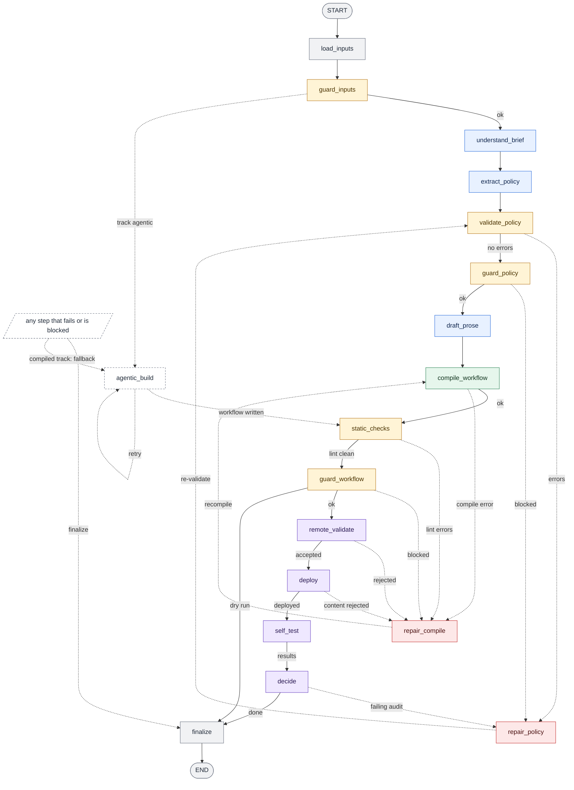

# builder/graph: the pipeline

The builder is one LangGraph `StateGraph` with 18 nodes. Each node does one job, writes a partial update to a shared
state, and a small pure function decides which node runs next. The longer reference is [docs/GRAPH.md](../../docs/GRAPH.md).

| File | What it holds |
|---|---|
| [`state.py`](state.py) | `BuilderState`, the data that flows between nodes (plain JSON), and `initial_state()` |
| [`context.py`](context.py) | `BuilderContext`, the services of one run: settings, LLM gateway, Freya client, trace, budget, cancel token |
| [`routing.py`](routing.py) | Node-name constants, one router per node (`after_<node>`), the `ROUTERS` table and `STATIC_EDGES` |
| [`build_graph.py`](build_graph.py) | `build_graph()` assembles and compiles the graph; `edge_list()` lists every edge |
| [`nodes/`](nodes/) | One module per node (`NAME` and `async def run(state, runtime)`); [`_common.py`](nodes/_common.py) wraps every body |

## The graph

Drawn from the compiled graph by [`builder/viz.py`](../viz.py). Solid arrows are forward progress, dotted arrows are repair
loops, the agentic fallback and the failure exits. [`builder_graph_full.mmd`](../../docs/graphs/builder_graph_full.mmd)
draws every edge.

<!-- mmd: builder_graph.mmd -->

## The nodes

"Strong" and "fast" are the two model roles of the gateway (`*_STRONG_MODEL`, `*_FAST_MODEL`). On the compiled track a
failed node goes to `agentic_build` when the fallback is allowed (`--track auto`; the default `compiled` does not allow it)
and time is left, else to `finalize`.

| Node | What it does | Model | Next | Other exits |
|---|---|---|---|---|
| `load_inputs` | Reads the briefs and the tool API; picks track (default `compiled`), profile (default `staged`), self-test mode (default `smoke`), limits | none | `guard_inputs` | `finalize` when unreadable |
| `guard_inputs` | Guard: size, hidden characters, injection-like text (warnings), tool API sanity | none | `understand_brief` | `agentic_build` when the track is agentic; `finalize` (blocked) |
| `understand_brief` | Builds the rule ledger: one quoted rule per entry, amendments, ambiguities | strong | `extract_policy` | fallback |
| `extract_policy` | Turns the ledger and the tool contracts into the typed policy (`PolicyIR`) | strong | `validate_policy` | fallback |
| `validate_policy` | Checks the policy against the tool API and the ledger | none | `guard_policy` | `repair_policy` while errors and rounds remain |
| `repair_policy` | Deterministic fixes first, then the model for what remains | strong | `validate_policy` | always loops back |
| `guard_policy` | Guard: every date, amount and enum must come from the briefs or the tool API; records the unresolved policy issues | none | `draft_prose` | `repair_policy`, else `finalize` (blocked); grounding-only findings left after the repairs go on best effort |
| `draft_prose` | Short per-node guidance; template-only text on any problem | fast | `compile_workflow` | fallback |
| `compile_workflow` | Policy, tool API and prose become the Freya workflow, a rule map and a coverage report | none | `static_checks` | `repair_compile` |
| `static_checks` | Lint rules L001 to L029, the same for both tracks | none | `guard_workflow` | `repair_compile` |
| `repair_compile` | Changes the compile inputs: drop the prose, then switch profile | none | `compile_workflow` | fallback when no strategy is left |
| `guard_workflow` | Guard: bank URLs only, no secrets, no forbidden word before verification | none | `remote_validate` | `finalize` on a dry run; `repair_compile` or `finalize` (blocked) |
| `remote_validate` | Platform dry run of the definition, nothing stored | none | `deploy` | `repair_compile` when rejected; platform trouble still deploys |
| `deploy` | Saves or updates the slot, confirms publication, reads back, verifies the export | none | `self_test` | `repair_compile` on a content rejection, else `finalize` |
| `self_test` | Smoke chat by default; walkthrough audit and practice cases are opt-in modes; each runs only if time allows | fast (walkthrough) | `decide` | `finalize` when no test ran in this round |
| `decide` | A failing walkthrough or practice result becomes policy issues for one more round; a failed smoke test is only reported | none | `finalize` | `repair_policy` when a round is worth the time |
| `agentic_build` | Opt-in fallback: a Claude Agent SDK session writes the workflow | session | `static_checks` | retried (at most 2 attempts), else `finalize` |
| `finalize` | Status, closing files, trace summary (with unresolved policy issues), the one JSON result line | none | END | only way out |

## State and context

`BuilderState` is a `TypedDict(total=False)` of JSON values. Groups: identity and inputs, understanding (`bundle`, `tool_api`,
`ledger`, `ir`, `policy_issues`, `prose`), compiling (`profile`, `compiled`, `coverage`, `lint`), platform (`remote_validation`,
`deploy`, `exported`, `self_tests`) and control (`track`, `failed`, `blocked`, `status`, `budget_remaining_s`). Four lists
accumulate across nodes (`errors`, `notes`, `self_tests`, `guard_reports`); every other key is overwritten. Services that are
not data (the LLM gateway, the Freya client, the trace, the budget) live in `BuilderContext`, not in the state.

`run_node` in [`nodes/_common.py`](nodes/_common.py) wraps every node body: it writes the `STAGE start/end` trace lines, opens an
observer span, records the time left in `budget_remaining_s`, and turns an unexpected exception into `failed=<node>` plus an
entry in `errors`. Only the cancellation of the wall-clock guard passes through. A node therefore never crashes the run.

## Routing

All routers are pure: they read only the state (the caps come from `state["limits"]`, the time left from
`budget_remaining_s`), so they need no clock and no settings.

- `failed` is the node that could not do its work; `fallback_target` sends it to `agentic_build` or `finalize`.
- `blocked` means a guard stopped the build. It is never sent to the agentic track and never deployed.
- Once an agent is deployed, nothing replaces it: later failures end the run.
- Repair loops are bounded by `max_policy_repairs`, `max_compile_repairs` and `max_selftest_repairs` and by the stage
  estimates in [`builder/budget.py`](../budget.py).
- A dry run ends after `guard_workflow`.

## Adding a node

1. Create `nodes/<name>.py` with `NAME`, `async def _body(state, ctx) -> dict` and `run(state, runtime)` that calls `run_node`.
2. Import it in [`nodes/__init__.py`](nodes/__init__.py) and add it to `_MODULES`.
3. In `routing.py` add the name constant, write `after_<name>`, and list every node it can return in `ROUTERS`. Change the
   routers of the nodes that should lead to it. A fixed edge goes into `STATIC_EDGES`.
4. New state keys go into `BuilderState` (`Annotated[list[...], add]` if they accumulate).
5. If routing asks whether the stage is affordable, add its estimate to `STAGE_ESTIMATES_S` in `builder/budget.py`.
6. Tests: `EXPECTED_NODES`, `HAPPY_PATH` and `LOOPS_AND_FALLBACKS` in `tests/graph/test_topology.py`, the router in
   `tests/graph/test_routing.py`, the node in `tests/graph/test_nodes.py`.
7. Give the node a colour in `NODE_ROLES` (`builder/viz.py`), then regenerate the diagrams:
   `python -m builder.viz builder --out docs/graphs/builder_graph.mmd`,
   `python -m builder.viz builder --view full --out docs/graphs/builder_graph_full.mmd`, `python -m builder.viz sync`.
   `tests/unit/test_viz.py` fails while a committed diagram is stale.

## Tests

`pytest tests/graph` runs whole builds offline: `FixtureGateway` answers the model calls and `FakeFreya` stands in for the
platform (both in [`builder/testing.py`](../testing.py)). The fixture gateway also answers `python builder/build.py ... --dry-run
--fake-llm tests/fixtures/policy`. These runs prove the orchestration, not that a real model reads an unfamiliar brief well.
