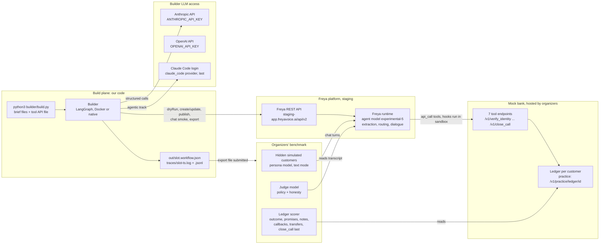
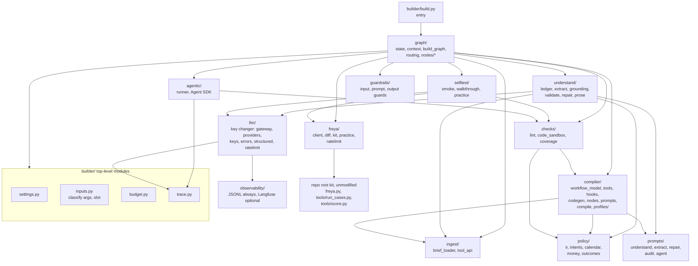
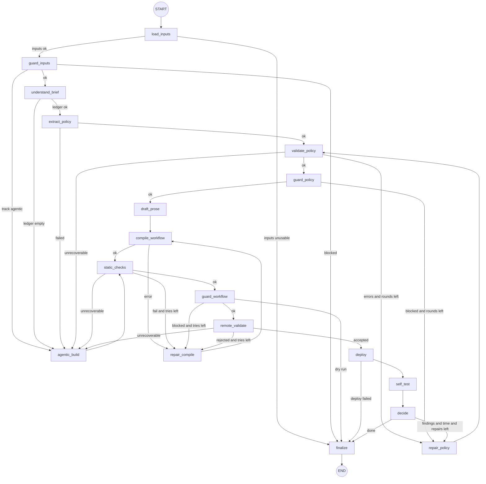
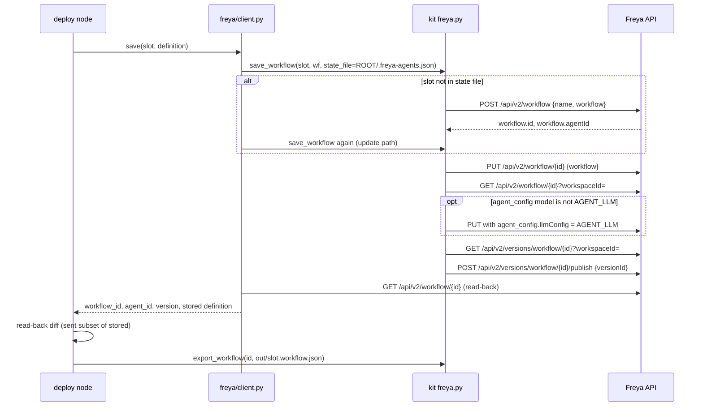
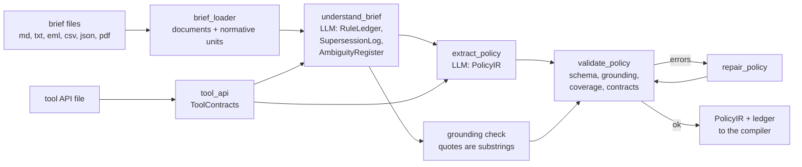
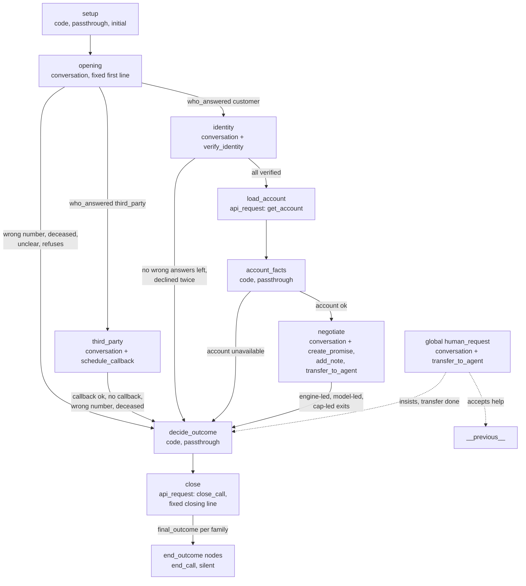
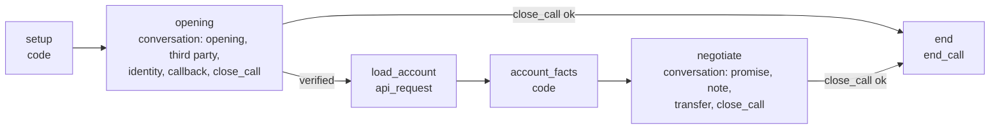
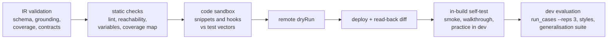
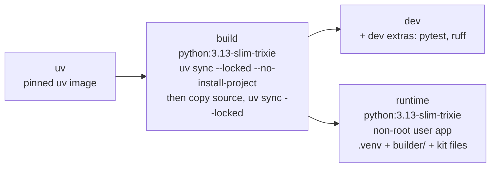

# Architecture: Freya "Build the Builder" collections builder

Version 2, 2026-10-10. Derived from the decisions brief v2, which is the single source of truth for requirement IDs
(R1 to R9), decisions (ADR-01 to ADR-16), graph node names, repo layout, phases (P0 to P7), milestones (M1 to M4),
experiments (E-1 to E-8), questions (Q-1 to Q-8) and risks (RK-1 to RK-12). Companion documents:
[FOLDER_STRUCTURE.md](FOLDER_STRUCTURE.md), [IMPLEMENTATION_PLAN.md](IMPLEMENTATION_PLAN.md), [TASKS.md](TASKS.md).

**Sources and precedence.** The hackathon kit is authoritative on platform behaviour and rules. It lives at
`data/build-the-builder-v3/build-the-builder/` and is copied unmodified to the repo root in P0 (ADR-02). Links to kit
documents in this file use their post-P0 location: [docs/workflow-format.md](workflow-format.md),
[docs/tools-and-code.md](tools-and-code.md), [docs/api.md](api.md) are siblings of this file after P0 (before P0 read them
under `../data/build-the-builder-v3/build-the-builder/docs/`). Research notes: [11](research/11_hackathon_rules_and_kit.md)
(rules, scoring, kit), [12](research/12_tau_tau_bench_lessons.md) (paper lessons P1 to P8), older background
[01](research/01_freya_config_reference.md) to [10](research/10_chat_eval_harness.md) (the kit wins on any conflict).

**Conventions.** **[UNVERIFIED]** marks a platform claim no source confirms, with the experiment that settles it.
"Brief A example" marks a value that the builder *extracts* from a brief at run time. Such values are never constants in
`builder/` (hackathon rule, ADR-16).

## Table of contents

- [1. Purpose, scope and non-goals](#1-purpose-scope-and-non-goals)
  - [1.1 What changed since the first draft](#11-what-changed-since-the-first-draft)
  - [1.2 Glossary](#12-glossary)
- [2. System context](#2-system-context)
- [3. Hackathon contract as architecture drivers](#3-hackathon-contract-as-architecture-drivers)
- [4. Freya platform primer for builders](#4-freya-platform-primer-for-builders)
  - [4.1 Three model calls per turn](#41-three-model-calls-per-turn)
  - [4.2 Node types and the fields that survive](#42-node-types-and-the-fields-that-survive)
  - [4.3 Transitions, operators and order of evaluation](#43-transitions-operators-and-order-of-evaluation)
  - [4.4 Variables](#44-variables)
  - [4.5 Tools, pre_actions and lifecycle tools](#45-tools-pre_actions-and-lifecycle-tools)
  - [4.6 Hooks](#46-hooks)
  - [4.7 end_call terminals](#47-end_call-terminals)
  - [4.8 Dashboard areas and the API routes we use](#48-dashboard-areas-and-the-api-routes-we-use)
  - [4.9 Pitfalls](#49-pitfalls)
- [5. Builder architecture](#5-builder-architecture)
- [6. Builder LangGraph](#6-builder-langgraph)
  - [6.1 Topology](#61-topology)
  - [6.2 Node table](#62-node-table)
  - [6.3 BuilderState and context](#63-builderstate-and-context)
  - [6.4 Routing functions](#64-routing-functions)
  - [6.5 Budget manager](#65-budget-manager)
  - [6.6 Trace events](#66-trace-events)
  - [6.7 Deploy sequence](#67-deploy-sequence)
- [7. Understanding layer](#7-understanding-layer)
- [8. Tool contracts](#8-tool-contracts)
- [9. Phone-agent design](#9-phone-agent-design)
  - [9.1 Design principles and the exit protocol](#91-design-principles-and-the-exit-protocol)
  - [9.2 Staged profile graph](#92-staged-profile-graph)
  - [9.3 Node-by-node specification](#93-node-by-node-specification)
  - [9.4 Global nodes policy](#94-global-nodes-policy)
  - [9.5 Lean profile](#95-lean-profile)
  - [9.6 Code-node library](#96-code-node-library)
  - [9.7 decide_outcome and close](#97-decide_outcome-and-close)
  - [9.8 Prompt architecture](#98-prompt-architecture)
  - [9.9 Brief A rule families mapped to mechanisms](#99-brief-a-rule-families-mapped-to-mechanisms)
  - [9.10 Brief B multi-product](#910-brief-b-multi-product)
  - [9.11 Conversation style](#911-conversation-style)
  - [9.12 Reference agent findings](#912-reference-agent-findings)
- [10. Requirement traceability](#10-requirement-traceability)
- [11. Verification architecture](#11-verification-architecture)
- [12. Cross-cutting concerns](#12-cross-cutting-concerns)
- [13. Deployment view](#13-deployment-view)
- [14. ADR log and paper principles](#14-adr-log-and-paper-principles)
- [15. Risks, open questions and experiments](#15-risks-open-questions-and-experiments)

---

## 1. Purpose, scope and non-goals

**Purpose.** One command, `python3 builder/build.py {brief_path} {tool_api_path}`, reads a bank's collections brief (one
or more files, possibly raw bank material) and the brief's own tool-API OpenAPI file, and produces:

1. a **phone agent**: a Freya workflow, created or updated in place and published;
2. an **export file** of that workflow, written with `freya.export_workflow` to `out/<slot>.workflow.json`;
3. a **trace** of the run in `traces/<slot>-<UTC timestamp>.log` and `.jsonl`.

The organizers load the export into their own workspace and score the agent on hidden simulated customers (text mode,
English, call variables including `now`), three runs per customer, all three must pass ([11](research/11_hackathon_rules_and_kit.md) §3).

**In scope.**

- The `builder/` package (entry `builder/build.py`): input loading, understanding (rule ledger, PolicyIR), deterministic
  compilation to Freya workflow JSON, static and remote validation, deploy and export, budget-aware self-test, trace.
- The phone-agent design that the compiler emits (staged profile by default, lean profile as alternative).
- The agentic fallback track (Claude Agent SDK, upgraded from `examples/agent_builder.py`).
- The development harness in `evals/` around the kit's `tools/run_cases.py`.
- Docker and native execution with the same entry point.

**Non-goals.**

- Voice: STT, TTS, voice settings, `agent_config` tuning. Simulations are text (`mode: "chat"`); the workflow we send
  omits `agent_config` ([docs/workflow-format.md](workflow-format.md) "Top-level keys").
- Our own LLM-simulated-customer harness. Dropped; the kit harness (personas + chat simulation + mock ledger + judge) is
  ground truth (ADR-11).
- Choosing the phone-agent model. Fixed to `experimental-5` (`AGENT_LLM` in `freya.py`); never changed.
- Any service of ours at call time. The runtime plane is Freya plus the mock bank only (ADR-01).
- Hand edits of a created agent, platform probing, load tests (hackathon rules).
- Brief-specific knowledge in `builder/` (no holiday dates, outcome names, product names, numbers from any brief; ADR-16).
- Agent behaviour the brief does not allow (discounts, plans, invented pressure or consequences). The judge fails it.
- Human-in-the-loop interrupts during a build. Runs are headless.
- Freya features we do not need: knowledge base, telephony, integrations, insights, unit tests, `transfer_call` nodes.

### 1.1 What changed since the first draft

The first draft (decisions brief v1 and research 01 to 10) assumed a different platform contract. Changes, from the
kit v3 ([11](research/11_hackathon_rules_and_kit.md) §1):

- **Workflows are created and updated through the API.** `POST /api/v2/workflow` (agent created with it),
  `POST /api/v2/workflow?dryRun=true` (validate, store nothing), `PUT /api/v2/workflow/{id}` (replace definition, saves an
  unpublished version), `POST /api/v2/versions/workflow/{id}/publish`. We call `freya.save_workflow(slot, wf)`. The seeded
  base workflow is not touched.
- **Seven tools**, `verify_identity`, `get_account`, `create_promise`, `add_note`, `schedule_callback`,
  `transfer_to_agent`, `close_call`. `close_call` exactly once and last. Fields and enums come from the tool API file and
  change per hidden brief.
- **Text simulations.** `agent_config` omitted, so all voice/STT/TTS work is dropped.
- **`now` is a call variable.** The system clock is never used for date rules.
- **Official evaluation is the kit's `tools/run_cases.py`** with `--reps 3` and `--style`. Our own simulated-customer
  harness is dropped.
- **The brief is the law.** The user's generic asks (gates, persistence, rudeness flag, hardship empathy, money
  consistency, Akbank objection taxonomy, promise extraction, callback scheduling) are builder capabilities that activate
  only when a brief specifies them.
- **τ^τ-bench lessons** ([12](research/12_tau_tau_bench_lessons.md)) are first-class design principles (P1 to P8, mapped in §14.2).
- **One LLM gateway, several providers.** Every builder model call goes through the key changer (`builder/llm/`):
  providers `anthropic` → `openai` → `claude_code`, several keys per provider, dead and cooling keys handled, cheap
  default models (ADR-14, §12.2).
- **Guardrails and observability are part of the flow.** `builder/guardrails/` checks inputs, the PolicyIR and the
  workflow (§6.1); `builder/observability/` writes the full prompt and reply of every model call (§12.3).
- **Reference agent measured before the compiler was built** (§9.12): the staged profile mirrors what passed.

### 1.2 Glossary

| Term | Meaning in this project |
|---|---|
| Brief | The bank's specification of the collections call. One or more files: a clean Markdown spec (Brief A, Brief B) or raw bank material (a mail, a policy extract, an amending memo, a code list). Several files can build on each other (Brief B on Brief A). |
| Tool API file | The OpenAPI 3 file that comes with a brief (`tools/openapi.json` for practice). Defines the seven tool endpoints, request fields, enums and response fields. Authoritative for field names and allowed values. |
| Builder | Our program (`builder/build.py` plus the `builder/` package). Runs in the build plane. |
| Phone agent | The Freya agent that the builder creates. Its behaviour is fully defined by one workflow. |
| Workflow | The JSON graph that defines a Freya agent: `initial_node`, `nodes`, `global_nodes`, `system_prompt`, optional `tools`. The value of `workflow` in `{"name": ..., "workflow": {...}}`. |
| Node | One step of the workflow. Types used: `conversation`, `api_request`, `code`, `end_call`. |
| Transition | An entry in a node's `transitions` array: `target_node`, `description`, `condition`, optional `is_tool_call`. |
| Code node | A `code` node: a passthrough node whose `pre_actions` holds one `code_exec` function; the Python snippet reads and writes `vars`. |
| api_request node | A node whose `pre_actions` holds `api_call` functions that the engine fires on entry; results map to variables through node-level `response_mapping`. |
| Hook | `pre_process_code` / `post_process_code` on an `api_call` tool: Python run in a sandbox before and after the HTTP call. |
| Call variable | A variable passed when the call starts (`customerVariablesMap` in a simulation, `customerVariables` in chat). Brief A example: `customer_id`, `first_name`, `last_name`, `title`, `now`. |
| Ledger | The mock bank's record of every tool call for one practice customer, read by `tools/score.py` from `/v1/practice/ledger/{customer_id}`. The hidden scorer reads the same kind of record. |
| Judge | The model that reads the transcript against per-case checks for policy and honesty. Practice runs use `google / gemini-3-flash-preview` (`SIM_LLM` in `freya.py`). |
| Slot | The label passed to `freya.save_workflow(slot, wf)`. The same slot updates the same workflow (state file `.freya-agents.json`). Slots: `brief-a`, `brief-ab`, `hidden-1`, `hidden-2` (ADR-16). |
| Trace | The run record required by the rules: start/end time, every model call (model and one-line purpose), every Freya write, every self-test and result. Written by `builder/trace.py`. |
| Rule ledger | The list of atomic rules extracted from all brief files, each with id, source file, verbatim quote, category, scope and effect (ADR-05). |
| PolicyIR | The typed Pydantic model (`builder/policy/ir.py`) that captures a brief as a generic capability surface; the compiler's only policy input (ADR-06). |
| Track | Which builder path produced the workflow: `compiled` (LLM understanding + deterministic compiler, primary) or `agentic` (Claude Agent SDK with skills, fallback and baseline) (ADR-03). |
| Profile | Which phone-agent architecture the compiler emits: `staged` (default) or `lean` (ADR-07, E-4). |
| Contract | A `ToolContract` parsed from the tool API file (ADR-04). |

---

## 2. System context



**Two planes (ADR-01).**

| Plane | Runs | Owner | Our code present |
|---|---|---|---|
| Build plane | `builder/build.py` in Docker or natively; calls the LLM providers through the key changer (`builder/llm/`) and the Freya REST API | us | yes |
| Runtime plane | Freya runs the published workflow on `experimental-5`; the workflow's `api_call` functions call the mock bank; hooks and code nodes run in Freya's sandbox | Freya + organizers | no (only the code we compiled into the workflow) |

Consequence: every brief rule must be compiled into workflow artefacts before the call starts: node structure,
transitions, code-node snippets, hooks, tool schemas (enums, baked defaults) and prompt text. Nothing we run can correct a
call while it happens.

**Data flows.**

1. The builder reads the brief files and the tool API file from disk.
2. Understanding calls the strong role of the key changer (structured output; `claude-sonnet-5-5` by default, `gpt-5.6-terra` when only OpenAI has a key) and returns a rule ledger and a PolicyIR.
3. The compiler emits workflow JSON; checks run locally; `POST /api/v2/workflow?dryRun=true` validates remotely.
4. `freya.save_workflow(slot, wf)` creates or updates the workflow and publishes it; `GET /api/v2/workflow/{id}` reads it
   back; `freya.export_workflow` writes the export file.
5. Optional self-tests: `POST /api/v2/chat/message` (smoke) and, in development only, practice simulations through the
   kit harness.
6. At scoring time the organizers load the export, run hidden customers against it, read the ledger and the judge verdict.

---

## 3. Hackathon contract as architecture drivers

Source: kit README "How you are scored", "The final", "Rules"; [11](research/11_hackathon_rules_and_kit.md) §2 to §5.

### 3.1 Inputs, outputs and run command

| Contract item | Fact | Design element it drives |
|---|---|---|
| Run command | `python3 builder/build.py {brief_path} {tool_api_path}` (submission form field `run_command`) | `builder/build.py` is a script entry; `builder/inputs.py` accepts any number of brief files plus one tool API file and classifies them by content (an OpenAPI JSON has an `openapi` key), not by position. Same entry in Docker (§13). |
| Brief input | Clean spec or raw bank material (mail, policy extract, amending memo, code list); a brief can build on another | `ingest/brief_loader.py` reads md/txt/eml/csv/json/pdf; understanding produces a SupersessionLog (§7.4). |
| Tool API input | One OpenAPI file per brief; tool names fixed, fields and enums may change | `ingest/tool_api.py` builds `ToolContract`s; nothing about fields, enums or URLs is hard-coded (ADR-04). |
| Output: phone agent | Published Freya workflow | `graph/nodes/deploy.py` via `freya.save_workflow(slot, wf)`, which publishes. |
| Output: export file | `freya.export_workflow(workflow_id, "<brief>.workflow.json")`; the organizers score what is exported | `out/<slot>.workflow.json`, written after the read-back diff. |
| Output: trace | Start/end, every model call (model + one-line purpose), what was created on Freya, every self-test and its result; plain text | `builder/trace.py` writes `traces/<slot>-<ts>.log` and `.jsonl` (ADR-13). |

### 3.2 Limits

| Limit | Fact | Design element |
|---|---|---|
| 30 minutes per brief, including self-tests | Hard rule | Budget manager with deadline `started_at + BUILD_TIME_BUDGET_S` (default 1680 s), reserve for deploy/export/trace, skip ladder for optional steps (§6.5). |
| Build time is tie-break 2 | Shorter is better | Target build ≤ 8 min without simulation; practice simulations only in development (ADR-12, ADR-13). |
| One simulation at a time per workspace; a ten-case run takes 3 to 11 min | Hard platform limit | In-build self-test prefers chat smoke turns; dev evaluation runs are queued and scheduled (RK-9). |
| Agent model fixed | `AGENT_LLM` = `experimental-5`; do not change | `freya.py` used unmodified; levers are structure, code and prompt economy. |
| Agent may call only the bank tool API | Hooks and code nodes allowed | All logic lives in code nodes and hooks; no external service. |
| 200 workflows per workspace; update in place | `freya.save_workflow` with a stable slot | Slot derivation in `builder/inputs.py`; `.freya-agents.json` persisted (and volume-mounted in Docker, §13.5). |
| No manual step, no hand edits | Hard rule | Fully headless graph; any fix is a builder change. |
| After hidden briefs open: bug fixes only, nothing from a hidden brief in the builder | Hard rule | ADR-16 compliance grep test, freeze at Sun 16:30 UTC. |
| Do not probe or load-test the platform | Hard rule | Self-tests bounded (≤ 3 chat turns, no loops); no exploratory API calls in the build. |
| Synthetic data only | Hard rule | Test fixtures are generated; no real customer data anywhere. |

### 3.3 Scoring

| Scoring element | Fact | Design element |
|---|---|---|
| Ledger correct | Outcome + reason; every promise (product, amount, date) once; every note, callback, transfer; `close_call` last; no `get_account`/`create_promise` before verification; no identity/account tools when the right person was not reached (`tools/score.py`) | Deterministic close (ADR-09): `decide_outcome` code node + engine-fired `close` node; reachability lint (third-party paths cannot reach `identity` or `load_account`); `get_account` is a `pre_actions` call reachable only after verification (ADR-10). |
| Policy | The conversation stayed inside the brief (judge, per-case checks) | Rule ledger + coverage audit (ADR-05); fixed lines for mandatory sentences; forbidden-word lint before verification; prompts carry only brief rules; never-do list from the IR. |
| Honesty | Never claims a recorded promise when the tool failed | Post-hooks with `what_to_do_next` on every tool; closing lines chosen from tool results in code (ADR-10). |
| 3 of 3 runs must pass | Variance of `experimental-5` | Rules in routes and code rather than prompts; dev evaluation always with `--reps 3` (ADR-11, RK-3). |
| Several calendar days | `now` differs per case | All date logic computed from `now` in code; sandbox test vectors over many `now` values (ADR-08, RK-6). |
| Tie-break 1: total promised amount on passed cases | Higher is better | Ask the full past-due amount first and offer the floor only where the brief allows it (also a Brief A rule). |
| Tie-break 2: build time | Shorter is better | Budget manager; no simulations in hidden runs. |
| Tie-break 3: submission time | Earlier is better | P7 target: form sent before 19:30 UTC. |
| Top-10 re-run | Organizers re-run the builder and compare with the trace | Deterministic compiler, trace of every model call, Docker and native parity (ADR-15). |

---

## 4. Freya platform primer for builders

Everything in this section comes from the kit docs ([docs/workflow-format.md](workflow-format.md),
[docs/tools-and-code.md](tools-and-code.md), [docs/api.md](api.md)) unless tagged. It is the reference the compiler and the
checks are written against.

### 4.1 Three model calls per turn

After each user message the platform runs three separate model calls, in this order. They do not share a prompt.

| # | Call | Sees | Produces | Consequence for the compiler |
|---|---|---|---|---|
| 1 | Extraction | Recent messages + current node's `extraction_schema` | Variable values (confidence from token probabilities) | Classify the user's turn into string enums; set `min_confidence` on every variable. |
| 2 | Routing | Recent messages + transition descriptions (not the dialogue prompt) | The transition to take, or none | Routing rules live only in `transitions`; text in `task_message` cannot route. Deterministic conditions are evaluated first and need no model call. |
| 3 | Dialogue | `system_prompt` + `role_message` + `## Current Task` + `task_message`, full history, the node's `tools` | The reply or a tool call | The model can call only the current node's tools. |

Because routing runs **before** dialogue, a deterministic exit on an extracted enum leaves the node before the node's
dialogue model writes anything. Routing also runs again after a tool result arrives, in the same turn, before the next
model turn (verified in a working builder). Both facts are used by the exit protocol (§9.1).

### 4.2 Node types and the fields that survive

| `node_type` | Purpose | Fields that survive a save | Silently stripped |
|---|---|---|---|
| `conversation` | Dialogue step | `name`, `task_message`, `role_message`, `on_enter`, `on_enter_first_entry_only`, `tools`, `extraction_schema`, `transitions`, `routing_prompt`, `loop_condition`, `loop_prompt`, `max_node_turns`, `max_turn_transition`, `truncation_strategy`, `truncation_window_size`, `suppress_tool_results`, `disable_inactivity_monitor`, `reasoning_override` | `pre_actions` |
| `api_request` | Engine-fired HTTP call on entry | `pre_actions`, node-level `response_mapping`, `passthrough`, `passthrough_default_transition`, `on_enter`, `transitions`, `suppress_tool_results` | `tools` |
| `code` | Engine-fired Python snippet on entry | `pre_actions` with one `code_exec` function, `passthrough`, `passthrough_default_transition`, `on_enter`, `transitions` | `tools` |
| `end_call` | Ends the call | `terminal`, `on_enter`, `disable_inactivity_monitor`, `transitions: []` | (not documented) |

Other stripping behaviour: hooks on any handler other than `api_call` (and integration/knowledge search) are removed on
save; the top-level `context_variables` key came back missing after a save on 10 October; a `response_mapping` nested
inside a `pre_actions` entry is ignored. Validation reports none of this. Hence the read-back diff (§11.4).

Top-level keys we send: `initial_node`, `nodes`, `global_nodes`, `system_prompt`. We do not send `agent_config`
(the platform fills it; `freya.update_workflow` sets its model to `AGENT_LLM`), `test_variables` (a stale default `now`
would mask a missing call variable), `context_variables` (dropped), workflow-level lifecycle `tools` (not needed in the
staged profile), or `nodePositions`.

### 4.3 Transitions, operators and order of evaluation

Transition fields: `target_node`, `description`, `condition`, optional `is_tool_call`.

| Operator | Kind | True when |
|---|---|---|
| `equals` / `not_equals` | deterministic | `str(value) == str(operand)` / inverse |
| `greater_than` / `less_than` | deterministic | float comparison (use for counters) |
| `contains` | deterministic | operand is a case-insensitive substring |
| `is_set` / `is_not_set` | deterministic | the variable has / has no value |
| `always` | deterministic | always |
| `matches_intent` | routing model | the last user message matches `description`; all intent checks of one evaluation share one model call |

Condition shapes the compiler emits (only these):

```json
{ "operator": "always" }
{ "operator": "matches_intent", "description": "..." }
{ "logic": "or", "conditions": [ { "variable": "v", "operator": "equals", "operand": "x" } ] }
{ "logic": "or", "conditions": [ { "logic": "and", "conditions": [ { "variable": "a", "operator": "is_set" },
                                                                   { "variable": "b", "operator": "less_than", "operand": 1 } ] } ] }
```

The top-level group is always `"logic": "or"`; AND is a nested group. We never nest an OR inside an AND (not documented).

Order of evaluation after each user message (and after each tool result):

1. `loop_condition` of the current node (we do not use it; self-transitions are preferred);
2. the node's `transitions` in list order, deterministic ones first, first match wins;
3. global nodes;
4. nothing matched: stay in the node.

Transitions with the same `target_node` are merged at load time into one OR; if one is unconditional the merged one is.
The compiler therefore emits at most one transition per target per node. `is_tool_call: true` turns a transition into a
tool `transition_to_<node>` that the dialogue model calls. Passthrough nodes must end with an `always` transition or they
deadlock.

### 4.4 Variables

One table per call; no per-node scope; never cleared on a transition; a later write with the same name overwrites.

| Source | Name pattern | Notes |
|---|---|---|
| Call variables | as passed, e.g. `customer_id`, `now` | Brief A example: `customer_id`, `first_name`, `last_name`, `title`, `now` (`2026-10-14T11:00`). Readable as `{{now}}` and `vars.get("now")`. |
| Extraction | `extraction_schema[].name` | Available to the same node's transitions in the same turn. Types: `string`, `integer`, `float`, `boolean`, `date`, `datetime`, `name`, `phone_number`; `enum_values` on any type. |
| Node-level `response_mapping` | chosen name | For `pre_actions` nodes; paths start with `data.`. |
| Tool-level `response_mapping` | chosen name | For tools in `tools`; paths start with `data.`. |
| Automatic result keys | `<tool>_response.status`, `<tool>_response.data.<field>`, `<tool>_response.message`, `<tool>_response.status_code`, `<tool>_response.header.<H>`, `<tool>_status_code` | Flattened with dots; booleans arrive as the string `true`. Overwritten on each call of the same tool. For a code node the keys are named after the node (`setup_response.status`). For an `api_request` node the `_response` key prefix is **[UNVERIFIED]** (we use node-level mapping instead). |
| Model arguments | `<tool>_args.<field>` | Overwritten on each call. |
| Counters | `<tool>_success_count`, `<tool>_failure_count` (tools in `tools`); `<nodeId>_success_count`, `<nodeId>_failure_count` (`pre_actions` nodes) | Integers; route with `greater_than`. Whether an HTTP 200 with `ok: false` counts as failure is **[UNVERIFIED → E-3]**. |
| Code | any key written to `vars` | Strings written by a code node resolve as `{{name}}` in later prompts; multi-line strings work. |
| System | `{{system.iso_utc_now}}`, `{{system.todays_date_en_est}}`, `{{call.duration}}`, `{{<node>.current_turns}}`, `{{<node>.total_turns}}`, `{{system.conversation.last-N}}` | System dates are the real clock; we never use them for date rules. |

Substitution: `{{var}}` in prompts, `on_enter.text`, descriptions, URLs, headers, bodies; `{{var:json}}` JSON-encodes. An
unresolved placeholder stays literal in prompts and is spoken aloud in fixed lines. In an engine-run call field it drops
the field when the value is exactly one placeholder and sends the literal `{{x}}` when mixed with text.

### 4.5 Tools, pre_actions and lifecycle tools

| Placement | Node type | Fired by | When | `response_mapping` lives | Used by us for |
|---|---|---|---|---|---|
| `tools` | `conversation` | dialogue model | inside a turn, when the model decides | on the tool | `verify_identity`, `create_promise`, `add_note`, `schedule_callback`, `transfer_to_agent` (and `close_call` in the lean profile) |
| `pre_actions` | `api_request`, `code` | engine | on node entry, cannot be skipped | on the node | `get_account` (`load_account`), `close_call` (`close`), `code_exec` (`setup`, `account_facts`, `decide_outcome`) |
| workflow `tools` with `config.alwaysRunsAt` | none | engine | `start_of_call` / `end_of_call` (`each_turn` never fires) | applied for start only | not used (the base agent's end-of-call `close_call` is replaced by ADR-09) |

Parameter values: a `default` bakes the value at node entry (literal, or a `{{var}}` that has a value then) and hides
the parameter from the model; a `default` whose `{{var}}` has no value, or no `default`, lets the model fill it. `const`
never bakes. Every `api_call` body field is a leaf under `body.properties.<field>` with its own `type`, `description`,
`enum`, `default`; required fields go in `body.required`. A model-filled field must not share its name with a variable
already set at node entry, or it is baked.

### 4.6 Hooks

| Hook | Available names | We use it to |
|---|---|---|
| `pre_process_code` | `vars` (mutable, fills placeholders), `config` (the substituted request: `url`, `method`, `headers`, `body`) | normalise answers, dates, amounts and times; inject `customer_id` and product ids into `config["body"]` |
| `post_process_code` | `result` (the envelope: `status`, `data`, `message`, `status_code`, `header`) | `result.pop("header", None)`; add `data["what_to_do_next"]` so the model always has an instruction after a tool result |

The post-hook runs before `response_mapping` and extraction see the result. Keys added inside `result["data"]` reach the
dialogue model. Whether they also appear as flattened `<tool>_response.data.*` variables (and can be routed on) is
**[UNVERIFIED → E-8]**. A post-hook can read call variables and write new ones that a later pre-hook reads (kit, test on
10 October); we rely on that only behind E-8. What the platform does when a hook raises is not documented, so every hook
is wrapped in `try`/`except Exception: pass`. Whether hooks run on `api_call` functions inside `pre_actions` is
**[UNVERIFIED → E-8]**; the staged profile does not depend on it.

### 4.7 end_call terminals

An `end_call` node has `terminal.function` with `handler: "__function__:end_call"` and parameters `message_mode`
(`custom` | `llm` | `none`), `spoken_message`, `llm_prompt`, `interruptible`, `trigger_timeout`,
`trigger_pattern_both`. The farewell comes from the terminal, not from `on_enter`. The call's `endedReason` is the
terminal's `function.name`, so we name terminals after the outcome. `message_mode: "none"` with a silent `on_enter` ends
the call on arrival (verified). We set `disable_inactivity_monitor: true`, `transitions: []`, no `interruptible`.

### 4.8 Dashboard areas and the API routes we use

Base URL `https://staging-app.freyavoice.ai`; headers `Authorization: Bearer fak_...`, `Content-Type: application/json`,
browser-like `User-Agent` (`freya.py` sets one; without it Cloudflare answers `error code: 1010`). Responses wrap the
payload in `{"success", "data": {"message", "result"}}`.

| Dashboard area | What it shows | Route(s) we call | Caller in our code |
|---|---|---|---|
| API Keys | The workspace key (`fak_...`) | none (key read from `FREYA_API_KEY`) | `builder/settings.py` |
| Workspaces | Workspace list | `GET /api/v2/workspaces` (`freya.workspace_id()`, or `FREYA_WORKSPACE_ID`) | `freya/client.py` |
| Workflows | Workflow graphs and versions | `POST /api/v2/workflow?dryRun=true`; `POST /api/v2/workflow`; `PUT /api/v2/workflow/{id}`; `GET /api/v2/workflow/{id}?workspaceId=`; `GET /api/v2/versions/workflow/{id}?workspaceId=`; `POST /api/v2/versions/workflow/{id}/publish` | `freya/deploy.py` through `freya.validate_workflow`, `freya.save_workflow`, `freya.export_workflow` |
| Agents | The agent created with each workflow | none directly; `workflow.agentId` comes back from create | `freya/deploy.py` |
| Agent test / chat panel | Turn-by-turn text test | `POST /api/v2/chat/message`, `POST /api/v2/chat/end` | `freya/chat.py`, `selftest/smoke.py` |
| Personas | Simulated callers | `POST /api/v2/personas` (through `tools/run_cases.py`, cached in `.personas.json`) | `freya/simulate.py` (dev) |
| Simulation | Runs of personas against an agent | `POST /api/v2/simulations`; `GET /api/v2/simulations/{id}`; `GET .../iterations`; `GET .../iterations/{iterationId}` (paged, `limit` ≤ 100) | `freya/simulate.py` (dev and practice self-test) |
| Call Logs | Transcript and engine events of a call | `GET /api/v2/call/{callId}` → `result.call.messages`, `transcript`, `endedReason` | `freya/calls.py`, `evals/` triage |

Routes are singular for workflow and call, plural for personas and simulations. An HTML 404 means a wrong route.

### 4.9 Pitfalls

| # | Pitfall | Effect | Our countermeasure |
|---|---|---|---|
| 1 | `null` anywhere in the workflow | Write validation fails | Pydantic mirror (`compiler/workflow_model.py`) serialises with `exclude_none`; lint rejects `null`. Note: exports contain platform-written `null`s (seen in `examples/base-agent.json`); the read-back diff treats `null` as absent. |
| 2 | Silent stripping (`tools` on non-conversation nodes, `pre_actions` on conversation nodes, hooks on non-`api_call` handlers, `context_variables`) | Stored node differs from the sent one, no error | Lint forbids the misplaced fields; read-back diff after deploy (§11.4). |
| 3 | Booleans arrive as `"true"` or `"True"` | An `equals` branch never fires | Route on strings written by code; for API booleans test both spellings and both the mapped variable and the flattened key in one OR group. |
| 4 | `{{` or `}}` in code (including a nested dict literal) | Unset placeholder text breaks the Python | Codegen never emits them (dict literals spaced as `} }`); lint greps every snippet and hook. |
| 5 | Unresolved `{{var}}` | Literal placeholder shown to the model, spoken in fixed lines, dropped or sent literally in engine-run bodies | Variable producer analysis (`checks/variables.py`); code nodes write a fallback for every variable a later prompt or condition reads. |
| 6 | `context_variables` dropped on save | Values never reach the model | Not used; values go into prompts with `{{var}}`. |
| 7 | Silent turn after a tool result | Customer hangs up | Post-hook `what_to_do_next` on every tool; prompt rule "after every tool result, speak or call the next tool". |
| 8 | Chat route may skip an initial code node | Values from `setup` empty in chat | Smoke test checks only call-variable-based output (E-5); `account_facts` recomputes date facts if missing. |
| 9 | Plain `PUT` does not publish | Simulation tests the old version | Always `freya.save_workflow` (update + publish); check `agentVersionNumber` in dev runs. |
| 10 | `PUT` replaces the whole definition | Omitted top-level keys deleted | Always send the complete definition. |
| 11 | `const` does not bake | "URL is required" | Only `default`. |
| 12 | Model-filled leaf named like an existing variable | Value baked, model never sees the parameter | Lint: model-filled leaf names disjoint from every produced variable. |
| 13 | Mapping without `data.` prefix | Variable stays unset | Paths always start with `data.`. |
| 14 | `response_mapping` inside a `pre_actions` entry | Ignored | Node-level mapping for `pre_actions`. |
| 15 | Extraction `min_confidence` default 0.95 | Values silently discarded | Set on every variable (0.6 to 0.8, tuned in E-7). |
| 16 | `extraction_prompt` replaces the whole template | Extractor sees nothing | Not used. |
| 17 | Extraction `type: "date"` anchors relative dates to the platform's today | With `now` ≠ real date, "next Friday" resolves wrongly | Dates resolved against a code-computed calendar table built from `now` (§9.6); relative-date extraction is not trusted **[UNVERIFIED → E-2]**. |
| 18 | `max_node_turns` without `max_turn_transition` | Cap does nothing | Lint requires both. Order of the cap versus normal transitions is **[UNVERIFIED → E-4]**; caps are sized with one turn of slack. |
| 19 | Tool not listed in the current node | "The function `<name>` is not currently available." | Tools listed exactly in the nodes whose prompts mention them; lint cross-checks prompt mentions. |
| 20 | Model turn with no text and no tool call | Error event "The model returned no speakable content" | Same as 7. |
| 21 | `interruptible: false` (background) tools | Result arrives turns later | Not used. |
| 22 | Long chat turn | 504 on `/api/v2/chat/message` | Smoke test tolerates one 504 as inconclusive. |
| 23 | No browser-like `User-Agent` | HTML `error code: 1010` | Kit `freya.py` headers. |
| 24 | Too many workflows | `Workspace plan limit reached` | Stable slots; state file persisted. |
| 25 | Dynamic values in `system_prompt` | Breaks the per-node prefix cache (dashboard warning, [09](research/09_call_variables.md) §0) | `system_prompt` is static; per-call facts go at the end of `task_message` (E-6). |

---

## 5. Builder architecture

### 5.1 Package diagram



### 5.2 Package responsibilities

| Package | Responsibility | I/O | LLM |
|---|---|---|---|
| `builder/build.py` | Parse argv, load settings, build context, invoke the graph with `durability="sync"`, map final status to exit code, never raise past `main` | reads argv/env | no |
| `settings.py`, `inputs.py`, `budget.py`, `trace.py` | Env-backed settings; argument classification and slot; deadline arithmetic and skip decisions; trace writer (text + JSONL, redaction) | files | no |
| `graph/` | `state.py` (BuilderState), `context.py` (BuildContext), `build_graph.py`, `routing.py` (pure routing functions), `nodes/<node>.py` (one module per graph node) | via context | via context |
| `ingest/` | `brief_loader.py`: documents and normative units; `tool_api.py`: OpenAPI → `ToolContract` | files | no |
| `understand/` | `ledger.py` (RuleLedger, SupersessionLog, AmbiguityRegister models + LLM pass), `extract.py` (PolicyIR pass), `grounding.py`, `validate.py`, `repair.py`, `prose.py` (node prose), `fixes.py` | none | yes |
| `policy/` | `ir.py` (PolicyIR), `intents.py` (intent catalog seed), `calendar.py` and `money.py` (reference implementations, ADR-08), `outcomes.py` (outcome table, precedence) | none | no |
| `compiler/` | `workflow_model.py` (Pydantic mirror of the workflow JSON), `tools.py` (contracts → tool JSON), `hooks.py`, `codegen.py` (code-node snippets), `nodes.py`, `prompts.py` (Jinja rendering of task messages from IR lines), `compile.py`, `profiles/staged.py`, `profiles/lean.py` | none | no (optional prose pass injected by the graph node) |
| `checks/` | `lint.py` (rules L001–L027, incl. reachability and variable rules), `code_sandbox.py`, `coverage.py` (rule coverage report) | none | no |
| `freya/` | `client.py` (wraps the root `freya.py`: validate, save, get, export, chat), `diff.py` (stripped-field check), `kit.py`, `practice.py` (kit harness), `ratelimit.py` | HTTP | no |
| `selftest/` | `smoke.py` (chat turns), `walkthrough.py` (LLM audit of the compiled workflow), `practice.py` (kit harness) | HTTP | walkthrough only |
| `agentic/` | `runner.py` (Claude Agent SDK fallback track; skills `build-phone-agent` and `collections-workflow-patterns`) | SDK | yes |
| `llm/` | key changer: `gateway.py` (provider chain, key rotation, retries, deadline), `providers.py` (anthropic, openai, claude_code), `keys.py` (key discovery, pools, health file), `errors.py` (error classes → actions), `structured.py` (schema sanitising, JSON parsing), `ratelimit.py` | HTTP | yes |
| `guardrails/` | `input_guard.py` (brief and tool API checks, injection heuristics), `prompt_guard.py` (guard preamble, untrusted-document wrapping), `output_guard.py` (ledger, IR, prose and workflow checks) | none | no |
| `observability/` | `jsonl.py` (always on: full prompts and replies in `traces/*.llm.jsonl`), `langfuse_observer.py` (optional), `factory.py` | files, optional HTTP | no |
| `playground.py`, `playground_views.py`, `monitor_views.py`, `robustness.py`, `diagnostics.py` | development views and offline checks for `streamlit_app.py` | files | no |
| `prompts/` | Jinja templates `*.v1.j2` for understand, extract, repair, audit, agent | files | n/a |

### 5.3 Dependency rules

1. `policy/` and `ingest/` are pure: no network, no LLM, no imports from other `builder/` subpackages except
   `policy` importing `ingest.tool_api` types where needed.
2. `compiler/` and `checks/` are deterministic: same IR and contracts give byte-identical workflow JSON. They never import
   `llm/` or `freya/`.
3. Only `graph/nodes/*` perform side effects (LLM calls, Freya writes, file writes other than the trace). Each side
   effect is announced to `trace.py` before and after.
4. `freya/client.py` is the only importer of the kit's `freya.py`. Naming hazard: running `python3 builder/build.py` puts
   `builder/` first on `sys.path`, so a plain `import freya` would resolve to the `builder/freya/` package. `client.py`
   loads the kit module by file path (`importlib.util.spec_from_file_location("kit_freya", ROOT / "freya.py")`) and
   `build.py` puts the repo root on `sys.path` before any import, as `tools/run_cases.py` does.
5. Kit files (`freya.py`, `tools/`, `docs/`, `examples/`, `briefs/`, `public-test-set.json`, `.claude/skills/build-phone-agent`)
   are never modified; they are re-synced when `VERSION` changes (ADR-02, RK-11).
6. Nothing in `builder/` imports from `evals/` or `tests/`.
7. No brief-specific literal anywhere in `builder/` (ADR-16, enforced by `tests/compliance/`).
8. State carries JSON-able dumps (`model_dump(mode="json")`); nodes re-validate into Pydantic models at their boundary.

### 5.4 The two tracks (ADR-03)

| | Compiled track (primary) | Agentic track (fallback and baseline) |
|---|---|---|
| Understanding | LLM: rule ledger + PolicyIR, structured output, grounded | Claude Agent SDK reads brief and tool API file itself; receives the rule ledger and IR when they exist |
| Structure | Deterministic compiler (`compiler/`) | Claude writes `out/<slot>.candidate.json` using our skills (`.claude/skills/build-phone-agent` from the kit + our `collections-workflow-patterns/`) |
| When used | Default (`BUILDER_TRACK=compiled` or `auto`) | `BUILDER_TRACK=agentic`; or `auto` when the compiled track is unrecoverable (§6.4); in development as a comparison baseline (`evals/compare_tracks.py`) |
| Gates after it | `static_checks` → `remote_validate` → `deploy` | the same gates; the runner never calls `save_workflow` itself |
| Determinism | High (only understanding varies) | Low |
| Typical time | 3 to 8 min | 8 to 20 min |

The agentic runner is an upgraded `examples/agent_builder.py`: same `ClaudeAgentOptions` pattern (`skills`,
`setting_sources=["project"]`, `permission_mode="dontAsk"`, `allowed_tools` limited to Read/Write/Edit/Glob/Grep and a
Bash allowance restricted to our lint command), a hard wall-clock limit from the budget manager, every SDK message
written to the trace, and no practice simulations in hidden runs (Q-1). Restricting Bash to one command through an
`allowed_tools` pattern is **[UNVERIFIED → T-check, ADR-15]**.

---

## 6. Builder LangGraph

### 6.1 Topology

Canonical node names from decisions brief §4.



The repair after `decide` re-enters the same chain (`repair_policy` → `validate_policy` → `guard_policy` → `draft_prose` → `compile_workflow` → `static_checks` → `guard_workflow` → `remote_validate` → `deploy`), so the second deploy updates the same slot in place and publishes a new
version. An agentic-track workflow that fails `static_checks` twice is not repaired; the graph deploys the last workflow
that passed all gates, or the last-resort agent (§12.4).

### 6.2 Node table

Budget shares are targets for a build without simulation (target ≤ 8 min, hard stop `BUILD_TIME_BUDGET_S` = 1680 s).

| Node | Purpose | Reads | Writes | LLM | Side effects | Budget target | Failure route |
|---|---|---|---|---|---|---|---|
| `load_inputs` | Classify args (tool API by `openapi` key), load documents and units, parse contracts, derive slot, set `deadline_at`, choose track | argv, settings | `run_id`, `slot`, `started_at`, `deadline_at`, `inputs`, `tool_contracts`, `track` | no | reads files; `run_start`, `input_loaded` events | ≤ 5 s | unreadable tool API file or no brief text → `status="failed_inputs"` → `finalize` |
| `guard_inputs` | Size limits, control characters, prompt-injection heuristics over brief text, tool API sanity | `inputs`, `tool_api` | `guard_reports` | no | none | ≤ 1 s | blocked → `finalize`; agentic track → `agentic_build`; else `understand_brief` |
| `understand_brief` | RuleLedger, SupersessionLog, AmbiguityRegister from all documents (§7) | `inputs`, `tool_contracts` | `rule_ledger`, `supersessions`, `ambiguities` | yes, strong role | model calls | 90 to 180 s | one retry on transport error, then `agentic_build` |
| `extract_policy` | PolicyIR from ledger + full texts + contracts | `rule_ledger`, `supersessions`, `ambiguities`, `inputs`, `tool_contracts` | `policy_ir` | yes, strong role | model calls | 90 to 180 s | parse error recorded in `policy_errors` → `validate_policy` |
| `validate_policy` | Pydantic, grounding, coverage, contract cross-check, semantic checks | `policy_ir`, `rule_ledger`, `inputs`, `tool_contracts` | `policy_errors` | no | none | ≤ 2 s | routing (§6.4) |
| `repair_policy` | Full corrected IR from errors, coverage gaps or self-test findings, citing rule ids | `policy_ir`, `policy_errors`, `self_tests`, `rule_ledger` | `policy_ir`, `repairs` | yes (the strong role) | model calls | ≤ 90 s each, ≤ 2 | back to `validate_policy` |
| `guard_policy` | Output guard on the IR: date and amount literals must appear in the brief or tool API; enums ⊆ tool API; injection markers | `policy_ir`, `rule_ledger`, `inputs` | `guard_reports` | no | none | ≤ 1 s | blocked → `repair_policy` while rounds remain, else `finalize` |
| `draft_prose` | Concise task messages per node, rule ids kept, no invented behaviour; template-only fallback when no model answers | `policy_ir`, `rule_ledger`, `profile` | `prose` | yes (fast role) | model calls | ≤ 240 s | no prose → template text; continues to `compile_workflow` |
| `compile_workflow` | IR + contracts → workflow JSON for the chosen profile, plus coverage map | `policy_ir`, `tool_contracts`, `repairs` | `workflow` | no (optional prose pass) | writes `out/<slot>.candidate.json` | ≤ 5 s (≤ 60 s with prose pass) | exception captured as a lint error → `static_checks` |
| `static_checks` | Lint, reachability, variables, code sandbox, coverage map (§11.2, §11.3) | `workflow`, `policy_ir`, `rule_ledger`, `tool_contracts` | `lint_report`, `sandbox_report` | no | none | ≤ 10 s | routing |
| `repair_compile` | Degrade ladder: LLM patch of the IR fields named by findings → switch to lean profile → move offending structure to `residual_rules` | `lint_report`, `sandbox_report`, `remote_validation`, `policy_ir` | `policy_ir`, `workflow.profile`, `repairs` | yes on step 1 (strong role) | model calls | ≤ 60 s each, ≤ 2 | back to `compile_workflow` |
| `guard_workflow` | Blocks api_call URLs off the bank host, secret-like tokens, `agent_config`, forbidden words in pre-verification TTS | `workflow`, `tool_api`, `policy_ir` | `guard_reports` | no | none | ≤ 1 s | blocked → `repair_compile` while tries remain, else `finalize`; dry run → `finalize` |
| `remote_validate` | `POST /api/v2/workflow?dryRun=true` | `workflow`, `slot` | `remote_validation` | no | Freya dry run (stores nothing) | ≤ 5 s | rejected → `repair_compile`; transport error → one retry, then treat as passed with a warning (deploy will surface real errors) |
| `deploy` | `freya.save_workflow` (create or update + publish), read-back diff, export | `workflow`, `slot` | `deploy`, `workflow.last_valid` | no | Freya create/update/publish; writes `out/<slot>.workflow.json` | 10 to 20 s | API error → 2 retries (update is idempotent) → `status="deploy_failed"` → `finalize` |
| `self_test` | Budget-aware smoke, walkthrough, practice (§11.5) | `deploy`, `policy_ir`, `rule_ledger`, `workflow` | `self_tests` | walkthrough only | chat turns; simulations (dev) | 0 to 60 s smoke, 60 to 120 s walkthrough, 3 to 11 min practice | test errors recorded as inconclusive; never blocks |
| `decide` | Repair or finish | `self_tests`, `repairs`, budget | (route only) | no | none | 0 | routing |
| `finalize` | Final status, summary, close trace files, exit code | everything | `status` | no | writes traces | ≤ 5 s | always runs |
| `agentic_build` | Claude Agent SDK writes a candidate workflow | `inputs`, `tool_contracts`, `rule_ledger`/`policy_ir` if present, failure reasons | `workflow`, `track="agentic"` | yes (SDK) | SDK session; no Freya writes | ≤ remaining − reserve, capped at 15 min | no file or invalid JSON → last valid workflow or last-resort agent → `static_checks` |

### 6.3 BuilderState and context

```python
class BuilderState(TypedDict, total=False):
    run_id: str
    slot: str
    started_at: str                    # ISO 8601 UTC
    deadline_at: str                   # started_at + BUILD_TIME_BUDGET_S
    inputs: dict                       # {"briefs": [DocumentDump, ...], "tool_api": {"path", "sha256", "raw"}}
    tool_contracts: list[dict]         # ToolContract dumps (§8.1)
    rule_ledger: list[dict]            # Rule dumps (§7.3)
    supersessions: list[dict]          # Supersession dumps (§7.4)
    ambiguities: list[dict]            # Ambiguity dumps (§7.5)
    policy_ir: dict                    # PolicyIR dump (§7.8)
    policy_errors: list[dict]          # {"code", "path", "message", "rule_ids", "recoverable"}
    workflow: dict                     # {"profile", "definition", "coverage_map", "last_valid"}
    lint_report: dict                  # {"errors": [...], "warnings": [...], "rules_run": [...]}
    sandbox_report: dict               # {"snippets": n, "vectors": n, "failures": [...]}
    remote_validation: dict            # {"ok", "status_code", "body_excerpt"}
    deploy: dict                       # {"workflow_id", "agent_id", "version", "exported_path"}
    self_tests: list[dict]             # {"kind", "result", "findings", "duration_s"}
    repairs: list[dict]                # {"kind": "policy"|"compile"|"self_test", "reason", "at"}
    track: Literal["compiled", "agentic"]
    trace_events: Annotated[list[dict], operator.add]
    status: str                        # running|ok|degraded|failed_inputs|deploy_failed|failed
```

```python
@dataclass(frozen=True, slots=True)
class BuildContext:
    llm: LLMFactory          # builder/llm/factory.py
    freya: FreyaClient       # builder/freya/client.py
    trace: TraceWriter       # builder/trace.py
    budget: BudgetManager    # builder/budget.py
    settings: Settings       # builder/settings.py
```

Invocation in `build.py`: `graph.invoke(initial_state, {"configurable": {"thread_id": run_id}, "recursion_limit": 100},
context=BuildContext(...), durability="sync")`. Checkpointer: `InMemorySaver` (a run is under 30 minutes); SQLite
optional for dev resume (ADR-16). Context is not checkpointed. LLM nodes get a LangGraph `RetryPolicy` limited to
transient errors (`max_attempts=2`); `deploy` and `finalize` get `max_attempts=1`.

### 6.4 Routing functions

All in `graph/routing.py`, pure functions of state plus the budget manager.

| Function | Returns | Rule |
|---|---|---|
| `route_after_load_inputs` | `understand_brief` \| `agentic_build` \| `finalize` | `finalize` if `status == "failed_inputs"`; `agentic_build` if `BUILDER_TRACK=agentic`; else `understand_brief` |
| `route_after_understand` | `extract_policy` \| `agentic_build` | `agentic_build` only when the ledger is empty after the retry |
| `route_after_validate_policy` | `compile_workflow` \| `repair_policy` \| `agentic_build` | no blocking errors → compile; blocking errors and `count(repairs, "policy") < 2` and budget allows a repair → repair; else, under `auto`, `agentic_build` if budget allows it, otherwise `compile_workflow` with offending parts moved to `residual_rules` |
| `route_after_static_checks` | `remote_validate` \| `repair_compile` \| `agentic_build` \| `finalize` | no errors → remote; errors and `count(repairs, "compile") < 2` and track compiled → repair; agentic track or tries exhausted → deploy `last_valid` if it exists (via `remote_validate`), else `agentic_build` if not yet tried and budget allows, else `finalize` |
| `route_after_remote_validate` | `deploy` \| `repair_compile` \| `agentic_build` \| `finalize` | same rules as above with the dry-run result |
| `route_after_deploy` | `self_test` \| `finalize` | `finalize` on `deploy_failed` or when no self-test fits the budget |
| `route_after_decide` | `repair_policy` \| `finalize` | `repair_policy` if findings cite ledger rules, `track == "compiled"`, `count(repairs, "self_test") < 2`, and the budget fits repair + recompile + redeploy + reserve; else `finalize` |
| `route_after_agentic_build` | `static_checks` \| `finalize` | `finalize` only when no workflow exists at all |
| `route_after_guard_inputs` | `understand_brief` \| `agentic_build` \| `finalize` | blocked → `finalize`; agentic track → `agentic_build`; else understand the brief |
| `route_after_guard_policy` | `draft_prose` \| `repair_policy` \| `agentic_build` \| `finalize` | ok → draft the prose; blocked → repair while rounds remain, else finish |
| `route_after_guard_workflow` | `remote_validate` \| `repair_compile` \| `agentic_build` \| `finalize` | ok → remote validation (a dry run ends here); blocked → repair the compile while tries remain |

"Unrecoverable" means: a blocking error flagged `recoverable=False` (for example a tool API file without one of the seven
tools, a brief concept the IR cannot hold after two repairs), or a budget that cannot fit another repair.

### 6.5 Budget manager

`builder/budget.py`. Inputs: `started_at`, `BUILD_TIME_BUDGET_S` (1680 s), a static cost table, and observed durations
(the table is updated with the actual time of each finished node during the run).

| Rule | Value |
|---|---|
| Deadline | `deadline_at = started_at + BUILD_TIME_BUDGET_S` (120 s below the 30-minute rule) |
| Reserve | 120 s kept for `deploy` + export + `finalize` once a valid workflow exists |
| Gate | An optional step runs only if `remaining ≥ estimate(step) + estimate(rest of mandatory path) + reserve` |
| Hard timeouts | Each LLM call and SDK session gets `timeout = min(own cap, remaining − reserve)` |
| Never skipped | `static_checks`, `remote_validate`, `deploy` (incl. export), `finalize`, trace writing |

Skip ladder, in this order, when time is short:

1. practice simulation (needs practice cases for the brief and ≥ 12 min remaining; ADR-12);
2. LLM walkthrough audit;
3. chat smoke turns;
4. self-test repairs (`decide` → `repair_policy`);
5. compile and policy repairs beyond the first;
6. the agentic fallback (needs ≥ 10 min remaining; otherwise the lean profile with `residual_rules` is deployed instead).

Every skip writes a `budget_skip` trace event with the remaining seconds and the estimate that did not fit.

### 6.6 Trace events

`builder/trace.py` writes one JSON object per event to `traces/<slot>-<ts>.jsonl` and one formatted line per event to
`traces/<slot>-<ts>.log`. Model calls are written by `LLMGateway`: one `model_call` event per attempt (provider, model, masked key label, purpose, tokens, error kind), and the agentic runner summarises the SDK messages.

| Event | Fields | Required by rules |
|---|---|---|
| `run_start` | run_id, slot, argv, briefs (path, sha256), tool_api (path, sha256), budget_s, track, git commit | start time |
| `input_loaded` | file, kind, chars, units | |
| `model_call` | model, purpose (one line), node, input/output tokens, duration_s, ok | every model call |
| `node_start` / `node_end` | node, duration_s, remaining_s | |
| `decision` | what, chosen, why | |
| `ambiguity` | id, rule_ids, chosen interpretation, rationale | |
| `supersession` | superseding rule, superseded rules, justification | |
| `validation` | stage (policy, lint, sandbox, dryRun, read_back), errors, warnings | |
| `repair` | kind, attempt, reason, changed paths | |
| `freya_write` | action (dryRun, create, update, publish, export), workflow_id, agent_id, version, node_count, global_node_count, tool_count | what was created on Freya |
| `self_test` | kind (smoke, walkthrough, practice), result, findings, duration_s | every test on our agent |
| `budget_skip` | step, estimate_s, remaining_s | |
| `error` | node, type, message (redacted), recoverable | |
| `guard` (line kind `GUARD`) | stage, status (`ok` or `blocked`), violation count and messages | [GUARDRAILS](GUARDRAILS.md) |
| `rate` (line kind `RATE`) | provider, key label, seconds waited | every wait over 0.5 s |
| `run_end` | status, duration_s, workflow_id, agent_id, version, exported_path | end time |

### 6.7 Deploy sequence



After a first create, the client runs the update path once more so that the stored version is published and its
`agent_config` model is `AGENT_LLM` (from the `freya.update_workflow` code). Whether a freshly created workflow is already
published and chat-ready is **[UNVERIFIED]**; the extra update makes the result independent of it (one extra version per
first build only).

---

## 7. Understanding layer

ADR-05, ADR-06; paper principles P1 (read everything, decompose, prove coverage) and P2 (resolve amendments explicitly,
log interpretations).

### 7.1 Pipeline



### 7.2 Input documents and raw bank material

`ingest/brief_loader.py` turns every brief file into a `Document` with stable unit ids. Units are the smallest normative
pieces that the coverage audit tracks.

| Format | Parsing | Units |
|---|---|---|
| `.md`, `.txt` | Headings kept as section path; tables parsed into rows | numbered list items (`^\s*\d+\.`), bullet items, table rows, remaining sentences |
| `.eml` | `email` stdlib parser: `From`, `To`, `Date`, `Subject`, body (text part; HTML stripped); quoted replies kept with a `quoted` flag | sentences and list items; header fields as metadata (the `Date` orders amendments) |
| `.csv` | `csv` stdlib, header row = columns | one unit per row (a code list maps codes to meanings, for example outcome codes to tool enum values) |
| `.json` | parsed; arrays of objects treated like a table | one unit per object or leaf statement |
| `.pdf` | text extraction with a pure-Python library (choice and availability **[UNVERIFIED → P5 task]**) | as for text |

```python
class Unit(BaseModel):
    unit_id: str            # "<doc_id>#<n>", stable for the run
    doc_id: str             # file stem, e.g. "brief-a"
    section: str            # heading path or "mail body" / "row 4"
    kind: Literal["numbered_rule", "bullet", "table_row", "sentence", "header"]
    text: str               # verbatim

class Document(BaseModel):
    doc_id: str
    path: str
    kind: Literal["markdown", "text", "email", "csv", "json", "pdf"]
    date: str = ""          # ISO date if the document states one (mail Date header, memo date)
    title: str = ""
    text: str               # full normalised text
    units: list[Unit]
```

Handling raw bank material:

- **All documents are read in full** by the understanding model in one context, each with its `doc_id` and unit ids, in
  the order given, plus the document dates. No retrieval, no keyword search (paper failure mode 1).
- **Amending documents** (a memo that changes a policy, a later mail, Brief B on Brief A) produce SupersessionLog entries.
  Signals: explicit wording ("replaces", "instead of", "no longer", "applies unless a rule below replaces it"), later
  dates, narrower scope. The superseded rule stays in the ledger with `status="superseded"`.
- **Code lists** become table rows mapped to contract enum values (for example, outcome codes to `close_call.outcome`
  enum values); a code with no matching enum value is a blocking error.
- **Non-normative text** (greetings, "Freya Bank is fictional", signatures) is kept as units with
  `category="non_normative"` and a reason, so coverage can account for every unit.
- **Conflicts** that no explicit amendment resolves go to the AmbiguityRegister with the chosen reading.

### 7.3 RuleLedger

```python
class Rule(BaseModel):
    rule_id: str                    # "<doc_id>:R<n>" for numbered rules, "<doc_id>:S<section>.<k>" otherwise,
                                    # "<doc_id>:T<table>.<row>" for table rows; deterministic from unit ids
    source_file: str
    unit_ids: list[str]             # units this rule was taken from
    quote: str                      # verbatim span from the source (grounded, §7.6)
    category: Literal["call_variables", "opening", "right_party", "third_party", "identity", "disclosure",
                      "calendar", "bands", "promise_dates", "amounts", "persuasion", "intent", "confirmation",
                      "recording", "multi_product", "closing", "tool_usage", "style", "non_normative"]
    scope: str                      # "all" | "before_verification" | "after_verification" | "product:<type>" |
                                    # "band:<name>" | "multi_product" | free text
    effect: str                     # one imperative sentence: what the agent must / must not do or record
    modality: Literal["must", "must_not", "may", "definition", "table_row"]
    status: Literal["active", "superseded"] = "active"
```

One atomic rule per obligation: Brief A rule 26 (Brief A example) becomes several ledger rules (offer the floor once; say
the rest stays overdue; refusal of the floor counts as flat refusal; attempt 2 may name the floor again on the deadline).

### 7.4 SupersessionLog

```python
class Supersession(BaseModel):
    superseding_rule_id: str
    superseded_rule_ids: list[str]
    kind: Literal["replace", "amend", "add_exception", "revoke", "extend_scope"]
    justification_quote: str        # verbatim, grounded
    effective_scope: str            # e.g. "multi_product", "all calls after <date>"
```

Brief B example: B rule 4 ("Do not ask about today again for each product") amends Brief A rule 28 for multi-product
calls; B "Closing" adds the rule "first non-paid note reason" to Brief A's outcome table.

### 7.5 AmbiguityRegister

```python
class Ambiguity(BaseModel):
    ambiguity_id: str               # "AMB-<n>"
    rule_ids: list[str]
    question: str                   # what is unclear
    options: list[str]
    chosen: str
    rationale: str                  # by policy: keep the call inside the brief; prefer the conservative close;
                                    # never add behaviour; prefer the reading the tool API file supports
    affects: list[str]              # IR paths the choice feeds
```

Every entry is written to the trace (`ambiguity` event). Brief A examples of entries: whether "why do you need that?"
before a security answer is a decline (rule 15) or a question to answer with the explanation line; what outcome applies
when `get_account` fails (not specified by Brief A); whether `now` carries a timezone (Q-3).

### 7.6 Grounding algorithm

`understand/grounding.py`, deterministic.

1. Normalise source text and quote identically: Unicode NFKC; curly quotes and dashes to ASCII; Markdown emphasis,
   backticks and table pipes removed; whitespace runs collapsed to one space; case kept.
2. A quote is grounded if its normal form is a substring of the normal form of its `source_file`.
3. If not, split the quote on `...` / `…`; grounded if every segment is a substring, in order.
4. Numbers: every number, date, time and amount in an IR field must occur in one of that field's evidence quotes, or be
   produced by a declared derivation (for example "12th business day" is grounded; the date it yields per call is
   computed at run time, never stored in the IR).
5. Enum values in the IR (outcomes, reasons, queues, identity fields, note reasons) must be values of the corresponding
   contract enum, or appear verbatim in a grounded quote when the contract leaves the field free (Brief A example:
   `close_call.reason` is a free string described as "See the table in the brief").
6. Failures are blocking `policy_errors` with code `GROUNDING`, routed to `repair_policy`.

### 7.7 Coverage audit algorithm

`checks/coverage.py` (unit to rule and rule to mechanism).

1. **Unit coverage.** Every unit of every document must be cited by at least one ledger rule (`unit_ids`) or be
   classified `non_normative`. Every numbered rule must be cited. Uncited units are blocking errors (`COVERAGE_UNIT`).
2. **IR coverage.** Every active, normative ledger rule must appear in the `rule_ids` of at least one IR field or in
   `residual_rules`. Missing rules are blocking errors (`COVERAGE_IR`).
3. **Mechanism coverage.** The compiler tags every emitted artefact with the rule ids it implements: node prompt lines,
   transitions, extraction variables, code snippets (by function), hooks, tool schema fields, fixed lines, terminal
   names. The coverage map is `rule_id → [artefact paths]`. Every active normative rule needs at least one artefact; rules
   of categories that need structure (closing table rows, identity limits, band deadlines, outcome rows) need a
   non-prompt artefact (code, route, schema, hook). Gaps are lint errors (`COVERAGE_MECH`).
4. The final coverage numbers (units, rules, mechanisms) are written to the trace and to `lint_report`.

### 7.8 PolicyIR

`builder/policy/ir.py`. Every section model inherits `Traced` (`rule_ids: list[str]`, `evidence: list[str]`). LLM-facing
schemas follow the Anthropic structured-output subset: `extra="forbid"`, no numeric or length constraints, no recursion;
constraints are checked in validators (ADR-14).

| Section | Field | Type | Req. | Meaning |
|---|---|---|---|---|
| `call_variables` | items | `list[CallVariable{name, meaning, example, used_for}]` | yes | Every call variable the brief names; names must be valid `{{var}}` identifiers |
| `opening` | `agent_identity_line` | str | yes | Verbatim or minimal composition of the caller identity sentence |
| | `recording_notice` | str | no | Recording sentence if the brief requires one |
| | `forbidden_before_verification` | list[str] | yes | Words and topics not to say before identity passes |
| | `applies_to_everyone` | bool | yes | Whether the restriction also binds relatives and third parties |
| | `robot_answer` | str | no | What to say when asked if the agent is a robot or AI |
| | `scam_answer` | str | no | What to say when asked if the call is a scam |
| `right_party` | `question_template` | str | yes | With call-variable placeholders `{title} {last_name}` |
| | `confirmation_phrases` / `non_confirmations` | list[str] | yes / no | What counts and what does not |
| | `max_asks` | int | yes | Asks before closing as unclear |
| | `answer_questions_first` | bool | no | Answer a customer question before the next ask |
| | `unclear_outcome` | `OutcomeRef{outcome, reason}` | yes | Outcome row when still unclear |
| `third_party` | `disclose_nothing` | bool | yes | No reason for the call beyond the opening |
| | `ask_when_reachable` | bool | yes | |
| | `callback` | `CallbackRule{allowed_days: list[Literal["today","next_business_day", ...]], window_start, window_end, inclusive, later_than_now, reask_times, success_outcome, failure_outcome}` | no | Callback window rules |
| | `wrong_number_outcome`, `deceased_line`, `deceased_outcome` | `OutcomeRef`, str, `OutcomeRef` | no | |
| | `relative_restrictions` | list[str] | no | No security answers, no account information, no payment from a relative |
| `identity` | `questions` | `list[IdentityQuestion{order, ask_line, tool_field_value, answer_format, normaliser: Literal["date_iso","digits","year","postcode","text"], numeric_date_order: Literal["DMY","MDY","YMD"] or ""}]` | yes | Ordered; `tool_field_value` ∈ `verify_identity.field` enum |
| | `one_at_a_time` | bool | yes | |
| | `max_wrong_total` | int | yes | Across all questions |
| | `hint_handling` | `list[HintRule{hint_value, instruction, counts_as_wrong}]` | no | `hint_value` ∈ response `hint` enum |
| | `failure_message`, `failure_outcome` | str, `OutcomeRef` | yes | |
| | `decline` | `DeclineRule{explain_line, max_declines, purpose_question_counts_as_decline, outcome}` | yes | |
| `disclosure` | `team_phrase` | str | yes | Brief A example: "collections team about a late payment" |
| | `product_naming` | `dict[str, str]` | yes | Product `type` enum value → template using response fields (`{card_last4}`) |
| | `state_amount`, `state_days_late` | bool | yes | |
| `calendar` | `business_weekdays` | list[int] | yes | ISO weekday numbers |
| | `holidays` | list[str] | yes | ISO dates (Brief A example: five dates) |
| | `now_variable` | str | yes | Name of the call variable carrying the current time |
| | `timezone_note` | str | no | |
| `bands` | items | `list[Band{name, days_late_min, days_late_max, deadline: DeadlineRule{kind: Literal["nth_business_day_after_today", "nth_calendar_day_after_today", "fixed_weekday", "other"], n}, persuasion_attempts}]` | yes | Must be contiguous, non-overlapping |
| `promise_dates` | `earliest`, `must_be_business_day`, `not_after_deadline` | str, bool, bool | yes | |
| | `non_business_day_shift` | Literal["next_business_day","previous_business_day","none"] | yes | |
| | `vague_period` | `{ask_exact_times, fallback: Literal["propose_deadline","refusal","other"]}` | no | |
| | `weekday_semantics` | `{this: str, next: str}` | no | Brief A example: "this" = current week, "next" = following calendar week |
| | `after_deadline` | `{say_latest_is_deadline, offer_deadline, refusal_counts_as}` | no | |
| `amounts` | `ask_full_first` | bool | yes | |
| | `floor_field_by_product_type` | `dict[str, str]` | yes | Product `type` → response field name (Brief A example: credit_card → `minimum_payment`) |
| | `floor_offer` | `{max_times, say_rest_stays_overdue, refusal_counts_as}` | no | |
| | `accepted_range` | `{min: Literal["floor"], max: Literal["full"], inclusive}` | yes | |
| | `below_floor` | str | no | |
| | `never_ask_capacity` | bool | yes | Never ask "how much can you pay" |
| `persuasion` | `first_ask_line` | str | yes | Brief A example: "Can you make this payment today?" |
| | `flat_refusal_definition` | str | yes | |
| | `steps` | `list[PersuasionStep{attempt_no, bands: list[str], amount: Literal["full","floor","full_or_floor_if_too_much"], date: Literal["last_business_day_this_week_or_next","deadline","today","other"]}]` | yes | |
| | `when_exhausted` | `OutcomeRef` | yes | |
| `intents` | items | `list[Intent]` (§7.9) | yes | |
| `confirmation` | `read_back_fields` | list[Literal["product","amount","date"]] | yes | |
| | `confirm_question` | str | yes | Brief A example: "Do you confirm?" |
| | `change_handling` | str | yes | Re-validate and read back again |
| `recording` | `one_promise_per_product` | bool | yes | |
| | `no_change_line` | str | no | Brief A example: change in the mobile app |
| | `retries_on_failure` | int | yes | Brief A example: 1 |
| | `failure_outcome` | `OutcomeRef` | yes | |
| | `post_record_sentence` | str | no | |
| | `recorded_only_after_ok` | bool | yes | |
| `multi_product` | `enabled`, `max_products` | bool, int | yes | |
| | `statement_order`, `state_all_before_asking`, `first_ask_all_today` | str, bool, bool | if enabled | |
| | `per_product_bands`, `per_product_attempts` | bool | if enabled | |
| | `one_date_after_deadline` | Literal["clamp_to_product_deadline_and_say","refuse","other"] | if enabled | |
| | `single_confirmation` | bool | if enabled | |
| | `notes_for_unpromised` | `{tool: "add_note", reasons: list[str]}` | if enabled | Reasons ⊆ `add_note.reason` enum |
| | `dispute_or_paid_continues` | bool | if enabled | |
| | `transfer_policy` | `{keep_recorded, drop_unrecorded, no_notes_on_transfer}` | if enabled | |
| | `failed_promise_note_reason` | str | if enabled | |
| | `closing_reason_rule` | Literal["first_non_paid_note_in_tool_order","other"] | if enabled | |
| `closing` | `outcome_table` | `list[OutcomeRow{outcome, reason, situation, closing_line, rule_ids}]` | yes | `outcome` ∈ `close_call.outcome` enum; `reason` "" when the table lists none; `situation` is a generated snake_case key |
| | `precedence` | `list[PrecedenceRule{when, then_outcome_row, rule_ids}]` | yes | Ordered |
| | `goodbye_before_close`, `goodbye_line` | bool, str | yes | |
| | `close_last_exactly_once` | bool | yes | |
| | `notes_tool_used` | bool | yes | Brief A example: false ("Brief A never uses add_note") |
| `residual_rules` | items | `list[ResidualRule{rule_id, quote, placement: Literal["system_prompt","opening","third_party","identity","negotiate"]}]` | no | Everything not captured structurally, verbatim |

Validation in `validate_policy` beyond Pydantic: grounding (§7.6); coverage (§7.7); bands contiguous; every `OutcomeRef`
matches an `outcome_table` row; every enum value matches its contract (§7.10); every `situation` key unique; every
`rule_id` exists in the ledger and is active; call-variable placeholders in templates are declared call variables or
contract response fields.

### 7.9 Intent catalog and the R5 taxonomy

`builder/policy/intents.py` holds a **seed catalog** of intent names with neutral detection descriptions. The seed only
names things to look for. An intent becomes behaviour only when the brief defines handling for it; then the IR entry
carries the brief's actions and outcome with rule ids. A seed intent the brief does not handle produces no behaviour.

```python
class Intent(Traced):
    name: str                       # snake_case
    source: Literal["brief", "seed"]
    detection: str                  # description used for extraction enums / matches_intent
    applies: Literal["before_verification", "after_verification", "any"]
    say: list[str]                  # verbatim or minimal lines the brief prescribes
    actions: list[Action]           # Action{tool, params: dict[str, str]}; params ∈ contract enums
    outcome: OutcomeRef | None
    zero_persuasion: bool           # e.g. hardship
    overrides: list[str]            # rule ids this intent takes precedence over
    exit: Literal["immediate", "after_action", "continue"]
```

| Seed intent | Origin | Brief A example: handled by |
|---|---|---|
| `hardship` (illness, death in the family, job loss) | ADR-06 | rule 32: sympathy sentence, no persuasion, offer support transfer |
| `already_paid` | ADR-06, R5 | rule 39 |
| `dispute` | ADR-06, R5 | rule 40 |
| `restructuring` | ADR-06 | rule 41 |
| `human_request` | ADR-06 | rule 42 |
| `scam_question` | ADR-06 | rule 43 |
| `unknown_question` | ADR-06 | rule 44 |
| `refuse_to_talk` | ADR-06 | rule 45 |
| `robot_question` | ADR-06 | rule 4 |
| `forgot` | R5 (Akbank/Etiya taxonomy) | no special rule: normal negotiation (rules 28 to 31) |
| `cant_afford` | R5 | rules 26 and 27 (full amount too much → floor once) |
| `will_pay_later` | R5 | rules 21 to 23 (vague period, date after deadline) |
| `wrong_person` | R5 | rules 5 to 10 (third party, wrong number) |
| any new intent | the brief | created with `source="brief"` |

### 7.10 Cross-validation against tool contracts

| IR value | Must be in |
|---|---|
| `closing.outcome_table[].outcome` | `close_call` request `outcome` enum |
| intent `actions[].params.queue` | `transfer_to_agent` request `queue` enum |
| `identity.questions[].tool_field_value` | `verify_identity` request `field` enum |
| `identity.hint_handling[].hint_value` | `verify_identity` response `hint` enum |
| `multi_product.notes_for_unpromised.reasons` | `add_note` request `reason` enum |
| keys of `amounts.floor_field_by_product_type` and `disclosure.product_naming` | `get_account` response `products[].type` enum |
| values of `amounts.floor_field_by_product_type` | `get_account` response `products[]` field names |
| `call_variables[].name` | baked request fields (`customer_id`) and prompt placeholders |

A mismatch is a blocking error. Hidden briefs change fields and enums (RK-5); this table is where it surfaces.

---

## 8. Tool contracts

ADR-04, paper P4. `builder/ingest/tool_api.py` → `builder/compiler/tools.py` and `builder/compiler/hooks.py`.

### 8.1 ToolContract model

```python
class FieldSpec(BaseModel):
    name: str                       # e.g. "answer"; nested response fields as "products[].past_due"
    json_type: str                  # string | number | integer | boolean | array | object
    enum: list[str] = []
    description: str = ""
    required: bool = False
    format: str = ""                # e.g. "date"

class ToolContract(BaseModel):
    name: str                       # path stem: "/verify_identity" -> "verify_identity"
    url: str                        # servers[0].url + path
    method: str                     # "POST"
    summary: str
    request_fields: list[FieldSpec]
    response_fields: list[FieldSpec]
    error_notes: dict[str, str]     # status code -> description ("500": "Nothing was recorded. May be repeated.")
    kind: Literal["read", "write"]  # "read" when the summary and name describe a lookup (get_*); else "write"
    baked_fields: list[str]         # request fields whose name is a declared call variable (e.g. customer_id)
```

Parsing rules: `$ref` resolved inside the file; `allOf` merged; unknown constructs raise a recoverable error that
`load_inputs` records (the tool is still emitted with the fields that parsed). All seven tool names must be present; a
missing one is unrecoverable for the compiled track.

### 8.2 Contract to tool JSON

For every tool that the IR uses (Brief A example: `add_note` is not emitted because `closing.notes_tool_used` is false):

| Element | Generated from |
|---|---|
| `type` | `"function"` |
| `function.name` | contract `name` (unchanged, so `<tool>_response.*`, `<tool>_args.*`, counters and the judge's reading of tool calls all use the bank's names) |
| `function.handler` | `"__function__:api_call"` |
| `function.description` | instruction with trigger, from the contract summary + IR rules ("CALL it every time ... Only after ..."), naming the competing tool when two could match |
| `parameters.properties.url` | `{"type": "string", "default": contract.url}` |
| `parameters.properties.method` | `{"type": "string", "default": contract.method}` |
| `parameters.properties.headers` | `{"type": "object", "properties": {"Content-Type": {"type": "string", "default": "application/json"}}}` |
| `body.properties.<baked field>` | `{"type": "string", "default": "{{customer_id}}"}` |
| `body.properties.<model field>` | `{"type": <json_type>, "description": <contract description + IR format rule + enum list>, "enum": <contract enum if any>, "default": ""}` |
| `body.required` | contract required fields that the model fills |
| `config` | `{"timeoutMs": ..., "maxRetries": ...}` (§8.4) |
| `response_mapping` (tool level) | §8.3 |
| `pre_process_code`, `post_process_code` | §8.5 |

For an engine-fired call (`get_account` in `load_account`, `close_call` in `close`) the same builder emits a `pre_actions`
entry with every body field baked and `response_mapping` placed on the node.

### 8.3 response_mapping and routing variables

Every scalar field of the response schema is mapped from `data.<field>` to `<tool>_<field>`; arrays map whole
(`data.products` → `get_account_products`). Routing conditions test the mapped variable and the flattened key in the same
OR group, with both boolean spellings:

| Tool | Mapped variables (contract-derived; Brief A example names) |
|---|---|
| `verify_identity` | `verify_identity_ok`, `verify_identity_verified`, `verify_identity_wrong_answers_left`, `verify_identity_all_verified`, `verify_identity_hint`, `verify_identity_error` |
| `get_account` (node `load_account`) | `get_account_ok`, `get_account_products`, `get_account_error` |
| `create_promise` | `create_promise_ok`, `create_promise_promise_id`, `create_promise_error` |
| `add_note` | `add_note_ok`, `add_note_error` |
| `schedule_callback` | `schedule_callback_ok`, `schedule_callback_error` |
| `transfer_to_agent` | `transfer_to_agent_ok`, `transfer_to_agent_error` |
| `close_call` (node `close`) | `close_call_ok`, `close_call_error` |

Lint checks that no mapped name collides with an automatic key (`<tool>_status_code`, `<tool>_success_count`, ...) or a
model-filled leaf.

### 8.4 Timeouts and retries

| Kind | `timeoutMs` | `maxRetries` | Reason |
|---|---|---|---|
| read (`get_account`) | 12000 | 2 | 500 means "nothing recorded, may be repeated"; reads are safe to retry |
| write (`verify_identity`, `create_promise`, `add_note`, `schedule_callback`, `transfer_to_agent`, `close_call`) | 12000 | 0 | A retried write after a timeout can record twice; `verify_identity` counts wrong answers. Brief-level retries (Brief A example: try `create_promise` once more) are done by the conversation, counted and reported honestly |
| `code_exec` | `timeout_ms` 10000 | n/a | Snippets are fast; a hang must not block the call |

`connect_retries` is left at its default of 2 (transport-level, safe even for POST).

### 8.5 Hooks

Generated by `compiler/hooks.py` from contracts and IR. Each hook is self-contained Python (stdlib `json`, `re`,
`datetime` only), wrapped in `try`/`except Exception: pass`, contains no `{{` or `}}`, and is executed by
`checks/code_sandbox.py` against test vectors before deploy.

| Tool | Pre-hook (`config["body"]` edits) | Post-hook (`result`) |
|---|---|---|
| all | set `customer_id` from `vars` when missing; strip whitespace; case-fold enum values to the contract's spelling | `result.pop("header", None)`; add `data["what_to_do_next"]` |
| `verify_identity` | if `field` is a date field: parse the answer (ISO, numeric in the IR's `numeric_date_order`, month names, English number words and ordinals) to `YYYY-MM-DD`; if a digits field: keep digits, map English digit words; if `field` is missing or not in the enum, infer it from the answer shape | text from IR: verified and more questions → "Correct. Ask the next question: ..."; not verified with answers left → "That answer did not match. Ask the same question again."; hint value → IR hint instruction ("Ask the customer to say the month as a word"); `ok` false with an unreadable value → "The answer could not be read. Ask again ..."; all verified → "Identity verified. Do not say anything about it; continue."; no answers left → "The check has ended. Do not state the debt." |
| `create_promise` | `product_id`: map an index, a product type, a product name in words or a wrong id to the matching id from the `account_facts` product list (single product: always that id); `amount`: number with 2 decimals; `date`: ISO | `ok` true → "The promise is recorded. Say the IR post-record sentence verbatim. Then ..."; `ok` false or error → "The promise was NOT recorded. Do not say it is recorded. Call create_promise once more with the same values." (retry count from IR), then "Tell the customer you could not record it." |
| `add_note` | inject `product_id` as above; reason case-folded to the contract enum | `ok` true/false instruction |
| `schedule_callback` | `date` to ISO; `time` to `HH:MM` (24 h, from "eleven", "11am", "11:00") | instruction |
| `transfer_to_agent` | queue case-folded to the enum | "The transfer is done. Do not continue the negotiation." |
| `close_call` (lean profile only) | drop `reason` when the IR row for `outcome` has none (as the base agent's pre-hook does); never invent one | "The call is closed. Say nothing more." |

A pre-hook never changes an agreed amount or date; it only normalises format and fills ids. Values outside the brief are
prevented before the call (precomputed facts, §9.6) and, depending on E-2, by in-turn validation.

### 8.6 Example: generated `verify_identity` tool (Brief A tool API)

```json
{
  "type": "function",
  "config": { "timeoutMs": 12000, "maxRetries": 0 },
  "function": {
    "name": "verify_identity",
    "handler": "__function__:api_call",
    "description": "Check one security answer. CALL it every time the customer gives a complete answer to a security question. One call per answer.",
    "parameters": {
      "type": "object",
      "properties": {
        "url": { "type": "string", "default": "https://freya-bank-mock.freyavoice.workers.dev/v1/verify_identity" },
        "method": { "type": "string", "default": "POST" },
        "headers": { "type": "object", "properties": { "Content-Type": { "type": "string", "default": "application/json" } } },
        "body": {
          "type": "object",
          "properties": {
            "customer_id": { "type": "string", "default": "{{customer_id}}" },
            "field": { "type": "string", "enum": ["date_of_birth", "phone_last4"], "description": "Which question was answered. One of: date_of_birth, phone_last4.", "default": "{{field}}" },
            "answer": { "type": "string", "description": "date_of_birth as YYYY-MM-DD; read numbers as day, month, year. phone_last4 as four digits.", "default": "{{answer}}" }
          },
          "required": ["field", "answer"]
        }
      }
    }
  },
  "response_mapping": [
    { "path": "data.verified", "variable": "verify_identity_verified" },
    { "path": "data.error", "variable": "verify_identity_error" },
    { "path": "data.all_verified", "variable": "verify_identity_all_verified" },
    { "path": "data.wrong_answers_left", "variable": "verify_identity_wrong_answers_left" },
    { "path": "data.hint", "variable": "verify_identity_hint" },
    { "path": "data.ok", "variable": "verify_identity_ok" }
  ],
  "pre_process_code": "<generated normaliser>",
  "post_process_code": "<generated what_to_do_next>"
}
```

The URL, enum values, the date format sentence and the day-month-year order are Brief A tool API and Brief A rule 11
examples: the compiler takes them from the contract and the IR, never from code.

---

## 9. Phone-agent design

ADR-07 to ADR-10; paper P4 and P5 (rules in routes and code, short prompts, deterministic guards).

### 9.1 Design principles and the exit protocol

1. **Structure over prose.** Each gate of R1 is a node boundary or a deterministic transition; arithmetic and dates are
   code; the model only speaks and chooses tool calls inside a narrow task.
2. **Facts, not instructions to compute.** Code nodes give the model finished facts ("deadline: Friday 23 October 2026,
   2026-10-23") in prompt text. Brief A example values.
3. **Every tool result carries an instruction** (`what_to_do_next`), so the model never ends a turn silently and never
   misreads a negative result.
4. **One close, computed.** `close_call` is fired by the engine once, last, with outcome and reason computed in code
   (ADR-09).
5. **Prompts are lean** (latency, RK-4): static `system_prompt`, per-node `task_message` with only that node's rules and
   facts at the end.

**Exit protocol.** Every path to `decide_outcome` is one of three kinds:

| Kind | Trigger | Who speaks the last words | Examples |
|---|---|---|---|
| Engine-led | A deterministic transition on an extracted enum or a tool result | The `close` node's fixed line `{{closing_line}}` (from the IR outcome row: mandatory sentences of that outcome + thanks + goodbye). Because routing runs before dialogue (§4.1), the node's dialogue model does not reply in that turn | right party wrong number; identity exhausted; dispute claim; transfer done; promise failed after retries |
| Model-led | The model calls `transition_to_decide_outcome` (an `is_tool_call` transition) after saying what the brief requires | The model says the content; the `close` line adds the goodbye | persuasion exhausted; hardship transfer declined; multi-product finish |
| Cap-led | `max_turn_transition` | `close` line | runaway conversation |

The model is told never to say goodbye itself. The `close` node's `on_enter` line is spoken before its `pre_actions`
fire, so the goodbye precedes `close_call` (Brief A rule 47 example). That ordering is **[UNVERIFIED → E-3]**; if E-3
shows the line after the call, the goodbye moves into the conversation nodes (model-led for all exits) and the `close`
node becomes silent.

### 9.2 Staged profile graph



### 9.3 Node-by-node specification

Values marked "Brief A example" are what the compiler emits for Brief A; all of them come from the IR.

#### setup (code, initial)

| Field | Value |
|---|---|
| `node_type` | `code`; `initial_node` of the workflow |
| `passthrough` / `passthrough_default_transition` | `true` / `opening` |
| `on_enter` | `{"type": "silent"}`; `disable_inactivity_monitor: true` |
| `pre_actions` | one `code_exec` function: `code` = generated setup snippet (§9.6), `timeout_ms` 10000 |
| `transitions` | `[{"target_node": "opening", "description": "always", "condition": {"operator": "always"}}]` |

#### opening (conversation)

| Field | Value |
|---|---|
| `on_enter` | `{"type": "tts", "text": "<opening.agent_identity_line> <opening.recording_notice> <right_party.question_template with {{title}} {{last_name}}>"}`; `on_enter_first_entry_only: true`. Brief A example: a digital-assistant line naming Freya Bank, the recording notice, "Am I speaking with {{title}} {{last_name}}?" |
| `task_message` outline | Confirm who is on the line. Only the IR confirmation phrases count (listed); the IR non-confirmations do not. If the person asks a question, answer it with the always-valid lines, then ask again. Say nothing about why you are calling or about any account. No tool call is allowed in this step. |
| `tools` | none |
| `extraction_schema` | `who_answered`: string, `enum_values` from IR = `customer`, `third_party`, `wrong_number`, `deceased`, `unclear_final`, `refuses_final` (only values the brief handles); description lists the IR phrases and defines `unclear_final` as "still unclear after the agent asked <max_asks> times"; `min_confidence` 0.7 |
| `transitions` (ordered) | 1. `who_answered` equals `customer` → `identity`; 2. equals `third_party` → `third_party`; 3. OR of equals `wrong_number`, `deceased`, `unclear_final`, `refuses_final` → `decide_outcome` |
| Limits | `max_node_turns` = `right_party.max_asks` + 1 (Brief A example: 3); `max_turn_transition`: `decide_outcome` |

#### third_party (conversation)

| Field | Value |
|---|---|
| `on_enter` | `{"type": "llm"}` |
| `task_message` outline | You are not speaking with the customer. Do not say why you are calling; say nothing beyond the opening sentence. Ask when the customer can be reached. Allowed callback times: `{{callback_slots_text}}`. If the person offers a time outside them, ask once for another time. When a time inside them is agreed, call `schedule_callback` with the date (YYYY-MM-DD) and time (HH:MM). Never ask security questions; never accept a payment. After every tool result, speak. Do not say goodbye. |
| `tools` | `schedule_callback` (customer_id baked; `date`, `time` model-filled) |
| `extraction_schema` | `third_party_status`: enum from IR = `no_callback_final`, `wrong_number`, `deceased` (plus `pending`); `min_confidence` 0.7 |
| `transitions` (ordered) | 1. callback recorded: OR [`schedule_callback_ok` equals `true`, equals `True`, `schedule_callback_response.data.ok` equals `true`, equals `True`] → `decide_outcome`; 2. OR of `third_party_status` equals `no_callback_final`, `wrong_number`, `deceased` → `decide_outcome`; 3. `is_tool_call` → `decide_outcome` (description: "The person will not give a time inside the allowed window") |
| Limits | `max_node_turns` 8; `max_turn_transition`: `decide_outcome` |

Reachability: no path from `third_party` reaches `identity` or `load_account` (lint `L-REACH-02`), which the ledger scorer
checks for not-reached outcomes.

#### identity (conversation)

| Field | Value |
|---|---|
| `on_enter` | `{"type": "llm"}`, `on_enter_first_entry_only: true` (asks the first IR question) |
| `task_message` outline | Ask the security questions one at a time, in this order: (IR list with `field` values). Call `verify_identity` once per complete answer, with `field` and the answer converted to the stated format. If the answer is incomplete (part of a date, fewer than four digits), ask for the rest first. Follow `what_to_do_next` in every result. If the customer does not want to answer, explain once: (IR explain line). Do not say why you are calling, the amount or the product. |
| `tools` | `verify_identity` |
| `extraction_schema` | `identity_status`: enum `answering`, `declined_final` (declined, or asked about the purpose instead of answering, after the explanation was given; per IR `decline`); `min_confidence` 0.7 |
| `transitions` (ordered) | 1. verified → `load_account` (condition below); 2. no wrong answers left → `decide_outcome`; 3. `identity_status` equals `declined_final` → `decide_outcome` |
| Limits | `max_node_turns` = questions × (`max_wrong_total` + 1) + hint retries + `max_declines` + 2 (Brief A example: 10); `max_turn_transition`: `decide_outcome` |

```json
{ "target_node": "load_account", "description": "All security answers verified",
  "condition": { "logic": "or", "conditions": [
    { "variable": "verify_identity_all_verified", "operator": "equals", "operand": "true" },
    { "variable": "verify_identity_all_verified", "operator": "equals", "operand": "True" },
    { "variable": "verify_identity_response.data.all_verified", "operator": "equals", "operand": "true" },
    { "variable": "verify_identity_response.data.all_verified", "operator": "equals", "operand": "True" } ] } }
```

```json
{ "target_node": "decide_outcome", "description": "No wrong answers left",
  "condition": { "logic": "or", "conditions": [
    { "logic": "and", "conditions": [
      { "variable": "verify_identity_wrong_answers_left", "operator": "is_set" },
      { "variable": "verify_identity_wrong_answers_left", "operator": "less_than", "operand": 1 } ] } ] } }
```

#### load_account (api_request)

| Field | Value |
|---|---|
| `passthrough` / default | `true` / `account_facts`; `on_enter` silent; `disable_inactivity_monitor: true` |
| `pre_actions` | `get_account` with every field baked (`customer_id`), `timeoutMs` 12000, `maxRetries` 2 |
| `response_mapping` (node) | `data.ok` → `get_account_ok`; `data.products` → `get_account_products`; `data.error` → `get_account_error` |
| `transitions` | `[always → account_facts]` (failure handling is in `account_facts`, which reads `load_account_failure_count`) |

`get_account` is reachable only through the verified transition of `identity` (ADR-10; lint `L-REACH-01`).

#### account_facts (code)

Passthrough code node; snippet in §9.6. Transitions: 1. `account_state` equals `unavailable` → `decide_outcome`;
2. `always` → `negotiate`.

#### negotiate (conversation)

| Field | Value |
|---|---|
| `on_enter` | `{"type": "llm"}`, `on_enter_first_entry_only: true`: state every product (IR team phrase, product name in words, past-due amount, days late), one sentence each, then the IR first ask |
| `task_message` outline | (1) Tool rules: when to call `create_promise`, `add_note`, `transfer_to_agent`; one tool per message; after every tool result speak or call the next tool; obey `what_to_do_next`; never say a promise is recorded before the result says so. (2) Dates: only dates from the allowed list per product; shifts, vague periods, "this"/"next" weekday from the table; after-deadline rule. (3) Amounts: ask the full amount first; never ask how much the customer can pay; floor once with the IR sentence; accepted range. (4) Persuasion ladder per product (precomputed offers, in order; stop when used up; never repeat a refused offer). (5) Intents the brief defines (hardship, paid, dispute, restructuring, ...): say the IR lines, take the IR action. (6) Read-back of product, amount and date, then the IR confirm question; call `create_promise` only after a clear yes. (7) Never-do list from the IR. (8) Do not say goodbye. Facts at the end: `{{account_facts_text}}` and `{{date_facts}}`. |
| `tools` | `create_promise`; `add_note` only if `closing.notes_tool_used`; `transfer_to_agent` |
| `extraction_schema` | `situation`: enum of the IR `situation` keys that are detected from speech (Brief A example: `paid_claim`, `dispute`, `hardship_declined`, `refuse_to_talk_final`, plus `none`); `after_record`: enum `done`, `more` ("done" when the customer answers after the agent confirmed a recorded promise); `min_confidence` 0.7 |
| `transitions` (single-product IR, ordered) | 1. transfer done: OR [`transfer_to_agent_ok` equals `true`/`True`, flattened key equals `true`/`True`] → `decide_outcome`; 2. promise failed beyond retries: `create_promise_failure_count` greater_than `recording.retries_on_failure` → `decide_outcome`; 3. promise recorded and acknowledged: OR [AND [`create_promise_ok` equals `true`, `after_record` equals `done`], AND [`create_promise_ok` equals `True`, `after_record` equals `done`]] → `decide_outcome`; 4. OR of `situation` equals each terminal key → `decide_outcome`; 5. `is_tool_call` → `decide_outcome` ("the rules say the call ends now: offers used up, hardship transfer declined, or nothing else to do") |
| `transitions` (multi-product IR) | 1 and 5 as above; 3 replaced by the model-led exit after all `create_promise`/`add_note` calls (post-hook instructs it); 4 limited to whole-call terminal keys (per-product dispute or paid continues, Brief B rule 9 example) |
| Limits | `max_node_turns` 30 (single product) or 50 (multi-product); `max_turn_transition`: `decide_outcome` |

A promise is never recorded on the same turn as an exit because exits 3 and 4 fire on the user's next message and exit 1
only on a transfer result. `ok: false` on `create_promise` counts towards the retry limit in `decide_outcome` (the
counter alone may not see it, **[UNVERIFIED → E-3]**).

#### decide_outcome (code) and close (api_request)

See §9.7.

#### end family (end_call)

One `end_call` node per outcome value in the IR table, keyed `end_<outcome>` (Brief A example: `end_promise`,
`end_not_reached`), plus `end_default`. Each: `on_enter` silent, `disable_inactivity_monitor: true`, `transitions: []`,
`terminal.function.name` = the outcome value (so `endedReason` names the outcome in call logs), `handler`
`"__function__:end_call"`, `message_mode` `"none"`.

### 9.4 Global nodes policy

Global nodes are used only for interrupts valid anywhere (ADR-07). `excluded_nodes` always lists `setup`,
`load_account`, `account_facts`, `decide_outcome`, `close` and every `end_*` node.

| Global node | Emitted when | Type and behaviour | Condition | Extra exclusions |
|---|---|---|---|---|
| `human_request` | IR has a `human_request` intent | conversation; `on_enter` llm: the IR line (Brief A example: ask once whether you can help first); tool `transfer_to_agent` with `queue` baked to the IR queue (Brief A example: `general`); extraction `human_insists` enum `insists`, `accepts_help`; transitions: transfer ok → `decide_outcome`, `human_insists` equals `accepts_help` → `__previous__` | `matches_intent` with the IR detection text | `third_party` when the IR restricts third parties (ambiguity entry otherwise) |
| `robot_question`, `scam_question` | IR has `robot_answer` / `scam_answer` and E-4 shows a benefit | passthrough conversation with `on_enter` tts = IR line, transition `always` → `__previous__` | `matches_intent` | none |

Default for robot and scam questions: answered in place from the `system_prompt` "always-valid answers" section, because
they change no state. Whether a node re-entered through `__previous__` re-asks its pending question is **[UNVERIFIED →
E-4]**; that decides whether the global variants are used.

### 9.5 Lean profile

Alternative profile for E-4 and the degrade ladder (`compiler/profiles/lean.py`). Same code-node library, hooks and
contracts.



Differences from staged: three conversation-bearing stages collapse into `opening`; `close_call` is a model-called tool in
both conversation nodes (outcome enum and reason guidance from the IR table; pre-hook drops a reason the row does not
have); exit on `close_call_ok` true/True; the model says the goodbye before calling `close_call`. Fewer node hops, longer
prompts, more reliance on the model.

### 9.6 Code-node library

`builder/compiler/codegen.py` emits self-contained snippets equivalent to `builder/policy/calendar.py` and `money.py`
(ADR-08). IR parameters are serialised into the snippet as Python literals (lists of tuples, no nested dict literals, no
`{{`/`}}`). Every snippet: `import json, re, datetime`; whole body in `try`; on any exception writes fallback values for
every output and a state flag; flags are strings.

**setup** (reads `now`; IR `calendar`, `third_party.callback`, `promise_dates.weekday_semantics`)

| Variable | Example (Brief A, `now` = 2026-10-14T11:00) | Meaning |
|---|---|---|
| `setup_state` | `ok` | `ok` or `error` |
| `today_iso`, `today_spoken`, `now_time` | `2026-10-14`, `Wednesday 14 October 2026`, `11:00` | |
| `today_is_business_day` | `yes` | |
| `next_business_day_iso` / `_spoken` | `2026-10-15` / `Thursday 15 October 2026` | |
| `last_bd_this_week_iso` / `_spoken` | `2026-10-16` / `Friday 16 October 2026` | |
| `last_bd_next_week_iso` / `_spoken` | `2026-10-23` / `Friday 23 October 2026` | |
| `weekday_table_text` | `this Friday = Friday 16 October 2026 (2026-10-16); next Friday = Friday 23 October 2026 (2026-10-23); ...` | IR weekday semantics, all seven weekdays |
| `calendar_text` | 30 lines `2026-10-26 Monday holiday` / `business day` / `weekend` | From today, IR holidays and business weekdays |
| `callback_slots_text` | `today Wednesday 14 October, later than 11:00 and until 19:00; Thursday 15 October from 10:00 to 19:00` | IR callback rule, "later than now" applied |
| `date_facts` | multi-line block combining the above | Placed at the end of task messages |

**account_facts** (reads `get_account_products` defensively: a list, a JSON string, or flattened keys; `load_account_failure_count`; IR `bands`, `amounts`, `disclosure`, `persuasion`, `promise_dates`, `multi_product`; recomputes the setup values when `setup_state` is missing, E-5)

| Variable | Example (Brief A, PUB-04-like product) | Meaning |
|---|---|---|
| `account_state` | `ok` | `ok` or `unavailable` |
| `product_count` | `1` | string |
| `product_ids` | `p1` | comma list in tool order |
| `p1_id`, `p1_type`, `p1_name` | `p1`, `car_loan`, `car loan` | name from the IR template |
| `p1_past_due`, `p1_days_late` | `1250.00`, `14` | amounts with two decimals |
| `p1_band`, `p1_attempts` | `late`, `2` | from IR bands |
| `p1_deadline_iso` / `_spoken` | `2026-10-23` / `Friday 23 October 2026` | nth business day after today |
| `p1_floor` | `400.00` | IR floor field for the product type |
| `p1_allowed_dates_text` | `2026-10-14 ... 2026-10-23, business days only` | today to deadline |
| `p1_offer1_text`, `p1_offer2_text` | `full 1250.00 on Friday 16 October 2026`, `floor 400.00 on Friday 23 October 2026` | ladder from IR persuasion steps |
| `products_json` | JSON string of all per-product facts | for hooks and `decide_outcome` |
| `account_facts_text` | multi-line facts block | placed at the end of the `negotiate` task |

Slots `p1_*` to `pN_*` are emitted for `N = multi_product.max_products` (1 when disabled). Variable names never collide
with model-filled leaves (`product_id`, `amount`, `date`, `time`, `field`, `answer`, `queue`, `reason`, `text`,
`outcome`).

**decide_outcome**: §9.7.

**E-2 variants** (only if E-2 shows a gain): (a) a model-called `code_exec` tool `check_offer` in `negotiate` that
validates a proposed date or amount against `products_json` and returns the verdict text; (b) extraction of the proposed
date and amount plus a code node `check_offer` re-entered from `negotiate`, which also counts persuasion attempts in code
and writes the next offer. The default design counts attempts by the precomputed ladder in the prompt and lets
`decide_outcome` classify the end state.

### 9.7 decide_outcome and close

`decide_outcome` is a passthrough code node. Inputs (all optional; absent means "did not happen"):

| Fact | Source variable(s) |
|---|---|
| who answered | `who_answered`, `third_party_status` |
| callback recorded | `schedule_callback_ok`, `schedule_callback_success_count` |
| identity passed / exhausted / declined | `verify_identity_all_verified`, `verify_identity_wrong_answers_left`, `identity_status` |
| account available | `account_state` |
| promises recorded | `create_promise_ok`, `create_promise_success_count`, `create_promise_failure_count`, promise log written by the post-hook **[UNVERIFIED → E-8]** |
| notes recorded | `add_note_success_count`, note log written by the post-hook **[UNVERIFIED → E-8]**, `add_note_args.*` |
| transfer done and queue | `transfer_to_agent_ok`, `transfer_to_agent_args.queue`, `human_insists` |
| speech situation | `situation` |

Algorithm (generic; the rule list is IR data baked into the snippet as a list of tuples):

```text
facts = collect(vars)                                   # strings normalised: "true"/"True" -> True
rules = IR.closing.precedence compiled to an ordered list of (predicate kind, args, outcome row)
for rule in rules:                                      # first match wins
    if holds(rule, facts):
        row = rule.row; break
else:
    row = fallback row chosen in the AmbiguityRegister  # e.g. verified -> refusal row; not verified -> decline row
vars["final_outcome"] = row.outcome
if row.reason: vars["final_reason"] = row.reason        # never written when the row has no reason
vars["closing_line"] = row.closing_line + " " + IR.closing.goodbye_line
vars["outcome_trace"] = rule id + facts summary          # visible in route_evaluated.variable_table for triage
```

Predicate kinds (generic): `transfer_done(queue)`, `promise_recorded`, `promise_failed_beyond(n)`,
`all_notes_reason(r)`, `first_non_paid_note`, `situation_is(key)`, `identity_exhausted`, `identity_declined`,
`callback_recorded`, `who_answered_is(v)`, `third_party_status_is(v)`, `account_unavailable`.

Brief A example of the compiled order: transfer done (queue → reason; covers "transfer after a recorded promise is
transferred") → promise recorded → promise failed twice (`no_promise`/`service_error`) → `situation` rows (`paid`,
`dispute`, `hardship`, refusal) → identity exhausted / declined → callback / no callback / wrong number / deceased /
unclear → fallback. Brief B example additions: with no promise, all notes `paid` → `paid`, else `no_promise` with the
reason of the first product (tool order) whose note is not `paid`; promise wins except after a restructuring transfer.

**close** (api_request):

| Field | Value |
|---|---|
| `passthrough` | `true`, default → `end_default` |
| `on_enter` | `{"type": "tts", "text": "{{closing_line}}"}` (always set by `decide_outcome`) |
| `pre_actions` | `close_call`, body `customer_id` `{{customer_id}}`, `outcome` `{{final_outcome}}`, `reason` `{{final_reason}}`; `timeoutMs` 12000, `maxRetries` 0 |
| reason handling | When `final_reason` was never written, the field is a sole unresolved placeholder and is dropped from the request (kit rule), so the ledger shows no reason; this matches expected `reason: null` (Brief A example: `promise`, `paid`) |
| `response_mapping` (node) | `data.ok` → `close_call_ok` |
| `transitions` | one per outcome: `final_outcome` equals `<outcome>` → `end_<outcome>`; last `always` → `end_default` |

Nothing that can call a tool is reachable after `close` (lint `L-CLOSE-01`), so `close_call` is the last tool call and
fires exactly once per call.

### 9.8 Prompt architecture

**`system_prompt`** (static, same in every node; contains no purpose or debt words, because it is visible before
verification):

| Section | Content source |
|---|---|
| Role | IR `opening.agent_identity_line` rephrased as identity ("You are the digital assistant of <bank>") |
| Language and turn style | English; one or two short sentences per turn; one question per turn; amounts with two decimals as in the facts; dates as weekday + day + month (+ year when not this year); read values back before recording |
| Always-valid answers | IR `robot_answer`, `scam_answer`, unknown-question rule ("say you do not have that information; never invent figures, dates or reasons") |
| Tool discipline | After every tool result, speak to the customer or call the next tool; follow `what_to_do_next`; one tool per message; never say something is recorded unless the result says so |
| Never-do list | From IR (Brief A example: no discount, waiver, instalment plan or other term; never ask how much the customer can pay) |
| Residual rules | `residual_rules` with `placement="system_prompt"`, verbatim |

**Per-node `task_message`**: role of the step, the rules of that step only, the tool rules first, then reference facts
last (`{{date_facts}}`, `{{account_facts_text}}`). Rule ids are not written into prompts; they are kept in the coverage
map. No node names, no routing language, no "then move to". Nodes without tools
say "No tool call is allowed in this step."

**Fixed lines** (`on_enter` tts and `closing_line`): composed from IR verbatim lines; placeholders only from call
variables (`{{title}}`, `{{last_name}}`) or variables a code node always sets.

**Prose generation**: templates in `builder/prompts/agent/*.v1.j2` filled with IR lines; the optional LLM pass in
`compile_workflow` may only rephrase residual rules into instructions and is linted like the rest.

### 9.9 Brief A rule families mapped to mechanisms

All values in the right-hand column are Brief A examples extracted at run time.

| Family | Mechanism | Where | Brief A example |
|---|---|---|---|
| Opening | Fixed first line from IR; forbidden-word lint over every text visible before verification | `opening.on_enter`, `system_prompt`, lint `L-DISC-01` | Digital assistant of Freya Bank, call recorded; no "collections", "debt", "payment" or product before verification, for everyone (rule 1) |
| Right party | `who_answered` enum with IR phrases; ask cap; unclear row | `opening` | "yes", "that's me", "speaking", own name count; "hello", "go ahead", "who is this" do not; two asks; `not_reached`/`unclear` (rules 2, 3) |
| Third party, callback | Separate node without account facts; reachability lint; callback slots from code; time normalising pre-hook; one re-ask; outcome rows | `third_party`, `setup`, `schedule_callback` hooks | Today or next business day, 10:00 to 19:00 inclusive, later than `now`; `callback`, `no_callback`, `wrong_number`, deceased line then `deceased`; relatives get nothing (rules 5 to 10) |
| Identity | Ordered questions → `field` enum; date/digit normaliser; `what_to_do_next`; routes on `all_verified` and `wrong_answers_left`; decline explanation once | `identity`, `verify_identity` hooks | Date of birth then phone last four; three wrong answers total; `day_month_swapped` → month as a word, not counted; app or branch message; `not_verified`/`failed`, `declined` (rules 11 to 15) |
| Disclosure | Product statements from code facts in `negotiate`'s first line | `account_facts`, `negotiate.on_enter` | Collections team, late payment, "credit card ending 4821" / "personal loan" / "car loan", amount and days late (rules 16, 17) |
| Dates | Calendar code from `now`; allowed dates per product; shift to next business day; vague-period ask once then deadline; this/next weekday table; after-deadline offer | `setup`, `account_facts`, `negotiate` | Business days Monday to Friday minus five holidays; early 1 to 7 days, 12th business day; late 8 to 45 days, 7th business day (rules 18 to 23) |
| Amounts | Floor per product type in code; full first; floor once with the overdue sentence; accepted range; capacity question banned (lint on prompts) | `account_facts`, `negotiate`, lint `L-NEVER-01` | `minimum_payment` (card), `instalment_amount` (loans) (rules 24 to 27) |
| Persuasion | First ask; precomputed ladder per product; stop when used up; no repeats | `account_facts` (`p1_offer*_text`), `negotiate`; E-2 | "Can you make this payment today?"; attempt 1 last business day of this week (or next week); attempt 2 late band only, floor on deadline (rules 28 to 31) |
| Hardship | Intent with zero persuasion: sympathy sentence, support transfer offer; accept → transfer; decline → close | `negotiate` (`situation` `hardship_declined`), `transfer_to_agent`, `decide_outcome` | Queue `support`; `transferred`/`support` or `no_promise`/`hardship`; overrides rules 30 and 41; a date or amount the customer names is still recorded (rule 32) |
| Paid | Engine-led exit; IR sentence in `closing_line` | `situation` `paid_claim` → `decide_outcome` | "payments can take one business day to appear"; `paid` (rule 39) |
| Dispute | Engine-led exit, no argument, no promise | `situation` `dispute` | Past closure or payoff claims are disputes; `no_promise`/`dispute` (rule 40) |
| Restructuring | Transfer with IR queue; no plan described | `transfer_to_agent` → route | Queue `restructuring`; `transferred`/`restructuring` (rule 41) |
| Human | Global node; ask once; transfer on insistence | `human_request` | Queue `general`; `transferred`/`human`; before and after verification (rule 42) |
| Scam | Always-valid answer | `system_prompt` | Verify by phoning customer service, continue (rule 43) |
| Unknown question | Always-valid answer; no invented facts | `system_prompt` | (rule 44) |
| Refuse to talk | `_final` enum values per node; outcome chosen by verification state in code | `opening`, `identity`, `negotiate`, `decide_outcome` | Second time: `no_promise`/`refused`, or `not_verified`/`declined` before verification (rule 45) |
| Confirm and record | Read-back of product, amount, date; confirm question; `create_promise` after a clear yes; changed values re-checked; one per product; one retry; honesty via post-hook; post-record sentence | `negotiate`, `create_promise` hooks, routes | "Do you confirm?"; change in the mobile app; one retry then `service_error`; text-message sentence (rules 34 to 38) |
| Closing | `decide_outcome` + `close` + `end_*`; goodbye before close | §9.7 | Table of six outcomes; transfer after promise is `transferred`; `add_note` never used (rules 46, 47) |
| Never offer | Never-do list | `system_prompt` | No discount, waiver, instalment plan, other terms (rule 33) |

### 9.10 Brief B multi-product

Activated when `multi_product.enabled` (Brief B example).

| Brief B rule (example) | Mechanism |
|---|---|
| 1 to 3: one to three products, each with own band and deadline | `account_facts` per-product slots; deadlines per product |
| 2: state every product before asking | `negotiate.on_enter` lists all products from `account_facts_text` |
| 4: ask about today once for all, then product by product in tool order, attempt 1 per product | Prompt order from IR; ladder per product; `first_ask_all_today` |
| 5: attempts counted per product | `pK_attempts`, ladder per product (E-2 variant counts in code) |
| 6: one date after one product's deadline → that product on its deadline, said in the read-back | `allowed_dates` per product; prompt rule from IR `one_date_after_deadline` |
| 7: one read-back, one confirmation, then one `create_promise` per product | Confirmation section; post-hook drives the next call; product id injection |
| 8: `add_note` per unpromised product with a reason | `add_note` tool emitted; reason enum from contract; post-hook prompts the next note |
| 9: dispute or paid on one product does not end the call | `situation` not terminal for per-product claims |
| 10: restructuring transfers; recorded promises stay; no notes on any transfer | Transfer exit fires immediately on the result; prompt rule "no notes before a transfer"; `decide_outcome` precedence |
| 11: a failed `create_promise` twice → keep others, note `service_error` | Post-hook instruction; retry count per product from the promise log (E-8) |
| Closing: all noted paid → `paid`; else first non-paid note reason; promise wins except rule 10 | `decide_outcome` predicates `all_notes_reason`, `first_non_paid_note` |

If E-3 or dev evaluation shows that model-called `add_note` misses notes, the same `decide_outcome` output can drive
engine-fired `add_note` `api_request` nodes (one per product slot) between `decide_outcome` and `close`, with no notes on
transfer outcomes. This is a compiler option, not a default.

### 9.11 Conversation style

R6; the kit's `--style` options (`pieces`, `corrects`, `talkative`, `asks_back`, `in_words`).

| Customer behaviour | Mechanism |
|---|---|
| Gives a number or date in two parts | Identity task: never call `verify_identity` with an incomplete answer, ask for the rest; extraction descriptions accept partial values as not final |
| Corrects themselves | Prompt: the corrected value counts; read-back before recording; `create_promise` only after the confirm question |
| Talks about other things (for example a wedding date) | Prompt: a date counts only when offered for paying; extraction descriptions say the same |
| Asks a question back | Always-valid answers; identity decline rule interpreted per AmbiguityRegister |
| Says amounts and dates in words | Model converts; pre-hooks parse English number words, ordinals, month names; read-back uses the precomputed figures |
| Slow turns cause hang-ups | Lean prompts, static `system_prompt`, facts at the end, `reasoning_override` per node tested in E-6 |

---

### 9.12 Reference agent findings (dev evidence)

A hand-authored phone agent for Brief A and Brief B, `evals/reference/brief_a_ref.py`, is a development fixture and is
never submitted. It was scored with the kit's official scorer (`tools/run_cases.py`; strict: a case counts only when
every run passes). Its job is to show which platform mechanisms pass before the compiler generates agents from any
brief. The staged profile must reproduce these mechanisms from the PolicyIR.

| Version | Brief | Result | Note |
|---|---|---|---|
| kit base agent | all 13 cases | 0/13 (1 rep) | [BASELINE](../results/BASELINE.md) §1 |
| v2 | A | 7/10 (reps 3) | identity, callback and opening-word failures |
| v4 | A | 9/10 (reps 3) | only PUB-05 at 2/3: the support team offered twice |
| v2 | B | 2/3 (reps 3) | attempt counting and a goodbye loop |
| v4 | B | 3/3 in runs 1 and 2 | run 3 hit a transient SSL error |
| v8, talkative customers | A | 9/10 (2 runs) | PUB-02 failed in run 1 |
| v8, talkative customers | B | 0/3 strict (2 runs) | run 1 failed PUB-11 to PUB-13; run 2 passed 3/3 |

**Lessons the compiler mirrors** (generic mechanisms, no brief value in `builder/`):

- Fixed sentences that the brief prescribes are spoken from code: a `tts` node whose text is a computed variable. A
  model-spoken line was sometimes skipped.
- Verify first: a customer message that contains an answer is verified at once, even when it is mixed with a question.
  Only complete answers count (a date needs day, month and year).
- After a successful terminal action, a counter condition routes to a passthrough node that speaks the prescribed
  sentence and the goodbye. A model that announced a result without calling its tool left the customer silent.
- Goodbye-loop breaker: when the agent has said goodbye and the customer only says goodbye, the call ends
  (`end_auto`), with a call-situation field as the fallback.
- Persuasion per product: precomputed attempt scripts with exact questions; every scripted attempt is made, never more
  or fewer.
- Multi-product notes: a pre-hook appends `product:reason;` to a variable. A variable written in a pre-hook persists to
  routing (E-8 verified).
- Computed close: a code node picks the outcome by precedence; the close call takes outcome and reason from variables,
  and an unset reason is dropped from the request.
- Dates in code: a date table with weekday, business-day and holiday flags. A named non-business day maps to the next
  business day; days after a product's deadline are marked.
- Hard promise guard: a `create_promise` pre-hook refuses an unknown product, a disallowed date or an amount outside
  floor..full by clearing the URL, which sends no request (E-9 verified); the post-hook then explains why.
- Talkative customers: a cut-off or small-talk-only message gets a short acknowledgement and never counts as a refusal.

**Open at sync (10 Oct):** the talkative-customer runs are not clean (table above), PUB-05 is 2/3 in v4, and the
compiler's staged parity tests (`tests/unit/test_compile_staged.py`) were failing; that test file is the check that the
staged profile mirrors this reference.

## 10. Requirement traceability

### 10.1 R1 to R9

| Req | Mechanisms | Checks | Phases (tasks in [TASKS.md](TASKS.md)) |
|---|---|---|---|
| R1 Gates | Node boundaries `opening` → `identity` → `load_account` → `negotiate`; verified transition; read-back + confirm before `create_promise`; post-hook honesty; `decide_outcome` + `close` exactly once and last | `L-REACH-01` (no `get_account`/`create_promise` before verification), `L-REACH-02` (third party cannot reach identity/account), `L-CLOSE-01`, `L-DISC-01`; run_cases ledger checks | P3, P4 |
| R2 Persistence within the brief | IR `persuasion` ladder per band/product computed in code; refusal and refuse-to-talk counts as IR defines; human-request rule; never-do list | Lint `L-NEVER-01`; walkthrough audit; run_cases families Amounts/Dates; E-2 | P2, P3, P4 |
| R3 Understanding | Hardship intent with zero persuasion and IR offer; precedence over refusal rules | Coverage map rule ids; PUB-05-like cases; synthetic variants | P2, P3, P4 |
| R4 Money and dates | `calendar.py`/`money.py` reference + generated snippets; product id injection; facts in prompts; read-back of recorded values; full amount first | Code sandbox differential tests over many `now` values; run_cases Dates/Amounts; ADR-16 grep | P3, P5 |
| R5 Prior art | Intent catalog seed (taxonomy); promise extraction (read-back + `create_promise` schema + pre-hook normalising + E-2 validation); callback window from code | IR cross-validation; sandbox; PUB-02-like cases | P2, P3 |
| R6 Style | Short turns, one question, clear amounts/dates, read-back; style handling (§9.11) | `--style` runs with `--reps 3` (E-7); latency median (E-6) | P4, P5 |
| R7 LangGraph, Docker and native | `builder/graph/*`; Dockerfile and compose; same entry | Topology test; clean-clone run native + Docker | P1, P6 |
| R8 Compliance | Run command; budget manager; trace; export; update in place; fixed model; no hidden-brief content; no probing; synthetic data | `tests/compliance/` grep; trace completeness test; timed rehearsal | P1, P6, P7 |
| R9 τ^τ-bench principles | §14.2 mapping | Coverage audit, generalisation suite, budget events | all |

### 10.2 The user's asks, realised within the brief

Each ask is a generic capability in the IR. It emits behaviour only when the brief defines it; otherwise nothing is
compiled. The right-hand column states what the agent never does.

| User ask | Generic capability | Activation | Brief A example | Never |
|---|---|---|---|---|
| Gates | Stage nodes and deterministic transitions (R1) | Always (every brief has identity and close); stages without rules are omitted | Right party → identity → disclosure → negotiation → read-back → tool success → close | No disclosure before the identity gate; no tool after close |
| Persistent, but flag rudeness | `persuasion.steps`, attempt counts per band and product; `refuse_to_talk` and `human_request` intents | Only the steps, counts and limits the brief states | One attempt early band, two late band; close after two "do not want to talk"; transfer on insisting | No invented pressure, consequences, deadlines or threats; no extra attempts; no "rudeness" label or outcome the brief does not define |
| Understanding / hardship | `intents` with `zero_persuasion`, `say`, `actions`, `overrides` | Only intents with brief-defined handling | Illness, death in the family, job loss: one sympathy sentence, support offer | No counselling, no discount, no plan, no extra sympathy script |
| Consistent money | Code-computed amounts, floors, deadlines, allowed dates; product ids injected; read-back = recorded values | Always, parameterised by the IR | Floor = minimum payment or instalment; deadlines by band | The model never computes an amount or date; never asks how much the customer can pay when the brief bans it |
| Akbank/Etiya objection taxonomy | Seed intents `forgot`, `cant_afford`, `dispute`, `already_paid`, `wrong_person`, `will_pay_later` | Mapped to brief rules; unmapped seeds are inert | `cant_afford` → floor rule; `will_pay_later` → vague period and deadline rules | No objection script beyond the brief's lines |
| Promise extraction | Read-back fields, confirm question, `create_promise` schema with enums and formats, pre-hook normalisation, E-2 validation | When the brief records promises | Product + amount + date, "Do you confirm?" | No promise without a clear yes; no "recorded" before `ok: true` |
| Callback scheduling | `third_party.callback` window rule computed in code; `schedule_callback` tool; one re-ask | When the brief defines callbacks | Today or next business day, 10:00 to 19:00, later than now | No callback outside the window; no disclosure to the third party |

---

## 11. Verification architecture

### 11.1 Layers



Layers A to E run in every build. F is budget-aware. G is development only.

### 11.2 Static checks

`builder/checks/`. Rule ids are stable so that the trace, tests and [TASKS.md](TASKS.md) can refer to them. "Kit" marks
items from the kit checklist ([docs/tools-and-code.md](tools-and-code.md) "Checklist", [docs/workflow-format.md](workflow-format.md)
"Design rules").

| Id | Check | Origin |
|---|---|---|
| `L-SCHEMA-01` | Validates against `compiler/workflow_model.py`; no `null`; only known top-level keys; no `agent_config`, `context_variables`, `test_variables` | kit + ours |
| `L-NODE-01` | Node key equals `name`, snake_case | kit |
| `L-NODE-02` | `tools` only on `conversation`; `pre_actions` only on `api_request`/`code` | kit |
| `L-NODE-03` | Every passthrough node has `passthrough_default_transition` and ends with `always` | kit |
| `L-NODE-04` | Every `max_node_turns` has a `max_turn_transition` | kit |
| `L-NODE-05` | `end_call` nodes: `transitions: []`, silent `on_enter`, `disable_inactivity_monitor: true`, terminal handler `__function__:end_call` | kit |
| `L-TOOL-01` | Fixed values use `default`, never `const` | kit |
| `L-TOOL-02` | Every body field is a leaf under `body.properties` with its own `default`; `type`, `description`, `enum` on the leaf; required fields in `body.required` | kit |
| `L-TOOL-03` | `response_mapping` on the tool for `tools`, on the node for `pre_actions`; paths start with `data.` | kit |
| `L-TOOL-04` | Tool descriptions state when to call | kit |
| `L-TOOL-05` | Tool names, URLs, fields and enums equal the contracts; `customer_id` baked | ours (ADR-04) |
| `L-TOOL-06` | Writes have `maxRetries` 0 | ours |
| `L-COND-01` | Top-level condition groups use `"logic": "or"`; no OR nested in AND | kit |
| `L-COND-02` | Booleans from results tested as both `true` and `True` | kit |
| `L-COND-03` | Deterministic transitions before `matches_intent` ones; one transition per target per node | kit |
| `L-CODE-01` | Code and hooks contain no `{{` or `}}`; read via `vars`; body wrapped in `try`; imports limited to `json`, `re`, `datetime` | kit |
| `L-VAR-01` | Every `{{var}}` in prompts, fixed lines, descriptions and bodies has a producer (call variable, extraction, mapping, automatic key, code write, system variable) on every path to its use | kit + ours |
| `L-VAR-02` | Mixed-text engine-run fields reference only always-set variables | kit |
| `L-VAR-03` | Model-filled leaf names disjoint from every produced variable | kit |
| `L-EXTR-01` | Every extraction variable has `min_confidence`; dates typed `date` only where relative resolution is not needed | kit + ours |
| `L-PROMPT-01` | Task messages do not name nodes or describe routing; nodes without tools state that no tool call is allowed | kit |
| `L-PROMPT-02` | Every tool named in a prompt is in that node's `tools` | ours |
| `L-REACH-01` | `load_account` and `create_promise` unreachable without passing the verified transition | ours (R1, score.py) |
| `L-REACH-02` | No path from `third_party` or from not-reached outcomes to `identity`, `verify_identity`, `load_account` | ours (score.py) |
| `L-REACH-03` | Every node reaches an `end_call` node; no dead ends | kit |
| `L-CLOSE-01` | Every path to an `end_call` passes `close` exactly once; nothing tool-capable after `close`; global nodes exclude `close` and `end_*` | ours (ADR-09) |
| `L-DISC-01` | No IR forbidden-before-verification word in `system_prompt`, fixed lines, or any prompt of nodes reachable before verification (including global nodes) | ours |
| `L-NEVER-01` | IR never-do items (for example the capacity question) absent from all prompts | ours |
| `L-OUT-01` | Every IR outcome row reachable in `decide_outcome`; every `final_outcome` value has an `end_<outcome>` node | ours |
| `L-COV-01` | Mechanism coverage (§7.7) complete | ours (ADR-05) |
| `L-SIZE-01` | Prompt size per node under the E-6 budget (warning) | ours |

### 11.3 Code sandbox

`builder/checks/code_sandbox.py` runs every generated snippet and hook locally with `exec` in a namespace that exposes
only `vars`, `config`, `result` and the three allowed modules, with a per-snippet time limit. Test vectors are generated
from the IR, never from a brief's literals:

- `now` values: every weekday; the last business day of a week; the day before and after each IR holiday; a weekend
  `now`; month and year boundaries; times before, inside and after the callback window.
- Products: 1 to `max_products`, every product `type` in the contract enum, `days_late` at every band boundary (min, max,
  max + 1), missing floor fields, `get_account_products` as a list, a JSON string, flattened keys, empty, or absent with
  `load_account_failure_count` 1.
- Hook inputs: dates in ISO, numeric (all orders), words, ordinals; digits with spaces and words; amounts as strings and
  words; times like `11`, `11am`, `11:00`, `eleven`.

Assertions: no exception escapes; every declared output is set; flags are strings; outputs equal the reference
implementation in `policy/calendar.py` and `policy/money.py` (differential test); no placeholder text in outputs.

### 11.4 Remote dryRun and read-back diff

1. `remote_validate`: `freya.validate_workflow(name, workflow)` (`POST /api/v2/workflow?dryRun=true`). Any HTTP error
   status is a rejection; the body excerpt goes to `remote_validation` and to the trace. The fields of a successful
   dry-run result are not documented.
2. After `deploy`: `GET /api/v2/workflow/{id}` and compare the stored definition with the sent one. The sent definition
   must be a subset of the stored one after normalisation (platform-added keys such as `agent_config`, `position`,
   `assertions`, `interruptible`, `return_to_previous_on_interrupt`, condition `mode`, and `null` values are ignored).
   Any sent key that is missing or changed (stripped `tools`, `pre_actions`, hooks, mappings) is an error recorded in the
   trace; in `auto` mode it triggers one `repair_compile` if the budget allows, otherwise the build finishes `degraded`.

### 11.5 In-build self-test (ADR-12)

| Kind | When | What | Pass criteria |
|---|---|---|---|
| Static + sandbox + dryRun + read-back | always | §11.2 to §11.4 | no errors |
| Smoke | `SELF_TEST` auto or smoke, ≥ 2 min remaining | `POST /api/v2/chat/message` with synthetic call variables (`customer_id` `c_selftest`, a `now` from the IR example format), 1 to 3 turns: "Hello?", then a right-party confirmation; `POST /api/v2/chat/end` | First line contains the IR opening elements; no forbidden-before-verification word; the next agent turn asks the first identity question. Stops before any tool call. A 504 or a skipped `setup` (E-5) makes the result inconclusive, not failed |
| Walkthrough | auto, ≥ 4 min remaining | LLM audit (fast role): for each scenario derived from the IR (each intent, each outcome row, each gate failure), trace the path through the compiled workflow and list rule violations with ledger rule ids | Findings with rule ids go to `decide`; findings without rule ids are ignored |
| Practice | `SELF_TEST` practice or auto, practice cases exist for this brief (dev runs on A and A+B), ≥ 12 min remaining | Kit harness logic via `freya/simulate.py` on the practice cases (needs `FREYA_BANK_TEAM_KEY`) | Per-case pass/fail with ledger and judge reasons |

Bounded repair: at most 2 iterations, each must cite ledger rule ids, and each redeploys the same slot.

### 11.6 Development evaluation (ADR-11)

- Ground truth: `python3 tools/run_cases.py <agent_id> --brief A|B --reps 3 [--style S] --out results/<run>.json`;
  `results/log.jsonl` is appended by the kit. Expected outcomes are never edited.
- `evals/run_matrix.py`: builds each slot, then runs the matrix {brief A, A+B} × {no style, each of the five styles} ×
  `--reps 3`, queued one simulation at a time (RK-9), and writes `evals/reports/`.
- `evals/compare_tracks.py`: compiled vs agentic, staged vs lean (E-4), close strategies (E-3).
- Generalisation suite: `evals/synthetic_briefs/<variant>/{brief*.md, openapi.json, expected_ir.json}` with variants we
  author (other holidays and bands, other identity questions such as postcode, birth year or company number, other
  outcome names, changed tool enums, raw-material form with an amending memo and a code list). Offline tests compare
  `understand` + `compile` output with the hand-labelled expectations; no Freya calls.
- Rule: every fix is a builder change justified by a brief rule; no tuning to the 13 public cases alone.

### 11.7 Failure triage

`builder/freya/calls.py` and `evals/` read `GET /api/v2/call/{callId}` for every failed run (call ids from
`run_cases.py --out`).

| Signal in `messages` | Tells us | Typical fix location |
|---|---|---|
| `node_enter` sequence (`node`, `from_node`, `reason`) | Which path the call took vs the expected path | compiler transitions |
| `route_evaluated` (`branches`, `variable_table`) | Why a transition did or did not fire; actual variable values (for example `True` vs `true`, unset mapping) | conditions, mappings, extraction confidence |
| `function_call_start` (`url`, `method`, `headers`, `body`) | Exact request: invented product id, wrong date format, missing reason | hooks, tool schema, prompts |
| `function_call_complete` (`result`) | Tool result and our `what_to_do_next` | post-hook text |
| `error` (`message`, `details`) | "no speakable content", hook or code failures | prompt tool discipline, snippets |
| `workflowSnapshot.variableTable` | Values with `source` and `source_node` | code nodes |
| `endedReason` | Terminal name (our outcome) or `customer-ended-call` (latency or silence) | E-6, post-hooks |
| Ledger diff from `score_ledger` | Outcome/promise/note/callback/transfer/close mismatch | `decide_outcome`, IR |
| Judge `reason` | Policy or honesty violation | ledger coverage, prompts |

Each failure is classified as understand (rule missing or misread), IR (wrong value), compiler (mechanism), prose, or
platform variance (slow model, passes on re-run), and logged in `evals/reports/`.

---

## 12. Cross-cutting concerns

### 12.1 Settings and environment variables

`builder/settings.py` (pydantic-settings; secrets as `SecretStr`). Names from decisions brief §5.

| Variable | Default | Used by | Notes |
|---|---|---|---|
| `FREYA_API_KEY` | none (required unless `DRY_RUN`) | `freya/client.py` via kit `freya.py` | Alias: the user's `FREYA_KEY` is accepted and exported as `FREYA_API_KEY` before the kit module loads |
| `FREYA_API_URL` | `https://staging-app.freyavoice.ai` | kit `freya.py` | |
| `FREYA_BANK_TEAM_KEY` | none | `tools/run_cases.py`, `tools/score.py`, practice self-test | Dev and practice only; never needed for a hidden-brief build |
| `FREYA_WORKSPACE_ID` | none (looked up) | kit `freya.workspace_id()` | Optional |
| `ANTHROPIC_API_KEY`, `OPENAI_API_KEY` | none | `builder/llm/` (key changer) | Several keys per provider: `<P>_API_KEY`, `<P>_API_KEY_1` to `_20`, `<P>_API_KEYS` (separated by commas, semicolons or newlines); empty values are skipped |
| `LLM_PROVIDERS` | `anthropic,openai,claude_code` | `builder/llm/gateway.py` | Provider order of the key changer; a provider without a usable key is skipped |
| `ANTHROPIC_STRONG_MODEL`, `ANTHROPIC_FAST_MODEL` | `claude-sonnet-5-5`, `claude-haiku-5-5` | providers | Same pattern for `OPENAI_` (`gpt-5.6-terra`, `gpt-5.6-luna`) and `CLAUDE_CODE_`; the strong role runs understand, extract and repair, the fast role runs the audit and prose |
| `LLM_TIMEOUT_S`, `LLM_MAX_TOKENS`, `LLM_RETRIES_PER_KEY` | `300`, `16000`, `2` | gateway | One model call; transient errors are retried on the same key before rotating |
| `LLM_RATE_LIMIT_COOLDOWN_S`, `LLM_MAX_COOLDOWN_WAIT_S`, `LLM_DEAD_KEY_TTL_S`, `LLM_KEY_HEALTH_FILE` | `30`, `45`, `21600`, `data/key_health.json` | gateway | Cooling keys, the longest wait for a cooled key, and how long a dead key stays skipped |
| `LLM_MAX_CONCURRENCY`, `LLM_RPM_PER_KEY`, `LLM_TPM_PER_KEY`, `LLM_MIN_INTERVAL_S`, `LLM_RATE_OVERRIDES` | `2`, `30`, `150000`, `0.5`, empty | `builder/llm/ratelimit.py` | Limits per (provider, key); overrides such as `openai=60:200000` |
| `LANGFUSE_PUBLIC_KEY`, `LANGFUSE_SECRET_KEY`, `LANGFUSE_HOST`, `OBSERVABILITY_LOG_PROMPTS` | none, none, `https://cloud.langfuse.com`, `true` | `builder/observability/` | Langfuse is on only when both keys are set; the local `.llm.jsonl` is always written |
| `BUILDER_TRACK` | `auto` | routing | `compiled` \| `agentic` \| `auto` |
| `BUILD_TIME_BUDGET_S` | `1680` | `budget.py` | Must stay ≤ 1800 |
| `SELF_TEST` | `auto` | `self_test` | `auto` \| `none` \| `smoke` \| `practice` |
| `BUILD_SLOT` | derived | `inputs.py` | Default: brief file stems; several files with a shared prefix join their suffixes (`brief-a` + `brief-b` → `brief-ab`); hidden runs set `hidden-1`, `hidden-2` |
| `DRY_RUN` | `false` | graph | Skips `remote_validate`, `deploy`, `self_test`; still writes the candidate and the trace |
| `FREYA_AGENT_PROVIDER`, `FREYA_AGENT_MODEL` | unset | kit `freya.py` | Organizer-only overrides; we never set them |

CLI flags mirror the variables (`--dry-run`, `--slot`, `--track`, `--profile`, `--self-test`, `--budget-s`); a flag wins over the environment. `--fake-llm DIR` answers every model call from fixture files (offline runs and tests).

### 12.2 LLM backends (ADR-14)

| Provider | Module | Auth | Structured output | Role in the chain |
|---|---|---|---|---|
| `anthropic` | `builder/llm/providers.py` (`AnthropicProvider`, langchain-anthropic `ChatAnthropic`, SDK retries off) | `ANTHROPIC_API_KEY` (or `ANTHROPIC_API_KEY_n`, `ANTHROPIC_API_KEYS`) | `with_structured_output(..., method="json_schema", include_raw=True)`; schema sanitised by `builder/llm/structured.py`; text fallback parses the reply | first in `LLM_PROVIDERS` |
| `openai` | `builder/llm/providers.py` (`OpenAIProvider`, langchain-openai `ChatOpenAI`) | `OPENAI_API_KEY` (same naming) | `with_structured_output(..., method="json_schema", strict=False)`; same fallback | second; used when Anthropic has no usable key |
| `claude_code` | `builder/llm/providers.py` (`ClaudeCodeProvider`, Claude Agent SDK `query`) | local Claude Code login, no key | instructed JSON parsed with Pydantic | last; a "Not logged in" reply is classified as AUTH, so the chain moves on |

Rules: never pass `temperature`, `top_p` or `top_k`; always set `max_tokens` explicitly (16000 for structured calls);
strong role for understand, extract, repair and compile repairs; fast role for the walkthrough audit and prose drafting (§12.1). Every
call carries `metadata={"purpose": "<one line>"}` for the trace. The phone-agent model is never chosen by us.

**Key changer (`builder/llm/`, ADR-14).** One `LLMGateway` serves every builder model call. It walks the providers in
`LLM_PROVIDERS` order and rotates keys inside each provider. The error class decides the action: quota or an invalid key
→ the key is dead and is remembered in `data/key_health.json` for 6 h; a rate limit → the key cools down (Retry-After or
`LLM_RATE_LIMIT_COOLDOWN_S`); timeout, overload or server error → retry the same key with backoff; bad request or context
too long → next provider; unparseable structured output → one repair retry, then next provider. A provider with three
failures in a row is paused for 120 s. Every attempt writes one `MODEL` line and one `.llm.jsonl` record; no key value is
ever written. Details and examples: [LLM_KEY_CHANGER](LLM_KEY_CHANGER.md).

### 12.3 Trace format

Two files per run, same events: `traces/<slot>-<UTC ts>.log` (plain text, one line per event, human-readable, the file
we submit) and `.jsonl` (machine-readable). Illustrative excerpt with synthetic ids:

```text
2026-10-11T17:05:02Z RUN_START run=7f3c slot=hidden-1 briefs=[hidden-1/brief.md sha256=9b1e...] tool_api=hidden-1/openapi.json sha256=41aa... budget_s=1680 track=auto commit=abc1234
2026-10-11T17:05:03Z INPUT file=hidden-1/brief.md kind=markdown chars=11204 units=96
2026-10-11T17:05:03Z TOOLS contracts=7 enums: close_call.outcome=6 transfer_to_agent.queue=3 verify_identity.field=2
2026-10-11T17:06:31Z MODEL_CALL model=claude-sonnet-5-5 purpose="understand_brief: rule ledger from 1 brief file" in=31877 out=11902 s=87.6
2026-10-11T17:06:31Z AMBIGUITY AMB-1 rules=[brief:R15] chosen="'why do you need that' is answered with the explanation line, not counted as a decline" why="keeps the call inside the brief"
2026-10-11T17:08:02Z MODEL_CALL model=claude-sonnet-5-5 purpose="extract_policy: PolicyIR from ledger and contracts" in=44310 out=14227 s=90.4
2026-10-11T17:08:02Z VALIDATION stage=policy errors=0 warnings=2 coverage units=96/96 rules=58/58
2026-10-11T17:08:04Z VALIDATION stage=lint errors=0 warnings=1 sandbox snippets=5 vectors=412 failures=0 coverage mechanisms=58/58
2026-10-11T17:08:06Z FREYA_WRITE action=dryRun result=ok nodes=14 global_nodes=1 tools=6
2026-10-11T17:08:18Z FREYA_WRITE action=update workflow_id=wf_xxxx agent_id=ag_xxxx version=3 published=true nodes=14 global_nodes=1 tools=6
2026-10-11T17:08:19Z VALIDATION stage=read_back diff=none
2026-10-11T17:08:20Z FREYA_WRITE action=export path=out/hidden-1.workflow.json
2026-10-11T17:08:41Z SELF_TEST kind=smoke result=pass turns=2 detail="opening elements present; no forbidden word; first identity question asked"
2026-10-11T17:10:12Z MODEL_CALL model=claude-sonnet-5-5 purpose="self_test walkthrough: audit 31 scenarios against the ledger" in=38122 out=6040 s=88.9
2026-10-11T17:10:12Z SELF_TEST kind=walkthrough result=pass findings=0
2026-10-11T17:10:12Z BUDGET_SKIP step=practice reason="no practice cases for this brief"
2026-10-11T17:10:13Z RUN_END status=ok duration_s=311 workflow_id=wf_xxxx agent_id=ag_xxxx version=3 export=out/hidden-1.workflow.json
```

### 12.4 Error handling and never-crash policy

Goal: some valid, published, exported agent exists before the deadline, and the trace is complete.

1. Every graph node catches exceptions, records an `error` event, sets a recoverable flag, and returns state; routing
   decides the fallback (§6.4). `build.py` wraps the whole invoke in `try`/`finally` so `finalize`-equivalent trace
   writing always happens.
2. Fallback order when the compiled track fails: repair (≤ 2) → lean profile with `residual_rules` → agentic track (if ≥
   10 min remain) → last workflow that passed all gates in this run → **last-resort agent**: the lean profile compiled
   from whatever IR sections validated, with all remaining ledger rules as residual prompt text. With no IR at all, the
   builder compiles a contract-only agent (opening, identity, close by model-called `close_call`) whose prompts quote the
   ledger rules verbatim; it is valid but weak.
3. Network calls: Freya client retries idempotent reads and the update path (bounded, within budget); create is
   attempted once per run (the state file makes later attempts updates).
4. A deploy failure after a successful earlier deploy in the same run leaves the earlier published version in place; the
   export is taken from what is on the platform.
5. Exit codes: 0 `ok`; 3 `degraded` (fallback agent or read-back differences); 1 `failed` (no agent published). The trace
   states which.

### 12.5 Security

- Keys only from the environment (`FREYA_API_KEY`/`FREYA_KEY`, `ANTHROPIC_API_KEY`, `OPENAI_API_KEY`, `FREYA_BANK_TEAM_KEY`); never in code,
  prompts, workflow JSON, traces, exports or commits.
- `trace.py` redacts known secret values and patterns (`fak_[A-Za-z0-9]+`, `sk-ant-[A-Za-z0-9_-]+`, `Bearer \S+`) in
  every event before writing.
- `.env` is in `.gitignore` and `.dockerignore`; never baked into the image; compose passes named variables explicitly
  (no `env_file: .env`, which in this repo also holds a dashboard password).
- `.freya-agents.json` and `.personas.json` hold ids only.
- `data/key_health.json` holds key fingerprints, reasons and timestamps, never key values.
- Data is synthetic only; synthetic briefs and fixtures contain no real persons.
- The agentic track runs with `permission_mode="dontAsk"` and a fixed tool allowlist; it cannot reach Freya write routes.

### 12.6 Cost and budget

| Resource | Per build (estimate) | Control |
|---|---|---|
| Builder LLM tokens (all providers) | ~0.2 to 0.4 M input, ~0.05 M output with the strong role for understand + extract (fast role for the audit and prose); the trace measures the cost of each build; a few USD at the prices in [06](research/06_langgraph_docker_notes.md) §2.7 **[UNVERIFIED]** | One pass per stage; repairs bounded; dev cache of understand outputs keyed by brief sha256 (RK-10) |
| Agentic track | up to 15 min of SDK turns | Budget cap; only as fallback or in comparisons |
| Freya calls in a build | 1 dryRun, 1 to 3 updates/publishes, 1 export, ≤ 3 chat turns | Bounded by design; no probing |
| Freya simulations | 0 in hidden runs; dev: each 10-case run 3 to 11 min, one at a time | Scheduled in [IMPLEMENTATION_PLAN.md](IMPLEMENTATION_PLAN.md); [APPROVAL] experiments (Q-7) |
| Wall clock | target ≤ 8 min, hard 28 min | Budget manager |

---

## 13. Deployment view

ADR-15. Same entry point natively and in Docker.

### 13.1 Dockerfile stages



| Stage | Content |
|---|---|
| `uv` | `ghcr.io/astral-sh/uv:<pinned>` (research [06](research/06_langgraph_docker_notes.md) §5 proposes 0.12.24) |
| `build` | `UV_COMPILE_BYTECODE=1`, `UV_LINK_MODE=copy`, `UV_PYTHON_DOWNLOADS=0`; dependency layer from `pyproject.toml` + `uv.lock` with cache mounts; then source |
| `dev` | dev extras for the `tests` and `evals` services |
| `runtime` | Non-root `app` user; `/app` holds `.venv`, `builder/`, the kit files at their root paths (`freya.py`, `tools/`, `docs/`, `examples/`, `.claude/skills/`), `public-test-set.json`; `ENTRYPOINT ["python", "builder/build.py"]`; `PYTHONUNBUFFERED=1` |

The Claude Agent SDK may need the Claude Code CLI and Node.js inside the image **[UNVERIFIED → T-check]**; if so, the
runtime stage adds them, or the agentic track is disabled in Docker and runs natively.

### 13.2 Compose services

| Service | Target | Command | Mounts | Environment |
|---|---|---|---|---|
| `builder` | `runtime` | `<brief>... <tool_api>` (args) | `./out`, `./traces`, `./results`, `./data`, `./state` read-write (`state/` holds `.freya-agents.json` and `.personas.json`); `./inputs` read-only | named variables only; no `env_file` |
| `tests` | `dev` | `pytest -m "not live"` | source read-only | none (offline) |

### 13.3 Native run

```bash
uv sync   # Python 3.13 (.venv); there is no requirements.txt, uv.lock is the lock
export FREYA_API_KEY=fak_...  OPENAI_API_KEY=...   # or ANTHROPIC_API_KEY, or a Claude Code login (claude_code provider)
python3 builder/build.py briefs/brief-a.md tools/openapi.json
python3 builder/build.py briefs/brief-a.md briefs/brief-b.md tools/openapi.json   # slot brief-ab
```

Run from the repo root (the kit's state file and paths are root-relative; `build.py` also resolves them from its own
location). Python 3.13 is required (LangGraph supports up to 3.13); the kit itself needs 3.10+.

### 13.4 run_command options

| Option | Command | Status |
|---|---|---|
| Native (primary, matches the form example) | `python3 builder/build.py {brief_path} {tool_api_path}` | default |
| Docker | `docker compose run --rm builder {brief_path} {tool_api_path}` | pending Q-2 (acceptability, Python/OS of the re-run) |

### 13.5 Outputs and state files

| Path | Written by | Committed | Purpose |
|---|---|---|---|
| `out/<slot>.workflow.json` | `deploy` (export) | yes (submission) | What the organizers load and score |
| `out/<slot>.candidate.json` | `compile_workflow` / `agentic_build` | no | Debugging |
| `traces/<slot>-<ts>.log`, `.jsonl` | `trace.py` | yes (submission; keys removed) | Rules-required trace |
| `traces/<slot>-<ts>.llm.jsonl` | `observability/jsonl.py` | decide at submission (prompts and replies, keys redacted) | Every model call with its full prompt and reply |
| `data/key_health.json` | `builder/llm/keys.py` | no | Dead keys and their reasons (fingerprints only), 6 h TTL |
| `results/*.json`, `results/log.jsonl` | `tools/run_cases.py`, `evals/` | yes (dev record) | Score history |
| `results/BASELINE.md` | P0 (E-1) | yes | Seed baseline |
| `.freya-agents.json` | kit `freya.save_workflow` | decided in [FOLDER_STRUCTURE.md](FOLDER_STRUCTURE.md) | Slot → workflow id; must persist across runs and containers for in-place updates |
| `.personas.json` | `tools/run_cases.py` | no | Persona id cache |

---

## 14. ADR log and paper principles

### 14.1 ADR-01 to ADR-16

**ADR-01 Two planes.**
Context: Freya runs the agent; our code cannot run during calls. Decision: build plane (our LangGraph builder) vs
runtime plane (Freya on `experimental-5` + mock bank); every rule compiled into nodes, routes, code nodes, hooks, tool
schemas and prompts. Consequences: correctness must be proven before deploy (checks, sandbox); no runtime patching.
Status: Accepted.

**ADR-02 Repo = kit layout + `builder/` package.**
Context: the kit expects root-relative paths (`freya.py`, `tools/`, `.claude/skills`); kit updates arrive with a
`VERSION` bump. Decision: copy kit files to the repo root unmodified; our code in `builder/` (entry `builder/build.py`),
dev harness in `evals/`; re-sync on kit updates, never hand-merge. Consequences: `builder/freya/` shadows `freya.py` on
`sys.path` when run as a script, so the kit module is loaded by path (§5.3). Status: Accepted.

**ADR-03 Hybrid builder.**
Context: LLMs understand prose well and produce structure unreliably (paper: deterministic guards win). Decision: LLM for
understanding (rule ledger, PolicyIR) and prose only; deterministic compiler for structure; agentic track (Claude Agent
SDK + skills, upgraded `examples/agent_builder.py`) as fallback and baseline; both pass the same gates. Consequences: the
IR must be expressive enough (RK-1, `residual_rules`); two code paths to maintain. Status: Accepted.

**ADR-04 Tool contracts from the tool API file.**
Context: hidden briefs change fields and enums (RK-5). Decision: `ingest/tool_api.py` → `ToolContract`; tool JSON,
schema enums and hook code generated from contracts; nothing hard-coded. Consequences: contract parsing must be robust
(`$ref`, `allOf`); IR values cross-validated against contract enums. Status: Accepted.

**ADR-05 Read everything; rule ledger + coverage.**
Context: "Most failed cases come from one rule that was skipped" (Brief A); paper failure mode 1. Decision: full-read
understanding producing RuleLedger, SupersessionLog, AmbiguityRegister; deterministic grounding and two-level coverage
audit with `rule_ids` tags on compiled artefacts. Consequences: longer understand stage; coverage gaps block the build
until repaired or moved to residual rules. Status: Accepted.

**ADR-06 PolicyIR = generic capability surface.**
Context: the builder must read any brief of this kind, not know one. Decision: typed Pydantic IR with the sections in
§7.8; every field with `rule_ids` and evidence. Consequences: hidden-brief concepts outside the IR go to
`residual_rules` (prompt-level, weaker); the generalisation suite tests the IR's reach. Status: Accepted.

**ADR-07 Staged profile (default) vs lean profile.**
Context: paper: architecture matters; explore two. Decision: staged graph `setup` → `opening` → `third_party` |
`identity` → `load_account` → `account_facts` → `negotiate` → `decide_outcome` → `close` → `end`; global nodes only for
interrupts valid anywhere; lean profile as A/B. Consequences: more nodes (latency per hop is small for code and API
nodes); E-4 decides. Status: Accepted, pending E-4.

**ADR-08 All arithmetic and dates in code.**
Context: date and amount errors fail ledger checks (RK-6); calendar days vary in the final. Decision: reference
implementations in `policy/calendar.py` and `policy/money.py`; `compiler/codegen.py` emits equivalent snippets (no
`{{`/`}}`, never raise, string flags); executed in `checks/code_sandbox.py`. Consequences: in-turn validation of
customer-proposed values depends on E-2. Status: Accepted, in-turn validation pending E-2.

**ADR-09 Deterministic close.**
Context: `close_call` exactly once and last with the right outcome/reason is the core ledger check. Decision: engine-fired
`close` node after `decide_outcome` computes outcome and reason from situation enum, counters, tool args and IR
precedence. Consequences: goodbye ordering depends on the `close` line (§9.1); model-called close is the A/B
alternative. Status: Accepted, pending E-3.

**ADR-10 Honesty and failure handling.**
Context: paper failure mode 4; silent turns and ignored negative results with `experimental-5`. Decision: post-hooks with
`what_to_do_next` on every tool; counters route deterministically; retry count from IR; "recorded" only after `ok: true`;
`get_account` unreachable before verification; product ids injected. Consequences: routing on hook-added keys needs E-8.
Status: Accepted, pending E-8 for hook-added routing keys.

**ADR-11 Evaluation.**
Context: paper failure mode 6 (tests that cannot fail). Decision: kit `run_cases.py` with `--reps 3` and all styles as
ground truth, results in `results/log.jsonl`; generalisation suite with hand-labelled expected IR; never tune on public
cases alone. Consequences: simulation queue is the bottleneck (RK-9). Status: Accepted.

**ADR-12 Budget-aware in-build self-test.**
Context: 30-minute limit, build time tie-break, no practice cases for hidden briefs (Q-1). Decision: always static +
sandbox + dryRun + read-back; smoke chat turns and LLM walkthrough if time; practice only with practice cases and ≥ 12 min;
bounded repair ≤ 2. Consequences: smoke design depends on E-5. Status: Accepted, smoke design pending E-5.

**ADR-13 Budget manager + trace.**
Context: rules require the trace; paper failure mode 5 (budget math). Decision: hard stop 30 min (budget 1680 s), target
≤ 8 min; `builder/trace.py` records everything listed in §6.6 to `traces/<slot>-<ts>.log` and `.jsonl`. Consequences:
every node reports durations; skips are visible. Status: Accepted.

**ADR-14 LLM key changer.**
Context: Q-5 (API key or Claude login); one provider can run out of credits or be rate limited in the middle of a build.
Decision: one `LLMGateway` (`builder/llm/`) with the provider chain `anthropic` → `openai` → `claude_code`, key rotation inside
each provider, error classes mapped to actions, a health file for dead keys, cheap default models for the strong and fast
roles, `method="json_schema"`, no sampling parameters, explicit `max_tokens`. Consequences: LLM-facing schemas restricted
to the supported subset; the Claude Code login is last and unusable until logged in. Status: Accepted (revised 10 Oct: OpenAI
added, cheaper default models).

**ADR-15 Docker + native parity.**
Context: R7; organizer re-runs (Q-2). Decision: same entry point; image `python:3.13-slim-trixie` + pinned uv, non-root;
compose services `builder` and `tests`; env passed explicitly; native via `uv sync`; there is no requirements.txt.
Consequences: state file and outputs must be mounted; the Agent SDK in the image may need the Claude Code CLI and Node.
Status: Accepted, SDK-in-image pending T-check.

**ADR-16 Compliance guardrails.**
Context: disqualification risk (RK-8). Decision: compliance test greps `builder/` for brief-specific literals (allowed
only in `tests/` and `evals/`); freeze Sun 16:30 UTC, crash fixes only after 17:00; slots `brief-a`, `brief-ab`,
`hidden-1`, `hidden-2` updated in place; `AGENT_LLM` untouched; `InMemorySaver` checkpointer (SQLite optional for dev).
Consequences: brief examples live only in tests, evals and documentation. Status: Accepted.

### 14.2 Paper principles mapped to ADRs

From [12](research/12_tau_tau_bench_lessons.md) §4.

| Principle | ADRs | Where in this document |
|---|---|---|
| P1 Read the whole brief; decompose into atomic rules; prove coverage | ADR-05, ADR-06 | §7.2, §7.3, §7.7 |
| P2 Resolve conflicts and amendments explicitly; log interpretations | ADR-05 | §7.4, §7.5, trace events |
| P3 Measure the seed and reuse what works | ADR-02, ADR-03 (E-1 in P0) | §5.4, kit files unmodified |
| P4 Generate tool contracts from the tool API file; handle loud and quiet tool failures in code | ADR-04, ADR-10 | §8, §9.7 |
| P5 Rules in routes and code; short prompts; deterministic guards | ADR-07, ADR-08, ADR-09 | §9 |
| P6 Validate against ground truth you did not author, plus a held-out generalisation suite | ADR-11 | §11.6 |
| P7 Explore at least two architectures with measurements | ADR-03, ADR-07 (E-4), ADR-09 (E-3) | §5.4, §9.5 |
| P8 Respect budgets with an explicit budget manager and a trace | ADR-12, ADR-13 | §6.5, §6.6, §12.6 |

---

## 15. Risks, open questions and experiments

Schedules, owners and approval gates are in [IMPLEMENTATION_PLAN.md](IMPLEMENTATION_PLAN.md); task breakdown in
[TASKS.md](TASKS.md).

### 15.1 Risks

| Id | Risk | Architecture mitigation |
|---|---|---|
| RK-1 | Hidden brief introduces a concept outside the PolicyIR | `residual_rules`; agentic fallback; synthetic variants; never-crash policy (§12.4) |
| RK-2 | Raw-material brief with conflicting or amending documents misread | Full read; SupersessionLog; coverage audit; raw-material variant tests (§7.2) |
| RK-3 | Variance: 3 of 3 runs required | Code and routes over prompts; `--reps 3`; E-7 |
| RK-4 | Latency → customers hang up | Lean, static prompts; E-6; `--rerun-if-slow` awareness in dev |
| RK-5 | Tool API changes field names or enums | ADR-04 contracts; cross-validation (§7.10); lint `L-TOOL-05` |
| RK-6 | Calendar or date logic errors | Code + sandbox vectors over many `now` values (§11.3) |
| RK-7 | Build over 30 min, or slow build hurts tie-break | Budget manager (§6.5); no simulations in hidden runs |
| RK-8 | Compliance violation | ADR-16 grep test; freeze; trace |
| RK-9 | One-simulation-at-a-time bottleneck | Chat smoke; offline tests; scheduled runs |
| RK-10 | Builder LLM access or cost | Two backends; dev cache keyed by brief sha256 |
| RK-11 | Kit update mid-event | Kit files unmodified; re-sync on `VERSION` change |
| RK-12 | Silent field stripping, `null` rejection, unresolved `{{var}}` | Pydantic mirror; lint `L-SCHEMA-01`, `L-VAR-*`; read-back diff (§11.4) |

### 15.2 Open questions

| Id | To | Question | Architecture impact |
|---|---|---|---|
| Q-1 | Organizers | Practice cases or sessions for hidden briefs; can the mock create practice sessions for our synthetic cases? | Whether `self_test` practice can run on hidden briefs |
| Q-2 | Organizers | Docker `run_command` acceptable for the top-10 re-run; which Python/OS? | §13.4 |
| Q-3 | Organizers | Several brief files per hidden run? Is `now` always local time without timezone? | `inputs.py`; `calendar.py` parsing of `now` |
| Q-4 | Organizers | Rate limits on the Freya API and simulations during self-tests | Smoke and practice bounds |
| Q-5 | User | `ANTHROPIC_API_KEY` (budget?), `OPENAI_API_KEY`, or a Claude Code login | ADR-14 provider order; partly answered 10 Oct (OpenAI key added, Anthropic key empty, Claude Code login not active) |
| Q-6 | User | `FREYA_BANK_TEAM_KEY` value; GitHub repo visibility for submission | Dev evaluation; submission |
| Q-7 | User | Approval for E-1 and later simulation experiments | Dev evaluation schedule |
| Q-8 | User | Team size (parallel tracks) | Task scheduling only |

### 15.3 Experiments

| Id | Question | Decides | Approval |
|---|---|---|---|
| E-1 | Seed baseline: base agent and example builder on A and A+B with `--reps 3` | How much to borrow from the example skill; baseline for M2 | [APPROVAL] |
| E-2 | Model-called `code_exec` validation tool vs extraction + code node; also whether `type: date` extraction anchors to the real clock | In-turn validation of dates and amounts (§9.6), counting attempts in code | [APPROVAL] |
| E-3 | Computed `close` node vs model-called `close_call`; also `close` line ordering, `ok: false` vs failure counters | ADR-09 default; exit protocol (§9.1) | [APPROVAL] |
| E-4 | Staged vs lean profile; global-node variants for robot/scam; max-turn cap ordering | ADR-07 default profile | [APPROVAL] |
| E-5 | Chat API with an initial code node | Smoke-test design (§11.5) | [APPROVAL] |
| E-6 | Prompt size and node count vs slowest-turn median | Prompt budgets (`L-SIZE-01`), `reasoning_override` | [APPROVAL] |
| E-7 | Each `--style` with `--reps 3` | Extraction confidence and style rules (§9.11) | [APPROVAL] |
| E-8 | Post-hook result mutation visible in flattened `<tool>_response.*`; hooks on `pre_actions`; post-hook variable writes | Routing on hook-added keys; promise and note logs for `decide_outcome` | [APPROVAL] |

All simulation experiments queue behind each other (one simulation per workspace).
