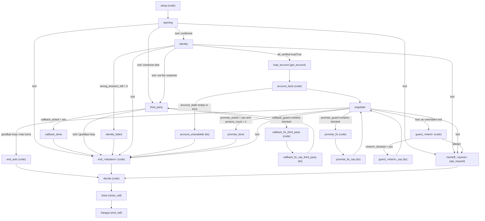

# Compiler

`builder/compiler/` turns the structured policy of a brief into a Freya workflow, and `builder/checks/` verifies the
result before anything is deployed. Both are **pure**: no network, no LLM call, no file written. The same inputs always
give the same workflow.

```text
PolicyIR  ─┐
ToolApi   ─┼─► compile_workflow(ir, tool_api, ledger, prose, profile) ─► CompiledWorkflow(workflow, rule_map, notes)
RuleLedger ┤                                                                   │
NodeProse ─┘  (optional, LLM-drafted)                                          ├─► checks.lint.lint_workflow
                                                                               ├─► checks.coverage.coverage_report
                                                                               └─► checks.code_sandbox.run_snippet (tests)
```

Contents: [1 Inputs and outputs](#1-inputs-and-outputs) · [2 The staged agent](#2-the-staged-agent-default) ·
[3 Node-by-node table](#3-node-by-node-table-staged) · [4 Variables written by code](#4-variables-written-by-code-nodes-and-hooks) ·
[5 Rule to mechanism](#5-rule-to-mechanism-mapping) · [6 Prompts and prose](#6-prompts-and-prose) · [7 Tools and hooks](#7-tools-and-hooks) ·
[8 Lean profile](#8-the-lean-profile) · [9 Lint rules](#9-lint-rules) · [10 Verified and unverified](#10-verified-and-unverified-platform-behaviours) ·
[11 Extending](#11-extending-the-compiler) · [12 Tests](#12-tests)

## 1. Inputs and outputs

| Input | What the compiler takes from it |
|---|---|
| `PolicyIR` (`builder/policy/ir.py`) | Every brief-specific value: sentences, calendar, bands and deadlines, floors, persuasion steps, intents, outcome table, queues, product naming, identity questions |
| `ToolApi` (`builder/ingest/tool_api.py`) | URLs, methods, request fields, enums and response fields of the 7 tools. The tool *names* are fixed by the hackathon; **fields, flags and allowed values are not**: every field the compiler touches is found by its role in the contract (`compiler/roles.py`, section 7) - the success flag of a response, the customer-id field, the outcome and reason fields of `close_call`, the product / amount / date fields of `create_promise`, the id and type keys of the `get_account` items, the queue field, the shape of the `verify_identity` response. A role the agent cannot do without that cannot be found is a `CompileError`; the compiler never falls back to an invented name |
| `RuleLedger` | Rules that no IR section cites are placed **verbatim, with their ids** in the prompt of the stage they apply to; the rule map is built against it |
| `NodeProse` (`compiler/prose.py`) | Optional extra text per node drafted by the `draft_prose` stage; defused and appended (`prose.clean_text`) |

`compile_workflow(ir, tool_api, ledger, prose=None, profile="staged") -> CompiledWorkflow`:

* `workflow` - the JSON for the REST `workflow` key. It is validated through `workflow_model.Workflow` and never contains
  `null` (also not inside an embedded code string: IR data is embedded with `None` entries removed).
* `rule_map` - `{ledger rule id: [where it is enforced]}`, for example `node:negotiate/task_message`, `code:account_facts`,
  `tool:verify_identity/post_process_code`. Superseded rules are never listed.
* `notes` - non-fatal findings for the trace (a queue that is not in the `transfer_to_agent` enum, a missing `now` variable ...).

`CompileError` is raised when a tool the policy needs is missing from the tool API (`verify_identity`, `get_account`,
`create_promise`, `close_call`; `schedule_callback` when there is a callback rule; `transfer_to_agent` when a transfer exists;
the notes tool for several-product briefs), the IR has no identity question, or a field role cannot be found: no outcome field in
`close_call`, a required `close_call` field the compiler cannot fill, an optional one that may hold the reason while the outcome
table has reasons, no product / amount / date field in `create_promise` (the promise guard could not be generated), no product-id
or product-type key in the `get_account` items, no boolean in the `verify_identity` response that says whether an answer was
accepted, or a policy without an opening sentence whose brief requires a recording notice in the opening.

Nothing in `builder/` names a bank, a holiday, an outcome, a product or a sentence of a brief. The test
`test_the_compiler_sources_hold_no_brief_specific_values` scans the sources for such tokens.

## 2. The staged agent (default)

The staged profile reproduces the structure of the hand-authored reference `evals/reference/brief_a_ref.py` (9/10 on the
official scorer in its first run, then improved by the lessons below). `test_structure_matches_the_validated_reference`
compares both workflows: same node types and the same edges at the level of roles (`end_*`, `handoff_*`, named nodes).



Design principles (each is a measured lesson of the reference runs; see the *Addendum* section of the implementation contract):

| # | Principle | Mechanism in the compiled workflow |
|---|---|---|
| 1 | The model never calculates dates or amounts | `setup` and `account_facts` code nodes write the date table, deadlines, floors, allowed dates and scripted attempts as text |
| 2 | A sentence the brief prescribes at a fixed point is spoken by the engine, not by the model | `on_enter: tts` for the opening, `{{debt_statement}}`, `callback_done`, `promise_done`, `identity_failed` |
| 3 | A fixed line must not contain a word a judge can misread | Any phrasing about the call being recorded in the opening ("This call is recorded", "may be recorded for quality purposes", "Calls are recorded", "we are recording this call") becomes "We record this call" (`context.soften_recording_notice`; lower-case "we" inside a sentence, the rest of the sentence is kept), because "recorded" is also the word of the promise honesty rule |
| 4 | Moving on after a terminal action is deterministic | Acknowledgement flags (`callback_acked = yes`; `promise_acked = yes` AND `product_count = 1`) route to a passthrough node that speaks the prescribed sentence and says goodbye. The flags are written by post-hooks only when the bank acknowledged the call (AUD-07): the engine's `<tool>_success_count` counts any HTTP 2xx, a refusal with `ok: false` included |
| 5 | The model says goodbye and leaves in the same message | Tool-call transitions (`is_tool_call`): the model calls `transition_to_end_*` / `transition_to_handoff_*` |
| 6 | The model never names an outcome | `end_<situation>` nodes only write `chosen_end`; `decide` applies the IR precedence to counters, notes and the chosen situation |
| 7 | A goodbye loop must end | `matches_intent` "only goodbyes left" -> `end_auto`; `max_turn_transition` -> `end_auto`; the `call_situation` extraction is the outcome fallback |
| 8 | Persuasion attempts are counted per product | `account_facts` writes "Attempt k - ask: ..." scripts per product with exact questions and "After attempt N is refused: make NO further offer". **The ladder is never padded** (audit F19): the node compiles exactly the distinct prescribed steps of the product's band, capped at the band's allowance, and states `min(allowed attempts, prescribed steps)` as the attempt count (a band with no applicable step says "NONE ... make NO offer"); `codegen.persuasion_ladder_gaps` reports every band whose allowance exceeds its steps as a compile note, because repeating the last step made the customer hear the same offer twice. Every date kind of `PersuasionStep.date` is resolved in the snippet exactly as `calendar.resolve_proposal_date` does (capped at the product's deadline); a `customer` / `custom` step keeps the documents' own date rule as an unquoted "Date rule for this attempt: ..." line. The amount and days-late fields are `Disclosure.amount_and_days_fields()` (the IR's explicit fields first) |
| 9 | A mixed answer + question must still be verified | The identity prompt: "A complete answer that comes with a complaint, a question or other words is checked FIRST: call verify_identity before you say anything ... and only then answer the complaint or the question" |
| 10 | A tool result needs an instruction | Post-hooks write `what_to_do_next` into `result.data` |
| 11 | Several products | The `add_note` pre-hook stages the normalised request (`note_pending_product` / `note_pending_reason`); the post-hook appends `pid:reason;` to `vars['notes_log']` only when the bank acknowledged THIS request (principle 30); `decide` applies the notes closing rule |
| 12 | A promise the rules forbid must not be recorded, even for a talkative customer | **Hard promise guard**: the `create_promise` pre-hook blocks an unknown product, a date outside `allowed_<pid>` and an amount outside floor..full by emptying `config['url']` (experiment E-9, verified: no request is sent, the engine reports `Missing required field: url`, and **the post-hook does not run**). The explanation therefore comes from principle 23 |
| 13 | A day the customer names that is not a business day has a ready answer | Date table rows for weekends and holidays end with "-> if the customer names this day, offer <next business day> instead" (or the previous one / "cannot be recorded", per `non_business_day_shift`) |
| 14 | A complete identity answer is checked at once, a partial one is completed first (audit C-14) | The identity prompt says "A COMPLETE answer is checked at once ... never hold it back and never ask the customer to repeat or confirm a part they already said", that an answer said in words is whole when every part is there (a year said in words is a whole year; written only for date and year questions), and that a partial answer is not sent: "ask only for the missing part and combine both parts, then check the whole answer". The earlier wording "Only a COMPLETE answer can be checked" made a model withhold a complete date (reference v10, PUB-03: a date with the year said in words was answered with "I need the full date including the year", the third wrong answer was never counted and the call closed as declined instead of failed); the tool's field note still says never to send a partial answer |
| 15 | Talkative customers | System prompt: a cut-off or small-talk-only message gets "I understand, go on." and is never a refusal; a message that holds an answer, day, time, date or amount is acted on at once; a callback is booked as soon as a valid day and time are given |
| 16 | An intent that takes precedence says what it forbids | `IntentRule.overrides` becomes "Once this applies, it comes before the rules for X: never <do X> in this call"; an offer with precedence is made once and is the only offer |
| 17 | Turn caps are generous and lead to a computed end | opening 30, third party 30, identity 60, negotiation 60 (a cap counts customer messages; a talkative customer spends them on fragments); every cap leads to a computed end (`end_auto` or the stage's own end node); `decide` closes an unverified `end_auto` as failed when no wrong answers are left (`verify_identity_response.data.wrong_answers_left` is `0`), else as declined |
| 18 | Amounts are exact | **One input contract** in the Decimal helper (`policy.money.to_money`) and in the generated code (`pycode.MONEY_BODY`, used by `account_facts`, `check_promise` and the hooks): an int is whole units, a float is read through its text form, in text only `0-9 , . -` are kept (currency words, symbols and spaces drop out), a `-` is a sign only in first place, with both `,` and `.` the last one is the decimal mark, a lone `,` with one or two digits after it is a decimal comma (`637,50`), any other `,` and several `.` are thousands separators (`1,250.00`), anything else is not an amount. Rounding is half-up to whole cents with string and integer arithmetic in the generated code (`ROUND_HALF_UP` in the helper): 1.005 -> 1.01, 0.125 -> 0.13, 2125.1 -> 2125.10. The floor / full comparisons of the check snippet, the promise guard and `check_promise_amount` are done on those cents, so they agree at the half-cent boundary |
| 19 | `paid` needs a paid note for every product | `policy.outcomes`, the `decide` snippet and the reference agent: with no promise, the call closes as all-paid only when every product in `product_ids` has a `paid` note (the latest note of a product counts); a product without a note is not paid; a non-paid note decides with the reason of the first such product in `get_account` order; when existing notes are all paid but some product has none, the notes do not decide and the chosen situation (default: the persuasion stop outcome) does |
| 20 | The opening needs an explicit, complete confirmation (reference v9) | The opening prompt: a reply that is cut off, or that contains "no" or says who is speaking ("this is her ..."), is NOT a confirmation - let the person finish ("I understand, go on.") before deciding; only an explicit complete confirmation calls `transition_to_identity` |
| 21 | Every step before verification can be left because the person is not the customer (reference v9) | `identity` has tool-call exits to `third_party` and to the wrong-number end (from the IR's `wrong_number` intent or `third_party.wrong_number`) next to the declined / human exits, and the prompt says "say nothing about the account". A relative's cut-off "no, this is her ..." used to be sent to identity, which had no way back |
| 22 | The model must not call a day after the deadline "a business day" (reference v10) | `account_facts` re-renders `date_table`: every row after a product's deadline ends with `\| after the deadline of pN - not allowed for pN`, or, after every product's deadline, `\| AFTER THE DEADLINE - not allowed: offer the deadline instead` (only `not allowed` when the policy does not offer the deadline; no marks when promises may pass the deadline). The marks follow the hints for weekends and holidays |
| 23 | A blocked promise is corrected out loud, not left as a generic error (reference v10) | **Guard recovery**: when the pre-hook blocks it also writes `promise_guard_blocks` (counter) and `promise_guard_say`, the spoken correction built from the product's spoken name (`<pid>_name`), the latest allowed day (`<pid>_deadline_spoken`) for a date after the deadline - with the same amount, or the full amount when the amount was invalid too -, the next allowed day (`allowed_spoken_<pid>`; the closest one under a previous-business-day policy; a plain "another day" under `reject`) for a day that is not allowed, or the allowed amount range (only the full amount for a product without a floor, "x or y" when between-amounts are not accepted), with the brief's `currency_word`. `negotiate`'s **first** transition (`promise_guard` contains `blocked`) leads to `promise_fix` (code: `promise_guard = 'handled'`, `promise_fix_text = promise_guard_say`) and `promise_fix_say` (`tts` `{{promise_fix_text}}`, passthrough) back to `negotiate`, whose debt statement is first-entry only. `decide` counts service failures as `create_promise_failure_count - promise_guard_blocks`, because the engine counts a blocked call as a failed one |
| 24 | An intent that takes precedence is a latch and a guard, not only a sentence (audit C-15) | `IntentRule.overrides` ("once hardship applies it comes before the restructuring rule") was only prompt text; in one run of three the extraction flipped from `hardship` to `restructuring` after "I just need a discount" and the call ended in the restructuring queue. For every intent `X` with `overrides` and every overridden intent `Y` that has an exit in the stage: `negotiate` extracts `<X>_seen` (`yes`/`no`, "at ANY point in this call", `min_confidence` 0.6) next to `call_situation`; the exit of `Y` leads to the node `guard_<Y>` (code, passthrough) which sets `<Y>_blocked` from `<X>_seen` (or `call_situation`) and routes `<Y>_blocked = yes` -> `guard_<Y>_say` (`tts`, the brief's `override_refusal` phrase or "I am sorry, I cannot arrange that.") -> `negotiate`, else always -> the real exit. **The engine names the tool of a tool-call transition after the node it leads to**, so the prompt of the stage tells the model to call `transition_to_guard_<Y>` (`exit_bullet(..., redirect=...)`); a test checks that every `transition_to_*` a prompt names is a tool the node offers. Not yet validated on the platform (no Freya writes in the audit) |
| 25 | The engine merges transitions that share a target (audit C-13) | A node never has two transitions to one target: the goodbye-loop breaker of `third_party` leads to `end_auto_third_party` (records the same situation as `end_callback_not_booked`), as the reference's `end_auto_tp`. `ProfileBuilder.merge_duplicate_targets` joins two tool-call exits to one node and raises `CompileError` for any other pair; lint L028 checks every workflow |
| 26 | The retry rule, the failure sentence and the notes agree (audit C-09, C-11, C-12) | `context.recording_failure_texts` builds the prompt rule 9 and the `create_promise` post-hook from `recording.retries_on_failure` and one give-up clause: 0 retries -> "do not try again"; 1 -> "once more ... if it fails again"; N >= 2 -> "at most N more ... fails a (N+1)th time" in the prompt and "failure number 1 to N" in the hook. With several products and a service-error note reason the give-up clause is the B7 behaviour (say the failure sentence, note the reason for that product, go on with the next one); only a single-product call ends with `transition_to_end_recording_failed`. When the policy forbids notes on a transfer (`notes_on_transfer` false) every note is **deferred**: the bullets say "add_note reason X (do not call add_note yet - write it only at the very end)", B5 says "Call add_note only at the very end, when every product is handled and the call is not being transferred", the tool description says the same, so a note can never be written before a transfer. A policy that wants notes on a transfer keeps the immediate calls |
| 27 | An empty list of allowed dates means "nothing is allowed" (audit C-06, C-07) | `account_facts` enumerates every allowed day up to the deadline (no cap at 120 days; with no deadline, or a deadline beyond one year, up to a one-year horizon). `allowed_count_<pid>` is `0` when no day is left (the deadline is before today or before the first business day): the guard blocks every date with "I am sorry, I cannot record a payment date for your <name> in this call." and the prompt says "Allowed promise dates: none ... Record NO promise". A list cut at the horizon writes `until_<pid>` (`open`, or the ISO deadline): the guard accepts later ISO dates (up to the deadline). The prompt lists up to 30 days one by one and summarises longer lists as a range with the bank holidays inside; the date table is capped at 70 days. The differential test compares the allowed dates with `policy.calendar.check_promise_date` over deadline kinds x clocks x date rules |
| 28 | Ids and enum values keep the spelling of the data (audit C-08, N-2) | The hooks take an exact match of the model's product id first; only when there is none, a match ignoring case, spaces and dashes that names exactly one product, and write back the id of `product_ids` (`CC-4821`). Ids that differ only by case are never merged; enum fields (`add_note` reason ...) are written back in the contract's spelling; `notes_log`, the guard and `check_promise` use the canonical id; `decide` maps note ids and reasons case-insensitively before it applies the paid rule |
| 29 | Fields are found by role (audit C-01 .. C-05) | See section 7, "Field roles" |
| 30 | A note is a record only after the bank acknowledged it (audit C-10, F04) | The `add_note` pre-hook only **stages** the request (`note_pending_product`, `note_pending_reason`, reset on every call, also on an incomplete request); the post-hook (`hooks.post_hook_notes_log`) appends `pid:reason;` to `notes_log` only when the result status is `success` AND the contract's success flag (a role, never "any true boolean": `audit_logged` never counts) is true, then clears the staged fields, so a failed, unknown or repeated result adds nothing and a successful retry adds exactly one entry. `decide` reads only `notes_log`. A post-hook that writes `vars` is documented behaviour (`docs/tools-and-code.md`, seen in a test on 10 October); the staged request is what the pre-hook of the next call overwrites |
| 31 | One immutable acknowledged promise per product (audit C-17, F17) | The `create_promise` pre-hook stages a request that passed the guard in `promise_pending_product` (reset on every call); `hooks.post_hook_promise_log` adds it to `promised_products` (csv) only on an acknowledgment (status `success` AND the success flag). The guard then blocks every later request for an acknowledged product - identical, changed terms, another spelling of the id, a re-entered node - with the spoken correction "the payment promise for your <name> is already recorded and cannot be changed or recorded again in this call." plus the brief's `recording.immutable_sentence`, through the same `promise_fix` route as every block. Another product stays eligible; failed or unknown outcomes are never acknowledged, so the supported retry stays possible. `recording.one_promise_per_product = false` switches the block off |
| 32 | A handoff offer has separate accept / decline / clarification branches (audit F18, AUD-37) | `exit_bullet` writes "If they accept or insist (yes, or any clear agreement): ...", "If they clearly decline: ... do not ask again" and "If they ask a question about the offer (for example what it would help with), ask for time, make small talk or say something cut off, it is neither a yes nor a no: answer briefly ... keep the offer open and wait; do not ask it again. This is not a refusal and not a second offer ... If the next reply is still neither a clear yes nor a clear no, take it as a decline." Re-asking the yes / no read as a second offer (AUD-37). An offer without a decline outcome ("may I help first?") transfers only when the customer insists: "If they insist: ... transfer ... If they let you help, go on; do not offer it again." |
| 33 | The persona noun comes from the policy (audit U-17) | `context.persona_noun` reads it from the policy's own sentences (robot answer, opening sentence, robot-question response: "I am / this is / you are" + article or possessive + noun phrase); the system prompt says "You are <bank>'s <noun> ..." or, when the policy names none, "You make an outbound phone call for <bank>."; the neutral fallback opening is "Hello, this is <bank>'s <noun>." or "Hello, this is <bank>." No builder code or template contains a persona word |
| R3 | Prescribed sentences and placeholders (AUD-09, AUD-12) | `ProfileBuilder.finalize_texts`: `phrasing.unspoken_phrases` finds a prescribed sentence (a `Phrases` field, any `phrases.extra` key, a quoted sentence of a rule the phrases cite) that no compiled string contains and places it word for word in the step its rule is scoped to (compile note); `phrasing.speakable` turns `{var}` into `{{var}}` everywhere and drops any other `{token}` from spoken lines. `account_facts` fills call variables into the debt statement and names a product whose naming field is missing by its type. Narrowed rules are printed with their amendment (AUD-36); global rules that name a pre-verification word go to the negotiation step (AUD-51). |

## 3. Node-by-node table (staged)

Names shown for the Brief A fixture. `<situation>` and `<queue>` come from the IR; only nodes that a transition uses are created
(the lint rule L005 would flag an orphan).

| Node | Type | Entry | Tools / actions | Transitions (in order) | Purpose |
|---|---|---|---|---|---|
| `setup` | code, initial, passthrough | silent | `codegen.setup_snippet` | always -> `opening` | Today's facts, date table, first proposal date, callback facts |
| `opening` | conversation | `tts`: opening sentence + right-party question, first entry only | none | tool-calls: `identity`, `third_party`, `end_unclear_party`, one per before-verification intent (`end_wrong_number`, `end_deceased`, `end_refuse_to_talk`, `handoff_general` ...) | Find out who answered (explicit complete confirmation only); max 30 turns -> `end_unclear_party` |
| `third_party` | conversation | model | `schedule_callback` (pre + post hook; the pre-hook is the callback guard, AUD-29) | var: `callback_guard` contains `blocked` -> `callback_fix_third_party`; var: `callback_acked = yes` -> `callback_done`; var: a dropped `transition_to_<T>_response` contains `Transitioning` -> `rescue_third_party`; intent: goodbye loop -> `end_auto_third_party`; tool-calls: `end_callback_booked`, `end_callback_not_booked`, `identity` (the customer comes to the phone, AUD-45), `end_wrong_number`, `end_deceased` | Say nothing about the debt; ask when the customer can be reached; book inside the allowed times |
| `callback_fix_<stage>` / `callback_fix_say_<stage>` / `callback_stop_<stage>` | code / conversation `tts` / conversation `tts` | silent / `{{callback_fix_text}}` / cannot-book line + goodbye | `codegen` callback fix snippet | fix: `callback_guard_stop = yes` -> stop, always -> say; say: always -> the stage; stop: always -> `end_callback_not_booked` | Speak the allowed times after a blocked slot; give up after `max_extra_asks` (AUD-29) |
| `end_auto_third_party` | code, passthrough | silent | `vars['chosen_end'] = 'callback_not_booked'` | always -> `decide` | The goodbye-loop breaker needs a node of its own (one transition per target, principle 25) |
| `callback_done` | conversation, passthrough | `tts`: "The callback is booked." + goodbye | none | always -> `end_callback_booked` | Deterministic farewell |
| `identity` | conversation | `llm` with the exact first question, first entry only | `verify_identity` (pre + post hook) | var: `verify_identity_response.data.all_verified` true\|True -> `load_account`; var: `...wrong_answers_left` = 0 -> `identity_failed`; tool-calls: `end_identity_declined`, `third_party`, intent exits (`handoff_general`, `end_refuse_to_talk`, `end_wrong_number`) | Ask the questions in order, one at a time; max 60 turns -> `end_auto` |
| `identity_failed` | conversation, passthrough | `tts`: failure sentence + goodbye | none | always -> `end_identity_failed` | Deterministic failure line |
| `load_account` | api_request | engine | `get_account` (`maxRetries` 2), node-level mapping `data.products` -> `products` | always -> `account_facts` | Fetch the products |
| `account_facts` | code | silent | `codegen.account_facts_snippet` | var: `account_state` = `empty` or contains `error` -> `account_unavailable`; always -> `negotiate` | Per-product facts, scripts, `debt_statement` |
| `account_unavailable` | conversation, passthrough | `tts`: cannot-open-the-account line + goodbye | none | always -> `end_recording_failed` | A failed or empty `get_account` closes with the recording-failure outcome (AUD-24) |
| `negotiate` | conversation | `tts`: `{{debt_statement}}`, first entry only | `create_promise` (pre + post hook), `add_note` (several-product briefs) | var: `promise_guard` contains `blocked` -> `promise_fix`; var: AND(`promise_acked = yes`, `product_count = 1`) -> `promise_done` (`promise_acked` is written by the post-hook only on an acknowledged result, AUD-07); var: a dropped transition -> `rescue_negotiate`; intent: goodbye loop -> `end_auto`; tool-calls: `end_promise_recorded`, `end_<stop>`, `end_recording_failed`, one per after-verification intent (`handoff_support`, `end_hardship`, `end_already_paid`, `end_dispute`, `guard_restructuring`, `handoff_general`, `end_refuse_to_talk` ...) | Get the promise; max 60 turns -> `end_auto`; extraction `call_situation` (enum of the end situations, `min_confidence` 0.6) and the latch `hardship_seen` (principle 24) |
| `guard_<intent>` | code, passthrough | silent | `codegen.guard_snippet`: `<intent>_blocked` from the latch `<X>_seen` and `call_situation` | var: `<intent>_blocked = yes` -> `guard_<intent>_say`; always -> the real exit (`handoff_<queue>` / `end_<situation>`) | Only for an exit that an intent with `overrides` forbids (principle 24); Brief A: `guard_restructuring` |
| `guard_<intent>_say` | conversation, passthrough | `tts`: "I am sorry, I cannot arrange that." | none | always -> `negotiate` | The engine, not the model, refuses |
| `promise_fix` | code, passthrough | silent | `codegen.promise_fix_snippet` | always -> `promise_fix_say` | Mark the block `handled`; copy `promise_guard_say` to `promise_fix_text` |
| `promise_fix_say` | conversation, passthrough | `tts`: `{{promise_fix_text}}` | none | always -> `negotiate` | Speak the correction the guard prepared, then resume |
| `promise_done` | conversation, passthrough | `tts`: "Your promise is recorded." + success sentence + goodbye | none | always -> `end_promise_recorded` | Deterministic post-promise sentence |
| `rescue_<stage>` / `rescue_<stage>_bye` / `rescue_<stage>_go` | code / conversation `tts` / code | silent / the IR goodbye sentence / silent | `rescue_target`, `rescue_ending`; the marked `transition_to_<T>_response` is overwritten with `handled` | rescue: non-ending target directly, ending target via `_bye` then `_go`; `_go`: one route per target | Recover a finishing transition the engine dropped because it was sent with other tool calls (AUD-28); on `identity`, `third_party` and `negotiate`, routed right after the node's deterministic routes |
| `end_<situation>` | code, passthrough | silent | `vars['chosen_end'] = '<situation>'` | always -> `decide` | Record how the call ended |
| `handoff_<queue>` | api_request | engine | `transfer_to_agent` with the queue baked (`maxRetries` 1, AUD-25) | always -> `decide` | Transfer |
| `decide` | code | silent | `codegen.decide_outcome_snippet` | always -> `close` | `final_outcome`, `final_reason` |
| `close` | api_request | engine | `close_call` with `{{final_outcome}}` / `{{final_reason}}` (`maxRetries` 2) | always -> `hangup` | The single close, always last |
| `hangup` | end_call | silent | terminal `call_closed`, `message_mode: none` | none | Hang up silently (the goodbye was said before) |

Counts for the kit fixtures: Brief A 49 nodes, Brief A+B 46 nodes (the intents that become notes need no end node). Since
round 3 both include `account_unavailable`, the three `callback_*_third_party` nodes and the nine `rescue_*` nodes (the
round-2 fixture builds had 36 / 33 nodes; the accepted live builds predate them all).

## 4. Variables written by code nodes and hooks

| Writer | Variables | Meaning |
|---|---|---|
| `setup` | `setup_state` (`ok` / `now_missing` / `error: ...`) | Health flag; a missing `now` falls back to the real clock |
| | `today_iso`, `today_spoken`, `weekday_name`, `now_time`, `today_is_business_day` (`yes`/`no`) | Facts about today from `vars['now']` |
| | `next_business_day_iso`, `next_business_day_spoken` | The next business day |
| | `date_table` | One line per day, at least 50 days (more when a deadline is further): `2026-10-16 = Friday 16 October 2026 [this week] business day`; flags `weekend, not a business day` and `BANK HOLIDAY, not a business day` |
| | `attempt1_date`, `attempt1_spoken` | The date of persuasion step 1 (when it is a computable kind: not `customer`, `custom` or `deadline`) |
| | `deadline_<band>` | ISO deadline per band (empty when the rule is `custom`) |
| | `callback_facts`, `callback_slots` | "A callback can be booked only for: today ... or ..." from the callback rule and the clock; the same windows as `date|from|strict|to|inclusive|label` entries for the callback guard |
| | `promise_acks`, `callback_acks` (`0`), `promise_acked`, `callback_acked` (`no`) | Start values of the acknowledgement counters and flags |
| `account_facts` | `account_facts` | The LATE PRODUCTS block: name, past-due, days late, band, floor, deadline, the exact floor-offer sentence, scripted attempts, allowed dates |
| | `debt_statement` | The sentence the agent says on entry to `negotiate`; always set (a generic line on failure) |
| | `product_ids` (csv), `product_count` | Product ids in `get_account` order; routing condition |
| | `<pid>_deadline`, `<pid>_deadline_spoken`, `<pid>_floor`, `<pid>_past_due`, `<pid>_band`, `<pid>_name` | Per product, for `check_promise_snippet`, the promise guard (the spoken name and deadline go into its correction) and tests |
| | `allowed_<pid>`, `allowed_count_<pid>`, `until_<pid>`, `allowed_spoken_<pid>` | Allowed promise dates of the product as an ISO csv (what the promise guard checks the date against); how many (`0` = none left: the guard blocks every date); only for a list cut at the one-year horizon: `open` or the ISO deadline up to which later dates are accepted; the first 90 days as spoken text, same order (what the guard names when it offers the next allowed day) |
| | `date_table` (re-rendered) | The `setup` table with the deadline marks of principle 22 |
| | `account_state`, `identity_verified` (`yes`) | Health flag; the verification flag `decide` reads |
| `end_<situation>` | `chosen_end` | The situation key (`auto` for `end_auto`) |
| `decide` | `final_outcome`, `final_reason`, `decide_situation`, `decide_state` | `final_reason` is written only when the outcome has a reason (an unset variable is dropped from the request) |
| `add_note` pre-hook | `note_pending_product`, `note_pending_reason` | The staged request (cleared on every call and by the post-hook) |
| `add_note` post-hook | `notes_log` | `pid:reason;` entries, appended only for an acknowledged request |
| `create_promise` pre-hook | `promise_guard`, `promise_guard_blocks`, `promise_guard_say`, `promise_pending_product` | `ok` or `blocked: <reason>`; how many calls were blocked (text counter); the spoken correction of a block; the product of a request that passed the guard |
| `create_promise` post-hook | `promised_products`, `promise_acks`, `promise_acked` | csv of the products whose promise the bank acknowledged (read by the guard); the acknowledgement counter and its text flag (`yes`), read by routes and `decide` (AUD-07) |
| `schedule_callback` pre-hook | `callback_guard`, `callback_guard_say`, `callback_guard_blocks`, `callback_guard_stop` | `ok` / `blocked: <reason>`; the spoken allowed times; blocked calls; `yes` once the asks the brief allows are used up |
| `schedule_callback` post-hook | `callback_acks`, `callback_acked` | Acknowledged bookings and the text flag the route `callback_acked = yes` reads |
| `callback_fix_<stage>` | `callback_guard`, `callback_fix_text` | `handled`; the text `callback_fix_say_<stage>` speaks |
| `rescue_<stage>` | `rescue_target`, `rescue_ending`, `transition_to_<T>_response` | The dropped target; `yes` when it ends the call; the marked response overwritten with `handled` |
| `promise_fix` | `promise_guard`, `promise_fix_text` | `handled` (so the transition fires once per block); the text `promise_fix_say` speaks |
| negotiate extraction | `call_situation` | Fallback situation for `end_auto` |
| | `<intent>_seen` (`yes` / `no`) | The latch of an intent with `overrides` (`hardship_seen`), read by the guard nodes |
| `guard_<intent>` | `<intent>_blocked` (`yes` / `no`) | Routing condition of the guard |
| engine | `<tool>_success_count`, `<tool>_failure_count`, `<node>_success_count`, `<tool>_response.*`, `<tool>_args.*` | Read by transitions and by `decide` |

Two more snippets are generated and tested but not wired into the staged graph: `check_callback_snippet` (`callback_check`,
`callback_suggestion` from `chk_cb_date` / `chk_cb_time`) and `check_promise_snippet` (`promise_check`, `promise_date_check`,
`promise_amount_check`, `promise_suggestion` from `chk_product_id` / `chk_amount` / `chk_date`). They mirror
`policy.calendar.check_callback`, `check_promise_date` and `money.check_promise_amount` and are meant for code nodes (a repair
profile); inside a tool call the enforcement is the promise-guard hook.

### The decide snippet

`decide_outcome_snippet` mirrors `policy.outcomes.compute_outcome` (the reference engine) and is tested against it on a grid of
133 call situations for Brief A and 645 for Brief A+B (every combination of party, verification, transfer queue, intent, notes and callback state the code can represent), plus the 13 public cases.

0. Service failures of `create_promise` are `create_promise_failure_count - promise_guard_blocks` (never below 0): the engine counts a blocked call as failed, but it is not a service failure.
1. Facts from `vars`: promised (`promise_acks` > 0; the engine's success counter only when `setup` never ran), notes (`notes_log`
   only; the former fallback to the notes tool's last `_args` is gone), transfer queue (a `handoff_*` node that was entered),
   callback booked (`callback_acks` > 0), `chosen_end`, verified. A `create_promise` call the engine counted as a success but the
   bank did not acknowledge counts as a service error.
2. Active situation keys, structural first (`promise_recorded`, `product_notes`, `recording_failed`, identity, party, callback), then
   the transfer key and the chosen key.
3. A promise plus a transfer with `closing.transfer_after_promise_outcome` -> that outcome (a missing reason is the transfer
   row's reason); a promise with `promise_wins` -> the promise row.
4. Otherwise the first active key in `closing.resolved_precedence()` that resolves: `product_notes` through the notes rule
   (`first_non_paid_note`: the reason of the first non-paid note in `get_account` order; `all_paid_outcome` only when **every**
   product in `product_ids` has a paid note - a product with no note is not paid, and when the existing notes are all paid but
   some product has none, the notes do not decide and the chosen situation does), any key through its
   outcome row (rows can require a verified or an unverified call), then the IR section's own outcome.
5. Fallback: `persuasion.stop_outcome` when verified, `identity.on_declined` for a customer who was reached, else
   `right_party.unclear_outcome`.

Rows the table lacks but the compiler needs (the persuasion stop, intent exits, structural situations) are synthesised by
`naming.closing_rows` and appended, so table rows always win.

## 5. Rule to mechanism mapping

Every IR section carries `rule_ids`. The compiler records where each section is enforced:

| IR section / ledger category | Mechanism | `rule_map` locations |
|---|---|---|
| `phrases` | Opening `tts`, `{{debt_statement}}`, `callback_done`, `promise_done`, `identity_failed`, system prompt (robot / scam / unknown answers) | `node:opening/on_enter`, `node:negotiate/on_enter`, `node:promise_done`, `system_prompt` |
| `right_party` | Opening prompt and tool-call exits | `node:opening/task_message`, `node:opening/transitions` |
| `third_party`, `callback` | Third-party prompt, `schedule_callback` + hooks, `callback_facts`, `callback_done` | `node:third_party/...`, `tool:schedule_callback`, `code:setup`, `node:callback_done` |
| `identity` | Identity prompt, `verify_identity` hooks, deterministic routes, `identity_failed` | `node:identity/...`, `tool:verify_identity/post_process_code`, `node:identity_failed` |
| `disclosure` | Product names and the debt statement in code | `code:account_facts`, `node:negotiate/on_enter` |
| `calendar`, `bands` | Date table, deadlines, allowed dates | `code:setup`, `code:account_facts` |
| `promise_dates` | Rules 3 of the negotiation prompt, allowed-dates list | `node:negotiate/task_message`, `code:account_facts` |
| `amounts` | Floors and the exact floor-offer sentence in code, rule 4 of the prompt | `code:account_facts`, `node:negotiate/task_message` |
| `persuasion` | Attempt scripts in code, rule 5 of the prompt, the stop exit | `code:account_facts`, `node:negotiate/task_message`, `code:decide` |
| `intents` | One prompt bullet per intent with an exit, one tool-call transition and an `end_*` / `handoff_*` node; an intent with `overrides` adds the latch extraction and a guard node in front of every overridden exit | `node:<stage>/task_message`, `node:<stage>/transitions`, `node:end_<situation>`, `code:decide`, `node:guard_<intent>`, `code:guard_<intent>` |
| `confirmation`, `recording` | Rules 8-11 of the prompt, `create_promise` hooks, `promise_done` | `node:negotiate/task_message`, `tool:create_promise/post_process_code`, `node:promise_done` |
| `multi_product` | Block B1-B8 of the prompt, `add_note` pre-hook, notes closing rule | `node:negotiate/task_message`, `tool:add_note/pre_process_code` (only when the workflow has the notes tool), `code:decide` |
| `closing` (rows, precedence) | `decide` + `close` | `code:decide`, `node:close` |
| `residual_rules`, uncovered ledger rules | Verbatim text with the id in the prompt of the rule's scope | `system_prompt` (scope global), `node:<stage>/task_message` |

`checks.coverage.coverage_report(ledger, rule_map, workflow)` returns `covered`, `uncovered`, `superseded` and `dangling`;
superseded rules are never required. With the workflow, a location that names no node, code step, tool or hook of it is
`dangling` and covers nothing. The summary says "mapped", not "enforced": the rule map is the compiler's declaration, not
behavioural evidence (audit A9 / F09), and a rule cited by a section whose fields cannot hold its condition is mapped but
not necessarily applied (audit AUD-10). The kit fixtures are fully mapped to existing locations in both profiles
(`test_the_kit_fixture_rule_maps_name_only_existing_locations`).

### Intent classification (`naming.intent_exit`)

| IntentRule | Becomes |
|---|---|
| has an `outcome`, no transfer | `end` exit: a bullet, a tool-call transition to `end_<situation>`; the situation is the outcome-table row with the same outcome and reason (else the intent key) |
| has a `transfer_to_agent` action | `handoff` exit to `handoff_<queue>`; with an `offer`, "ask once, accept -> transfer, decline -> `declined_outcome` (end) or a note" |
| has a `note_reason` and the brief has several products | `note` guidance: remember the reason, continue, and call the notes tool only at the very end (principle 26; immediately when the policy wants notes on a transfer) |
| nothing of the above | guidance only: no exit. Catalog intents that the fixed prompt text already covers (`proposes_date`, `flat_refusal`, ...) are skipped, other response texts become a bullet |

## 6. Prompts and prose

Templates live in `builder/prompts/agent/*.v1.j2` and are rendered by `compiler/prompts.py`:

* Jinja delimiters are `<< >>`, `<% %>` and `<# #>`, so the literal `{{variable}}` references of Freya pass through untouched.
* `StrictUndefined`: a template that needs a value the compiler did not pass fails at compile time.
* A loader keeps the line break after inline block tags, which `trim_blocks` would otherwise eat.

| Template | Used for |
|---|---|
| `system_prompt.v1.j2` | Global rules: style, the before-verification ban (`forbidden_before_verification`), robot / scam / unknown answers, goodbye rule, global ledger rules |
| `opening.v1.j2` | Who is on the line: confirmation examples, the second ask, exits |
| `third_party.v1.j2` | Disclose nothing, ask when reachable, `{{callback_facts}}`, booking rules |
| `identity.v1.j2` | The questions in order, how to send each answer, hints, decline handling |
| `negotiate.v1.j2` | `{{account_facts}}`, `{{date_table}}`, rules 1-5 (promise), intent bullets, several-product block B1-B8, rules 8-11 (confirm and record) |
| `lean.v1.j2` | Wrapper of the lean profile: the stage sections plus the outcome table |

Fixed rules of every prompt: short turns, one question per turn, amounts with two decimals (and the currency word only when the
brief has one), speak after every tool result, never claim "recorded" before the tool result says so, say goodbye in the same
message as the finishing tool.

**Rule tagging.** Section headings and intent bullets carry the ledger ids they implement (`[A-19, A-20, ...]`, at most four ids and
a count) so a reader can trace a sentence to the brief. Ledger rules that no IR section cites (`context.uncovered_rules`) are
appended verbatim under "Other rules of the brief for this step"; superseded rules are never included.

**Prose.** `NodeProse.per_node[<node>]` is appended at the end of the node's prompt, `system_prompt_extra` at the end of the system
prompt. The lean profile reads the keys `opening`, `third_party` and `identity` for its `call` node and `negotiate` for its other node.

**Free-form phrase keys.** `Phrases.extra` keys are chosen by the extraction stage. The compiler reads (exact key, or any key ending
in `_<name>`): `disclosure_intro` / `intro` (the first sentence of the debt statement), `today_question_all` (the question for
several products), `floor_offer` (template with `{floor_label}`, `{floor_amount}`), `below_floor`, `unknown_answer`,
`decline_explanation`, `override_refusal` (the line a guard node speaks). A missing key falls back to a neutral sentence built from other IR fields.

**Phrases the brief does not prescribe** never become empty quotes or a call without an introduction: the first ask after the debt statement
(`today_question`, else the first persuasion ask, else "Can you pay the full amount today?"), the confirm question ("Is that correct?"),
the decline explanation, the right-party question ("Am I speaking with <form of address>?") and the opening sentence ("Hello, this is <bank>'s
<persona noun>." - the noun is the policy's own, see principle 33 - or "Hello, this is <bank>.", with a compile note) have neutral defaults in `compiler/context.py`. A missing opening sentence is a `CompileError` when a
ledger rule of the opening scope requires a recording notice: the neutral introduction would leave it out.

## 7. Tools and hooks

Model-called tools are built from the contracts (`tools.model_tool`): the customer-id field is baked as `{{customer_id}}` (the call
variable that carries it), every other required
field is a leaf under `body.properties` with `default: ""` (no variable of that name exists, so the model fills it), the
contract's type, enum and description, `body.required`. Engine calls (`tools.engine_call`) bake every field.

### Field roles (`compiler/roles.py`)

The tool names are fixed; fields, flags and enum values may change between briefs. Every field the compiler or a hook touches is
found by its **role** (type, enum, `required`, description, how the tools refer to each other), and the lookups are tested with
renamed copies of the kit's tool API (`test_compile_api_variants.py`):

| Role | Found as | If it cannot be found |
|---|---|---|
| success flag of a response (`success_flag`, `success_status`) | the boolean whose own description or a response clause gives it action-success meaning ("`ok` is false on error.", "True if successful."), else a boolean called `ok` / `success` / `succeeded` ... with no contrary prose, else one undocumented boolean whose name only says the action happened (`recorded`, `is_saved`); a boolean flag wins over a string status field, which acknowledges only on its documented success value (AUD-04) | no boolean and no readable status: the post-hook judges the call by the status of the result envelope (`hooks.envelope_ok`). Booleans that exist but none with success meaning, two candidates, or inverted prose ("true on error") -> `CompileError` |
| customer id (`customer_binding`) | `customer_id`, else the required plain string that most tools share (a name equal to a call variable wins); the value comes from the call variable of that name, else `customer_id` | `customer_id` |
| `close_call` outcome / reason (`close_roles`) | outcome: the required enum string field that is not the customer id (`outcome`, `result`, `disposition` ... win a tie); reason: another string field called or described as the reason / detail | no outcome -> `CompileError`; a required field left over -> `CompileError`; an unmapped optional field while the outcome table has reasons -> `CompileError` |
| `get_account` items (`account_roles`) | list: the response array; id key: the item field the promise tool's product field is called, else the only id-like string; type key: the item field whose enum covers the policy's product types | no id key / no type key (when the policy names products by type) -> `CompileError`; an item without an id at run time makes `account_facts` fail with `account_state = error: ...` (**an id is never invented**) |
| `create_promise` product / amount / date (`promise_roles`) | date: the `date`-format field; amount: a number-typed field (`amount` ... first; an integer field is neither the amount nor coerced as money unless its name says amount); product: the field named like the account's id key, an id-like string, or the only required plain string | any of the three missing -> `CompileError` (the promise guard needs all three) |
| notes tool product / reason (`note_roles`) | product as above; reason: the enum string field | `CompileError` |
| transfer queue (`queue_field`) | the enum string field (`queue`, `team` ...) | `CompileError` when a transfer exists |
| `verify_identity` request (`verify_roles`) | selector: the enum string field; answer: the plain string field (`answer`, `value` ... first) | the usual names |
| `verify_identity` response (`verify_shape`) | overall flag: a boolean called / described "all", "overall", "complete" ...; per-answer flag: `verified`, `correct`, `match` ... (a lone ambiguous boolean is per-answer, the safe reading: an overall flag read as per-answer only costs a model decision, the reverse would move on after the first answer); counter: an integer called / described "left", "remaining" (counts down to 0) or "strikes", "wrong", "failed" (counts up to `identity.max_wrong_total`); an ambiguous counter is left to the model; hint: the enum string field whose values contain the policy's hint values | no boolean that says whether an answer was accepted -> `CompileError`. Without a per-answer flag the default message does **not** call the answer wrong |

`lint` L029 checks the same thing on any workflow: a post-hook, a transition condition (`<tool>_response.data.<field>`) or a prompt
reference may only read a response field the tool's contract returns.

| Tool | Hooks | Effect |
|---|---|---|
| `verify_identity` | pre: `pre_hook_identity_answers` | Numeric dates (`14/03/1988`) become `YYYY-MM-DD` in the brief's date order; digit answers keep digits only |
| | post | `what_to_do_next`: all verified -> "say nothing, the call continues"; unreadable -> ask again; each IR hint (`counts_as_wrong` decides the note); verified -> "ask the next question"; no wrong answers left -> the end sentence; else "wrong, do not reveal the answer" |
| `create_promise` | pre: `pre_hook_coerce` + `pre_hook_promise_guard` | Product id completed from `product_ids`, amount as a number rounded half-up to cents, date as `YYYY-MM-DD`; a missing value is never written back empty. Then the **promise guard** and its spoken correction (section 2, rows 12 and 23) |
| | post: `post_hook_promise_log` + `post_hook` | Commits the acknowledged product to `promised_products` (principle 31) and counts `promise_acks` / `promise_acked`. Calls the model sends in parallel are staged as one batch and committed when every call in it is acknowledged (AUD-06). Recorded -> say the success sentence; not recorded -> "never say it is recorded", retry as many times as `recording.retries_on_failure` allows (same text as prompt rule 9, principle 26), then the failure sentence and `transition_to_end_recording_failed` - or, with several products and a service-error note reason, the note step of rule B7. A branch for the platform's "missing URL" answer is kept as a safety net, but the post-hook does not run for a blocked call (E-9), so it is not what the customer hears |
| `add_note` | pre: `pre_hook_notes_log` | Normalises product id and reason and stages them (principle 30) |
| | post: `post_hook_notes_log` + `post_hook` | Appends the staged note to `notes_log` on an acknowledgment; saved / not saved instruction |
| `schedule_callback` | pre: date and time normalised + `pre_hook_callback_guard`; post: `post_hook_ack` + `post_hook` | The guard blocks a day and time outside `callback_slots` (written by `setup`) by emptying the url, and writes `callback_guard`, `callback_guard_say`, `callback_guard_blocks` and, past `max_extra_asks`, `callback_guard_stop` (AUD-29). Booked -> `callback_acks` / `callback_acked`, "say nothing, the system confirms"; not booked -> check against the allowed times and ask again |

All hooks are wrapped in `try ... except Exception: pass`, use `isinstance` checks, drop `result['header']` and contain no `{{`.
The hook generators (`post_hook`, `pre_hook_coerce`, ...) assert that.

Code rules for every generated snippet (`pycode.assert_safe_code`, lint L008): reads and writes through `vars`, never raises (a
fallback writes the variables later prompts read), strings for flags, only `json` / `datetime` imports, no `{{` / `}}` (IR data is
embedded as a JSON string whose braces are written `\x7b` / `\x7d`), no f-strings, no lambdas or closures, no `strftime` (it imports `time`).

## 8. The lean profile

`profile="lean"` compiles six nodes: `setup`, `call`, `load_account`, `account_facts`, `negotiate`, `hangup`.

```mermaid
flowchart LR
    setup --> call
    call -- "all_verified true|True" --> load_account --> account_facts --> negotiate
    call -- "close_call_success_count &gt; 0" --> hangup
    negotiate -- "close_call_success_count &gt; 0" --> hangup
```

`call` is opening, third party and identity in one node with the tools `verify_identity`, `schedule_callback`, `transfer_to_agent`
and `close_call`. `negotiate` has `create_promise`, the notes tool, `transfer_to_agent` and `close_call`. The prompts carry the
outcome table (`lean.closing_text`) and the model chooses the row; the engine only ends the call after a successful `close_call`.
The same code nodes, hooks, prompt templates and rule map are used. It trades the deterministic outcome engine and the fixed
sentences for fewer nodes; experiments E-3 and E-4 compare the two. The lean profile has no guard nodes (principle 24): an intent's
precedence stays prompt text there. Its prompts name the contract's own field names for the outcome, the reason and the queue.

## 9. Lint rules

`checks.lint.lint_workflow(wf, tool_api, call_variables) -> LintReport`; `report.ok` is true when no `error` is left; warnings go to
the trace. Works on dicts, so it also checks the reference agents and platform exports.

| Rule | Sev. | Check |
|---|---|---|
| L001 | error | No `null` anywhere |
| L002 | error | `tools` only on conversation nodes (a workflow-level tool needs `alwaysRunsAt`: warning) |
| L003 | error | `pre_actions` only on api_request / code nodes |
| L004 | error | Passthrough nodes have `passthrough_default_transition` and end with an `always` transition; api/code nodes must be passthrough |
| L005 | error | Every node reachable from `initial_node` (global nodes are roots) |
| L006 | error | Every node can reach an `end_call` node |
| L007 | error | `initial_node`, transition, default and max-turn targets exist; `__previous__` only in global nodes |
| L008 | error / warn | Code and hooks: no `{{`/`}}`, compile; warning for imports beyond json/re/datetime and for a long code node without `try` |
| L009 | error | `response_mapping`: paths start with `data.`, identifiers as variables, node level for pre-actions (a mapping inside a pre-action is ignored) |
| L010 | error | `equals` on a boolean tests both spellings in one OR group; no bare boolean `equals` |
| L011 | error | `api_call` parameters: only url/method/headers/body, `default` never `const`, body fields are leaves with `default`, `required` names exist |
| L012 | error | Tool name in the tool API; url and method equal the contract; body fields are request fields; required fields present; enum values within the contract; baked literals within the enum |
| L013 | error | `close_call` reachable before every `end_call`, never twice on a path (a model-called close counts as once; a lifecycle end-of-call tool satisfies the rule) |
| L014 | error | Every `{{variable}}` and condition variable resolves: call variables, `test_variables`, `vars['x'] =` in code (dynamic suffixes too), extraction names, mapped names, `<tool>_response.*`, `<tool>_args.*`, `<tool\|node>_success_count`, `system.*`, `call.*`, `<node>.current_turns` |
| L015 | error | Extraction fields set `min_confidence` |
| L016 | error | `end_call`: silent `on_enter`, no transitions, `disable_inactivity_monitor` true, `end_call` handler |
| L017 | error | `max_node_turns` comes with `max_turn_transition` |
| L018 | warning | `task_message` or `system_prompt` over 6000 characters |
| L019 | error | No `agent_config` |
| L020 | warning | Tool descriptions say when to CALL the tool |
| L021 | error / warn | Top-level condition groups use `or`; bare variable conditions and deterministic transitions listed after a `matches_intent` one warn |
| L022 | warning | `{name}` IR placeholder left in spoken text |
| L023 | error | `is_tool_call` only on conversation nodes |
| L024 | warning | Node `name` differs from its key |
| L025 | error | Transition has a `target_node`; `matches_intent` has a description |
| L026 | warning | Duplicate tool names in a node |
| L027 | error | `tts` entry has text |
| L028 | error | No two transitions of a node share a `target_node` (the engine merges them into one OR condition, so a tool-call exit or a condition is lost) |
| L029 | error | A post-hook, a transition condition (`<tool>_response.data.<field>`) or a prompt reference reads a response field the tool's contract does not return |

Checks that need the policy, not only the workflow, are compile-time errors instead (`CompileError`): a field role that cannot be found
(section 7), a guarded exit that is missing, two transitions to one target that are not both tool-call exits.

The staged workflows of the kit briefs lint with zero errors; the only warning is L018 for the several-product negotiation prompt
(about 9 200 characters on 11 October; Brief A's is about 6 000, right at the limit, so one more rule in that prompt adds the
warning; the hand-written reference's was 6 572 before the v6-v8 lessons). L018 is a warning, never a block. The validated reference agents also lint with zero errors, which is the
check that the rules do not reject what is known to work.

`checks.code_sandbox` runs snippets and hooks locally with the platform's documented limits (only `json`, `re`, `datetime`, `math`; no
file or network; a trace-based time limit). It refuses `import time`, which is how the `strftime` pitfall was found.

## 10. Verified and unverified platform behaviours

**Verified** (kit documentation "verified in a working builder", or measured on the reference agent with the official scorer):

* A passthrough `code` node can be the initial node; `vars` holds the call variables; strings written to `vars` resolve as
  `{{var}}` in later prompts; `json`, `re`, `datetime` import.
* `api_request` node with a `get_account` pre-action and node-level `response_mapping` `data.products` -> `products`: the products reach
  the following code node (as a list, a JSON string or flattened keys; the snippet reads all three).
* Tool-call transitions fire immediately and the model says goodbye in the same message.
* `verify_identity` post-hook `what_to_do_next`, deterministic routes on `...all_verified` (`true` / `True`) and `wrong_answers_left` = 0.
* `close_call` with an unset `{{final_reason}}`: the field is dropped from the request.
* **E-8**: a variable written in a pre-hook (`vars['x'] = ...`) persists in the call's variable table and is visible to routing
  (`route_evaluated` showed `promise_guard`). The guard's `promise_guard*` variables are therefore sound. `notes_log` and
  `promised_products` are written by the **post-hooks** after an acknowledgment: the kit documentation records a test of
  10 October in which a post-hook read and wrote call variables and a later pre-hook read them (what is not confirmed is whether a
  change to `result` also changes the flattened `<tool>_response.*` variables, which these hooks do not rely on).
* **E-9**: `config['url'] = ''` in a pre-hook sends no request; the platform emits `function_call_error: Missing required field: url`,
  sets `<tool>_response.status` to `error` (status code 400) and increments `<tool>_failure_count`. **The post-hook does not run on
  this path**, so the model only sees a generic error; the spoken correction is the job of `promise_fix` (principle 23) and `decide`
  subtracts `promise_guard_blocks` from the failure counter.
* `on_enter` `tts` with a code-computed `{{variable}}`; deterministic routes on `product_count`; the goodbye-loop
  breaker with a `call_situation` extraction fallback; the "We record this call" phrasing; per-product attempt scripts.

**Seen in call records of the live builds** (the reasons for AUD-06, AUD-07, AUD-27 and AUD-28):

* `<tool>_success_count` counts any HTTP 2xx, a bank answer with `ok: false` included; routes therefore read the
  acknowledgement flags.
* Post-hooks do not run on an HTTP 5xx, so the system prompt itself says what an error result means.
* Tool calls sent in one message run every pre-hook before any post-hook, in start order (hence the batch staging).
* Booleans in call variables are lowercase strings, and `equals` compares as text (hence `true|True` groups and `yes` flags).
* A transition sent in the same message as a bank tool can be dropped: only `Transitioning to <node>` is written to
  `transition_to_<node>_response` (hence the rescue routes).

**Not verified** (implemented from the documentation or by analogy; the traces and the practice run will show them):

* The **hardship guard** (principle 24): the latch extraction `hardship_seen`, the tool-call transition to a `guard_*` code node, its variable
  routes and the fixed refusal. Its parts are the verified patterns of the recovery flow, but the audit that introduced it was not
  allowed to write to Freya, so it has not run on the platform; the reference carries the same nodes (`guard_restructuring`) for the
  next practice run (PUB-05, `--reps 3`).
* **Deferred notes** (principle 26): the model keeps the reasons in mind and calls the notes tool at the end; a model that forgets
  leaves the ledger without notes (`decide` then falls back to the chosen situation).
* The **recovery flow** as a whole (`promise_guard` contains `blocked` -> `promise_fix` -> `promise_fix_say` -> `negotiate`): its parts are
  verified (E-8, E-9, tts passthrough nodes, a first-entry-only `on_enter`) and it is the design of reference v10, but its effect on the
  official score is not measured yet.
* The `verify_identity` **pre-hook** that normalises answers; `pre_hook_coerce` on `schedule_callback`.
* The wording of the spoken corrections is generic English with the product's name, the brief's currency word and spoken dates; how
  customers react to it is not measured.
* A transfer node whose call failed counts as a transfer (`<handoff>_failure_count`); the engine retries it once (`maxRetries` 1, AUD-25).
* The callback guard and its correction nodes (AUD-29), the rescue routes (AUD-28) and `account_unavailable` (AUD-24) are built from
  verified patterns but have not run on the platform; the accepted live builds predate them.
* `maxRetries` 2 on `close_call` (documented as safe by the API's "nothing was recorded; may be repeated" error text, not measured).
* Dates are spoken with English weekday and month names whatever `ir.language` says.
* A callback is allowed "today" even on a non-business day when the rule is `today_or_next_business_day` (as `policy.calendar` defines it).
* The **lean** profile as a whole: model-called `close_call`, routing on `close_call_success_count`, no fixed sentences.
* `max_turn_transition` behaviour at the cap ("not confirmed" in the kit docs); the compiler always sets it.
* Several-product flows beyond PUB-11..13: the reference reached 3/3 on Brief B in two of three runs; one run hit a transient SSL error.

## 11. Extending the compiler

* **A new mechanism**: add the node in `profiles/staged.py` (`_Staged`), a snippet in `codegen.py` if it needs arithmetic, a row in
  the table of section 3, a lint rule if it can silently fail, and a test that executes the snippet in `code_sandbox`.
* **A new IR field**: read it in the context builders (`ProfileBuilder.*_text`), render it in the template, record its `rule_ids` with
  `rm(...)`, add it to the rule-to-mechanism table.
* **A new lint rule**: add a method `lNNN` to `_Linter`, list it in `run`, the module table and `RULES`, and add a failing and a passing
  example to `tests/unit/test_lint.py`.
* **A new profile**: subclass `ProfileBuilder`, register it in `compile.compile_workflow`; `test_coverage` and the lint tests should
  pass for it unchanged.

## 12. Tests

| File | Covers |
|---|---|
| `test_workflow_model.py` | Round trip of `examples/base-agent.json`, condition and node models, graph helpers |
| `test_tools_builder.py` | Tool builders against `tools/openapi.json`, brace-free embedding |
| `test_compiled_note_acknowledgment.py` | The compiled `add_note` hooks in both profiles (and the reference agent's): failed, unknown and repeated results, retries, stale arguments, the closing outcome |
| `test_compiled_promise_once.py` | One immutable acknowledged promise per product through the compiled `create_promise` hooks (both profiles and the reference): blocked repeats, independent products, failed / unknown outcomes, id spelling, the policy switch |
| `test_codegen_persuasion_ladder.py` | The persuasion ladder is never padded; the attempt count is `min(allowed, steps)`; the compile note for a short ladder |
| `test_compile_offer_branches.py` | Accept / decline / clarification branches of a handoff offer (both profiles, one and several products, the reference) |
| `test_compile_persona.py` | The persona noun and the neutral opening come from the policy; no builder code or template hard-codes a persona |
| `test_hooks.py` | Every hook executed in the sandbox; the envelope rule, canonical ids and enum spelling, the guard's "no date left" and truncated-list cases |
| `test_compile_api_variants.py` | Renamed copies of the kit's tool API (close outcome / reason, success flag, `get_account` keys, customer and queue fields, `create_promise` product field, every `verify_identity` response field, upper-case ids, enum spelling): the compiled agent follows the rename, lints clean, or raises `CompileError` |
| `test_compile_consistency.py` | Prompt, hook and graph agree: retry rule per `retries_on_failure`, deferred notes and the B7 note step, one transition per target, the hardship latch and guard, blank phrases, rule-map locations that exist, every `transition_to_*` a prompt names is offered |
| `test_codegen_promise_dates.py` | Allowed dates and the promise guard against `policy.calendar.check_promise_date` over deadline kinds x clocks x date rules (empty list, long deadline, no deadline) |
| `test_code_sandbox.py` | Import restrictions, time limit, snippet extraction |
| `test_codegen.py` | `setup`, `account_facts`, `check_*` and `decide` against `policy.*` for the 13 practice cases and a grid of situations; the generic-policy outcome test asserts outcome AND reason; amount verdicts are checked against the Decimal helper on the raw input and with literal half-cent vectors |
| `test_money.py` | The Decimal helper, the money input contract as literal vectors, a differential run of the helper and the generated integer-cent code on ~100 inputs, floor / full comparisons at the half-cent boundary |
| `test_outcomes.py` | The reference outcome engine; the paid-invariant table (literal `(outcome, reason)`) run against the engine, the generated `decide` code and the hand-written reference agent |
| `test_lint.py` | One failing and one passing example per rule; reference agents lint clean |
| `test_compile_staged.py` | Fixture IRs lint clean, structure equals the reference, mechanisms, prompts, all 13 cases through the generated code nodes, no brief-specific values |
| `test_compile_lean.py` | The lean graph, outcome table in the prompts, same facts as the staged code nodes |
| `test_compiler_lessons.py` | Reference v6-v10 lessons with literal expectations: promise guard (also in whole cents at the half-cent boundary), the spoken correction of every kind of block (after the deadline, a day that is not allowed under each shift policy, amounts, unknown product, missing facts), the recovery nodes, the deadline marks of the date table, money vectors, date-table hints, turn caps (30 / 30 / 60 / 60), identity completeness and escape exits, the strict opening confirmation, precedence lines |
| `test_coverage.py` | Coverage report and full coverage of the kit briefs |
| `test_prompts_prose.py` | Jinja environment, prose cleaning, context helpers, naming and intent classification |
| `test_hidden_tool_contracts.py` | Tool-API variants a hidden brief may bring: reworded success flags and string status fields, renamed queue field, fixed request values, minor units, integer ids, headers, transfer retry (AUD-04, -16, -21, -22, -25, -27, -48) |
| `test_compile_flow_exits.py` | Exits for every closing situation, intent callbacks and notes, decline limit, third-party hand-back, multi-product switches, rescue routes (AUD-08, -11, -28, -34, -35, -45) |
| `test_compile_text_round3.py` | Prescribed sentences, placeholders, joint confirmation, amendments, amount correction, concession line, floor sentence, pre-verification leaks, form of address (AUD-09, -12, -32, -36, -38, -47, -49, -51, -52) |
| `test_state_routes_and_dates.py` | Renamed clock, date table vs guard, counting verified answers, unloaded account, callback guard, non-ISO clocks (AUD-13, -17, -23, -24, -29, -50) |
| `test_parallel_acknowledgement.py` | Parallel promises and notes through the batch staging; one note per product (AUD-06, -07, -26) |
| `test_floor_rules.py`, `test_band_product_types.py`, `test_persuasion_date_cues.py` | Computed floors (AUD-10), bands per product type (AUD-39), date kinds read from the step text (AUD-18) |
| `tests/variants/test_structural_variants.py` | Whole-pipeline variants of the kit brief and API (renamed clock, string status, postcodes, non-ISO days) |

```bash
.venv/Scripts/python.exe -m pytest tests/unit/test_codegen.py tests/unit/test_lint.py tests/unit/test_compile_staged.py -q
.venv/Scripts/python.exe -m ruff check builder tests
```
