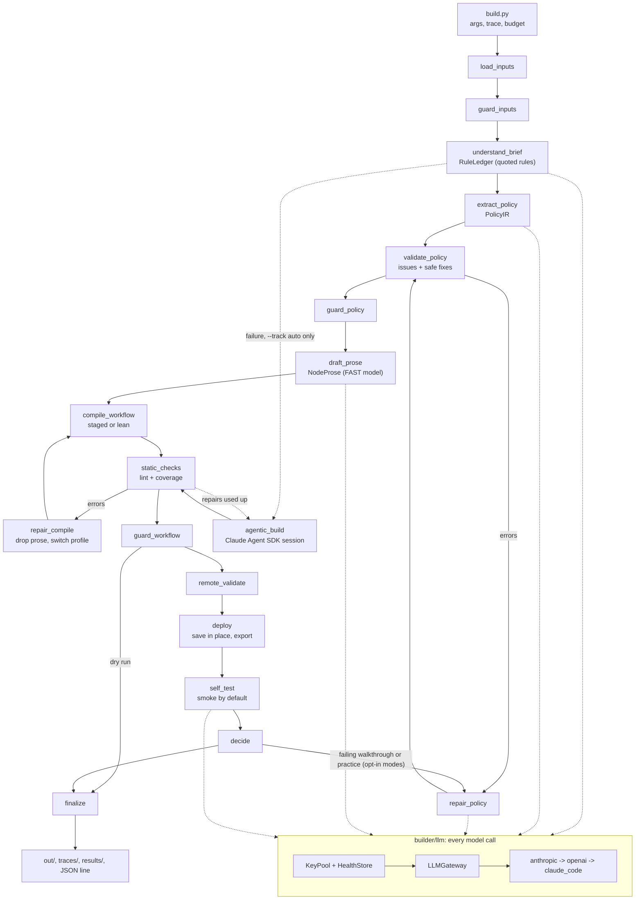

# Developer guide

For anyone who changes the builder. The README covers installation and running; this guide covers how the code is organised,
how data flows through it, how to extend it, and the rules that keep it legal for the hackathon.

1. [Principles](#1-principles)
2. [Module map](#2-module-map)
3. [Data flow](#3-data-flow)
4. [The main data types](#4-the-main-data-types)
5. [How to extend](#5-how-to-extend)
6. [Testing](#6-testing)
7. [Compliance rules](#7-compliance-rules)
8. [Working habits and gotchas](#8-working-habits-and-gotchas)
9. [Other documents](#9-other-documents)

## 1. Principles

* **The brief is data.** The builder reads a brief it has never seen. Every value that matters (limits, dates, holidays, outcome
  names, identity questions, sentences) travels as data through the policy IR. Code and prompt templates never contain one.
* **Models understand, code decides.** An LLM turns text into a *quoted rule ledger* and then a typed `PolicyIR`. From there on
  everything is deterministic: validation, the compiler, the checks. The LLM never writes the workflow on the compiled track.
* **Every rule has an owner.** Each ledger rule must map to a node, a code snippet or a hook (`rule_map`). The coverage report
  says which rule is not mapped anywhere. A mapped rule is placed, not proven: behaviour needs a test or a live run.
* **Never crash, always trace.** Every graph node catches its own errors. The trace is closed and one JSON line is printed whatever
  happens. Failures go to repair loops or to a fallback; only a guard can stop a build for good.
* **Few model calls.** The strong role reads the brief (ledger, extraction, repair); the fast role does the small jobs (prose,
  re-quotes, the optional walkthrough). Nothing calls an LLM that a function can answer.
* **Offline first.** The whole pipeline runs without keys against fixtures (`--fake-llm`), and the tests never touch the network.

## 2. Module map

```
builder/
  build.py              CLI: arguments, trace, wall-clock guard, graph run, the final JSON line
  _startup.py           stdlib-only start checks: supported interpreter (3.11-3.13), complete checkout, dependencies
  submission.py         prepares and checks the local submission draft (no git, no network)
  viz.py                Mermaid diagrams of the builder graph and of a compiled workflow (python -m builder.viz)
  inputs.py             classify arguments into briefs and the tool API file; choose the slot
  settings.py           Settings (pydantic-settings): .env + environment, every knob with a default and a description
  paths.py, budget.py   repository paths; the wall-clock Budget (deadline(), remaining(), allows_stage()) and STAGE_ESTIMATES_S
  trace.py              TraceWriter: the run log (.log/.jsonl), secret masking, the summary block; NullTrace for tests
  diagnostics.py        offline, credential-safe views of request traces and Freya engine events (playground and monitor)
  _compat.py            environment shims (a blocked native module on locked-down Windows machines); stdlib only

  ingest/               brief_loader.py (md, txt, pdf, mail-like text -> BriefBundle), tool_api.py (OpenAPI -> ToolApi)
  llm/                  the key changer: gateway.py (fallback loop), keys.py (discovery, KeyPool, HealthStore),
                        providers.py (Anthropic, OpenAI, Claude Code), errors.py (classification), structured.py, ratelimit.py
  observability/        jsonl.py (local prompt/reply log), langfuse_observer.py (optional), factory.py
  guardrails/           input_guard.py, output_guard.py (ledger, policy, prose, workflow), patterns.py, prompt_guard.py, models.py

  understand/           ledger.py (brief -> RuleLedger), extract.py (ledger -> PolicyIR), validate.py + fixes.py (checks and
                        safe repairs), repair.py (model repair), grounding.py (quotes and values must appear in the source),
                        prose.py (node prose drafting)
  policy/               ir.py (PolicyIR and RuleLedger models), calendar.py, money.py, outcomes.py, intents.py:
                        the reference semantics (business days, deadlines, amounts, outcome precedence, intent catalog)
  robustness.py         offline invariants sampled over any PolicyIR (informational)

  compiler/             compile.py (compile_workflow), profiles/staged.py and lean.py, codegen.py (Python snippets for code
                        nodes), hooks.py (tool pre/post hooks), toolset.py + tools.py (tool definitions), nodes.py (node and
                        transition constructors), naming.py + context.py (situations, prompt contexts), prose.py (NodeProse),
                        pycode.py (brace-free embedding), workflow_model.py (typed Freya workflow), layout.py (editor
                        nodePositions), roles.py (field roles from the tool contracts), phrasing.py, prompts.py, errors.py
  prompts/              versioned Jinja templates: understand/, extract/, repair/, compile/, audit/, agent/
  checks/               lint.py (rules L001-L029), code_sandbox.py (runs generated code), coverage.py (rule coverage)

  graph/                state.py, context.py, routing.py (pure), build_graph.py, nodes/ (one module per node)
  selftest/             smoke.py (chat), walkthrough.py (model audit), practice.py (the kit harness)
  agentic/runner.py     the Claude Agent SDK fallback track
  freya/                client.py (FreyaClient around the kit's freya.py), transport.py (deadline-bounded HTTP), background.py
                        (abandonable platform calls), practice.py, diff.py, kit.py, ratelimit.py

  testing.py            FixtureGateway (answers model calls from fixture files) and FakeFreya (in-memory platform)
  playground.py, playground_views.py, monitor_views.py   the Streamlit pages (streamlit_app.py at the repository root)

tests/
  unit/                 one file per module family; no network
  graph/                topology, routing, node and whole-graph runs with fakes
  variants/             structural variants of a hidden brief, compiled and run by an offline engine (engine.py)
  fixtures/policy/      brief_a / brief_ab ledger and IR JSON, hand-written (brief values live only in tests/ and evals/)
  fixtures/real_ir/     the accepted live builds' model-made IRs and ledgers (Brief A, A+B)
  fixtures/variants/    the model-made IR and ledger of the synthetic pack evals/synthetic_briefs/v01_clean
  conftest.py           autouse safety nets: disabled .env, cleared key variables, sockets to non-loopback hosts blocked
evals/                  reference/brief_a_ref.py (hand-authored 9/10 agent), triage.py (failure timelines)
tools/, freya.py, docs/workflow-format.md, docs/tools-and-code.md, docs/api.md, briefs/, examples/   organiser kit: never edit
```

## 3. Data flow



In words: **understand** (`understand/`) turns text into a `RuleLedger` and a `PolicyIR`; **validate** (`understand/validate.py`,
`guardrails/`) checks them against the tool API and the source text; the **compiler** (`compiler/`) turns the IR into a Freya workflow
dict with prompts, code nodes and hooks; **checks** (`checks/`) lint it, run its code in a sandbox and measure rule coverage; the
**Freya client** (`freya/`) validates, saves and exports it; **self-tests** (`selftest/`) probe it; in the opt-in modes their findings
can go back to the policy repair. The graph (`graph/`) owns control flow only; it contains no policy logic. Details per stage: `docs/GRAPH.md`,
`docs/UNDERSTANDING.md`, `docs/COMPILER.md`, `docs/GUARDRAILS.md`.

## 4. The main data types

| Type | Module | What it is |
|---|---|---|
| `Settings` | `settings.py` | all configuration; `get_settings()` |
| `InputBundle` | `inputs.py` | brief files, tool API file, slot |
| `BriefBundle`, `ToolApi` | `ingest/` | normalised brief text with line numbers; the tool API's tools, fields and enums |
| `RuleLedger`, `RuleEntry` | `policy/ir.py` | one entry per rule: id, scope, quote, summary, status (active / superseded), ambiguities |
| `PolicyIR` | `policy/ir.py` | the typed policy: calendar, bands, amounts, identity, intents, persuasion, third party, recording, closing rows, phrases, call variables |
| `PolicyIssue` | `understand/validate.py` | one validation finding with a stable `code`, severity and the rule ids it concerns |
| `NodeProse` | `compiler/prose.py` | optional model-written wording for four nodes (opening, third_party, identity, negotiate) |
| `CompiledWorkflow` | `compiler/compile.py` | `workflow` (dict in the kit format), `rule_map` (rule id to locations), `profile`, `notes` |
| `LintReport`, `CoverageReport` | `checks/` | findings by rule id (errors block); rules mapped (`covered`), `uncovered`, `superseded`, `dangling` |
| `GuardReport` | `guardrails/models.py` | violations of one guard stage |
| `BuilderState` | `graph/state.py` | what flows between graph nodes (JSON values only) |
| `LLMGateway`, `LLMCallResult` | `llm/gateway.py` | `await gw.structured(purpose=..., schema=Model, system=..., user=..., role=LLMRole.STRONG)` |

## 5. How to extend

Run the tests and `ruff check builder tests evals` (commands in section 6) after every step below. Each recipe lists what must change so
nothing is left half done.

### 5.1 Add an LLM provider

Full walk-through with a worked example: `docs/LLM_KEY_CHANGER.md` section 13. In short:

1. Write an adapter in `builder/llm/providers.py` (or a new module) with `name`, `model_for(role, settings)`, `async complete_text(...)`
   and `async complete_structured(...)`. No retries inside it (the gateway does that), SDK imports inside the methods, SDK exceptions
   propagate so that `classify_error` can classify them. When an SDK reports failure without raising, raise
   `ProviderError(message, kind=ErrorKind.X, ...)`.
2. Call `register_provider("name", Factory)`. Add `name` to `LLM_PROVIDERS` to put it in the chain.
3. Add `*_STRONG_MODEL` / `*_FAST_MODEL` fields in `settings.py` if the provider has its own models.
4. Tests with a fake SDK object in `tests/unit/test_llm_gateway.py` and `test_llm_errors.py` style. Never a real call.

### 5.2 Add or change a key source

Keys are found by `discover_keys(provider, env)` in `builder/llm/keys.py`: `P_API_KEY`, `P_API_KEY_1` to `_20`, `P_API_KEYS`. A new
provider `mistral` needs only `MISTRAL_API_KEY` in `.env`; list it in `.env.example`. Dead keys are tracked by fingerprint in
`HealthStore` (`data/key_health.json`). Keep key handling in `keys.py`; nothing else may read a key variable, and no code may print
one (use `ApiKey.label`, which is masked, and `scrub_secrets`).

### 5.3 Add a setting

Add a field with a default and a `description` to `Settings` in `builder/settings.py`, document it in `.env.example` (name, default,
purpose), and mention it in the README table if a user needs it. Tests run with a disabled `.env` and cleared setting variables, so a
test sets it with `monkeypatch.setenv` and builds `Settings()`.

### 5.4 Add an IR field

1. Add the field to `builder/policy/ir.py` with a **default** (old fixtures must stay valid) and a docstring.
2. Explain it generically in `builder/prompts/extract/policy_ir.v1.j2`. No brief values in the text. If it takes values from the tool
   API, add the vocabulary to `validate.tool_vocabulary`.
3. Add a check to `understand/validate.py` (one method per concern, a stable issue `code`, error or warning) and, if a mechanical fix is
   always safe, to `understand/fixes.py`.
4. Teach the compiler to use it: read it in the context builders of `compiler/profiles/staged.py` (and `lean.py`), render it in the
   template under `builder/prompts/agent/`, and record the rule ids with `self.rm(...)` so the coverage stays complete.
5. Update `tests/fixtures/policy/*.json` (hand-written IRs in the model's format; the IRs the model really produced for the
   accepted builds are in `tests/fixtures/real_ir/`, checked by `tests/unit/test_real_ir_compile.py`, and the synthetic
   structural variants are in `tests/fixtures/variants/` + `tests/variants/`) and add a failing and a passing case to
   `tests/unit/test_validate_policy.py` and `tests/unit/test_policy_ir.py`.

A new *intent* is cheaper: add it to `builder/policy/intents.py` (key, neutral description). The catalog only names what to detect;
behaviour comes from the brief.

### 5.5 Add a lint rule

1. In `builder/checks/lint.py` add a method `lNNN` to `_Linter` with the next free number. Take names and enums from the tool API and
   the workflow, never from a brief. Use `error` only for what the platform rejects or what silently breaks a call; use `warning`
   for style and size.
2. List it in `run`, in the module docstring table and in `RULES`.
3. Add one failing and one passing example to `tests/unit/test_lint.py`. The compiled kit workflows must still lint clean
   (`test_compile_staged.py::test_the_compiled_workflow_lints_clean`).
4. Add the row to the lint table in `docs/COMPILER.md`.

### 5.6 Add or change a code snippet (code node or hook)

Generated Python lives in `builder/compiler/codegen.py` (code nodes) and `hooks.py` (tool pre and post hooks).

1. Write a function that returns the source as a string. Embed data with `pycode.json_literal` (braces are written as `\x7b` and
   `\x7d`), build dicts with `dict()`, and finish with `pycode.assert_safe_code`. Platform rules for code: no `{{` or `}}` in the
   text, read everything from `vars`, never raise, no imports other than the allowed ones (`docs/tools-and-code.md`).
2. Money goes through `MONEY_FUNCS` (integer cents, half-up) and dates through the date table built by the `setup` snippet. Do not
   use floats for amounts or the real clock for dates; `now` is a call variable.
3. Wire it in `profiles/staged.py` with `code_node(name, snippet, next_node)` (or in `toolset.py` for a hook) and record the rules it
   enforces with `self.rm(rule_ids, "code:<name>")`.
4. Test it by running it: `from builder.checks.code_sandbox import run_snippet, run_hook`, then assert on the returned variables with
   literal expectations (see `tests/unit/test_codegen.py` and `test_hooks.py`). For amounts and dates also compare with the
   reference semantics in `policy/money.py` and `policy/calendar.py`.
5. `test_no_null_and_no_double_braces_in_code` checks every snippet of the compiled kit workflows for `{{`, `}}` and compilability.

### 5.7 Add a graph node, a guard or a self-test

* **Graph node.** Create `builder/graph/nodes/<name>.py` with `NAME` and `async def run(state, runtime)` (the body goes in
  `_body(state, ctx)` and runs inside `_common.run_node`). Register it in `nodes/__init__.py`, add its router and its possible targets to
  `routing.ROUTERS` (or a plain edge to `routing.STATIC_EDGES`; `build_graph.py` derives the graph from those two tables), and update
  `tests/graph/test_topology.py`. Every node that can fail needs an edge to `finalize`.
  Update the node table and the topology picture in `docs/GRAPH.md`.
* **Guard.** Follow "How to add a guard" in `docs/GUARDRAILS.md`: stable guard id, block only what is provably wrong, thresholds from
  the inputs, a clean test and a seeded-defect test.
* **Self-test.** Add a module under `builder/selftest/`, return findings in the shape the `decide` node reads, and give the mode a
  time estimate in `STAGE_ESTIMATES_S` (`builder/budget.py`) so the budget logic can skip it.

### 5.8 Change or add a prompt

Templates are `builder/prompts/<area>/<name>.v<N>.j2`. Callers name the file, version included, and render it with `render_prompt` or
`render_prompt_parts` (the latter needs a `system` and a `user` block; strict undefined: a missing variable raises). When a prompt changes
meaning, add a `.v2.j2` file and switch the caller, so that earlier traces and LLM logs can still be matched with the prompt that
produced them (`prompt_id(name)` gives the short id). Templates never hold brief values; pass them in as context. The templates in
`agent/` use the delimiters `<< >>`, `<% %>` and `<# #>` because the agent text contains literal `{{variable}}` references for the
platform. Any prompt change needs a test with a literal expectation (`test_prompts_prose.py`, `test_understand_fake_llm.py`).

### 5.9 Add a new compiler profile or mechanism

See `docs/COMPILER.md` section 11. A profile subclasses `ProfileBuilder` and is registered in `compile.compile_workflow`; the lint
and coverage tests must pass for it unchanged.

## 6. Testing

```sh
.venv/Scripts/python.exe -m pytest tests -p no:cacheprovider   # everything offline (3,380 passed and 4 xfail on 11 October)
.venv/Scripts/python.exe -m pytest tests/unit/test_codegen.py
.venv/Scripts/python.exe -m pytest tests/graph
.venv/Scripts/python.exe -m ruff check builder tests evals
```

`pyproject.toml` already sets `-q` in `addopts`; a second `-q` hides the summary line. On Linux or macOS use `.venv/bin/python`,
or `uv run` in front of `pytest` / `ruff`.

* **No network, no keys.** `tests/conftest.py` disables `.env`, clears every setting and key variable, and fails any test that opens a
  socket to a non-loopback host. Only `@pytest.mark.live` tests may talk to Freya or an LLM, and none exist for the automated
  suite. Do not add a live test that runs by default.
* **Fakes.** `builder.testing.FixtureGateway` answers model calls from JSON fixtures; `FakeFreya` is an in-memory platform. For the
  graph use the `make_ctx` helper of `tests/graph/conftest.py`; it defaults to the compiled track and isolates the key-health file, so a
  test cannot start a real agentic session or mark a real key dead. A test that wants the fallback passes an `agentic_runner` fake.
* **Literal expectations.** Assert on explicit values (a date, an amount, an outcome and reason), not on a second implementation of
  the same logic. Never weaken a test to make it pass; fix the code.
* **Brief values live in tests only.** `tests/fixtures/policy/` holds the Brief A and A+B ledgers and IRs; tests that check calendar
  facts name the dates there.
* **Parity with the reference.** `test_compile_staged.py::test_structure_matches_the_validated_reference` compares the compiled
  structure with `evals/reference/brief_a_ref.py` (node types and role-level transitions). If the reference moves, follow it in the
  compiler.
* **Live checks are manual.** After a change that affects the deployed agent, run a build, then `tools/run_cases.py` (README,
  "Development commands"), then `evals/triage.py` on the failures.

## 7. Compliance rules

These come from the hackathon and are enforced by tests where possible.

1. **Nothing brief-specific in `builder/`.** No holiday dates, bank or customer names, sentences of a brief, outcome names of a bank as
   constants, no product or identity field names of one brief. `tests/unit/test_compliance.py` scans the whole package and
   `test_compile_staged.py::test_the_compiler_sources_hold_no_brief_specific_values` scans the compiler more strictly. Generic
   situation keys of the internal taxonomy (`flat_refusal`, `callback_booked`, ...) are fine; they describe the builder's own model, not a bank's.
2. **Values come from the brief and the tool API.** Allowed values of tool fields come from `ToolApi`; thresholds, dates and wording
   from `PolicyIR`. The guards (`guardrails/output_guard.py`) block an IR value that the briefs do not contain.
3. **Do not edit the kit.** `freya.py`, `tools/`, `docs/workflow-format.md`, `docs/tools-and-code.md`, `docs/api.md`, `briefs/`, `examples/`,
   `public-test-set.json` and `KIT_README.md` are the organisers' files.
4. **The agent calls only the bank's tool API** and uses the platform-set model. The builder never sets `FREYA_AGENT_PROVIDER` or
   `FREYA_AGENT_MODEL` and never puts `agent_config` in a workflow.
5. **No manual step and no hand edit** of a created agent. Update in place through the slot; do not create a workflow per run.
6. **No load-testing** of the platform. Freya calls are paced (`FREYA_MIN_INTERVAL_S`); one simulation at a time.
7. **No secrets in the repository or the trace.** `.env`, `env.sh` and `data/key_health.json` are never committed. All traces are masked.
8. **A trace per run**: start and end, every model call with a one-line purpose, what was created on Freya, tests and results. The
   builder writes it automatically; keep that true when adding a stage (use `trace.stage(...)` through `run_node`, and pass a `purpose`
   to every gateway call).
9. **Time budget**: 30 minutes per brief including self-tests. New stages declare an estimate in `STAGE_ESTIMATES_S` so the budget logic can skip them.
10. **Synthetic data only.**

## 8. Working habits and gotchas

* **Git is the user's.** Do not run commands that change the repository from tools or scripts.
* **Files and encodings.** Python files use LF endings and UTF-8. Some editors' file-writing tools produce CRLF on Windows; normalise
  before committing. `.gitattributes` is present.
* **Shell escapes.** Backslash sequences inside shell heredocs can be interpreted before they reach Python. Edit files with an editor
  tool, or build such characters with `chr()`.
* **Script start.** `builder/build.py` removes `builder/` from `sys.path` and inserts the repository root, because `builder/freya/` would
  shadow the kit's `freya.py` and `builder/trace.py` would shadow the standard library's `trace` module. Do not rename around this;
  a subprocess test covers it.
* **Masked labels.** `gw.describe()` and key labels include the last four characters of a key. Do not echo them in logs you share.
* **Dead logins.** If a run marked the `claude_code` login dead, `data/key_health.json` keeps that for six hours. Delete the file
  after `claude login`.
* **Formatting.** The graph part was formatted with `ruff format`; the rest of the repository is not. Do not reformat unrelated files in
  a feature change.
* **Open items** worth knowing before a change are in [FIXING_ISSUES.md](FIXING_ISSUES.md). The platform behaviours the compiler
  relies on, verified and not, are listed in `docs/COMPILER.md` section 10. The automated suite never calls Freya or a model;
  live evidence is in `results/BASELINE.md`.

## 9. Other documents

| Topic | Document |
|---|---|
| Installation, running, submission | `README.md` |
| Graph, state, routing, self-tests | `docs/GRAPH.md` |
| Rule ledger, grounding, IR extraction, validation | `docs/UNDERSTANDING.md` |
| Compiler, profiles, rule mapping, lint rules | `docs/COMPILER.md` |
| Guards | `docs/GUARDRAILS.md` |
| Key changer | `docs/LLM_KEY_CHANGER.md` |
| Traces, LLM log, Langfuse, rate limits | `docs/OBSERVABILITY.md` |
| Platform reference (organisers) | `docs/workflow-format.md`, `docs/tools-and-code.md`, `docs/api.md`, `KIT_README.md` |
| Hackathon rules and research notes | `docs/research/11_hackathon_rules_and_kit.md`, `docs/research/12_tau_tau_bench_lessons.md`, `docs/research/13_brief_rule_mechanism_map.md` |
| How the pieces fit together | `docs/HOW_IT_WORKS.md` |
| Known defects and their status | `docs/FIXING_ISSUES.md` |
| Submission procedure | `docs/SUBMISSION.md` |
| Early planning (historical; superseded where they disagree) | `docs/ARCHITECTURE.md`, `docs/IMPLEMENTATION_PLAN.md`, `docs/TASKS.md`, `docs/FOLDER_STRUCTURE.md` |
