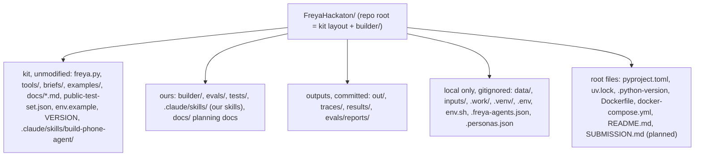
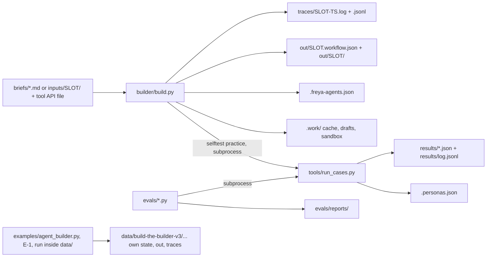
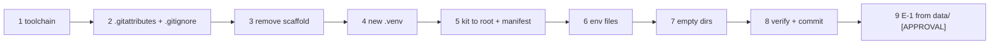

# FOLDER_STRUCTURE: repository layout of the Freya builder

> **Status: historical planning document (Oct 10); the as-built system is described in [HOW_IT_WORKS.md](HOW_IT_WORKS.md).**
> Open defects are in [FIXING_ISSUES.md](FIXING_ISSUES.md), measured results in
> [results/BASELINE.md](../results/BASELINE.md), the submission procedure in [SUBMISSION.md](SUBMISSION.md). Where this
> document and the code disagree, the code wins. Differences that matter most: the defaults are `BUILDER_TRACK=compiled`
> and `SELF_TEST=smoke` (not `auto`); lint rules run L001 to L029; the platform export is written to
> `out/<slot>.exported.json` (`out/<slot>.workflow.json` is the definition that was sent) and is copied to
> `submission/hidden-N.workflow.json` for the form; the planned `tests/compliance/` folder does not exist (the check is
> `tests/unit/test_compliance.py`).

Status: plan for the repository after phase P0 (kit copied to the root). Single source of truth: decisions brief v2
(brief §4 graph node names, brief §5 repo layout, ADR-01..ADR-16). This document expands brief §5 to file level. It
renames nothing. Everything it adds beyond brief §5 is marked **(added)** and listed in
[Appendix A](#appendix-a-additions-to-brief-5).

Kit location: the organizer kit v3 is extracted today at `data/build-the-builder-v3/build-the-builder/`. P0 copies it to
the repo root (ADR-02), so kit docs end up next to this file: [workflow-format.md](workflow-format.md),
[tools-and-code.md](tools-and-code.md), [api.md](api.md). Links in this document point to those post-P0 locations. Until
P0 has run, read them under `../data/build-the-builder-v3/build-the-builder/docs/`.

Companion documents: [ARCHITECTURE.md](ARCHITECTURE.md), [IMPLEMENTATION_PLAN.md](IMPLEMENTATION_PLAN.md),
[TASKS.md](TASKS.md). Rules and scoring: [11](research/11_hackathon_rules_and_kit.md). Design principles P1–P8:
[12](research/12_tau_tau_bench_lessons.md).

Legend used throughout:

| Mark | Meaning |
|---|---|
| (kit, unmodified) | Byte-identical copy of a kit v3 file. Never edited. Checked by `tests/compliance/test_kit_unmodified.py` |
| (added) | Not named in brief §5; introduced by this document (Appendix A) |
| (gitignored) | Exists locally only; never committed |
| (committed for submission) | Must be in the submitted commit (README "The final", [11](research/11_hackathon_rules_and_kit.md) §5) |
| **[UNVERIFIED]** + E-n / Q-n / T-check | Claim not yet confirmed; the experiment, question or task named settles it |

## Contents

1. [Annotated repository tree (after P0)](#1-annotated-repository-tree-after-p0)
   - [1.1 Root and kit files](#11-root-and-kit-files)
   - [1.2 builder/](#12-builder)
   - [1.3 builder/graph/nodes/: one module per graph node](#13-buildergraphnodes-one-module-per-graph-node)
   - [1.4 builder/prompts/](#14-builderprompts)
   - [1.5 tests/](#15-tests)
   - [1.6 evals/](#16-evals)
   - [1.7 Output, state and local-only directories](#17-output-state-and-local-only-directories)
2. [Package responsibilities and import rules](#2-package-responsibilities-and-import-rules)
3. [Naming conventions](#3-naming-conventions)
4. [Root files explained](#4-root-files-explained)
5. [Generated and runtime artifacts](#5-generated-and-runtime-artifacts)
6. [P0 migration from the current state](#6-p0-migration-from-the-current-state)
7. [Where does X live?](#7-where-does-x-live)
8. [docs/ index](#8-docs-index)
- [Appendix A. Additions to brief §5](#appendix-a-additions-to-brief-5)

---

## 1. Annotated repository tree (after P0)

Top-level map:



### 1.1 Root and kit files

```text
FreyaHackaton/                                 repo root = kit layout + builder/ (ADR-02)
├── README.md                                  ours: what the builder does, run command, setup, Docker, tests, compliance
├── SUBMISSION.md                              ours: submission form template, filled in P7 (M4); not yet written (planned for P6)
├── VERSION                                    (kit, unmodified) kit version, "3"; a bump triggers the re-sync (RK-11, §6.4)
├── freya.py                                   (kit, unmodified) stdlib Freya client: api(), save/validate/update/export_workflow,
│                                              create_personas, run_simulation, get_iteration, get_call, AGENT_LLM
├── public-test-set.json                       (kit, unmodified) 13 practice cases PUB-01..PUB-13 (brief A: 01-10, brief B: 11-13)
├── env.example                                (kit, unmodified) kit template for env.sh (export lines) used by kit tools
├── .env.example                               ours: every variable the builder reads, names only (§4.9)
├── .python-version                            "3.13" (uv, Docker)
├── pyproject.toml                             project metadata, dependencies, dev group, ruff and pytest config (§4.1)
├── uv.lock                                    exact resolved versions, committed (§4.2)
├── (no requirements.txt)                      not created: uv.lock is the only lock file (§4.2)
├── Dockerfile                                 python:3.13-slim-trixie + pinned uv; ENTRYPOINT python3 builder/build.py (§4.4)
├── docker-compose.yml                         services builder and tests (§4.5); Langfuse stack in docker-compose.langfuse.yml
├── .dockerignore                              keeps secrets, venvs, state files and outputs out of the image (§4.6)
├── .gitignore                                 existing Python template + project section (§4.7)
├── .gitattributes                             LF line endings everywhere, binary types (§4.8)
│
├── .claude/
│   └── skills/
│       ├── build-phone-agent/
│       │   └── SKILL.md                       (kit, unmodified) skill of examples/agent_builder.py; used for the E-1 baseline only
│       ├── collections-workflow-patterns/     ours: knowledge skill for the agentic track (ADR-03)
│       │   ├── SKILL.md                       front matter + when to use + index of the reference files
│       │   └── (references/ planned; not created: the skill is one SKILL.md)
│       └── build-collections-agent/           planned, not created
│           └── SKILL.md                       read every input file, list rules, write the draft workflow to the given path, run the linter
│
├── briefs/                                    (kit, unmodified)
│   ├── brief-a.md                             practice brief A (one product)
│   └── brief-b.md                             practice brief B (up to three products; amends A)
├── examples/                                  (kit, unmodified)
│   ├── base-agent.json                        two-node example agent; reference for valid workflow JSON
│   └── agent_builder.py                       example builder (Claude Agent SDK + kit skill); E-1 baseline and model for builder/agentic/
├── tools/                                     (kit, unmodified)
│   ├── openapi.json                           tool API of the practice briefs (7 tools); hidden briefs bring their own file
│   ├── run_cases.py                           official practice harness: personas, chat simulation, ledger + judge, --reps, --style
│   └── score.py                               ledger scoring (score_ledger) and the mock-bank HTTP helper (needs FREYA_BANK_TEAM_KEY)
│
├── docs/
│   ├── ARCHITECTURE.md                        ours: two planes, builder graph, PolicyIR, phone-agent profiles, ADRs
│   ├── FOLDER_STRUCTURE.md                    ours: this file
│   ├── IMPLEMENTATION_PLAN.md                 ours: phases P0..P7, milestones M1..M4, experiments E-1..E-8
│   ├── TASKS.md                               ours: task list per phase, status at each sync
│   ├── COMPILER.md                            ours: compiler, profiles, code-node snippets, hooks
│   ├── UNDERSTANDING.md                       ours: understanding layer, rule ledger, PolicyIR extraction, validation, repair
│   ├── GRAPH.md                               ours: LangGraph builder, nodes, routing, state, trace events
│   ├── DEVELOPER_GUIDE.md                     ours: module map, how to add a provider, IR field or lint rule; tests
│   ├── LLM_KEY_CHANGER.md                     ours: key changer (builder/llm), provider order, error classes, health file
│   ├── GUARDRAILS.md                          ours: guard flow and rate limits
│   ├── OBSERVABILITY.md                       ours: LLM logging (JSONL always, Langfuse when keys are set)
│   ├── KIT_README.md                          (kit, unmodified content) kit README.md, relocated because README.md at root is ours (added)
│   ├── api.md                                 (kit, unmodified) REST calls a builder needs
│   ├── workflow-format.md                     (kit, unmodified) workflow JSON: nodes, prompts, variables, transitions, extraction
│   ├── tools-and-code.md                      (kit, unmodified) api_call tools, pre_actions, response_mapping, hooks, code nodes
│   └── research/
│       ├── 01_freya_config_reference.md … 10_chat_eval_harness.md     background, partially superseded (§8)
│       ├── 11_hackathon_rules_and_kit.md      authoritative rules, scoring, timeline
│       ├── 12_tau_tau_bench_lessons.md        paper lessons, principles P1–P8
│       ├── 13_brief_rule_mechanism_map.md     Brief A and B rule → mechanism map (where each rule is enforced)
│       └── data/                              JSON snapshots taken during research (base workflow, agent defaults, model catalog, UI strings)
│
├── builder/                                   the builder package (§1.2)
├── evals/                                     dev harness (§1.6)
├── tests/                                     test suite (§1.5)
├── out/                                       exports + run artifacts (committed for submission) (§1.7)
├── traces/                                    one trace pair per build run (committed for submission) (§1.7)
├── results/                                   run_cases outputs, log.jsonl, BASELINE.md (committed) (§1.7)
│
├── data/ (gitignored) kit zip + pristine extracted kit; E-1 runs here (§6); key_health.json (LLM dead keys, §12.2)
├── state/                                     (gitignored) Docker state directory: .freya-agents.json, .personas.json (§1.7)
├── inputs/                                    (gitignored) (added) hidden brief inputs, inputs/<slot>/ (§1.7)
├── .work/                                     (gitignored) (added) run scratch: LLM cache, agentic drafts, sandbox temp (§1.7)
├── .freya-agents.json                         (gitignored) slot → workflow_id/agent_id/version, written by freya.save_workflow
├── .personas.json                             (gitignored) case hash → persona id, written by tools/run_cases.py
├── .env                                       (gitignored) local secrets (§4.9); this repo has no env.sh
└── .venv/ .idea/ .junie/                      (gitignored) local Python 3.13 venv, IDE settings, IDE agent plans
```

### 1.2 builder/

Entry: `python3 builder/build.py <brief>... <tool_api>` (brief §0, R8). The project is run from source, not installed
(§4.1), so `build.py` puts the repo root on `sys.path` (as `tools/run_cases.py` does) before importing `builder.*` and
the root `freya.py`.

```text
builder/
├── __init__.py          package marker; no import-time side effects
├── build.py             ENTRY: argv → inputs, settings, graph run, summary line, exit code
│                        flags: --slot --track --profile --self-test --budget-s --dry-run --fake-llm DIR
├── _compat.py           small compatibility helpers
├── budget.py            deadline arithmetic, stage estimates, skip decisions (ADR-13)
├── inputs.py            classify argv (tool API file vs briefs), slot derivation, sha256 per file
├── paths.py             repo, output, trace, result and data paths
├── settings.py          pydantic-settings: env + .env → Settings; key aliases; apply_kit_env; secret_values
├── trace.py             TraceWriter: .log (text) + .jsonl (events), secret redaction, flush per event
├── testing.py           test doubles shared by the tests (fake LLM, fake Freya)
├── robustness.py        bounded offline checks of supplied policy data (invariant sampler)
├── diagnostics.py       read-only trace and engine-event views (development)
├── playground.py        session-scoped adapters for the Streamlit playground (development)
├── playground_views.py  playground page helpers (development)
├── monitor_views.py     Streamlit monitor helpers (development)
│
├── graph/               LangGraph builder
│   ├── build_graph.py   StateGraph from the routing tables; build_graph(); edge_list() for the topology test
│   ├── context.py       BuilderContext (settings, LLM gateway, Freya client, trace, budget)
│   ├── routing.py       pure routing functions; ROUTERS and STATIC_EDGES tables
│   ├── state.py         BuilderState (JSON-serialisable TypedDict)
│   └── nodes/           one module per node (§1.3); _common.py holds the shared span and trace helpers
│
├── ingest/              brief_loader.py (md, txt, eml, csv, json, pdf, html → BriefDocument); tool_api.py (OpenAPI → ToolContract)
├── understand/          ledger.py, extract.py, validate.py, grounding.py, repair.py, prose.py (node prose), fixes.py, _common.py
├── policy/              pure, no I/O: ir.py (PolicyIR), intents.py (catalog), calendar.py, money.py, outcomes.py (compute_outcome)
├── compiler/            pure: workflow_model.py, tools.py, hooks.py, codegen.py, nodes.py, toolset.py, prompts.py, prose.py,
│                        compile.py, naming.py, pycode.py, errors.py, context.py; profiles/staged.py, profiles/lean.py
├── checks/              lint.py (rules L001–L029, incl. reachability and variable rules), code_sandbox.py, coverage.py
├── freya/               client.py (validate, save, get, export, chat, call), diff.py (stripped-field check), kit.py (loads the
│                        root freya.py), practice.py (kit practice harness), ratelimit.py (polite client)
├── llm/                 key changer (ADR-14): gateway.py (LLMGateway), providers.py (anthropic, openai, claude_code),
│                        keys.py (keys, pools, health file), errors.py (error classes → actions), structured.py (schemas,
│                        JSON parsing), ratelimit.py (token buckets, slots)
├── guardrails/          input_guard.py, prompt_guard.py, output_guard.py, patterns.py, models.py (GuardReport)
├── observability/       base.py (observer protocol), jsonl.py (always on), langfuse_observer.py (when keys are set), factory.py
├── selftest/            smoke.py, walkthrough.py (fast-role audit), practice.py (kit practice run when the brief matches)
├── agentic/             runner.py (Claude Agent SDK fallback track)
├── prompts/             Jinja templates: agent/, audit/, compile/, extract/, repair/, understand/ (§1.4)
│
└── not built (planned in earlier drafts): checks/reachability.py, checks/variables.py, checks/coverage_map.py,
    freya/deploy.py, freya/chat.py, freya/simulate.py, freya/calls.py, ingest/segmenter.py, agentic/skills_sync.py,
    llm/factory.py. Their jobs live in lint.py, coverage.py, freya/client.py and the graph nodes.
```

### 1.3 builder/graph/nodes/: one module per graph node

| Module | Job |
|---|---|
| `load_inputs.py` | classify and read the brief files and the tool API; derive the slot |
| `guard_inputs.py` | input guard: size, control characters, injection heuristics over the brief text |
| `understand_brief.py` | rule ledger from all documents (strong role) |
| `extract_policy.py` | PolicyIR from the ledger and the tool contracts (strong role) |
| `validate_policy.py` | schema, grounding, coverage and contract checks → policy issues |
| `repair_policy.py` | bounded IR repair from issues or self-test findings |
| `guard_policy.py` | output guard on the IR: literals, enums, injection markers |
| `draft_prose.py` | node task messages (fast role; template-only fallback) |
| `compile_workflow.py` | IR + contracts → workflow JSON for the profile |
| `static_checks.py` | lint, code sandbox, coverage |
| `repair_compile.py` | compile-level repair (another profile, no prose) |
| `guard_workflow.py` | workflow guard: bank host only, secret-like tokens, forbidden words before verification |
| `remote_validate.py` | Freya dry run (stores nothing) |
| `deploy.py` | save and publish, read-back diff, export |
| `self_test.py` | smoke, walkthrough and practice within the budget |
| `decide.py` | findings and remaining time → repair or finish (routing only) |
| `agentic_build.py` | Agent SDK writes a candidate workflow (fallback track) |
| `finalize.py` | final status, summary, close the trace files |

The graph has 18 node modules. The routing tables in `graph/routing.py` are the only place where the edges are declared;
`tests/graph/test_topology.py` compares them with this table.

### 1.4 builder/prompts/

```text
builder/prompts/
├── agent/        system_prompt, opening, third_party, identity, negotiate, lean (*.v1.j2): phone-agent text from the IR
├── audit/        walkthrough.v1.j2: the walkthrough audit (fast role)
├── compile/      node_prose.v1.j2: node task messages (fast role)
├── extract/      policy_ir.v1.j2: PolicyIR extraction (strong role)
├── repair/       policy_repair.v1.j2: IR repair from issues or findings
└── understand/   rule_ledger, ledger_complete, ledger_reconcile, ledger_requote (*.v1.j2): rule ledger passes
```

### 1.5 tests/

```text
tests/
├── conftest.py          repo paths, fake LLM and Freya doubles, network guard
├── fixtures/policy/     brief_a_ir.json, brief_ab_ir.json, brief_a_ledger.json, brief_ab_ledger.json (fixtures for the two briefs)
├── graph/               test_topology, test_routing, test_dry_run, test_graph_runs, test_nodes, test_selftest, test_agentic,
│                        test_testing_doubles
└── unit/                one file per module family: settings, trace, budget, inputs, brief loader, tool API, calendar, money,
                         outcomes, PolicyIR, code sandbox, codegen (+ calendar parity), compile (staged, lean, lessons), hooks,
                         tools, workflow model, lint, coverage, understand (fake LLM), grounding, validate policy, LLM (errors,
                         gateway, keys, ratelimit, structured), Freya (client, diff, practice, ratelimit), guardrails (input,
                         output, prompt), observability, robustness, diagnostics, playground, Streamlit, build CLI, prompts and
                         prose, and compliance (no brief literal in builder/)
```

Not yet: the kit-manifest check (`tests/fixtures/kit_manifest.sha256`) and the live tests (`-m live`).

### 1.6 evals/

```text
evals/
├── reference/brief_a_ref.py   hand-authored reference phone agent for Brief A and B: --write, --validate, --deploy
│                              (dev fixture, never submitted; findings in ARCHITECTURE §9.12)
├── reference/out/             ref-a.workflow.json, ref-ab.workflow.json (written by --write)
└── triage.py                  failure triage: a tools/run_cases.py --out file → the Freya call timeline of each failed case
```

Results of the runs are in `results/` (for example `ref_a_v4_reps3.log`, `ref_ab_v5_reps3.log`); the baseline is in
`results/BASELINE.md`.

### 1.7 Output, state and local-only directories

```text
out/                                       committed; P7 files are part of the submission
├── .gitkeep
├── brief-a.workflow.json                  export by freya.export_workflow: {workflow_id, agent_id, updated_at, workflow}
├── brief-a/                               run artifacts of the latest brief-a build (overwritten per run; history in git)
│   ├── sent.workflow.json                 the exact workflow dict deploy sent
│   ├── readback.diff.json                 fields the platform dropped or changed on save (RK-12)
│   ├── rule_ledger.json   supersessions.json   ambiguities.json   policy_ir.json
│   ├── coverage.json                      segment → rule → mechanism, with gaps
│   └── lint.json   sandbox.json   selftest.json
├── brief-ab.workflow.json   brief-ab/
├── hidden-1.workflow.json   hidden-1/     (committed for submission)
└── hidden-2.workflow.json   hidden-2/     (committed for submission)

traces/                                    committed; one pair per build run
├── .gitkeep
├── brief-a-20261010T213512Z.log           example name; plain-text trace (the submitted format)
├── brief-a-20261010T213512Z.jsonl         same run, one JSON event per line
└── hidden-1-<UTC ts>.log / .jsonl         (committed for submission)

results/                                   committed
├── .gitkeep
├── BASELINE.md                            E-1 table (P0 exit)
├── log.jsonl                              appended by tools/run_cases.py, one line per invocation
└── <slot>-<style|plain>-r<reps>-<UTC ts>.json   run_cases --out files (§3.4)

inputs/            (gitignored) inputs/hidden-1/, inputs/hidden-2/: hidden brief files + tool API as received
.work/             (gitignored) cache/<sha>/ (dev LLM cache), <run_id>/ (agentic drafts, context, sandbox temp)
data/              (gitignored) build-the-builder-v3.zip + build-the-builder-v3/ (pristine kit)
```

---

## 2. Package responsibilities and import rules

Allowed dependency directions (an arrow means "may import"; type-only edges such as `selftest/` → `understand/` are
left out of the diagram, the table is authoritative):

```mermaid
flowchart TD
  build["builder/build.py"] --> settings["settings.py"]
  build --> inputs["inputs.py"]
  build --> graph["graph/"]
  build --> trace["trace.py"]
  build --> budget["budget.py"]
  graph --> ingest["ingest/"]
  graph --> understand["understand/"]
  graph --> policy["policy/"]
  graph --> compiler["compiler/"]
  graph --> checks["checks/"]
  graph --> freyapkg["freya/"]
  graph --> selftest["selftest/"]
  graph --> agentic["agentic/"]
  graph --> llm["llm/"]
  understand --> llm
  understand --> policy
  understand --> ingest
  understand --> prompts["prompts/"]
  compiler --> policy
  compiler --> ingest
  compiler --> prompts
  checks --> compiler
  checks --> policy
  checks --> understand
  selftest --> freyapkg
  selftest --> llm
  selftest --> compiler
  selftest --> prompts
  agentic --> llm
  agentic --> checks
  agentic --> prompts
  llm --> trace
  llm --> settings
  freyapkg --> rootfreya["root freya.py (kit)"]
  freyapkg --> settings
```

| Package | Responsibility | May import (inside builder/) | Must not import | Side effects allowed |
|---|---|---|---|---|
| `build.py` | Thin entry: sys.path, argv, Settings, Context, invoke graph, print summary, exit code. Target ≤ 80 lines | `settings`, `inputs`, `errors`, `trace`, `budget`, `graph` | every other package directly | stdout/stderr, exit code |
| `settings.py` | Env → typed Settings; FREYA_KEY alias; export env for kit modules | `errors` | any other builder module | reads env and `.env`; writes `os.environ` (alias export only) |
| `inputs.py` | Classify argv, expand directories, sha256, slot | `settings`, `errors` | all other builder packages | reads file heads |
| `budget.py` | Deadline arithmetic | none | all | wall clock (injectable) |
| `trace.py` | Trace files, redaction | `settings` | everything else (others import trace, never the reverse) | writes `traces/` |
| `errors.py` | Exception types | none | all | none |
| `graph/` | Orchestration only: state, context, topology, routing, node functions. Nodes do not import each other | all builder packages | root `freya` (go through `builder/freya`), `tools/*`, `examples/*` | via callees; `deploy` and `finalize` write `out/<slot>/` |
| `ingest/` | Read input files, segment, OpenAPI → ToolContract | `errors` (+ stdlib email/csv/json, pypdf, pyyaml, pydantic) | `llm`, `freya`, `understand`, `compiler`, `graph` | reads input files |
| `understand/` | Ledger, IR extraction, grounding, coverage, repair | `llm`, `policy`, `ingest`, `prompts`, `errors` | `freya`, `compiler`, `checks`, `selftest`, `graph` | model calls through `llm/` only |
| `policy/` | IR model + pure reference logic (calendar, money, outcomes, intents) | `errors` | every other builder package | none: no I/O, no network, no wall clock |
| `compiler/` | IR + contracts → workflow dict + mechanism map | `policy`, `ingest` (ToolContract type), `prompts` (registry), `errors` | `llm`, `freya`, `understand`, `checks`, `selftest`, `agentic`, `graph` | none except reading package templates |
| `checks/` | Static checks, local code sandbox, coverage map | `compiler`, `policy`, `ingest`, `understand` (RuleLedger type), `errors` | `llm`, `freya`, `graph` | subprocess sandbox in a temp dir under `.work/` |
| `freya/` | The only Freya HTTP, always via root `freya.py` | `settings`, `errors`, root `freya` | `llm`, `compiler` (takes plain dicts), `policy`, `understand`, `graph` | network to Freya; writes `.freya-agents.json` and `out/<slot>.workflow.json` through kit functions |
| `selftest/` | Smoke, walkthrough, practice | `freya`, `llm`, `compiler.workflow_model`, `understand` (types), `policy`, `prompts`, `errors` | root `freya`, `graph`; `tools/run_cases.py` by import (subprocess only) | network via `freya/`, model calls via `llm/`, subprocess |
| `agentic/` | Agentic track run and its skills | `llm` (`providers.py`, `claude_code`), `checks`, `compiler.workflow_model`, `prompts`, `errors` | `freya` (deploy stays in the graph, same gates), `graph` | writes `.work/<run_id>/` |
| `llm/` | The only model API calls; trace callback | `settings`, `trace`, `prompts`, `errors` | `graph`, `freya`, `policy`, `compiler`, `understand` | network to Anthropic / Claude CLI; `.work/cache/` when caching is on |
| `prompts/` | Templates + registry | `errors` | everything else | reads templates |

Rules that the table implies, stated once:

- **Pure** (`policy/`, `compiler/`): deterministic, no network, no model calls, no file writes, no `datetime.now()`.
  `compiler/` may read its own templates through `prompts/registry.py`. Phone-agent dates always derive from the `now`
  call variable at run time (brief §1); the builder never bakes a build-time date into a workflow.
- **Wall clock**: only `budget.py` and `trace.py` read it.
- **Root `freya.py`** is imported only by `builder/freya/client.py`, lazily, after `settings.py` has exported
  `FREYA_API_KEY` and `FREYA_API_URL`: `freya.py` builds its `URL` and `HEADERS` at import time.
- **Kit scripts** (`tools/run_cases.py`, `tools/score.py`, `examples/agent_builder.py`) are run as subprocesses, never
  imported, so a kit update cannot break builder imports (RK-11).
- **File writers** inside `builder/`: `trace.py` (`traces/`), `freya/` via kit functions (`.freya-agents.json`,
  `out/<slot>.workflow.json`), `graph/nodes/deploy.py` and `graph/nodes/finalize.py` (`out/<slot>/`), `checks/code_sandbox.py`,
  `agentic/` and `llm/structured.py` (`.work/`). Nothing else writes files.
- Enforcement: `tests/compliance/test_import_rules.py` parses every module with `ast` and checks its imports against this table.

---

## 3. Naming conventions

### 3.1 Builder modules and graph nodes

- Module name = graph node name = exported function name: `builder/graph/nodes/validate_policy.py` exports
  `validate_policy(state, runtime)`, registered as `add_node("validate_policy", validate_policy)`. The 14 names are those
  of brief §4; no aliases.
- Edge functions in `graph/routing.py` are named `route_after_<node>`.
- Python: snake_case modules and functions, PascalCase Pydantic models (`PolicyIR`, `RuleLedger`, `ToolContract`,
  `BuilderState`), UPPER_CASE constants. No brief-derived constants at all (ADR-16).

### 3.2 Prompt templates

- File: `builder/prompts/<family>/<name>.v<N>.j2`, e.g. `understand/rule_ledger.v1.j2`. Partials: `_<name>.v<N>.j2`.
- Template id: `<family>/<name>@v<N>`. The trace records the id and `sha256[:12]` of the rendered template source for
  every model call (ADR-13).
- A behavioural change makes a new file (`v2`); the old version stays until no code references it. Recorded LLM fixtures
  carry the template version in their file name (`tests/fixtures/llm/brief-a/rule_ledger.v1.json`), so a version bump
  shows which fixtures to re-record.

### 3.3 Freya slots and the state file

| Slot | Inputs | Use |
|---|---|---|
| `brief-a` | `briefs/brief-a.md` + `tools/openapi.json` | dev, M1, rehearsal |
| `brief-ab` | `briefs/brief-a.md briefs/brief-b.md` + `tools/openapi.json` | dev, M2, rehearsal |
| `hidden-1`, `hidden-2` | `inputs/hidden-1/…`, `inputs/hidden-2/…` | P7 final runs (one run each) |
| `exp-<e>-<variant>` (added) | as the base slot | A/B experiment agents, e.g. `exp-e4-lean`, `exp-e3-modelclose`; ≤ 10 in total |
| `syn-v<NN>` (added, optional) | `evals/synthetic_briefs/v<NN>_*` | only if a synthetic variant is deployed for a chat smoke |

- Slot derivation in `inputs.py`: `BUILD_SLOT` (or `--slot`) wins; otherwise from the brief file stems, lower-case,
  `[a-z0-9-]`, ≤ 40 chars. One stem → the stem (`brief-a.md` → `brief-a`). Several stems with a common prefix → prefix +
  the differing suffixes (`brief-a.md` + `brief-b.md` → `brief-ab`). Otherwise stems joined with `-`. The P7 runbook sets
  `BUILD_SLOT=hidden-1|hidden-2`.
- Every slot is updated in place: `freya.save_workflow(slot, wf, state_file=<repo root>/.freya-agents.json)` creates the
  workflow once (display name `"<slot> <mmdd-HHMMSS>"`, set by `freya.create_workflow`) and updates + publishes it
  afterwards. The state file maps `slot → {workflow_id, agent_id[, version]}`. The builder always passes an absolute
  path because the kit default is relative to the working directory.

### 3.4 Output files

| Artifact | Pattern | Example |
|---|---|---|
| Trace (plain text) | `traces/<slot>-<YYYYMMDDTHHMMSSZ>.log` | `traces/hidden-1-20261011T170530Z.log` |
| Trace (events) | `traces/<slot>-<YYYYMMDDTHHMMSSZ>.jsonl` (same stem) | `traces/hidden-1-20261011T170530Z.jsonl` |
| Export | `out/<slot>.workflow.json` | `out/hidden-1.workflow.json` |
| Run artifacts | `out/<slot>/<artifact>.json` | `out/brief-ab/policy_ir.json` |
| run_cases output | `results/<slot>-<style or plain>-r<reps>-<UTC ts>.json` | `results/brief-ab-pieces-r3-20261011T081000Z.json` |
| In-build practice | `results/<slot>-selftest-<UTC ts>.json` | `results/brief-a-selftest-20261011T090000Z.json` |
| E-1 baseline | `results/baseline-<base or example>-<brief>-r3-<UTC ts>.json` | `results/baseline-example-a-r3-20261010T140000Z.json` |
| Eval report | `evals/reports/<UTC ts>-<kind>.md` / `.json` | `evals/reports/20261011T120000Z-compare-e4.md` |

Timestamps are UTC, the start time of the run, basic ISO 8601 with a `Z` suffix. Trace event types in the `.jsonl`
(field `event`): `run_start` (inputs with sha256, slot, settings without secrets, git commit), `model_call` (model,
one-line purpose, template id, tokens, seconds), `freya_write` (endpoint, workflow id, agent id, version, node count,
tool count), `test` (kind, result), `decision`, `ambiguity`, `repair`, `error`, `run_end` (status, seconds per node).

### 3.5 Rule ids

Every atomic rule in the RuleLedger has an id `<doc_tag>-<locator>`, assigned from the deterministic segmentation in
`ingest/brief_loader.py`. The model cites segment ids; it does not invent them (ADR-05 grounding).

| Part | Rule | Examples |
|---|---|---|
| `doc_tag` for a lettered brief | upper-case letter at the end of the file stem | `brief-a.md` → `A`, `brief-b.md` → `B` |
| `doc_tag` for raw material | kind letter + ordinal per kind: `E` mail, `P` policy extract, `M` memo, `C` code list, `T` other table, `D` other document | `M1`, `E1`, `C1`, `P2` |
| `locator` for a numbered rule | the document's own number | `A-24`, `B-6`, `M1-3` |
| `locator` for unnumbered text | `s<section>.<sentence>` | `A-s7.1` |
| `locator` for a table row | `t<table>.r<row>` (CSV: `r<row>`) | `A-t2.r1`, `C1-r4` |
| Split atomic rules | letter suffix when one numbered rule holds several atomic rules | `A-30a`, `A-30b` |

The examples above use practice-brief ids only to show the format. Rule ids appear in the ledger, the IR (`rule_ids` on
every field), the mechanism map, coverage reports, walkthrough findings and the trace.

### 3.6 Test ids and markers

- Function names: `test_<subject>_<outcome>_when_<condition>`, e.g.
  `test_deadline_skips_holiday_when_nth_business_day_lands_on_one`.
- Parametrized vectors carry ids `<AREA>-<nnn>`: `CAL` (calendar), `MNY` (money), `OUT` (outcomes), `LINT`, `REACH`,
  `VAR`, `HOOK`, `ING` (ingest), `CMP` (compliance). Example: `pytest.param(..., id="CAL-007")`.
- The first docstring line names the requirement/ADR the test protects, e.g. `"""R4 ADR-08: ..."""`, so R1–R9 stay
  traceable.
- Markers: `live` (Freya or mock bank network, spends credits, [APPROVAL]), `llm` (Anthropic calls), `docker` (needs the
  daemon), `slow`. The default run excludes `live`, `llm` and `docker`.
- `tests/compliance/allowlist.txt`: one entry per line, `<word>  # reason`. Needed because generic ADR-06 intent names
  coincide with practice-brief reason codes (example: Brief A uses `hardship`, `dispute` and `restructuring` as reasons).
  Only generic capability words are allowed there; values (dates, numbers, product phrases, outcome-table rows) never.

### 3.7 Synthetic variant ids

- Folder `evals/synthetic_briefs/v<NN>_<slug>`: two-digit `NN`, never reused; `slug` names the single main change
  (`v01_other_calendar`, `v02_postcode_identity`, `v03_raw_material_memo`, `v04_new_outcome_table`,
  `v05_changed_tool_enums`, `v06_business_customer`).
- Variant id in reports and tests: `v<NN>` (pytest id `SYN-v01`). Optional deploy slot: `syn-v<NN>`.

### 3.8 Phone-agent (compiled workflow) names

- Node keys = `name` field = snake_case role names of ADR-07 (`setup`, `opening`, `third_party`, `identity`,
  `load_account`, `account_facts`, `negotiate`, `decide_outcome`, `close`, `end_<outcome family>`).
- `end_call` terminal `function.name` describes the outcome, because it becomes the call's `endedReason`
  ([workflow-format.md](workflow-format.md), "End-call nodes").
- Variables written by code: snake_case, string-valued flags (never route on a Python boolean), computed values the
  close node reads are `final_outcome` and `final_reason` (ADR-09).
- A variable whose body field must be omitted from an engine-run call stays unset: a field that is exactly one
  placeholder is dropped only when the variable is unset, while `""` is sent as an empty field
  ([tools-and-code.md](tools-and-code.md), "When a baked variable has no value"). This applies to `final_reason` for
  outcomes without a reason.

---

## 4. Root files explained

### 4.1 pyproject.toml

An application run from source, not a published package: `[tool.uv] package = false` makes uv install the
dependencies only. That keeps `python3 builder/build.py …` identical natively and in Docker.

- `requires-python = ">=3.10,<3.14"`. The kit README requires Python 3.10 or newer and the organizers' re-run
  environment is unknown (Q-2). LangGraph 1.2.x classifiers cover 3.10–3.13 ([06](research/06_langgraph_docker_notes.md)
  §2.1); 3.14 is not declared. Docker and local dev use 3.13 (`.python-version`). That every pinned dependency
  resolves for 3.10 is **[UNVERIFIED]**: `uv lock` in P1 fails if not.
- Because of the 3.10 floor, builder code avoids 3.11+ APIs (`datetime.UTC`, `enum.StrEnum`, `tomllib`, `ExceptionGroup`,
  `typing.Self`); ruff `target-version = "py310"`.

Sketch (lower bounds from [06](research/06_langgraph_docker_notes.md) §2.1 and §3; exact versions live in `uv.lock`):

```toml
[project]
name = "freya-collections-builder"
version = "0.1.0"
requires-python = ">=3.10,<3.14"
dependencies = [
  "langgraph>=1.2.12,<1.3",
  "langchain-core>=1.6.9,<2",
  "langchain-anthropic>=1.7.5,<2",
  "claude-agent-sdk",            # agentic track + agent_sdk backend (ADR-14); version pinned by uv.lock
  "pydantic>=2.13",
  "pydantic-settings>=2.14",
  "jinja2>=3.1.6",
  "tenacity>=9.2",
  "pypdf",                       # raw-material PDFs (ingest/brief_loader.py)
  "pyyaml",                      # tool API file in YAML form (robustness only)
]

[dependency-groups]
dev = ["pytest>=8", "pytest-asyncio>=0.24", "ruff>=0.17", "mypy", "langgraph-checkpoint-sqlite>=3.1.1"]

[tool.uv]
package = false

[tool.ruff]
line-length = 100
target-version = "py310"

[tool.ruff.lint]
select = ["E", "W", "F", "I", "N", "UP", "B", "SIM", "RUF"]

[tool.pytest.ini_options]
testpaths = ["tests"]
addopts = "-q --strict-markers -m 'not live and not llm and not docker'"
markers = ["live: Freya or mock-bank network, spends credits", "llm: calls Anthropic", "docker: needs the Docker daemon", "slow: long"]
```

The root `freya.py` and the kit tools use the standard library only, so they add no dependency. The SQLite checkpointer
is a dev-only resume aid (ADR-16: InMemorySaver for real runs).

### 4.2 uv.lock (no requirements.txt)

| File | Made by | Used by |
|---|---|---|
| `uv.lock` | `uv lock` (P1; again on every dependency change) | `uv sync` natively, `uv sync --locked` in Docker |
| `requirements.txt` | not created: `uv.lock` is the only lock file; Docker installs with `uv sync --locked` | — |

`uv.lock` is committed; Docker installs with `uv sync --locked`.
so the two never drift.

### 4.3 .python-version

`3.13`. Read by `uv venv` / `uv sync` (uv downloads a managed CPython if needed) and mirrored by the Dockerfile's
`PYTHON_VERSION`. The current `.venv` is CPython 3.14.6 and is replaced in P0 (§6).

### 4.4 Dockerfile

Key lines (P1 writes the real file; uv version from [06](research/06_langgraph_docker_notes.md) §5.1):

```dockerfile
# syntax=docker/dockerfile:1.7
ARG PYTHON_VERSION=3.13
FROM ghcr.io/astral-sh/uv:0.12.24 AS uv
FROM python:${PYTHON_VERSION}-slim-trixie AS base
COPY --from=uv /uv /uvx /bin/
ENV UV_COMPILE_BYTECODE=1 UV_LINK_MODE=copy UV_PYTHON_DOWNLOADS=0 \
    UV_PROJECT_ENVIRONMENT=/opt/venv PATH="/opt/venv/bin:$PATH" PYTHONUNBUFFERED=1
WORKDIR /app
RUN --mount=type=cache,target=/root/.cache/uv \
    --mount=type=bind,source=uv.lock,target=uv.lock \
    --mount=type=bind,source=pyproject.toml,target=pyproject.toml \
    uv sync --locked --no-install-project --no-dev
FROM base AS dev                      # used by the evals and tests services
RUN --mount=type=cache,target=/root/.cache/uv \
    --mount=type=bind,source=uv.lock,target=uv.lock \
    --mount=type=bind,source=pyproject.toml,target=pyproject.toml \
    uv sync --locked --no-install-project
FROM base AS runtime
COPY . /app
RUN useradd --system --create-home app && chown -R app /app
USER app
ENTRYPOINT ["python3", "builder/build.py"]
```

- The venv lives in `/opt/venv`, outside `/app`, so the compose bind mount of the repo (§4.5) never hides it.
- Same entry point as natively (ADR-15): `docker compose run --rm builder briefs/brief-a.md tools/openapi.json`.
- The Claude Agent SDK may need the Claude Code CLI and Node.js in the image **[UNVERIFIED → T-check, ADR-15]**.
- No secrets are baked in (`.dockerignore` excludes `.env`, `env.sh`); they arrive as environment variables at run time.

### 4.5 docker-compose.yml

Two services (ADR-15): `builder` and `tests`. Both mount the repo at `/app`, so `out/`, `traces/`, `results/`,
`.freya-agents.json` and `inputs/` are the same files as in a native run (one state file, no duplicate workflows when
switching between native and Docker). Environment is passed explicitly, never with `env_file: .env`.

```yaml
x-env: &env
  FREYA_API_KEY: ${FREYA_API_KEY}
  FREYA_API_URL: ${FREYA_API_URL:-https://staging-app.freyavoice.ai}
  FREYA_BANK_TEAM_KEY: ${FREYA_BANK_TEAM_KEY}
  FREYA_WORKSPACE_ID: ${FREYA_WORKSPACE_ID:-}
  ANTHROPIC_API_KEY: ${ANTHROPIC_API_KEY:-}
  OPENAI_API_KEY: ${OPENAI_API_KEY:-}
  LLM_PROVIDERS: ${LLM_PROVIDERS:-anthropic,openai,claude_code}
  BUILDER_TRACK: ${BUILDER_TRACK:-auto}
  BUILD_TIME_BUDGET_S: ${BUILD_TIME_BUDGET_S:-1680}
  SELF_TEST: ${SELF_TEST:-auto}
  BUILD_SLOT: ${BUILD_SLOT:-}
  DRY_RUN: ${DRY_RUN:-false}
services:
  builder:                                   # docker compose run --rm builder <brief>... <tool_api>
    build: { context: ., target: runtime }
    environment: *env
    volumes: [".:/app"]
  tests:                                     # docker compose run --rm tests
    build: { context: ., target: dev }
    entrypoint: ["python3", "-m", "pytest"]
    volumes: [".:/app"]
```

- The sample is simplified: the real compose file mounts `out/`, `traces/`, `results/`, `data/`, `state/` and `inputs/` (read-only) one by one.
- On a Linux host, run with the host user (`user: "${UID}:${GID}"`) so files written into the bind mount stay editable;
  Docker Desktop on Windows needs nothing.
- The `claude_code` provider inside Docker needs a mounted Claude login (the key changer skips it when there is none)
  **[UNVERIFIED → T-check, ADR-15]**.
- Compose reads `.env` only for `${…}` interpolation of the names listed; other entries of `.env` never reach the container
  environment. Through the bind mount the container can also see `/app/.env`; `settings.py` treats it as it does
  natively (fallback only, unknown keys ignored), so the explicit environment always wins.
- Without compose: `docker run --rm -v "$PWD:/app" -e FREYA_API_KEY -e FREYA_BANK_TEAM_KEY -e ANTHROPIC_API_KEY <image>
  briefs/brief-a.md tools/openapi.json`. The image also runs without the mount (code is copied in), but then `out/`,
  `traces/` and the state file stay inside the container.
- The `dev` stage holds dependencies only and relies on the bind mount for code.

### 4.6 .dockerignore

Excludes from the build context: `.git/`, `.venv/`, `.idea/`, `.junie/`, `.env`, `env.sh`, `data/`, `inputs/`, `.work/`,
`out/`, `traces/`, `results/`, `.freya-agents.json`, `.personas.json`, `**/__pycache__/`, `.pytest_cache/`, `.ruff_cache/`,
`.mypy_cache/`. The state files matter most: an image that carried our `.freya-agents.json` would try to update our
workflow ids in another workspace instead of creating its own.

### 4.7 .gitignore

The existing file (GitHub Python template plus a few personal entries) stays. P0 appends a project section:

```gitignore
# --- FreyaHackaton ---
# original kit zip + pristine extracted kit (reference, E-1 runs); leading slash keeps docs/research/data/ tracked
/data/
# run scratch: LLM cache, agentic drafts, sandbox temp
/.work/
# hidden brief inputs (the template already ignores "inputs"; explicit here)
/inputs/
# workspace-specific state written by kit code
.freya-agents.json
.personas.json
# kit-style secrets file
env.sh
# IDE agent plans and local Claude Code settings
.junie/
.claude/settings.local.json
# raw SDK dumps of examples/agent_builder.py (names start with a digit; ours start with a slot)
/traces/[0-9]*.jsonl
# the template ignores *.log; our plain-text traces are committed
!/traces/*.log
```

Comments stay on their own lines: in `.gitignore` a `#` after a pattern is part of the pattern.

| Path | Decision | Why |
|---|---|---|
| `.env`, `env.sh` | ignored | secrets (`.env` and `.venv` are already in the template) |
| `.venv/`, `__pycache__/`, `.idea/` | ignored | already in the template |
| `/data/` | ignored | organizer download; leading slash keeps `docs/research/data/` tracked |
| `.freya-agents.json` | ignored | workflow ids exist only in our workspace; a committed copy would make an organizer re-run in their workspace `PUT` to ids that do not exist there. Each trace records the ids, so the file can be rebuilt if lost |
| `.personas.json` | ignored | persona ids are workspace-specific too; `run_cases.py` recreates missing personas by itself. With two machines on one workspace, copy the file once to avoid duplicate personas |
| `/inputs/` | ignored | hidden brief files are inputs, not builder code; their sha256 is in the trace. Keeping them out of the tree also keeps them away from any builder path |
| `/traces/[0-9]*.jsonl` | ignored | example-builder dumps contain every SDK message (possibly shell output); E-1 results are summarised in `results/BASELINE.md` instead |
| `out/`, `traces/` (ours), `results/`, `evals/reports/` | committed | `out/` exports and `traces/` are submission items; results and reports are the evidence that every fix was measured |
| `uv.lock`, `.python-version` | committed | the template has both commented out; reproducible installs need them |

### 4.8 .gitattributes

```gitattributes
* text=auto eol=lf
*.zip binary
*.pdf binary
*.png binary
```

LF everywhere: the kit files are LF today (checked on the extracted kit), so the sha256 manifest in
`tests/fixtures/kit/kit-v3.sha256` matches on Windows and Linux checkouts alike; shell lines and generated code snippets
also need LF in the Linux container. Commit `.gitattributes` before adding the kit files (§6).

### 4.9 Environment files: .env.example, env.example, .env, env.sh

| File | Owner | Committed | Format | Purpose |
|---|---|---|---|---|
| `.env.example` | ours | yes | `KEY=` lines, no values | the full variable list the builder reads |
| `env.example` | kit, unmodified | yes | `export KEY=…` lines | kit template for `env.sh` |
| `.env` | local | no | `KEY=value` | values for native runs (read by `builder/settings.py`) and compose interpolation |
| `env.sh` | not used in this repo | — | — | `settings.py` reads `.env` directly |

`.env.example` content (names from brief §5):

```dotenv
# Freya (kit names). freya.py reads FREYA_API_KEY and FREYA_API_URL when it is imported.
FREYA_API_KEY=
# FREYA_KEY=  is accepted as an alias of FREYA_API_KEY by builder/settings.py
FREYA_API_URL=
FREYA_BANK_TEAM_KEY=
FREYA_WORKSPACE_ID=
# Builder LLM (ADR-14): set the key, or leave it empty to use a Claude login through the Agent SDK backend
ANTHROPIC_API_KEY=
LLM_PROVIDERS=anthropic,openai,claude_code
# Builder behaviour
BUILDER_TRACK=
BUILD_TIME_BUDGET_S=
SELF_TEST=
BUILD_SLOT=
DRY_RUN=
# Read by kit code. Never set the first two (AGENT_LLM is fixed; organizers only).
# FREYA_AGENT_PROVIDER=
# FREYA_AGENT_MODEL=
# FREYA_SIM_CONCURRENCY=
# FREYA_BANK_HOST=
```

| Variable | Default (in `settings.py`, not in the example file) | Notes |
|---|---|---|
| `FREYA_API_KEY` | none, required unless `DRY_RUN` | starts with `fak_` |
| `FREYA_API_URL` | `https://staging-app.freyavoice.ai` | kit default |
| `FREYA_BANK_TEAM_KEY` | none | needed by `tools/run_cases.py` / `tools/score.py`; 16+ chars, constant (Q-6) |
| `FREYA_WORKSPACE_ID` | first workspace of the key | `freya.workspace_id()` |
| `ANTHROPIC_API_KEY`, `OPENAI_API_KEY` | none; empty values are skipped; several keys per provider allowed (`<P>_API_KEY_n`, `<P>_API_KEYS`) | Q-5 |
| `LLM_PROVIDERS` | `anthropic,openai,claude_code` | key changer order (ADR-14); models per provider in §12.1 of ARCHITECTURE |
| `BUILDER_TRACK` | `compiled` (as built; the plan said `auto`) | `compiled`, `agentic`, `auto` |
| `BUILD_TIME_BUDGET_S` | `1680` | 28 min, under the 30 min limit |
| `SELF_TEST` | `smoke` (as built; the plan said `auto`) | `auto`, `none`, `smoke`, `walkthrough`, `practice` |
| `BUILD_SLOT` | derived (§3.3) | P7 sets `hidden-1` / `hidden-2` |
| `DRY_RUN` | `false` | no Freya writes; compile + local checks + trace only |

`FREYA_DASHBOARD_PASSWORD`, present in today's `.env`, is not used by the builder, is not listed in `.env.example` and is
ignored by `settings.py` (`extra="ignore"`).

### 4.10 README.md (ours)

Contents: one-paragraph purpose; the run command `python3 builder/build.py {brief_path} {tool_api_path}` and the multi-brief
form; prerequisites (Python 3.10–3.13, uv or pip, optional Docker); environment setup (§4.9); native run (`uv sync` or
`pip install -r requirements.txt`); Docker run (§4.5); where the outputs go (`out/`, `traces/`); how to run tests and
evals; compliance statement (kit files unmodified, `AGENT_LLM` untouched, no hidden-brief content in `builder/`, update in
place); links to `docs/FOLDER_STRUCTURE.md`, `docs/ARCHITECTURE.md` and the relocated kit README `docs/KIT_README.md`.

### 4.11 SUBMISSION.md (planned, P6)

Template for the submission form ([11](research/11_hackathon_rules_and_kit.md) §4: team, repo, commit, run_command,
workflows, traces), filled in during P7:

| Field | Value to fill |
|---|---|
| Team | name, members |
| Repository | GitHub URL (visibility per Q-6) |
| Commit | SHA of the submitted commit |
| run_command | `python3 builder/build.py {brief_path} {tool_api_path}` (Docker alternative in a note, Q-2) |
| Workflows | `out/hidden-1.workflow.json`, `out/hidden-2.workflow.json` with workflow_id and agent_id |
| Traces | `traces/hidden-1-<ts>.log` (+ `.jsonl`), `traces/hidden-2-<ts>.log` (+ `.jsonl`) |
| Build time | seconds per hidden brief, from the traces |
| Checklist | ran once per hidden brief, no manual step, no hand edit, `AGENT_LLM` untouched, compliance tests green, keys absent from traces |

### 4.12 VERSION and the other kit root files

`VERSION`, `freya.py`, `public-test-set.json`, `env.example` and the kit directories are byte-identical copies. When the
organizers publish a new kit, `VERSION` changes and the re-sync procedure (§6.4) replaces them; our code never patches
them (ADR-02, RK-11).

---

## 5. Generated and runtime artifacts



| Artifact | Holds | Written by | Read by | Committed |
|---|---|---|---|---|
| `out/<slot>.workflow.json` | `{workflow_id, agent_id, updated_at, workflow}` as stored on Freya | `freya.export_workflow`, called from `builder/freya/client.py` in node `deploy` | organizers (the scored file), reviewers | yes (submission for `hidden-*`) |
| `out/<slot>/sent.workflow.json`, `readback.diff.json` | what we sent; what the platform dropped or changed | node `deploy` | developers (RK-12) | yes |
| `out/<slot>/rule_ledger.json`, `supersessions.json`, `ambiguities.json`, `policy_ir.json`, `coverage.json`, `lint.json`, `sandbox.json`, `selftest.json` | the latest run's intermediate results for that slot | node `finalize` | developers, reviewers | yes |
| `traces/<slot>-<ts>.log` / `.jsonl` | start/end, every model call, every Freya write, every test, decisions, ambiguities, errors | `builder/trace.py` (events from all nodes; model calls via the `llm/` callback and SDK hook) | organizers (one per hidden brief), us | yes (submission for `hidden-*`) |
| `traces/<YYYYmmdd-HHMMSS>.jsonl` | raw SDK messages of the kit example builder | `examples/agent_builder.py` if run from the root | nobody after E-1 | no |
| `results/<…>.json` | per-case rows, all reps, call ids, failure reasons | `tools/run_cases.py --out`, invoked by us, `evals/run_matrix.py`, `selftest/practice.py` | `evals/triage.py`, `evals/compare_tracks.py`, us | yes |
| `results/log.jsonl` | one line per run_cases invocation: agent, brief, reps, passed, failed ids | `tools/run_cases.py` (always appends) | score history | yes |
| `results/BASELINE.md` | E-1 table: base agent and example builder on A and A+B, `--reps 3`, failure families, build time | written by hand in P0 from the baseline runs | P4 comparisons (M2 bar) | yes |
| `.freya-agents.json` | `slot → {workflow_id, agent_id[, version]}` | `freya.save_workflow` via `builder/freya/client.py` | the next build of the same slot (update in place) | no |
| `.personas.json` | `<case id>:<hash> → persona id` | `tools/run_cases.py` | `tools/run_cases.py` | no |
| `evals/reports/<ts>-<kind>.md/.json` | matrix, comparison, synthetic-suite and triage summaries | `evals/*.py` | us, P4/P5 decisions | yes |
| `.work/cache/<sha>/` | cached understand/extract outputs keyed by template sha + input sha + model (dev, `--cache` only) | `builder/llm/structured.py` | the same build on unchanged inputs (RK-10) | no |
| `.work/<run_id>/` | agentic drafts and context, sandbox temp files | `builder/agentic/`, `builder/checks/code_sandbox.py` | the same run | no |
| `inputs/<slot>/` | hidden brief files and tool API as received | us, at Sun 17:00 UTC | `builder/build.py` | no (sha256 in trace) |
| `data/` | kit zip, pristine extracted kit, E-1 side effects | download; E-1 runs | §6 re-sync, E-1 | no |

---

## 6. P0 migration from the current state

### 6.1 Current state (checked Sat 2026-10-10)

*Status at sync (10 Oct, late): the P0 steps below are done, with these differences: `main.py` and `test_main.http` are deleted, but `.venv-py314-old`, `.idea/` and `.junie/` remain; `requirements.txt` and `env.sh` were not created; `.env` is read directly.*

| Item | State | Action |
|---|---|---|
| `.git/` | already a repo: branch `master`, 2 commits, remote `origin` = GitHub `theFellandes/FreyaHackaton` | keep. Brief P0 "git init + GitHub remote" reduces to checking the remote and visibility (Q-6) |
| tracked files | `.env.example`, `.gitignore`, `docs/research/01–10`, `docs/research/data/*.json`, `main.py`, `test_main.http` | see below |
| untracked | `data/`, `docs/research/11_…md`, `docs/research/12_…md` | ignore `data/`, commit 11 and 12 |
| `.env` | `FREYA_DASHBOARD_PASSWORD`, `FREYA_KEY` | add `FREYA_API_KEY`, `FREYA_BANK_TEAM_KEY`, `ANTHROPIC_API_KEY` (§6.2 step 6) |
| `.env.example` | the same two names | rewrite (§4.9) |
| `.venv/` | CPython 3.14.6 (virtualenv), fastapi + pydantic only | delete, recreate with 3.13 |
| `main.py`, `test_main.http` | PyCharm FastAPI hello-world scaffold | delete |
| `.idea/` | PyCharm settings, interpreter "Python 3.14 (FreyaHackaton)"; already ignored | keep; repoint the interpreter to the new `.venv` in the IDE |
| `.junie/plans/` | empty JetBrains Junie folder; untracked, not ignored | keep locally, add to `.gitignore` |
| `data/build-the-builder-v3(.zip)` | kit v3 zip + extracted copy (16 files, all LF) | keep as pristine reference (gitignored); copy to root |
| Toolchain | uv not on PATH; `py -0` lists 3.14 and 3.12; Docker installed, daemon not running ([06](research/06_langgraph_docker_notes.md) §0) | install uv and Python 3.13; start Docker Desktop |

### 6.2 Steps (Git Bash, from the repo root)

Order matters: `.gitattributes` and `.gitignore` go in before the kit files and before any `git add`.



1. **Toolchain.** `winget install --id astral-sh.uv` (or `py -3.12 -m pip install --user uv`), then
   `uv python install 3.13`; start Docker Desktop and check `docker version`. Why: Python 3.13 is the target
   (LangGraph ≤ 3.13), uv produces the lock, Docker is needed from P1 (ADR-15).
2. **Git attributes and ignores first.** Write `.gitattributes` (§4.8); append the project section to `.gitignore`
   (§4.7); `git add --renormalize .` (a no-op today: the tracked files are LF already). Why: line-ending normalisation
   must be in place before the kit files enter the index, and `data/`, `.junie/` and the state files must never be
   staged.
3. **Remove the PyCharm scaffold.** `git rm main.py test_main.http`. Why: a FastAPI hello-world is unrelated to the
   builder, pulls an unused dependency and would confuse reviewers and the import-rule test.
4. **Replace the virtualenv.** Close PyCharm (it locks `.venv/Scripts/python.exe`), `rm -rf .venv`,
   `uv venv --python 3.13`. Why: 3.14 is outside `requires-python` and LangGraph does not declare 3.14. `uv sync` follows in
   P1 once `pyproject.toml` exists.
5. **Copy the kit to the root, unmodified.**

   ```bash
   KIT=data/build-the-builder-v3/build-the-builder
   cp -p "$KIT"/freya.py "$KIT"/VERSION "$KIT"/env.example "$KIT"/public-test-set.json .
   cp -rp "$KIT"/briefs "$KIT"/examples "$KIT"/tools .
   mkdir -p docs .claude/skills
   cp -p "$KIT"/docs/api.md "$KIT"/docs/workflow-format.md "$KIT"/docs/tools-and-code.md docs/
   cp -p "$KIT"/README.md docs/KIT_README.md
   cp -rp "$KIT"/.claude/skills/build-phone-agent .claude/skills/
   mkdir -p tests/fixtures/kit
   sha256sum freya.py VERSION env.example public-test-set.json briefs/*.md examples/* tools/* \
     docs/api.md docs/workflow-format.md docs/tools-and-code.md docs/KIT_README.md \
     .claude/skills/build-phone-agent/SKILL.md > tests/fixtures/kit/kit-v3.sha256
   # check the copies byte by byte (no output = identical)
   for f in freya.py VERSION env.example public-test-set.json; do cmp "$KIT/$f" "$f"; done
   diff -r "$KIT"/briefs briefs; diff -r "$KIT"/examples examples; diff -r "$KIT"/tools tools
   cmp "$KIT"/README.md docs/KIT_README.md
   ```

   Why: ADR-02 (kit layout at the root, unmodified); the kit README is the only file that moves, because the root
   `README.md` is ours. The manifest lets `tests/compliance/test_kit_unmodified.py` prove "unmodified" in a clean clone,
   where `data/` does not exist.
6. **Environment files.** Add the kit names to `.env` without printing values:
   `grep -q '^FREYA_API_KEY=' .env || sed -n 's/^FREYA_KEY=/FREYA_API_KEY=/p' .env >> .env`; add
   `FREYA_API_URL=https://staging-app.freyavoice.ai`, `FREYA_BANK_TEAM_KEY=` (value per Q-6) and `ANTHROPIC_API_KEY=`
   (Q-5) by editor. Rewrite `.env.example` (§4.9). Why: `freya.py` and the kit tools read `FREYA_API_KEY`, not
   `FREYA_KEY`; `tools/run_cases.py` needs `FREYA_BANK_TEAM_KEY`. For kit tools in a shell: `set -a; . ./.env; set +a`.
7. **Empty directories.** `mkdir -p out traces results evals/reports && touch out/.gitkeep traces/.gitkeep results/.gitkeep evals/reports/.gitkeep`.
   Why: `run_cases.py` creates `results/` itself, but our trace writer and exports expect the folders, and an empty
   folder needs a `.gitkeep` to exist in a clean clone. The `builder/`, `tests/` and `evals/` code follows in P1.
8. **Verify and commit.** `python3 -c "import freya; print(freya.AGENT_LLM)"` (no network at import);
   `python3 tools/run_cases.py --help` (argparse exits before any network call); `git status` shows the kit files,
   `docs/research/11–12`, `.gitattributes`, `.gitignore`, `.env.example`, the `.gitkeep` files and the deletions; no
   `data/`, `.env`, `.junie/`. Commit as one P0 commit and push (Q-6 decides public or shared).
9. **E-1 baseline from the pristine kit copy [APPROVAL].** Run the base agent and the example builder inside
   `data/build-the-builder-v3/build-the-builder/` (`cd` there; `--out` pointing at `../../../results/baseline-…json`).
   Why: the kit skill names its slot after the brief file (`brief-a`) and writes `out/<slot>.workflow.json`; run from
   the repo root it would share our `.freya-agents.json` slot `brief-a` and overwrite our export path. Inside `data/` its
   state file, personas file, `out/`, `traces/` and `results/log.jsonl` stay separate. Summarise in `results/BASELINE.md`
   (P0 exit).

### 6.3 What P1 adds on top

`pyproject.toml`, `uv.lock` (`uv lock`), `uv sync`, `requirements.txt` (`uv export`), `.python-version`, `Dockerfile`,
`docker-compose.yml`, `.dockerignore`, `README.md`, `SUBMISSION.md` (template), the `builder/` skeleton with stub nodes,
`tests/` skeleton with the compliance tests, `evals/` skeleton (brief §6 P1).

### 6.4 Kit re-sync procedure (RK-11)

When `VERSION` changes upstream: download the new zip into `data/`, extract to `data/build-the-builder-v<N>/`, diff it
against the root copies (`diff -r`), copy changed kit files over the root copies (same commands as step 5), regenerate
`tests/fixtures/kit/kit-v<N>.sha256`, read the kit README changelog for behaviour changes, run the offline test suite,
commit as `kit: sync v<N>`. Never merge kit changes into `builder/` by hand; adapt `builder/` in a separate commit.

---

## 7. Where does X live?

Test paths name the file that holds the tests today (§1.5). A test path that §1.5 does not list is planned and not yet written.


| X | Lives in | Graph node / when | Tests |
|---|---|---|---|
| Run command, CLI flags (`--dry-run`, `--track`, `--self-test`, `--slot`, `--profile`, `--close`, `--cache`; dev only) | `builder/build.py` | before the graph | `tests/compliance/test_run_command.py` |
| Classifying args (briefs vs tool API), directory expansion, slot | `builder/inputs.py` | before the graph | `tests/unit/test_inputs.py` |
| Settings, env aliases, defaults | `builder/settings.py` | start | `tests/unit/test_settings.py` |
| Reading the brief (md/txt/eml/csv/json/pdf) | `builder/ingest/brief_loader.py` | `load_inputs` | `tests/unit/test_brief_loader.py` |
| Segment ids → rule-id prefixes | not a separate module; the ledger quotes the text (`builder/understand/ledger.py`) | `understand_brief` | `tests/unit/test_understand_fake_llm.py` |
| Tool API → ToolContract (fields, enums, URLs) | `builder/ingest/tool_api.py` | `load_inputs` | `tests/unit/test_tool_api.py`, `tests/fixtures/tool_api/` |
| Document map (which file amends which) | `builder/understand/ledger.py` + `prompts/understand/document_map.v1.j2` | `understand_brief` | `tests/unit/test_understand_fake_llm.py` |
| Rule ledger | `builder/understand/ledger.py` + `prompts/understand/rule_ledger.v1.j2` | `understand_brief` | same + `tests/fixtures/llm/` |
| Supersessions (memo overrides) and ambiguity register | `builder/understand/ledger.py` + `prompts/understand/supersession.v1.j2`; written to the trace | `understand_brief` | `evals/synthetic_briefs/v03_raw_material_memo/` |
| Grounding (quotes are substrings) | `builder/understand/grounding.py` | `validate_policy` | `tests/unit/test_grounding.py` |
| Coverage: segments → ledger | `builder/understand/coverage.py` | `validate_policy` | `tests/unit/test_coverage.py` |
| Coverage: ledger → compiled mechanisms | `builder/checks/coverage.py` on the compiler's mechanism map (the workflow JSON cannot carry rule ids: unknown fields are stripped) | `static_checks` | `tests/unit/test_coverage.py` |
| PolicyIR model | `builder/policy/ir.py` | types used everywhere | `tests/unit/test_policy_ir.py` |
| PolicyIR extraction | `builder/understand/extract.py` + `prompts/extract/policy_ir.v1.j2` | `extract_policy` | `tests/unit/test_understand_fake_llm.py` |
| IR repair | `builder/understand/repair.py` + `prompts/repair/policy_repair.v1.j2` | `repair_policy` | `tests/unit/test_understand_fake_llm.py` |
| Intent catalog (R3, R5) | `builder/policy/intents.py`; intent values per brief in the IR | `extract_policy`, compile | `tests/unit/policy/test_intents.py` |
| Holiday / business-day logic | `builder/policy/calendar.py` (reference) → `builder/compiler/codegen.py` (emitted snippet) | compile; runs in the `setup` / `account_facts` code nodes | `tests/unit/test_calendar.py`, `tests/unit/test_code_sandbox.py` |
| Deadline per band | `policy/calendar.py` (nth business day) + IR `bands` + `compiler/codegen.py` | runtime: `account_facts` code node | same, vectors `CAL-*` |
| Promise-date rules (this/next weekday, weekend/holiday shift, after-deadline) | `policy/calendar.py` + `compiler/hooks.py` (pre-hook validation) + `compiler/codegen.py` | runtime: `negotiate` tools/hooks | `tests/unit/test_hooks.py` |
| Floor logic, accepted amount range | `builder/policy/money.py` → `compiler/codegen.py` / `compiler/hooks.py` | runtime: `account_facts`, `create_promise` pre-hook | `tests/unit/test_money.py` |
| Outcome table, precedence, situation enum | `builder/policy/outcomes.py` (reference) → `compiler/codegen.py` (`decide_outcome` snippet) + `compiler/nodes.py` (extraction enum) | runtime: `decide_outcome` code node | `tests/unit/test_outcomes.py`, vectors `OUT-*` |
| close_call firing (computed, ADR-09) | `compiler/profiles/staged.py` wires `decide_outcome` → `close` (api_request built by `compiler/nodes.py` + `compiler/tools.py`, body `{{final_outcome}}`/`{{final_reason}}`) | runtime: engine-fired once, last | `tests/unit/test_lint.py` |
| close_call as a model-called tool (E-3 / lean) | `compiler/profiles/lean.py` + `compiler/tools.py` | runtime | `tests/unit/test_compile_lean.py` |
| Tool JSON generation (body leaves, `default`, enums, required, config) | `builder/compiler/tools.py` | `compile_workflow` | `tests/unit/test_tools_builder.py` |
| Hooks (normalisation, product-id injection, `what_to_do_next`, honesty) | `builder/compiler/hooks.py` | `compile_workflow` | `tests/unit/test_hooks.py`, sandbox |
| Code-node snippets | `builder/compiler/codegen.py`; executed locally by `builder/checks/code_sandbox.py` | `compile_workflow`, `static_checks` | `tests/unit/test_codegen.py` |
| Node and transition construction | `builder/compiler/nodes.py`; assembly in `compiler/profiles/staged.py` / `lean.py`; entry `compiler/compile.py` | `compile_workflow` | `tests/unit/compiler/` |
| Workflow JSON schema mirror | `builder/compiler/workflow_model.py` | `compile_workflow`, `agentic_build` | `tests/unit/test_workflow_model.py` |
| Phone-agent prompts | `builder/prompts/agent/*.v1.j2`, rendered by `builder/compiler/prompts.py` | `compile_workflow` | `tests/unit/test_prompts_prose.py` |
| Prompt of each builder node | `understand_brief`: `understand/document_map`, `rule_ledger`, `supersession`; `extract_policy`: `extract/policy_ir`; `repair_policy`: `repair/policy_repair`; `repair_compile`: `repair/compile_repair`; `self_test` walkthrough: `audit/scenarios` + `audit/walkthrough`; `agentic_build`: `agentic/build_task` (all `.v1.j2`) | each node | `tests/unit/prompts/` |
| Static lint, reachability, variables | `builder/checks/lint.py` (reachability and variable rules) | `static_checks` | `tests/unit/checks/` |
| Compile repair | `builder/graph/nodes/repair_compile.py` → `understand/repair.py` + compile options | `repair_compile` | `tests/graph/test_nodes.py` |
| Remote dryRun (`POST /api/v2/workflow?dryRun=true`) | `builder/freya/client.py` → `freya.validate_workflow` | `remote_validate` | `tests/unit/test_freya_client.py` |
| Freya save + publish (`POST /api/v2/workflow`, `PUT /api/v2/workflow/{id}`, `POST /api/v2/versions/workflow/{id}/publish`) | `builder/freya/client.py` → `freya.save_workflow(slot, wf, state_file=…)` | `deploy` | same |
| Read-back diff | `builder/freya/client.py` (GET `/api/v2/workflow/{id}` vs sent) | `deploy` | same, `tests/fixtures/freya/` |
| Export | `builder/freya/client.py` → `freya.export_workflow(workflow_id, "out/<slot>.workflow.json")` | `deploy` | same |
| Chat smoke (`POST /api/v2/chat/message`, `/api/v2/chat/end`) | `builder/freya/chat.py` + `builder/selftest/smoke.py` | `self_test` | `tests/graph/test_selftest.py`; live: `tests/integration/test_freya_live.py` |
| Walkthrough audit | `builder/selftest/walkthrough.py` + `prompts/audit/*.v1.j2` | `self_test` | `tests/graph/test_selftest.py` |
| Practice simulation | `builder/selftest/practice.py` → subprocess `tools/run_cases.py`; `builder/freya/simulate.py` for per-run verdicts | `self_test` (only with practice cases and ≥ 12 min left) | `tests/graph/test_selftest.py` |
| Transcript / failure analysis | `builder/freya/calls.py`; `evals/triage.py` | dev | `tests/unit/freya/test_calls.py` |
| Official score (ledger + judge) | `tools/run_cases.py`, `tools/score.py` (kit) | dev, self-test | not ours to test; outputs in `results/` |
| Trace | `builder/trace.py`; model-call events from `builder/llm/gateway.py` callback and the SDK hook; Freya writes from `builder/freya/client.py` | every node | `tests/unit/test_trace.py`, `tests/compliance/test_no_secrets.py` |
| Budget | `builder/budget.py`; consulted by `graph/routing.py` and `graph/nodes/self_test.py` | `self_test`, `decide`, repair edges | `tests/unit/test_budget.py` |
| Graph topology and edges | `builder/graph/build_graph.py`, `builder/graph/routing.py` | n/a | `tests/graph/test_topology.py`, `test_routing.py` |
| Builder state and context | `builder/graph/state.py`, `builder/graph/context.py` | n/a | `tests/graph/` |
| Agentic fallback | `builder/agentic/runner.py`, `.claude/skills/collections-workflow-patterns/SKILL.md` | `agentic_build` | `tests/graph/test_agentic.py` |
| LLM key changer and model choice | `builder/llm/gateway.py`, `providers.py`, `keys.py` (defaults in `builder/settings.py`) | every LLM node | `tests/unit/test_llm_gateway.py`, `tests/unit/test_llm_keys.py` |
| Structured output (`method="json_schema"`) | `builder/llm/structured.py` | every structured LLM call | `tests/unit/test_llm_structured.py` |
| Never-crash policy | `builder/build.py` (top-level handler), `builder/errors.py`, `graph/nodes/finalize.py` (always writes the trace) | all | `tests/graph/test_dry_run.py` |
| Compliance grep (no brief literals) | `tests/unit/test_compliance.py` + `allowlist.txt`; scans `builder/` and our `.claude/skills/` (part of the builder for the agentic track) | every test run; P6 freeze | itself |
| Kit unmodified, AGENT_LLM untouched | `tests/compliance/test_kit_unmodified.py`, `test_agent_llm_untouched.py`, `tests/fixtures/kit/kit-v3.sha256` | every test run | itself |
| Synthetic briefs (generalisation suite) | `evals/synthetic_briefs/v<NN>_*/`; runner `evals/run_synthetic.py`; offline check `tests/integration/test_synthetic_variants.py` | dev (P2, P5) | itself |
| A/B experiments (E-3, E-4, E-6, E-7) | `evals/compare_tracks.py`, `evals/run_matrix.py`; slots `exp-<e>-<variant>` | dev (P4) | reports in `evals/reports/` |
| Slot → workflow id | `.freya-agents.json` (kit format) | `deploy` | `tests/unit/test_freya_client.py` (tmp file) |
| Phone-agent model (`experimental-5`) | root `freya.py` `AGENT_LLM` (never changed); `freya.update_workflow` re-sets it in `agent_config` | `deploy` (inside the kit function) | `tests/compliance/test_agent_llm_untouched.py` |
| Docker entry | `Dockerfile` `ENTRYPOINT ["python3", "builder/build.py"]`; compose service `builder` | n/a | `tests/integration/test_docker_entry.py` |
| Hidden brief inputs at run time | `inputs/<slot>/` (gitignored); values only ever in the PolicyIR built at run time | P7 | compliance grep can also read literals from `inputs/` |

---

## 8. docs/ index

Our planning documents:

| File | Content |
|---|---|
| [ARCHITECTURE.md](ARCHITECTURE.md) | two planes, builder LangGraph, PolicyIR, phone-agent profiles, close strategy, ADR-01..ADR-16, R1–R9 mapping |
| [FOLDER_STRUCTURE.md](FOLDER_STRUCTURE.md) | this file: repo tree, import rules, naming, root files, artifacts, P0 migration, lookup table |
| [IMPLEMENTATION_PLAN.md](IMPLEMENTATION_PLAN.md) | phases P0..P7 with times, milestones M1..M4, experiments E-1..E-8, questions Q-1..Q-8, risks RK-1..RK-12 |
| [TASKS.md](TASKS.md) | task list per phase with dependencies, status at each sync and exit checks |
| [COMPILER.md](COMPILER.md) | compiler: PolicyIR → workflow, profiles, code-node snippets, hooks |
| [UNDERSTANDING.md](UNDERSTANDING.md) | understanding layer: ingest, rule ledger, PolicyIR extraction, validation, repair |
| [GRAPH.md](GRAPH.md) | LangGraph builder: nodes, routing, state, budget and trace events |
| [DEVELOPER_GUIDE.md](DEVELOPER_GUIDE.md) | working on the builder: module map, adding a provider, IR field or lint rule; tests |
| [LLM_KEY_CHANGER.md](LLM_KEY_CHANGER.md) | key changer: provider order, keys, error classes, health file, tracing |
| [GUARDRAILS.md](GUARDRAILS.md) | guard flow: input, policy and workflow guards; rate limits |
| [OBSERVABILITY.md](OBSERVABILITY.md) | LLM logging: local JSONL always, Langfuse when keys are set |

Kit documents (copied in P0; kit, unmodified):

| File | Content |
|---|---|
| [KIT_README.md](../KIT_README.md) | kit README (relocated): ten-minute start, kit contents, scoring, the final, rules, troubleshooting |
| [api.md](api.md) | REST calls: workflow create/dryRun/update/publish/get, workspaces, personas, simulations, chat, iterations, calls |
| [workflow-format.md](workflow-format.md) | workflow JSON: top-level keys, node types and fields, prompts, variables, transitions, extraction, end-call, limits |
| [tools-and-code.md](tools-and-code.md) | api_call tools, parameter defaults, pre_actions vs tools, response_mapping, counters, hooks, code nodes, lifecycle tools |

Research ([11](research/11_hackathon_rules_and_kit.md) is authoritative after the kit; 01–10 are background and partially
superseded, the kit wins on any conflict):

| File | Content | Status |
|---|---|---|
| [01](research/01_freya_config_reference.md) | Freya agent/workflow configuration from the staging OpenAPI spec and live GETs | background, partially superseded (workflow JSON now from the kit) |
| [02](research/02_freya_testing_reference.md) | chat API, personas, simulations, unit tests, versions | background, partially superseded (kit `run_cases.py` is the harness) |
| [03](research/03_freya_calls_reference.md) | call data, transcripts, insights, observability | background, partially superseded (kit api.md lists the call events) |
| [04](research/04_freya_guides_digest.md) | digest of the Freya guides for a collections voice agent | background, voice parts obsolete |
| [05](research/05_base_workflow_analysis.md) | analysis of the seeded two-node base workflow | background, obsolete for design (we create our own workflows; base = `examples/base-agent.json`) |
| [06](research/06_langgraph_docker_notes.md) | LangGraph 1.x, LangChain 1.x, Docker with uv, user conventions, dependency versions | background, still the source for stack and pins |
| [07](research/07_deploy_publish_sequence.md) | create/update/publish sequence from GET-only evidence | background, superseded by kit api.md and `freya.save_workflow` |
| [08](research/08_runtime_config_and_models.md) | runtime config, model catalog, STT/TTS | background, voice parts obsolete; `experimental-5` remains the only agent LLM |
| [09](research/09_call_variables.md) | system variables and call-variable injection | background, partially superseded (`now` is a call variable) |
| [10](research/10_chat_eval_harness.md) | chat API as an evaluation harness | background, superseded by kit `run_cases.py` (own customer harness dropped) |
| [11](research/11_hackathon_rules_and_kit.md) | rules, scoring, timeline, what changed vs 01–10 | authoritative |
| [12](research/12_tau_tau_bench_lessons.md) | τ^τ-bench lessons, principles P1–P8 | authoritative design principles |
| [13](research/13_brief_rule_mechanism_map.md) | Brief A and B rule → mechanism map | working reference |
| `research/data/` | JSON snapshots: base workflow, agent defaults, model catalog summary, UI strings | background data |

---

## Appendix A. Additions to brief §5

Everything below is new in this document and does not rename or replace anything in brief §5. The other planning
documents should use the same names.

| # | Addition | Reason |
|---|---|---|
| 1 | `builder/errors.py` | one exception hierarchy for the never-crash policy |
| 2 | `builder/ingest/brief_loader.py` | deterministic segment ids make rule ids and grounding checkable (ADR-05) |
| 3 | `builder/checks/__main__.py` | the agentic track and developers lint a draft with `python -m builder.checks` |
| 4 | `builder/prompts/registry.py`, `builder/prompts/agentic/build_task.v1.j2` | one template loader with ids and hashes for the trace; agentic task prompt |
| 5 | `.claude/skills/build-collections-agent/` | the kit skill saves and tests by itself, which would bypass our gates; ours stops at a linted draft |
| 6 | `docs/KIT_README.md` | the root `README.md` is ours; the kit README keeps its content under a new path |
| 7 | `evals/run_synthetic.py`, `evals/triage.py`, `evals/README.md`; variants `v07_three_bands`, `v08_builds_on_previous` (planned) | generalisation suite runner, failure triage, more variants |
| 8 | `out/<slot>/` run-artifact folder | intermediate results per slot for audit and debugging next to the export |
| 9 | `inputs/<slot>/` (gitignored) | hidden brief inputs kept out of git; sha256 in the trace |
| 10 | `.work/` (gitignored) | LLM cache (dev), agentic drafts, sandbox temp |
| 11 | `tests/fixtures/kit/kit-v3.sha256`, `tests/compliance/allowlist.txt`, `test_import_rules.py`, `test_no_secrets.py`, `test_run_command.py` | prove kit unmodified in a clean clone; handle generic words shared with briefs; enforce §2; keep keys out of committed files |
| 12 | Slots `exp-<e>-<variant>`, `syn-v<NN>` | A/B agents and optional synthetic deploys without touching the four main slots |
| 13 | Docker: venv in `/opt/venv`, compose bind-mounts the repo at `/app` | one state file and identical output paths for native and Docker runs |
| 14 | Dependencies `pypdf`, `pyyaml`; `[tool.uv] package = false` | raw-material PDFs and YAML tool APIs (robustness); run from source |
| 15 | Dev-only CLI flags `--profile`, `--close`, `--cache` | E-3/E-4 A/B and the RK-10 cache; the organizers' run command uses the defaults |
