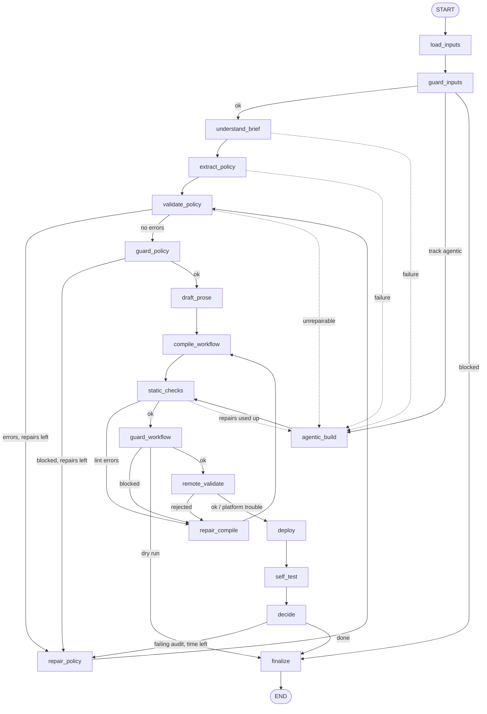

# The builder graph

`python builder/build.py <brief>... <tool_api>` runs one LangGraph (`builder/graph/`). The graph is a pipeline with
three kinds of loops: **repair** (fix the policy or the compile and try again), **fallback** (an agentic Claude session
writes the workflow when the compiled track cannot; opt-in with `--track auto`) and **self-test → redeploy** (a failing
walkthrough or practice result sends the policy back for one more round; opt-in, the default `smoke` self-test never
redeploys). Every stage writes to the trace, every stage catches its own errors, and one JSON line is printed
at the end.

```
builder/graph/
  state.py        BuilderState (TypedDict) - what flows between nodes
  context.py      BuilderContext (settings, LLM gateway, Freya client, trace, budget) - the LangGraph context
  routing.py      pure functions state -> next node name (+ ROUTERS: the conditional edges)
  build_graph.py  StateGraph assembly: build_graph(), edge_list()
  nodes/          one module per node (NAME + async run(state, runtime)); _common.py = the shared wrapper
builder/selftest/ smoke.py, walkthrough.py, practice.py     builder/agentic/runner.py  the Claude Agent SDK fallback
builder/testing.py FixtureGateway + FakeFreya (offline runs and tests)     builder/build.py  the CLI
```

## Topology



Dotted edges are the fallback: they are taken only when the agentic track is allowed (`--track auto|agentic`, the SDK
and a credential are available, not a dry run), fewer than two attempts were made, **and** the time left covers a whole
session (`STAGE_ESTIMATES_S["agentic_build"]` = 1100 s plus the 120 s reserve). `finalize` is the only way to END. Every
node that can fail also has an edge to `finalize` (omitted above for readability); `topology` tests keep this honest.

## Nodes

| Node | Does | Model call | When it fails |
|---|---|---|---|
| `load_inputs` | loads briefs (`load_briefs`) and the tool API; sets `track`, `profile`, `limits` | none | unreadable input → `finalize` |
| `guard_inputs` | `check_inputs`: size, control characters, injection heuristics (warnings), tool-API sanity | none | block → `finalize` (`blocked`) |
| `understand_brief` | `build_rule_ledger` (one quoted rule per entry, amendments, ambiguities) + `check_ledger` | STRONG, several (passages, completeness, reconcile) | → fallback or `finalize` |
| `extract_policy` | `extract_policy`: ledger + contracts → `PolicyIR` | STRONG, 1 | → fallback |
| `validate_policy` | `validate_policy` (+ phrase grounding, offline invariants as trace info) | none | issues drive the route |
| `repair_policy` | `repair_policy`: safe fixes, then the model for what remains | STRONG, 0-1 | keeps the old IR; the cap ends the loop |
| `guard_policy` | `check_policy`: values must appear in the briefs / tool API; enums ⊆ tool enums; records `policy_unresolved` for the summary | none | block → repair, else `finalize`; only grounding findings left after the repairs → go on best effort (AUD-14) |
| `draft_prose` | `draft_prose` + `check_prose`; template-only prompts on any problem or low budget | FAST, 1 | never fails because of the model |
| `compile_workflow` | `compile_workflow(ir, tool_api, ledger, prose, profile)` + rule coverage | none | `CompileError` → `repair_compile` |
| `static_checks` | `lint_workflow` (L001-L029) | none | errors → `repair_compile` |
| `repair_compile` | strategy 1 `drop_prose`, strategy 2 `switch_profile` (staged ↔ lean) | none | no strategy left → fallback |
| `guard_workflow` | `check_workflow`: only bank URLs, no secrets, no forbidden word before verification | none | block → `repair_compile`, else `finalize` |
| `remote_validate` | platform dry run (`validate`) | none | rejected → `repair_compile`; infra trouble → still deploy |
| `deploy` | writes `out/<slot>.workflow.json`, `save` (create or update the slot), stripped-field check, export | none | content rejection → repair; other → `finalize` |
| `self_test` | smoke chat by default; walkthrough audit and practice cases on request (see below) | FAST, 1 (walkthrough) | tests never raise |
| `decide` | failing audit findings → policy issues; repair round if the caps and the budget allow | none | - |
| `agentic_build` | Claude Agent SDK session writes `out/<slot>.agentic.workflow.json` | the session | → retry (bounded) or `finalize` |
| `finalize` | status, closing files, trace summary (once, with unresolved policy issues as `policy_issues`), result line | none | - |

Every node is `async def run(state, runtime)`; the body lives in `_body(state, ctx)` and runs inside
`nodes/_common.run_node`, which writes `STAGE start/end`, opens an observer span, converts an unexpected exception into
`failed=<node>` + an entry in `errors` (only `asyncio.CancelledError` passes), and records `budget_remaining_s`. It also
mirrors the key facts of the state into `ctx.progress` (deploy info, files, `remote_validation`, and - appended, because the
graph accumulates them - `self_tests`, `errors`, `notes`) and keeps `ctx.active_node` set while a node runs, so a build that
the wall-clock guard cuts off still reports what it had and which node it interrupted.

### `deploy` in detail

0. **A repair round is only deployed if it can be tested.** The first deployment always runs. A *repair* round (after a
   failing self-test) replaces a version that was deployed and tested; if the budget no longer covers a deploy plus a smoke
   test (`REDEPLOY_STAGES`, 90 + 90 s + the 120 s reserve) the node does nothing (`redeploy_skipped`, a note in `notes`,
   `after_deploy` -> `finalize`): the tested version stays live, reported (`version`) and exported. The final JSON then has
   `"redeploy_skipped": true`.
1. `FreyaClient.save` creates or updates the slot's workflow and tries to publish the newest version. Every create and every
   update (the model re-save included) sends `{"workflow": <definition>, "nodePositions": compute_layout(<definition>)}`:
   the editor layout is a *record-level* key of the platform (rejected inside the definition) and without it the visual
   editor stacks all nodes on one spot. Transient platform errors (network error/timeout, 429, 502, 503, 504) are retried with
   a short linear back-off that stops at the deadline; a repeated create first looks for the workflow the lost attempt may
   have created (see `FreyaClient.save`), a repeated publish first reads the versions again.
2. **Publication is confirmed, not assumed.** If `DeployInfo.published` is not `True` the node asks again
   (`FreyaClient.ensure_published`, `PUBLISH_RETRIES` times). A version that stays unconfirmed fails the node
   (`failed=deploy`, `TEST FAIL deploy`): no export, **no self-tests** (they would exercise whatever else is live), final
   status `deployed_unpublished` (exit code 2). A failed *re*-deploy keeps the `deploy` info of the earlier published version.
3. The stored definition is read back and compared with what was sent (`stripped_fields`).
4. **The export is verified before it replaces anything.** `FreyaClient.export` writes `out/<slot>.exported.json.part`; the file
   must parse, name the deployed workflow and hold exactly the definition that was just read back, then it is moved into
   place atomically. Up to `EXPORT_ATTEMPTS` rounds (on top of the client's own retries for reads). If none works,
   `exported` is set to `None` explicitly, a stale `out/<slot>.exported.json` of an earlier round is deleted and `errors`
   gets an entry: the final JSON shows `"exported": null, "export_ok": false` and the final status is
   `deployed_unexported` (exit code 2: the agent is live, but the exported file is part of the submission). The locally sent
   definition is **never** passed off as the export (only a `--dry-run`, which has no platform, reports its local file as
   `exported`). If the read-back of the stored definition fails it is retried before the export is compared; an export that
   could only be checked for naming the deployed workflow is accepted with a note.

All platform calls (`save`, `get_workflow`, `export`, `validate`, the smoke chat, the practice harness) run through
`builder.freya.background.run_blocking`: an abandonable **daemon** thread bound to `ctx.cancel` (see *Wall-clock guard*).
Their HTTP requests use `builder/freya/transport.py`, which is installed into the loaded kit (the kit file is untouched):
`timeout = min(120 s, time left before the deadline)`, and no request starts when less than half a second is left.

## State

`BuilderState` is a `TypedDict(total=False)`; values are JSON (Pydantic objects as `model_dump(mode="json")`).
`errors`, `notes`, `self_tests` and `guard_reports` accumulate (`Annotated[list, add]`); every other key is overwritten.

| Group | Keys |
|---|---|
| identity | `run_id`, `slot`, `started_at`, `inputs` (`briefs`, `tool_api`), `dry_run`, `limits` |
| understanding | `bundle`, `tool_api`, `ledger`, `ir`, `policy_issues`, `policy_repairs`, `prose` |
| compiling | `profile`, `compiled` (`workflow`, `rule_map`, `profile`, `notes`), `coverage`, `lint`, `compile_repairs`, `compile_repair_log`, `compile_feedback` |
| platform | `remote_validation` (`ok`, `kind` = ok / invalid / infra / skipped / deployed), `deploy` (`DeployInfo` + `track`; `published` is `false` when the newest version is not confirmed live), `workflow_path`, `exported` (the platform's export of the deployed version, or `null`), `self_tests`, `selftest_repairs`, `repair_requested`, `untested_redeploy`, `tested_version` (the version the last test that really ran was run against), `redeploy_skipped` |
| control | `track` (`compiled` / `agentic`), `agentic_attempts`, `failed`, `blocked`, `status`, `budget_remaining_s`, `errors`, `notes`, `guard_reports`, `final` |

`limits` is copied from the settings by `load_inputs` (`max_policy_repairs`, `max_compile_repairs`, `max_selftest_repairs`,
`allow_agentic`, `dry_run`, `self_test`, `budget_total_s`), so the routing needs neither settings nor a clock.

## Routing (`routing.py`, all pure)

* `failed` = the node that could not do its work. On the compiled track a failure goes to `fallback_target`: `agentic_build`
  if allowed / attempts left (max 2) / time left, else `finalize`.
* `blocked` = a guard stopped the build. Never routed to the agentic track, never deployed (`finalize`, status `blocked`).
* A deployed agent is **never replaced** by a fallback: once `deploy.workflow_id` exists, failures end the run.
* `after_validate_policy`: no error → `guard_policy`; errors and `policy_repairs < max_policy_repairs` and time for a repair
  (360 s + reserve) → `repair_policy`; otherwise fallback, or - with no fallback - go on best-effort (the guards still stand in the way).
* `after_static_checks` / `after_guard_workflow` / `after_remote_validate` / `after_deploy`: a rejection goes to `repair_compile`
  while `compile_repairs < max_compile_repairs` (compiled track only), then to the fallback. A dry run ends after `guard_workflow`.
* `after_self_test`: no result **of the current round** (mode `none`, or no time; `self_tests` accumulates over the repair
  rounds, so older results do not count) → `finalize`; else `decide`. `after_decide`: `repair_requested` → `repair_policy`.
* An agentic workflow goes through the same gates but skips `repair_compile`; a failed gate gives the session **one** more
  attempt with the findings as feedback if the budget covers it, else `finalize`.

## Self-tests and the repair round

`settings.self_test`: `smoke` (default since AUD-01: the configuration measured live), `none`, `auto`, `walkthrough`, `practice`. In `auto` each test runs only if its estimate
still fits (`smoke` 90 s, `walkthrough` 180 s, `practice` 780 s, each plus a 120 s reserve):

* **smoke** - a two-turn chat with test variables (`customer_id=c_selftest`, test names, `now` = the next weekday 11:00). Checks:
  replies are non-empty, none of the IR's `forbidden_before_verification` words appears, the opening contains the prescribed
  opening sentence and right-party question (≥ 60 % of their words). Needs a deployed agent. The summary lists only the
  checks that really ran (`details.checks`): e.g. `2 turn(s) answered; replies non-empty; forbidden words checked: 6; opening
  elements checked: 2`; without a policy IR (agentic track) it says `not checked: opening elements and forbidden words (no
  policy IR; reachability only)`. A transient platform error (HTTP 502/503/504, a timeout, a dropped connection)
  repeats the whole conversation once when the budget allows; both attempts are traced (`details.attempts`). A wrong
  reply or another error is never retried.
* **walkthrough** - one FAST-model call audits the active ledger rules against a condensed text of the workflow
  (`prompts/audit/walkthrough.v1.j2`); `missing`/`contradicted` fail the test, `unclear` only warns; an unavailable model skips it.
  The model must report that it examined at least 90 % of the submitted rules (`checked`); otherwise the audit is
  *inconclusive* and fails (`details.inconclusive`) instead of passing on an empty list. The summary reads
  `N rules submitted, model reports M examined, K missing/contradicted, U unclear`. Findings for rule ids that are not active
  rules are traced (`details.unknown_rule_ids`), not dropped silently; the compiler's rule map is given to the model as
  *unverified claims*.
* **practice** - the organisers' `tools/run_cases.py`, only when the inputs are the kit's own briefs (content hash) and the budget allows.

`decide` turns failing walkthrough findings and failed practice cases into policy issues. If the track is compiled, the cap
`max_selftest_repairs` (default 1) is not used up and the budget covers a whole round (repair 360 + prose 240 + compile 20 +
validate 30 + deploy 90 + smoke 90 s + reserve), the graph runs `repair_policy → … → deploy → self_test` again. The
repair uses the issues as given (no tool-API shortcut, which would only see validator errors). A smoke failure alone never
starts a repair.

`decide` looks at the results of the **current round** only, and only at tests that ran (a skipped test is no evidence). If a
repair round re-deployed the workflow but no test could run on the new version (not enough time), the verdict says
`no self-test ran for the redeployed version (round N); it is untested` and the final JSON carries
`"untested_redeploy": true` and `"tested_version": N` (the last version a test did run on; `version` and `exported` stay
those of what is live) - it never reports `all self-tests passed` for a version nothing tested. The `deploy` node avoids that
situation in the first place by not deploying a repair round that cannot be tested (see *`deploy` in detail*).

## Wall-clock guard

`build.py` cancels the graph at `budget + 45 s` (28 min 45 s by default). A blocking platform request cannot be interrupted,
so the guard does not try: platform calls run in daemon threads (`builder/freya/background.py`) that `asyncio.run` and the
interpreter never wait for, and a cancel token (`ctx.cancel`, with the guard's instant as an absolute deadline) makes every
*further* request refuse to start (`PlatformCancelled`, checked by the paced kit wrapper and by every `FreyaClient`
operation). The same deadline caps every request's timeout (`min(120 s, time left)`) and every retry/back-off of
`FreyaClient`, so nothing started before the guard outlives it by more than its capped timeout. The optional prose draft
gets a model deadline that leaves room for compile, validation and deploy (`Budget.deadline_before`), so a slow model
costs the polish, never the deployment. A call that was already in flight gets `INFLIGHT_GRACE_S` (15 s) to finish; what it created is read back with
`FreyaClient.deploy_snapshot` and reported as `deployed_unpublished` (nothing confirms the publication). The final JSON then
has `"cut_off": true`, the BUILD SUMMARY a `cut_off` line, and `errors` names the node that was interrupted. The summary's
tests are the state's merged with the `TEST` lines the trace recorded (`TraceWriter.merged_tests`), and a test that started
but never finished is listed as `aborted`, so a cut-off build shows every test that ran.

## Modes

| Flag / setting | Effect |
|---|---|
| `--dry-run` | no Freya call at all; stops after `guard_workflow`; writes `out/<slot>.workflow.json` |
| `--track compiled` | deterministic pipeline only |
| `--track agentic` | straight to the Claude session (falls back to compiled if the SDK / a credential is missing) |
| `--track auto` | compiled first, agentic fallback (opt-in; `compiled` is the default) |
| `--profile staged\|lean` | compiler design (staged = validated reference structure) |
| `--self-test …` | see above |
| `--budget-s N` | wall-clock budget (default 1680 s = 28 min; limit 30 min). The graph is cut off 45 s after it. |
| `--fake-llm DIR` | answer every model call from `DIR` (`ledger.json` + `ir.json`, or `<name>_ledger.json` + `<name>_ir.json`, optional `prose.json`, `walkthrough.json`); forces the compiled track |
| `--slot S` | workflow label (default: slug of the brief file names; a fingerprint of the inputs is appended when that slot already belongs to other inputs, AUD-05) |

Without `FREYA_API_KEY` a non-dry run is built as a dry run (trace error line, status `dry_run`, an entry in `errors`) and
exits with code 2, because nothing was deployed (AUD-55).

## Outputs

| File | Content |
|---|---|
| `out/<slot>.workflow.json` | the definition that was sent (or, dry run, would be sent) |
| `out/<slot>.exported.json` | the platform's export of the stored workflow (kit format) of the deployed version; verified before it replaces an older one, deleted when a re-export fails |
| `out/<slot>.ledger.json`, `out/<slot>.ir.json` | the understanding result, for inspection |
| `out/<slot>.rejected.workflow.json` | a workflow that failed the checks (diagnosis only) |
| `traces/<slot>-<UTC time>.log` / `.jsonl` | the run trace (submission); `.llm.jsonl` retains prompts/replies by default (`LLM_LOG_CONTENT=metadata` omits them); `.agentic.jsonl` = SDK session |
| `results/<slot>-<run id>.build.json` | the final summary with notes and test details |

## Trace format

One line per event, `<UTC time> | <KIND> | <text>`; the JSONL has the same events as objects.

```
2026-10-11T17:02:03.123Z | START  | run 246d3dfe6064 started | slot=brief-a | builder 0.1.0, python 3.13.16 | commit 6d75847+dirty
2026-10-11T17:02:03.301Z | STAGE  | understand_brief | start | budget_left_s=1680
2026-10-11T17:02:09.044Z | MODEL  | openai/gpt-5.6-terra | key=openai#1(…ab12) | ok 5.7s in=6095 out=2210 | rule ledger: brief-a.md passage 1/3
2026-10-11T17:03:40.512Z | GUARD  | policy | ok | 0 violations | blocked=False violations=[]
2026-10-11T17:05:02.000Z | LINT   | static checks: 0 errors, 0 warnings (ok)
2026-10-11T17:05:30.200Z | FREYA  | save | workflow_id=… agent_id=… version=1 node_count=31 tool_count=5
2026-10-11T17:06:10.900Z | TEST   | PASS smoke | 2 turn(s) answered; replies non-empty; forbidden words checked: 6; opening elements checked: 2
2026-10-11T17:06:11.020Z | FINAL  | run 246d3dfe6064 finished           (followed by the BUILD SUMMARY block)
2026-10-11T17:06:11.030Z | END    | run 246d3dfe6064 closed after 248.0 s
```

The BUILD SUMMARY block holds start / end / duration, model calls per model, the Freya objects (workflow id, agent id,
version - labelled `published version` only when the publication was confirmed, otherwise `newest version (NOT confirmed
published)` - node and tool count), the tests with their results, the stages with durations, track and status, and
`export_ok` / `cut_off` / `untested_redeploy` / `redeploy_skipped` when they apply.

## Running

```sh
# native (repo root, Python 3.13 venv)
python builder/build.py briefs/brief-a.md tools/openapi.json                       # build + deploy + self-test
python builder/build.py briefs/brief-a.md briefs/brief-b.md tools/openapi.json     # several brief files
python builder/build.py briefs/brief-a.md tools/openapi.json --dry-run             # compile + check only
python builder/build.py briefs/brief-a.md tools/openapi.json --dry-run --fake-llm tests/fixtures/policy   # offline, no keys
python -m builder.build --help                                                      # same program
freya-builder briefs/brief-a.md tools/openapi.json                                  # console script (uv sync / pip install -e .)

# Docker (see docker-compose.yml)
docker compose build
docker compose run --rm builder briefs/brief-a.md tools/openapi.json
docker compose run --rm builder briefs/brief-a.md tools/openapi.json --dry-run
docker compose run --rm tests
```

Progress goes to **stderr**; **stdout** carries only the final JSON line:

```json
{"slot": "brief-a", "track": "compiled", "workflow_id": "…", "agent_id": "…", "version": 1,
 "exported": "out/brief-a.exported.json", "trace": "traces/brief-a-20261011T170203Z.log", "status": "deployed",
 "export_ok": true, "workflow_file": "out/brief-a.workflow.json", "tests": {"passed": 3, "total": 3}, "errors": [], "policy_issues": []}
```

`status` is `deployed`, `deployed_unpublished` (a workflow exists but its newest version is not confirmed published),
`deployed_unexported` (it is live but has no verified platform export), `dry_run`, `blocked` or `failed`. `export_ok` is `false`
(and `exported` `null`) when the deployed workflow has no verified platform export; `cut_off` / `untested_redeploy` appear
(as `true`) only when they apply (`redeploy_skipped` too; `untested_redeploy` adds `tested_version`). A cut-off build whose agent is published and exported is still `deployed` (exit 0) -
`cut_off` and `errors` say that the self-tests were interrupted.

## Exit codes

| Code | Meaning |
|---|---|
| 0 | an agent was deployed, or a requested `--dry-run` produced a lint-clean, guard-clean workflow |
| 2 | anything else: failed, blocked, `deployed_unpublished` or `deployed_unexported` build, unusable inputs, usage error |

The process never ends without a summary line: unreadable inputs, an invalid `.env` value, an unwritable `traces/` folder, a
crash inside a node, a graph error and the wall-clock guard all end in `status: "failed"` (or `deployed` /
`deployed_unpublished` / `deployed_unexported` if an agent already existed) with the trace finalised wherever the folder
allows it. A graph crash is listed in `errors` (a `failed` build never has an empty list). An interpreter outside
`>=3.11,<3.14`, or one without the dependencies, is refused *before* anything is imported (`builder/_startup.py`): stderr
names the exact install commands (`uv sync --extra agentic --extra ingest`, `pip install -r requirements.txt`, Docker), stdout
ends with the same JSON line (`status: failed`) and the exit code is 2. A repair node that crashes still uses up one of its
rounds (`policy_repairs`), so the graph never loops until its recursion limit.

## Extending

* **A node**: add `builder/graph/nodes/<name>.py` with `NAME` and `run`, list it in `nodes/__init__.py`, add its router to
  `ROUTERS` (or an edge to `STATIC_EDGES`), update `tests/graph/test_topology.py` and this page.
* **A self-test**: return `{"name", "passed", "summary", "details"}` from a function in `builder/selftest/`, register it in
  `ORDER`, `plan_self_tests` and `nodes/self_test.py`, and give `decide` a mapping from its findings to policy issues if it
  should drive a repair.
* **A repair strategy for the compile**: append it to `STRATEGIES` / `next_strategy` in `nodes/repair_compile.py`.
