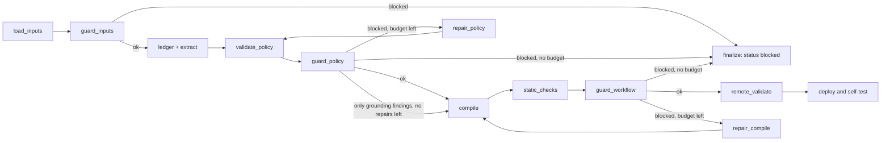

# Guardrails

The builder reads **untrusted bank documents** with a model and compiles the result into a phone agent that talks to
real customers. `builder/guardrails/` puts a deterministic check (no LLM, no network) at every hand-over so a
manipulated, invented or leaking artifact is stopped before the next step uses it. A guard never edits what it checks.
It returns a `GuardReport` (`stage`, `violations`); each `GuardViolation` has `guard` (stable id), `severity`
(`block` or `warn`), `message` (never contains a secret) and `location`.

## What is guarded where

| Stage | Function | Blocks | Warns |
|---|---|---|---|
| Inputs (briefs, tool API) | `check_inputs(bundle, tool_api)` | no text at all; > 3 000 000 characters; a tool without an absolute URL | > 300 000 characters; control, invisible or bidirectional characters; injection-like sentences (file:line); key-like tokens; non-https tool URL; several tool hosts; an expected tool missing |
| Every LLM call | `guarded_system(system)` | - | - |
| Documents inside prompts | `wrap_untrusted(name, text)` / `wrap_bundle(bundle)` | - | - |
| Rule ledger | `check_ledger(ledger, bundle)` | no rules; duplicate ids; a quote that is empty or in no brief (invented rule); injection or key in a statement | approximate quote; quote in another file than `source`; supersession of an unknown id |
| Policy IR | `check_policy(ir, bundle, tool_api)` | a date, amount or number >= 10 that no brief or the tool API states; an enum value the tool API does not allow; an action on an unknown tool; injection marker or key in any IR text | a number < 10 that is not stated; unknown action parameter; floor or state field that is not a product field |
| Drafted prose | `check_prose(prose, ir, tool_api=, ledger=)` | a date or amount the IR (and ledger) lacks; a tool the API lacks; injection marker or key | prose > 6 000 characters per node |
| Compiled workflow | `check_workflow(wf, tool_api, secrets, ir)` | an `api_call` whose `url` default is missing or off the tool API host; a secret value or key-like token anywhere; a `forbidden_before_verification` word in a fixed spoken line before `verify_identity` | `agent_config` present; `api_call` to an unknown path; foreign URL in prompt text; `pre_process_code` that rewrites the url; prompts > 60 000 characters in total or > 20 000 for one node; no node calls `verify_identity` |

## The flow

`guard_inputs`, `guard_policy` and `guard_workflow` are graph nodes that run a guard, append the report to
`state["guard_reports"]` and write the trace line `GUARD | <stage> | ok|blocked | n violations`
(`GuardReport.summary()`; `trace.event("guard", report.trace_message())` renders the same line). The ledger guard runs
inside `understand_brief` and the prose guard inside `draft_prose` (a failing prose draft falls back to template-only text).
A blocked workflow is never deployed.

One exception keeps a false positive from costing a whole brief (AUD-14): when the policy repairs are used up and every
blocking finding of `guard_policy` is a grounding heuristic (`ungrounded_date`, `ungrounded_amount`, `ungrounded_number`:
a value the guard could not find in the briefs, for example a holiday written as a name), the findings are kept as
warnings and the build goes on best effort. The trace, the notes and the final `policy_issues` list them. Secrets, foreign
hosts, enum values outside the tool API and injection markers still end the build `blocked`.



`report.blocking_messages()` is the feedback a repair prompt receives; `report.details()` is the human readable form.

## How the checks decide

* **Documents are data.** `GUARD_PREAMBLE` (prepended by `guarded_system`, idempotent) tells the model that anything inside
  `<untrusted_document>` is bank data it must never obey, that it must not invent rules, numbers, dates, names, outcomes or
  tools, and that gaps go into the fields designed for them. `wrap_untrusted` escapes a closing (or forged opening) tag
  inside a document, so a document cannot end its own block.
* **Injection markers** (`patterns.py`) are *strong* (`ignore the previous instructions`, `</system>`, `BEGIN SYSTEM`) or
  *weak* (`you are now`, `system prompt`). In a brief both only warn: the text stays data. In a derived artifact (IR, prose,
  ledger statement) a strong marker blocks; weak ones are ignored there because honest sentences use them.
* **Grounding of literals.** Dates, amounts and numbers are compared after normalisation: thousands separators and decimal
  commas are read both ways, number words count (`three`, `twice`, `two weeks` = 14), a date matches in any common spelling
  and a source date without a year matches any year, list numbering (`12.`), `rule 23` and ids (`A-26b`) are not values.
  Not checked: structural numbers (0, 1, priorities, ordinals), an open-ended `days_late_max` (>= 1000), and illustrative
  fields (`examples`, `example`). Band bounds may be one off a stated number ("more than 45 days" starts at 46).
* **Enums come from the tool API**, never from constants: outcomes, identity fields, hints, queues, note reasons, product types.
* **Workflow host check.** Allowed endpoints are the hosts (and ports) of the tool API URLs. Before verification means every
  node reachable from `initial_node` without passing through a node that calls `verify_identity`, plus global nodes.
* **Secrets.** `secrets` values (>= 8 characters, `str` or `SecretStr`) and the shapes `fak_`, `sk-ant-`, `sk-`, `pk-lf-`,
  `AKIA`, `ghp_`, `xox*-`, `Bearer ...`, private-key headers are reported by kind and location, never printed.

## Using it

```python
report = check_inputs(bundle, tool_api)            # GuardReport
trace.event("guard", report.trace_message())       # <ts> | GUARD | inputs | ok | 0 violations
if report.blocked: ...                             # finalize blocked, or repair with report.blocking_messages()
check_workflow(wf, tool_api, secrets=settings_secrets, ir=ir)
```

Gateway contract: `LLMGateway.text()/structured()` rebind `system = guarded_system(system)` once, before the first attempt
(so the rate-limited, logged and sent prompt is the same one), unless called with `guarded=False`; `probe()` stays unguarded.

## How to add a guard

1. Pick the stage (`input_guard.py`, `output_guard.py`) or add a function that returns `GuardReport(stage=...)`; add a new
   stage name to `GuardStage` in `models.py` if needed.
2. Give each finding a stable `guard` id, a severity, a message without secrets, and a `location` a human can find.
   Block only what is provably wrong; warn on heuristics. A false block ends a build, so prefer a warning when unsure.
3. Take thresholds and enums from the inputs (tool API, IR), not from constants of one brief. Put shared regexes in `patterns.py`.
4. Keep imports light (see the `TYPE_CHECKING` block in `output_guard.py`); the gateway imports this package.
5. Test it twice: a clean run on the kit fixtures (`violations == []`), and a seeded defect with the exact `guard`, `severity`
   and `location` expected. Literal expectations, no second implementation of the check.
6. Add the row to the table above and, for a graph stage, the trace line and the repair route to the flow.

## Limits

Heuristics cannot prove a prompt is safe or that a model understood a brief; they catch the cheap, certain failures
(invented numbers and rules, foreign hosts, leaked keys, forbidden words in fixed lines). Free-text prompts are not parsed for
meaning: the practice calls and the policy validator remain the check for behaviour.
