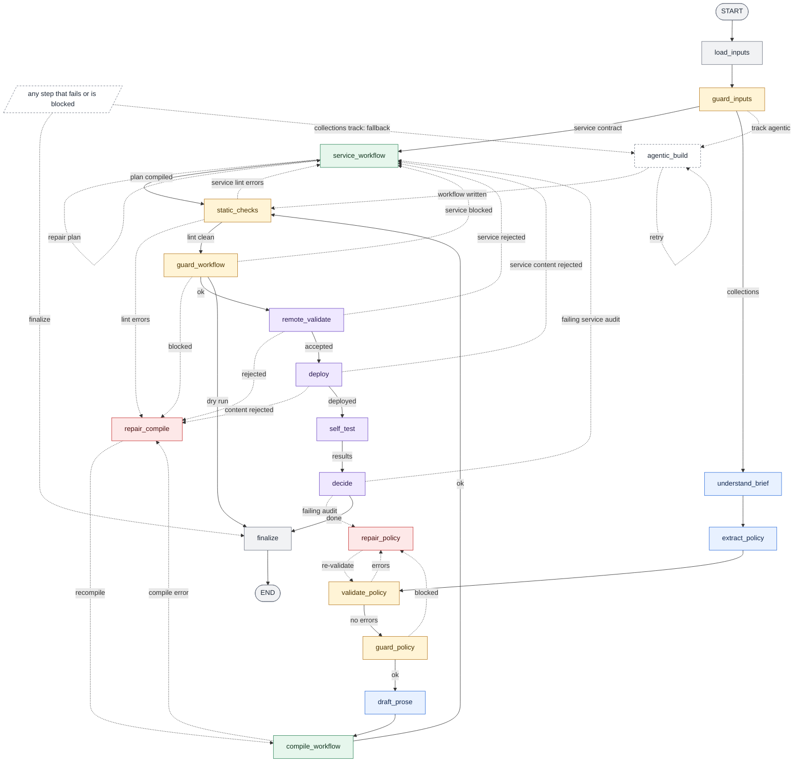

# How it works

One command turns a bank's collections brief and its tool API file into a published Freya phone agent. The diagrams are generated from the code ([`docs/graphs/`](graphs/README.md)).

## Two planes

- **Builder:** a LangGraph pipeline, `python builder/build.py <brief>... <tool_api>`. Every model call goes through the key changer: a strong tier reads the brief (rule ledger, policy extraction, policy repair), a fast tier drafts prose and runs the optional walkthrough audit. The default build is `--track compiled --self-test smoke`.
- **Phone agent:** the Freya workflow the builder generates (nodes, code, tools, routes). It calls only the bank's tool API, and its model is fixed by the platform (`AGENT_LLM` in `freya.py`), never touched by the builder. A model reads the documents; after that it is code: a typed policy (`PolicyIR`), a deterministic compiler, and an agent that computes dates, amounts and routes in code nodes.

## The builder pipeline

Solid arrows are forward progress; dotted ones are repair loops, the fallback and failure exits ([every edge](graphs/builder_graph_full.mmd), [node table and routing](../builder/graph/README.md)).

<!-- mmd: builder_graph.mmd -->

- `load_inputs`: reads the brief files and the tool API; picks track (default `compiled`), profile (default `staged`), self-test mode (default `smoke`) and limits.
- `guard_inputs`: guard; size, hidden characters, injection-like sentences (warnings only), tool API sanity.
- `understand_brief`: the rule ledger, one quoted rule per entry, amendments and ambiguities recorded (strong model).
- `extract_policy`: ledger plus tool contracts become the `PolicyIR` (strong model).
- `validate_policy`: checks the IR against the tool API and the ledger, no model.
- `repair_policy`: deterministic fixes first, the model for what remains; loops back to `validate_policy`.
- `guard_policy`: guard; every date, amount and enum must appear in the briefs or the tool API. A block goes to `repair_policy` while rounds remain. When the repairs are used up and only grounding findings are left (a date, amount or number the guard could not find), the build goes on best effort; any other block ends it as `blocked`. It also records the unresolved policy issues that `finalize` reports.
- `draft_prose`: the fast model drafts short task messages per node; template-only text on any problem.
- `compile_workflow`: IR, tool API and prose become the Freya workflow, a rule map and a coverage report (no model).
- `static_checks`: lint rules L001 to L029, the same for both tracks.
- `repair_compile`: changes the compile inputs: drop the prose, then switch profile (`staged` or `lean`).
- `guard_workflow`: guard; only bank URLs, no secrets, no forbidden word before verification. Blocked means never deployed; `--dry-run` ends here.
- `remote_validate`: platform dry run of the definition, nothing stored.
- `deploy`: create or update the slot, confirm publication, read the definition back, verify the export.
- `self_test`: by default (`smoke`) a short chat against the published agent. Opt-in modes add the walkthrough audit (`walkthrough`), the practice cases when the inputs are the kit briefs (`practice`), or all that fit the budget (`auto`).
- `decide`: turns a failing walkthrough or practice result into policy issues for one more round if time and caps allow. A failed smoke test is reported, never repaired, so the default build never redeploys a tested version.
- `agentic_build`: opt-in fallback (`--track auto` or `agentic`); a Claude Agent SDK session writes the workflow and it passes the same checks.
- `finalize`: status, closing files, trace summary (including unresolved policy issues) and the one JSON result line; every node routes errors here by state, so a trace always closes.

## The generated phone agent

Brief A compiled from the offline fixtures (`staged` profile), modelled on a hand-written reference agent that was measured on the official scorer.

```mermaid
flowchart TD
    _start(["START"]):::plain
    opening("opening")
    callback_stop_third_party("callback_stop_third_party")
    callback_fix_say_third_party("callback_fix_say_third_party")
    third_party("third_party<br/><i>schedule_callback</i>")
    callback_done("callback_done")
    identity("identity<br/><i>verify_identity</i>")
    identity_failed("identity_failed")
    load_account{{"load_account<br/><i>get_account</i>"}}
    account_unavailable("account_unavailable")
    negotiate("negotiate<br/><i>create_promise</i>")
    promise_done("promise_done")
    promise_fix_say("promise_fix_say")
    rescue_identity_bye("rescue_identity_bye")
    rescue_third_party_bye("rescue_third_party_bye")
    rescue_negotiate_bye("rescue_negotiate_bye")
    grp_end["end_*<br/><i>16 nodes</i>"]
    grp_handoff{{"handoff_*<br/><i>3 nodes</i>"}}
    guard_restructuring_say("guard_restructuring_say")
    close{{"close<br/><i>close_call</i>"}}
    hangup(["hangup"])
    _start --> setup
    setup -.->|"always"| opening
    opening -->|"tool:transition_to_identity"| identity
    opening -->|"tool:transition_to_third_party"| third_party
    opening -->|"tool:transition_to_end_* x4; max turns"| grp_end
    opening -->|"tool:transition_to_handoff_general"| grp_handoff
    callback_stop_third_party -.->|"always"| grp_end
    callback_fix_third_party -->|"callback_guard_stop = yes"| callback_stop_third_party
    callback_fix_third_party -.->|"always"| callback_fix_say_third_party
    callback_fix_say_third_party -.->|"always"| third_party
    third_party -->|"callback_guard contains blocked"| callback_fix_third_party
    third_party -->|"callback_acked = yes"| callback_done
    third_party -->|"transition_to_end_callback_booked_response contains..."| rescue_third_party
    third_party -->|"tool:transition_to_end_* x4; intent: The agent already said..."| grp_end
    third_party -->|"tool:transition_to_identity"| identity
    callback_done -.->|"always"| grp_end
    identity -->|"verify_identity_response.data.all_verified = true"| load_account
    identity -->|"verify_identity_response.data.wrong_answers_left = 0"| identity_failed
    identity -->|"transition_to_end_identity_declined_response contains..."| rescue_identity
    identity -->|"tool:transition_to_end_* x3; max turns"| grp_end
    identity -->|"tool:transition_to_third_party"| third_party
    identity -->|"tool:transition_to_handoff_general"| grp_handoff
    identity_failed -.->|"always"| grp_end
    load_account -.->|"always"| account_facts
    account_unavailable -.->|"always"| grp_end
    account_facts -->|"account_state = empty or account_state contains error"| account_unavailable
    account_facts -.->|"always"| negotiate
    negotiate -->|"promise_guard contains blocked"| promise_fix
    negotiate -->|"promise_acked = yes and product_count = 1"| promise_done
    negotiate -->|"transition_to_end_promise_recorded_response contains..."| rescue_negotiate
    negotiate -->|"tool:transition_to_end_* x7; intent: The agent already said..."| grp_end
    negotiate -->|"tool:transition_to_handoff_* x2"| grp_handoff
    negotiate -->|"tool:transition_to_guard_restructuring"| guard_restructuring
    promise_done -.->|"always"| grp_end
    promise_fix -.->|"always"| promise_fix_say
    promise_fix_say -.->|"always"| negotiate
    rescue_identity_bye -.->|"always"| rescue_identity_go
    rescue_identity_go -->|"rescue_target = end_identity_declined; rescue_target =..."| grp_end
    rescue_identity_go -->|"rescue_target = handoff_general"| grp_handoff
    rescue_identity_go -.->|"always"| identity
    rescue_identity -->|"rescue_target = third_party"| third_party
    rescue_identity -->|"rescue_ending = yes"| rescue_identity_bye
    rescue_identity -.->|"always"| identity
    rescue_third_party_bye -.->|"always"| rescue_third_party_go
    rescue_third_party_go -->|"rescue_target = end_callback_booked; rescue_target =..."| grp_end
    rescue_third_party_go -.->|"always"| third_party
    rescue_third_party -->|"rescue_target = identity"| identity
    rescue_third_party -->|"rescue_ending = yes"| rescue_third_party_bye
    rescue_third_party -.->|"always"| third_party
    rescue_negotiate_bye -.->|"always"| rescue_negotiate_go
    rescue_negotiate_go -->|"rescue_target = end_promise_recorded; rescue_target =..."| grp_end
    rescue_negotiate_go -->|"rescue_target = handoff_support; rescue_target = handoff_general"| grp_handoff
    rescue_negotiate_go -.->|"always"| negotiate
    rescue_negotiate -->|"rescue_target = guard_restructuring"| guard_restructuring
    rescue_negotiate -->|"rescue_ending = yes"| rescue_negotiate_bye
    rescue_negotiate -.->|"always"| negotiate
    grp_end -.->|"always"| decide
    grp_handoff -.->|"always"| decide
    guard_restructuring -->|"restructuring_blocked = yes"| guard_restructuring_say
    guard_restructuring -.->|"always"| grp_handoff
    guard_restructuring_say -.->|"always"| negotiate
    decide -.->|"always"| close
    close -.->|"always"| hangup
    linkStyle 2,3,5,14,20,21,31,32 stroke:#2f6fdb,color:#2f6fdb
    classDef conv fill:#e8f1ff,stroke:#2f6fdb,color:#10264d
    classDef say fill:#e8f1ff,stroke:#2f6fdb,stroke-dasharray:4 3,color:#10264d
    classDef code fill:#fff4d6,stroke:#b7791f,color:#4a3200
    classDef api fill:#e6f6ec,stroke:#2f855a,color:#12351f
    classDef term fill:#fde8e8,stroke:#c53030,color:#4a1010
    classDef plain fill:#f1f2f4,stroke:#6b7280,color:#1f2937
    class setup,callback_fix_third_party,account_facts,promise_fix,rescue_identity_go,rescue_identity,rescue_third_party_go,rescue_third_party,rescue_negotiate_go,rescue_negotiate,grp_end,guard_restructuring,decide code
    class opening,third_party,identity,negotiate conv
    class callback_stop_third_party,callback_fix_say_third_party,callback_done,identity_failed,account_unavailable,promise_done,promise_fix_say,rescue_identity_bye,rescue_third_party_bye,rescue_negotiate_bye,guard_restructuring_say say
    class load_account,grp_handoff,close api
    class hangup term
```

<!-- mmd: agent_brief_a.mmd -->

Rounded boxes are conversation nodes (dashed: a fixed line the engine speaks), rectangles code, hexagons engine tool calls; blue arrows are tool-call transitions. `setup` and `account_facts` compute dates, floors and persuasion scripts; `negotiate` offers `create_promise` behind a hard guard; `decide` applies the outcome precedence; `close` calls `close_call` last. The 16 `end_*` and 3 `handoff_*` nodes are folded into one box each.

## Key mechanisms

- **Code nodes for dates and money:** `setup` and `account_facts` are generated Python that write the date table, deadlines, floors, allowed promise days, callback slots and scripted offers. Amounts are exact cents, rounded half-up. A floor stated as a computation (a percentage of the past-due amount, a fixed sum, the larger or smaller of several) is computed there too, and a floor is never above the full amount. The model reads the result and never calculates.
- **Deterministic routes:** variables decide where the call goes (`callback_acked = yes`, `promise_acked = yes and product_count = 1`, `wrong_answers_left = 0`), so a booked callback or a recorded promise ends in a scripted sentence without model judgement.
- **Acknowledgement flags:** the engine's `<tool>_success_count` counts any HTTP 2xx, a bank refusal included. Post-hooks therefore write `promise_acks` / `callback_acks` and the flags `promise_acked` / `callback_acked` (`yes`) only when the transport succeeded and the contract's own success signal holds: a boolean success flag, or a status string with a documented success value; with neither, the transport status alone. Routes compare the flags as text. `setup` starts them at `0` / `no`.
- **Recorded state:** `notes_log` and `promised_products` are written by post-hooks after the acknowledgement, and a product with a recorded promise (or note) cannot get a second one. Calls the model makes in parallel run every pre-hook before any post-hook; they are staged as one batch and committed when every call in it is acknowledged.
- **Tool-call exits:** the model leaves a stage by calling `transition_to_<node>` and says goodbye in the same message, so the farewell and the exit cannot come apart. Prescribed sentences (opening, debt statement, callback done, promise done) are spoken by the engine (`tts`).
- **Rescue routes:** a transition sent in the same message as a bank tool is not routed by the platform; it only writes `Transitioning to <node>` into `transition_to_<node>_response`. Each stage with bank tools (`identity`, `third_party`, `negotiate`) has a route to `rescue_<stage>` (code), which finds the dropped target and goes there. A target that ends the call first passes `rescue_<stage>_bye` (the fixed goodbye) and `rescue_<stage>_go`.
- **Hooks:** pre-hooks clean the arguments (amounts, ISO dates, digit-only answers); every tool result gets a `what_to_do_next` line from a post-hook. A hook never raises. Post-hooks do not run on an HTTP 5xx, so the system prompt says what an error result means.
- **Promise guard and recovery:** the `create_promise` pre-hook blocks an unknown product, a request without loaded account facts, a day that is not allowed and an amount outside floor to full by blanking the request URL, so no request is sent. It writes a spoken correction (it proposes an amount, never asks how much the customer can pay); `promise_fix` and `promise_fix_say` say it and return to `negotiate`. A blocked call is not counted as a service failure.
- **Callback guard:** the `schedule_callback` pre-hook checks the requested day and time (a real clock time, inside the slots `setup` wrote) and blocks anything else the same way. A custom callback rule has no computable slots; its text goes to the prompt and the guard lets the request through. `callback_fix_<stage>` and `callback_fix_say_<stage>` speak the allowed times and return to the stage; in the third-party step, after the number of extra asks the brief allows, `callback_stop_third_party` apologises and the call closes without a booking.
- **Account not loaded:** when `get_account` fails after its retries or lists no product (`account_state` is `empty` or `error: ...`), `account_unavailable` says so in a fixed line and the call closes, instead of negotiating without facts.
- **Computed close:** `end_*` and `handoff_*` nodes only record how the call ended. `decide` applies the outcome precedence to the acknowledgement counters, notes and the chosen situation, and `close` calls `close_call` once, last. The model never names an outcome.
- **Intent guards:** an intent that takes precedence (in Brief A, hardship over restructuring) is a latch plus a guard node in front of the overridden exit, not only a sentence in the prompt.
- **Editor layout:** the compiler sends `nodePositions` (columns by longest path, side branches below, tall columns wrapped) so the Freya editor does not stack every node; it changes neither behaviour nor score.
- **Rule ledger and rule map:** each atomic rule has a verbatim quote and source, and the compiler records where each rule is placed ([UNDERSTANDING](UNDERSTANDING.md), [COMPILER](COMPILER.md)). The map says where a rule is placed, not that it is behaviourally enforced.
- **Nothing brief-specific in `builder/`:** values reach the compiler only through the IR and the tool API, and fields are found by role in the API file; `tests/unit/test_compliance.py` scans the sources (set `COMPLIANCE_BRIEFS` to scan against other brief files).

## Guardrails, key changer, observability

- **Guardrail flow:** `guard_inputs`, `guard_policy` and `guard_workflow` sit between the working stages. Documents reach a model wrapped as data behind a preamble that forbids obeying them; derived values must be grounded in the briefs or the tool API; a block goes to repair while rounds remain, then ends the build as `blocked` ([GUARDRAILS](GUARDRAILS.md)).
- **Key changer and rate limits:** every model call goes through [one gateway](../builder/llm/gateway.py). A key without credits is marked dead (`data/key_health.json`), a rate-limited one cools down, then the next key and provider take over. Token buckets and a concurrency cap keep it under provider limits ([LLM_KEY_CHANGER](LLM_KEY_CHANGER.md)).
- **Observability:** `traces/<slot>-<time>.log` and `.jsonl` are the run's trace (submit the printed output, for example `traces/hidden-1.log` from `tee`); `.llm.jsonl` holds every prompt and reply with secrets masked (`LLM_LOG_CONTENT=metadata` keeps lengths only); Langfuse is optional ([OBSERVABILITY](OBSERVABILITY.md)).

## Testing approach

`pytest tests` runs offline: a fixture gateway and a fake Freya client drive the whole graph ([`builder/testing.py`](../builder/testing.py)), and generated Python runs in a sandbox against literal expected outcomes. That proves the mechanics, not that a real model reads an unfamiliar brief correctly. Live evidence is separate: self-tests, then the official scorer ([`evals/`](../evals/README.md), [VALIDATION_AND_LESSONS](VALIDATION_AND_LESSONS.md)).

## Principles from τ^τ-bench ([our notes](research/12_tau_tau_bench_lessons.md))

1. Read the whole brief, split it into atomic rules and prove coverage: ledger, grounding, rule map.
2. Resolve amendments explicitly and log interpretations: supersession log, ambiguity register.
3. Measure the seed first and reuse what works: `results/BASELINE.md`, the kit scorer and skill.
4. Build tool contracts from the API file; handle loud and quiet tool failures in code: hooks, counters.
5. Put rules in routes and code, keep prompts short, guard outputs deterministically.
6. Validate on ground truth you did not write (kit ledger and judge) and on held-out briefs (`evals/synthetic_briefs/`).
7. Keep two architectures and measure: `staged` and `lean` exist; live scores so far cover the hand-written reference agent and builds with the default `staged` profile ([BASELINE](../results/BASELINE.md)).
8. Respect the budgets (30 minutes, one simulation at a time, latency): `builder/budget.py`.
