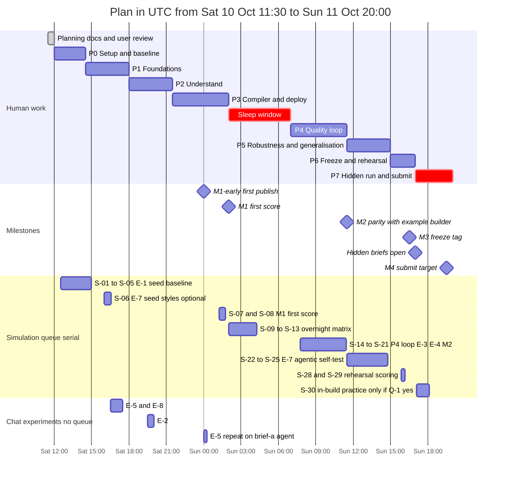
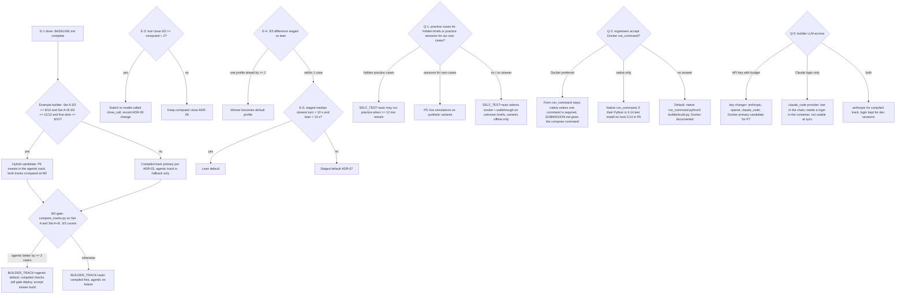
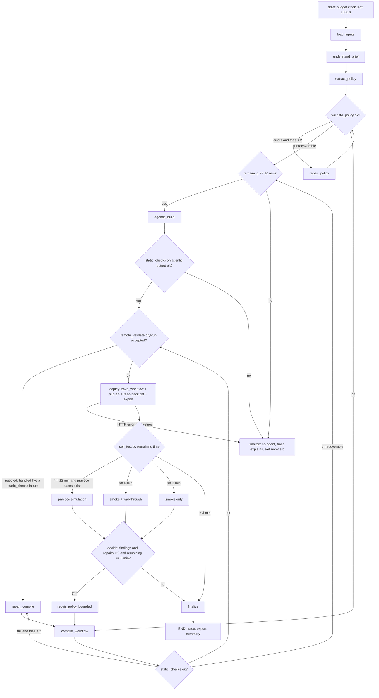

# Implementation Plan: Freya "Build the Builder"

Version 1, written Sat 2026-10-10 11:30 UTC. Single source of truth: decisions brief v2 (requirements R1–R9,
ADR-01..ADR-16, builder graph node names, repo layout, phases P0..P7, milestones M1..M4, experiments E-1..E-8,
questions Q-1..Q-8, risks RK-1..RK-12). This document must agree with [ARCHITECTURE.md](ARCHITECTURE.md),
[FOLDER_STRUCTURE.md](FOLDER_STRUCTURE.md) and [TASKS.md](TASKS.md). Research: [11](research/11_hackathon_rules_and_kit.md)
(rules, scoring, kit v3, authoritative), [12](research/12_tau_tau_bench_lessons.md) (τ^τ-bench principles P1–P8),
[01–10](research/) (older background; the kit wins on any conflict).

**Kit paths.** The kit is at `data/build-the-builder-v3/build-the-builder/` until P0 copies it unmodified to the repo
root (ADR-02). This document names kit files by their repo-root path from then on: `docs/workflow-format.md`,
`docs/tools-and-code.md`, `docs/api.md`, `tools/openapi.json`, `tools/run_cases.py`, `tools/score.py`, `freya.py`,
`public-test-set.json`, `briefs/`, `examples/`, `.claude/skills/build-phone-agent/SKILL.md`. The kit `README.md` is not
in the ADR-02 copy list (our own `README.md` takes the root). It stays at
`data/build-the-builder-v3/build-the-builder/README.md`, referred to below as "kit README".

**Tags used here.** **[APPROVAL]** = needs the user's explicit OK in chat (spends Freya credits, creates workspace
objects or spends Anthropic budget). **[UNVERIFIED] E-n** = a platform claim not yet confirmed, with the experiment that
settles it. **(estimate)** = a planning number, not a platform fact.

**What changed versus the v1 plan (short).**
- Workflows are created and updated through the API (`POST /api/v2/workflow`, `?dryRun=true`, `PUT /api/v2/workflow/{id}`,
  `POST /api/v2/versions/workflow/{id}/publish`); we use `freya.save_workflow(slot, wf)` and never touch the seeded base.
- Seven tools; `close_call` exactly once and last. Fields and enums come from the tool API file of each brief.
- Text simulations only; all voice/STT/TTS work is dropped. `now` is a call variable; the system clock is never used.
- Official evaluation is the kit's `tools/run_cases.py` (ledger + judge) with `--reps 3` and `--style`; our own
  simulated-customer harness is dropped.
- The brief is the law: generic capabilities activate only when a brief specifies them. τ^τ-bench lessons drive the plan.

## Contents

1. [Goal, scoring and success metrics](#1-goal-scoring-and-success-metrics)
2. [Constraints](#2-constraints)
3. [Strategy](#3-strategy)
4. [Phase plan](#4-phase-plan)
   - [4.1 P0 Setup and baseline](#41-p0-setup-and-baseline)
   - [4.2 P1 Foundations](#42-p1-foundations)
   - [4.3 P2 Understand](#43-p2-understand)
   - [4.4 P3 Compiler and deploy (M1)](#44-p3-compiler-and-deploy-m1)
   - [4.5 P4 Quality loop (M2)](#45-p4-quality-loop-m2)
   - [4.6 P5 Robustness and generalisation](#46-p5-robustness-and-generalisation)
   - [4.7 P6 Freeze and rehearsal (M3)](#47-p6-freeze-and-rehearsal-m3)
   - [4.8 P7 Hidden run and submit (M4)](#48-p7-hidden-run-and-submit-m4)
   - [4.9 Critical path, checkpoints and slip rules](#49-critical-path-checkpoints-and-slip-rules)
   - [4.10 Requirement traceability](#410-requirement-traceability)
5. [Timeline](#5-timeline)
6. [Simulation queue plan](#6-simulation-queue-plan)
7. [Experiments E-1 to E-8](#7-experiments-e-1-to-e-8)
8. [Decision trees](#8-decision-trees)
9. [Testing strategy](#9-testing-strategy)
10. [Hidden-brief day runbook (P7)](#10-hidden-brief-day-runbook-p7)
11. [Quality gates and Definition of Done](#11-quality-gates-and-definition-of-done)
12. [Open questions Q-1 to Q-8](#12-open-questions-q-1-to-q-8)
13. [Risk register RK-1 to RK-12](#13-risk-register-rk-1-to-rk-12)
14. [Working agreements](#14-working-agreements)

---

## 1. Goal, scoring and success metrics

### 1.1 Goal

Deliver one command, `python3 builder/build.py {brief_path} {tool_api_path}` (R7, R8), that reads a bank collections
brief (one or more files, possibly raw bank material) and its tool-API OpenAPI file, and in at most 30 minutes creates a
published Freya workflow (the phone agent), exports it with `freya.export_workflow` to `out/<slot>.workflow.json`, and
writes a trace to `traces/<slot>-<UTC timestamp>.log` and `.jsonl` (ADR-13). On Sun 11 Oct we run it once on each of
two hidden briefs and submit the two exports, the two traces and the commit.

### 1.2 Scoring recap

Source: kit README "How you are scored" and "The final", [11](research/11_hackathon_rules_and_kit.md) §3,
[tools/score.py](../tools/score.py).

| Item | Rule |
|---|---|
| Pass condition per case | All three hold: (1) ledger right: outcome + reason, every promise (product_id, amount, date) once, every note, callback and transfer, `close_call` last; no `get_account`/`create_promise` before verification; no identity/account tools when the customer was not on the line. (2) Policy: judge model finds the conversation inside the brief. (3) Honesty: judge finds no false statement (e.g. "recorded" after a failed tool call). |
| Partial credit | None. |
| Hidden benchmark | 2 briefs × 30 customers (1–3 products), several calendar days, 3 runs per case, a case counts only if all 3 runs pass. Score = passed / 60. |
| Customer behaviour | "Talk like people": numbers in two parts, self-corrections, off-topic talk, questions back, amounts and dates in words (`run_cases.py --style` with `pieces`, `corrects`, `talkative`, `asks_back` or `in_words`). |
| Tie-breaks | (1) total promised amount on passed cases, (2) shorter total build time (from traces), (3) earlier submission. |
| Persona/judge model in practice runs | `google / gemini-3-flash-preview` (`SIM_LLM` in [freya.py](../freya.py)). |

**Why 3/3 drives the design.** A behaviour that is right with per-run probability p passes a case with probability p³:
0.90 → 0.73, 0.95 → 0.86, 0.99 → 0.97. Rules therefore go into routes, code nodes and hooks (R1, R4, ADR-07..ADR-10),
and no measurement in this plan is believed until it has been repeated with `--reps 3`.

### 1.3 Evaluation sets used in this plan

| Set | `run_cases.py` scope | Cases | Agent built from | Slot |
|---|---|---|---|---|
| Set A | `--brief A` | PUB-01..PUB-10 | `briefs/brief-a.md` | `brief-a` |
| Set A+B | no `--brief` filter | PUB-01..PUB-13 | `briefs/brief-a.md` + `briefs/brief-b.md` | `brief-ab` |
| Set B | `--brief B` | PUB-11..PUB-13 | A+B | `brief-ab` (quick checks only) |

Brief B states that every Brief A rule applies unless replaced, and hidden customers have 1–3 products, so the A+B agent
is scored on all 13 cases. The kit skill's own loop uses `--brief B`; our M2 comparison uses the 13-case set for both
builders. **3/3 count** = the number of cases that `run_cases.py --reps 3` reports as `PASS <id> 3/3` (the
"a customer counts with 3 of 3 runs" total).

### 1.4 Success metrics per milestone

| Milestone | Due (UTC) | Must have (testable) | Measured by | Stretch |
|---|---|---|---|---|
| **M1** own agent published + first score | Sun 02:00 | `BUILD_SLOT=brief-a` build exits 0; workflow published (version number in trace); `out/brief-a.workflow.json` exported; trace complete; one `run_cases.py --brief A` result line in `results/log.jsonl` | trace, `.freya-agents.json`, `results/m1-*.json` | 3/3 count on Set A ≥ base agent's (measured by S-09 overnight); `brief-ab` also built for the overnight queue |
| **M2** parity with the example builder | Sun 11:30 | 3/3 count on Set A ≥ example builder's (E-1) **and** 3/3 count on Set A+B ≥ example builder's; coverage map shows no ledger rule without a mechanism; E-3/E-4 decided | `results/m2-*.json` vs `results/BASELINE.md` | Set A 10/10 and Set A+B 13/13 at 3/3; build ≤ 8 min without simulation |
| **M3** frozen, rehearsed commit | tag Sun 16:30, phase ends 17:00 | Tag `m3-freeze` made by the user; clean-clone rehearsal native and Docker, each exit 0, ≤ 15 min, trace complete, export present; unit/graph/compliance tests green at the tag | rehearsal traces `traces/brief-a-*`, `traces/brief-ab-*` | rehearsal builds ≤ 10 min |
| **M4** submitted | target 19:30, hard 20:00 | Form sent with team, repo, commit, run_command, two exports, two traces; the commit contains those files | form confirmation, `git ls-remote` | submitted before 19:00 |

### 1.5 Build-time targets

ADR-13: hard stop at `BUILD_TIME_BUDGET_S` = 1680 s (28 min, 2 min margin to the 30-minute rule); target ≤ 8 min
without simulation, because build time is tie-break #2. Stage targets below are planning values (estimate); the
authoritative thresholds live in `builder/budget.py` and [ARCHITECTURE.md](ARCHITECTURE.md). The P6 rehearsal measures
them.

| Builder graph node(s) | Target | Note |
|---|---|---|
| `load_inputs` (ingest briefs + OpenAPI → ToolContract) | ≤ 10 s | no LLM |
| `understand_brief` (RuleLedger, SupersessionLog, AmbiguityRegister) | ≤ 150 s | one strong-role call on the full text |
| `extract_policy` + `validate_policy` (+ `repair_policy` when needed) | ≤ 120 s + ≤ 45 s | repair ≤ 2 rounds |
| `compile_workflow` + `static_checks` (lint, reachability, variables, code sandbox) | ≤ 20 s | deterministic |
| `remote_validate` (dryRun) | ≤ 20 s | one POST |
| `deploy` (save_workflow + publish + read-back diff + export) | ≤ 60 s | several API calls |
| `self_test` smoke / walkthrough | ≤ 90 s / ≤ 120 s | only if budget allows (ADR-12) |
| `finalize` | ≤ 10 s | trace summary |
| **Total without simulation** | **≈ 7–8 min** (≈ 11 min with smoke + walkthrough) | practice simulation adds 3–11 min and runs only when practice cases exist and ≥ 12 min remain |

---

## 2. Constraints

### 2.1 Timeline

All times UTC. The local column assumes the host clock is UTC+3 (inferred from file timestamps: files written at
11:30 UTC show 14:30; verify once in P0).

| UTC | Local (UTC+3) | Event |
|---|---|---|
| Sat 10 Oct 10:00 | 13:00 | Kit and keys released ([11](research/11_hackathon_rules_and_kit.md) §4) |
| Sat 11:30 | 14:30 | Now: planning documents written |
| Sat 12:00 | 15:00 | P0 starts (user reviews docs in parallel; must finish before P1) |
| Sun 02:00 – 07:00 | 05:00 – 10:00 | Sleep window (overnight simulation queue runs unattended) |
| Sun 16:30 | 19:30 | Code freeze (ADR-16), tag `m3-freeze` |
| **Sun 17:00** | **20:00** | **Hidden briefs open** — run the builder once per brief; crash fixes only |
| Sun 19:30 | 22:30 | Our submission target |
| **Sun 20:00** | **23:00** | **Submission closes** |

### 2.2 Working hours

| Block | UTC | Length | Effective focus (estimate) |
|---|---|---|---|
| Saturday | 11:30 – Sun 02:00 | 14.5 h | ≈ 11–12 h after meals and breaks |
| Sleep | Sun 02:00 – 07:00 | 5 h | 0 (overnight queue only) |
| Sunday before hidden briefs | 07:00 – 17:00 | 10 h | ≈ 8 h |
| Hidden run | 17:00 – 20:00 | 3 h | runbook only (§10) |

Total ≈ 19–20 focused hours before the hidden briefs, matching the brief's estimate of 18–20 working hours.

### 2.3 Platform and rule limits

| Constraint | Consequence for the plan |
|---|---|
| ≤ 30 min per builder run, including any test the builder runs on its own agent (kit README "Rules") | Budget manager (ADR-13), `BUILD_TIME_BUDGET_S=1680`; practice simulation in-build only if ≥ 12 min remain (ADR-12). |
| One simulation at a time per workspace; a 10-case run takes 3–11 min; a second `run_cases.py` waits for the first (`freya.run_simulation` retries every 30 s on "concurrent simulations") | All simulations are scheduled in one serial queue (§6). Never start a dev simulation while a timed builder run with practice self-test is running: the build would wait and burn its budget. |
| `--reps N` runs N simulations one after another (`run_cases.py` loops `run_once`) | Time multiplies by N. Planning numbers in §6.1. |
| Workspace holds 200 workflows | Update in place: one slot per purpose in `.freya-agents.json` (ADR-16 slots `brief-a`, `brief-ab`, `hidden-1`, `hidden-2`; extra dev slots in §6.5). |
| Agent model fixed: `AGENT_LLM` = `experimental-5` in `freya.py` | Never change it; never set `FREYA_AGENT_PROVIDER`/`FREYA_AGENT_MODEL` (organiser-only). Levers are structure, code and prompt economy. |
| A plain `PUT` does not publish; simulations run the published version | Always deploy through `freya.save_workflow` (publishes); check `agentVersionNumber` when a change seems to have no effect. |
| No `null`; unknown fields stripped silently; `context_variables` dropped on save (10 Oct test) | Pydantic mirror, lint, read-back diff after save (RK-12). |
| No manual step; no hand edits after creation; agent may call only the bank tool API | Builder is the only writer of workflows. Code steps and hooks are allowed. |
| After hidden briefs open: bug fixes only, nothing from a hidden brief in the builder | We are stricter (ADR-16): crash fixes only, protocol in §10.4. |
| Do not probe or load-test the platform | No endpoint discovery, no parallel simulations, keep `FREYA_SIM_CONCURRENCY` at its default 5, chat experiments ≤ 10 turns each, one practice session per chat experiment. |
| Trace per run: start/end, each model call (model + one-line purpose), what was created on Freya (workflow id, agent id, steps, tools), any self-test and result | `builder/trace.py` (ADR-13); verification checklist §10.6. |
| Synthetic data only | Variant briefs in `evals/synthetic_briefs/` use invented values. |

### 2.4 Budgets

**Freya credits.** [10](research/10_chat_eval_harness.md) §4 read `creditsLeft: 20`, `creditUsdRate: 0.5` (≈ USD 10)
on 10 Oct. The UI text "chat and simulations are free" belongs to minute-contract plans and may not apply to this
workspace. Whether a simulation or a chat turn consumes credits is **[UNVERIFIED] E-1**: read credits before and after
S-01 (the read described in [10](research/10_chat_eval_harness.md) §4) and apply the projection rule in §6.4.

**Builder LLM — Q-5 (answered in part, 10 Oct).** The key changer (ADR-14, `builder/llm/`) tries the providers in order
`anthropic` → `openai` → `claude_code` (Claude Agent SDK on the local Claude Code login), with several keys per provider
and cheap default models (`claude-sonnet-5-5` / `claude-haiku-5-5`, `gpt-5.6-terra` / `gpt-5.6-luna`). At sync:
`OPENAI_API_KEY` is in `.env`, `ANTHROPIC_API_KEY` is empty and the Claude Code login is not active, so OpenAI carries
the builder. Details: [LLM_KEY_CHANGER](LLM_KEY_CHANGER.md).
Spend controls: cache `understand_brief`/`extract_policy` outputs per input sha256 in dev (RK-10); the example builder
prints its own cost at the end of a run (`ResultMessage.total_cost_usd` in [examples/agent_builder.py](../examples/agent_builder.py)),
which E-1 records.

**Claude plan limits (user's note).** The user's Claude plan has a weekly usage limit and 5-hour session windows. The
development sessions (Claude Code) draw on it, and so may the builder's `claude_code` provider if it runs on the same
login **[UNVERIFIED]** (not settled: the `claude_code` provider has no login at sync). Windows start at first use; the table assumes first use at the
window start.

| Window | UTC | Phase | Planned load |
|---|---|---|---|
| W1 | Sat 11:30 – 16:30 | docs, P0, start of P1 | heavy (docs), light (P0 waits on installs and E-1), heavy (P1) |
| W2 | Sat 16:30 – 21:30 | P1 end, P2 | heavy |
| W3 | Sat 21:30 – Sun 02:30 | P3 (M1) | heavy until 02:00 |
| — | Sun 02:30 – 07:00 | sleep | none: the overnight queue uses only Freya and the mock bank |
| W4 | Sun 07:00 – 12:00 | P4 (M2) | heavy |
| W5 | Sun 12:00 – 17:00 | P5, P6 | heavy until 15:00, light 15:00–17:00 (rehearsal mostly waits) |
| W6 | Sun 17:00 – 22:00 | P7 | reserved: crash fixes, and the builder itself if it runs on the `claude_code` provider |

Rules: (1) check the usage meter at Sat 21:30 and Sun 12:00; if the weekly reserve for W5–W6 is at risk, stop parallel
sessions and move builder LLM calls to a provider with credits (OpenAI now; `ANTHROPIC_API_KEY` if Q-5 provides one). (2) Avoid any Claude activity between
16:30 and 17:00 that is not on the runbook, so W6 starts fresh at 17:00. (3) P6 rehearsal uses the same backend as P7.

### 2.5 Host gaps (observed on Sat 10 Oct)

| Gap | Observation | Fix (P0) | Check |
|---|---|---|---|
| `uv` missing | not on PATH in Git Bash ([06](research/06_langgraph_docker_notes.md) §0) | install uv 0.12.24 (pinned; 0.13.0 was one day old, [06](research/06_langgraph_docker_notes.md) §8), e.g. `python -m pip install --user "uv==0.12.24"` | `uv --version` |
| Docker daemon stopped | client 29.6.1 present, daemon pipe missing | start Docker Desktop; keep it running for the whole event | `docker info` |
| Host venv on Python 3.14 | `.venv` = CPython 3.14.6 (virtualenv); LangGraph 1.2.14 classifiers stop at 3.13 | `uv python install 3.13`; recreate `.venv` with 3.13 (done: `.venv` is 3.13, the old one is `.venv-py314-old`); `.python-version` = `3.13`; `requires-python = ">=3.12,<3.14"` | `uv run python -V` |
| `python3` on Windows | `python3` on PATH is the global 3.14; a Windows venv may contain only `python.exe` **[UNVERIFIED] host check in P0** | native host runs use `uv run python builder/build.py …` (same entry point); the literal `python3 builder/build.py …` is exercised in Docker (Linux) and documented for Linux/macOS | P6 rehearsal |
| Encoding | Windows default code page | `PYTHONUTF8=1` in `env.sh`; every file write passes `encoding="utf-8"` | unit test writes a non-ASCII trace line |
| Line endings | Windows checkout | `.gitattributes`: LF for `*.py`, `*.sh`, `Dockerfile`, `*.j2` | `docker compose build` |
| Env names | `.env` holds `FREYA_KEY` and `FREYA_DASHBOARD_PASSWORD` | settings maps `FREYA_KEY` → `FREYA_API_KEY` and exports it **before** `import freya` (freya.py reads the key into `HEADERS` at import). The builder never reads `FREYA_DASHBOARD_PASSWORD`. | unit test on settings |
| Git | `.git` already exists with `origin` = `https://github.com/theFellandes/FreyaHackaton.git` and 2 commits (the brief assumed no git yet) | the user manages git; the ignore rules are already in `.gitignore` | `git remote -v` |
| `.gitignore` | line 59 `*.log` would ignore `traces/*.log`; `env.sh`, `data/`, `.freya-agents.json`, `.personas.json` not ignored | add `!traces/*.log`, `env.sh`, `data/`, `.freya-agents.json`, `.personas.json` | `git check-ignore -v traces/x.log` prints nothing |
| PyCharm scaffold | `main.py`, `test_main.http` | remove (brief §5) | — |

---

## 3. Strategy

### 3.1 Measure the seed first (paper P3)

[12](research/12_tau_tau_bench_lessons.md) §2 row 3: inherited seeds were rewritten without being measured. The kit
ships two seeds: `examples/base-agent.json` (2/13 in one run per the kit README) and `examples/agent_builder.py`
(10/10 on Brief A in one run, kit v3). E-1 measures both with `--reps 3` before builder code that depends on them is
written, and the numbers go into `results/BASELINE.md`. We reuse what works: `freya.py`, `run_cases.py`, `score.py`, the
skill, and the example builder as the base of the agentic track (ADR-03).

One measurement matters more than the headline: hidden briefs probably come without practice cases (Q-1 default), so
the example builder's test-and-fix loop cannot run on them. Its **first-shot** quality (the first `run_cases` line it
writes to its own `results/log.jsonl`) is the number that transfers to the final, and E-1 records it.

### 3.2 Walking skeleton to M1 fast

P1 wires every builder graph node (`load_inputs` … `finalize`) as a stub so `--dry-run` runs end to end and writes a
trace. P3 has an internal checkpoint at Sun 00:00 (M1-early): the first compiled workflow is published and answers one
chat turn, even if `negotiate` is incomplete. M1 at 02:00 adds the first official score. Every change after M1 is
measured against that score.

### 3.3 Rules in code and routes (paper P5, kit skill)

The kit skill says "Prefer rules in routes and code over rules in prompts". Applied:

| Rule family | Mechanism (ADR) |
|---|---|
| Gates: right party → identity → disclosure → negotiation → read-back → tool success → close (R1) | separate staged nodes; deterministic transitions on tool results and extracted enums (ADR-07) |
| Dates, deadlines, business days, holidays, floors, ranges (R4) | `code` nodes generated by `compiler/codegen.py` from `policy/calendar.py`/`money.py`; the model quotes precomputed facts (ADR-08) |
| Product ids, date formats, identity answer normalisation | pre-hooks inject and normalise (ADR-10) |
| "Recorded" only after `ok: true`; retry counts; silent turns | post-hooks add `what_to_do_next`; success/failure counters route (ADR-10) |
| Outcome and reason | `decide_outcome` code node + engine-fired `close` node (ADR-09; A/B in E-3) |
| Persuasion attempt counts per band/product (R2) | counters in code, not in prose |

Prompts stay short (latency, RK-4) and describe only the current node's job (`docs/workflow-format.md` "Prompts").

### 3.4 Evaluate against ground truth we did not write (paper P6)

Ground truth is `tools/run_cases.py` (mock ledger via `/v1/practice/ledger/{customer_id}` + judge). Every run appends
to `results/log.jsonl`; important runs also write `--out results/<name>.json`. Expected outcomes in
`public-test-set.json` are never edited (kit file, ADR-02, checksum test in §9.4). A single green run is a hint, not a
result (kit README).

### 3.5 Explore at least two architectures (paper §3)

92% of τ^τ-bench builds were one LLM tool loop; staged designs with deterministic guards were stronger. We measure,
not assume: E-4 (staged vs lean profile), E-3 (computed vs model-called close), and compiled track vs agentic track
(`evals/compare_tracks.py`) at the M2 gate.

### 3.6 Generalisation suite against overfitting to 13 public cases (paper failure mode 6)

`evals/synthetic_briefs/<variant>/` holds variant briefs we write with invented values (other identity questions,
holidays, bands, outcome tables, raw-material form, changed tool enums) and hand-labelled `expected_ir.json`. Rules for
every fix: it cites the brief rule id it enforces; it contains no logic keyed to a PUB case id or a Brief A/B value; the
variants still compile and pass static checks after it. Review question for every fix: "would this help a brief with
different values?"

### 3.7 Budget discipline (paper P5, P8)

Five budgets, each with an owner mechanism: build time (budget manager, ADR-13), simulation queue (§6), agent latency
(E-6, RK-4), Anthropic spend (dev cache, RK-10), Claude plan windows (§2.4). Tie-break #1 (promised amount) is served
by the brief rule family "ask for the full amount first" (R4), which the IR captures when a brief states it.

### 3.8 Compliance discipline

- No brief-specific literal in `builder/` (ADR-16 grep test; §9.4). Brief A/B values appear only in `tests/` and `evals/`.
- Kit files unmodified (checksum test). `AGENT_LLM` untouched. No hand edits of workflows on Freya or of exports.
- Freeze at 16:30; after 17:00 crash fixes only, reproduced on synthetic inputs (§10.4).
- Hidden briefs are read by the builder; humans open them only to identify file roles. They are never pasted into a
  coding session that edits `builder/`.
- The trace makes each build auditable (top-10 builders are re-run and compared with the trace).

---

## 4. Phase plan

> **Status at sync (10 Oct 2026):** P0 is done except E-1b and E-1c (blocked: the Claude Code CLI is not logged in). P1 and P2 code exists with open items. P3 code exists, but no M1 build is recorded. P4 has the hand-authored reference agent (Brief A 9/10 strict at v4). P5 to P7 are open. Per-task status: [TASKS](TASKS.md).

Phase names, windows and exit criteria are fixed by the decisions brief §6. Task ranges refer to [TASKS.md](TASKS.md)
(convention: `T<phase>.<n>`).

| Phase | UTC window | Milestone | Exit (short) | Tasks |
|---|---|---|---|---|
| P0 Setup & baseline | Sat 12:00 – 14:30 | — | `results/BASELINE.md` | T0.x |
| P1 Foundations | Sat 14:30 – 18:00 | — | `--dry-run` writes a trace; Docker image builds | T1.x |
| P2 Understand | Sat 18:00 – 21:30 | — | grounded valid IRs; 100% numbered-rule coverage | T2.x |
| P3 Compiler & deploy | Sat 21:30 – Sun 02:00 | **M1** | build + publish + export for Brief A; first score | T3.x |
| Sleep | Sun 02:00 – 07:00 | — | overnight queue (§6) | — |
| P4 Quality loop | Sun 07:00 – 11:30 | **M2** | ≥ example builder at 3/3 on Set A and Set A+B | T4.x |
| P5 Robustness & generalisation | Sun 11:30 – 15:00 | — | variants green; worst case < 30 min; fallback proven | T5.x |
| P6 Freeze & rehearsal | Sun 15:00 – 17:00 | **M3** | rehearsed commit (the user tags it) | T6.x |
| P7 Hidden run & submit | Sun 17:00 – 20:00 | **M4** | form sent | T7.x |

### 4.1 P0 Setup and baseline

Window: Sat 12:00 – 14:30 UTC. The E-1 simulations need ≈ 2.5 h of serial queue from ≈ 12:30 and finish ≈ 15:00
(worst ≈ 16:00); P1 does not wait for them (§6.2).

**Objective.** Working toolchain and credentials, kit at the repo root, organiser questions sent, and the seed measured
(E-1) so design choices start from numbers.

**Scope in.**
- Toolchain: uv 0.12.24, Python 3.13 venv (`.venv` recreated), Docker daemon running, `PYTHONUTF8=1`.
- Repo: verify existing git + `origin`; `.gitignore` additions (§2.5); remove `main.py`, `test_main.http`.
- Kit to root, unmodified (ADR-02): `freya.py`, `tools/`, `docs/workflow-format.md`, `docs/tools-and-code.md`,
  `docs/api.md`, `briefs/`, `examples/`, `public-test-set.json`, `env.example`, `VERSION`,
  `.claude/skills/build-phone-agent/`. Record sha256 of each file in `tests/fixtures/kit_checksums.json` (input for the
  compliance test). Record `VERSION` (= 3).
- `env.sh` (gitignored): `FREYA_API_KEY` (from `FREYA_KEY`), `FREYA_API_URL`, `FREYA_BANK_TEAM_KEY` (Q-6),
  `ANTHROPIC_API_KEY` (Q-5), `PYTHONUTF8=1`.
- Access check, one GET: `python3 -c "import freya; print(freya.workspace_id())"`.
- Send Q-1..Q-4 to the organisers (support channel); ask the user Q-5..Q-8.
- E-1 **[APPROVAL]** (§7.1), `claude-agent-sdk` installed into the 3.13 venv (also the agentic-track dependency).

**Scope out.** Builder code; any change to kit files; experiments other than E-1.

**Design notes.**
- Run the example builder from the extracted kit folder under `data/` (gitignored). The kit skill uses slot = brief file
  name, which would collide with our `brief-a` slot; running it there keeps its `.freya-agents.json`, `.personas.json`,
  `out/`, `traces/` and `results/` separate from the repo's.
- Read credits before and after S-01 (§2.4).
- The first `run_cases` line in the example builder's own `results/log.jsonl` is its first-shot score (§3.1).

**Deliverables.** `results/BASELINE.md`; `results/e1-*.json`; question log with timestamps in [TASKS.md](TASKS.md);
`tests/fixtures/kit_checksums.json`; local `env.sh`.

**Exit criteria (testable).**
1. `uv run python -c "import sys; assert sys.version_info[:2] == (3, 13)"` exits 0.
2. `docker info` succeeds.
3. `diff -r data/build-the-builder-v3/build-the-builder/tools tools` (and the same for every copied kit path) prints nothing.
4. `python3 -c "import freya; print(freya.workspace_id())"` prints a workspace id.
5. `results/BASELINE.md` has a row per agent (base, example-A, example-AB) and set (A, A+B): 3/3 count, per-rep pass
   counts, failing case ids, median slowest turn, build time, builder cost, credits delta, first-shot score.
6. Q-1..Q-4 sent (timestamp in TASKS.md).

**Dependencies.** Q-7 approval for E-1; Q-5 for the example builder; Q-6 team key.
**Risks.** RK-9, RK-10, RK-11. **Tasks.** T0.x.

### 4.2 P1 Foundations

Window: Sat 14:30 – 18:00 UTC.

**Objective.** The builder skeleton runs end to end in `--dry-run`, natively and in Docker, on the infrastructure every
later phase uses.

**Scope in.** `pyproject.toml`, `uv.lock`, `requirements.txt` (exported from the lock), `.python-version`; `Dockerfile`
(`python:3.13-slim-trixie` + pinned uv, non-root), `docker-compose.yml` (services `builder`, `evals`, `tests`; env passed
explicitly, never `env_file: .env`), `.dockerignore`; `builder/settings.py`, `budget.py`, `trace.py`, `inputs.py`;
`builder/llm/` (`gateway.py`, `providers.py`, `keys.py`, `errors.py`, `structured.py`, `ratelimit.py`);
`builder/freya/client.py` wrapping root `freya.py`; `builder/ingest/brief_loader.py` (md/txt first) and
`builder/ingest/tool_api.py` (OpenAPI → `ToolContract`); `builder/compiler/workflow_model.py` (Pydantic mirror);
`builder/checks/lint.py` core rules; `builder/graph/state.py`, `context.py`, `build_graph.py`, `routing.py`,
`builder/graph/nodes/<one module per graph node>.py` as stubs; chat experiments E-5 and E-8 **[APPROVAL]**.

**Scope out.** Real understanding prompts beyond one smoke call; compiler logic; raw-material formats (P5).

**Design notes.**
- `settings.py` exports `FREYA_API_KEY` before `builder/freya/client.py` imports `freya.py` (import-time header).
- `inputs.py`: an argument that parses as JSON with an `openapi` key is the tool API; a directory expands to its files;
  all other arguments are brief files, in the given order; slot = `BUILD_SLOT` if set (all commands in this plan set it).
- `.freya-agents.json` lives at the repo root (default of `freya.save_workflow`). Docker bind-mounts it; create it as
  `{}` first, otherwise Docker creates a directory with that name. Compose also mounts `out/`, `traces/`, `results/`
  and `data/final/` (read-only).
- Trace events: start/end, git SHA and dirty flag, every model call (model + one-line purpose, via LangChain callback and
  Agent SDK hook), every Freya write (workflow id, agent id, version, node count, tool count), every test and result,
  decisions, ambiguities. Secrets (`fak_…`, `sk-ant-…`, the team key) are redacted at write time.
- Lint core = the checklist of `docs/tools-and-code.md` plus the design rules of `docs/workflow-format.md` (§9.2).
- `--dry-run` / `DRY_RUN=1`: no LLM calls, no Freya writes; stubs return fixtures.
- LangGraph checkpointer: `InMemorySaver` (ADR-16).

**Deliverables.** The files above; `tests/unit` for settings, inputs, tool_api, workflow_model, lint; one `tests/graph`
skeleton test; E-5/E-8 findings recorded in [ARCHITECTURE.md](ARCHITECTURE.md) notes and TASKS.md.

**Exit criteria (testable).**
1. `uv run python builder/build.py briefs/brief-a.md tools/openapi.json --dry-run` exits 0 and writes
   `traces/<slot>-<ts>.log` and `.jsonl` with start, end and one event per graph node.
2. `docker compose build builder` succeeds and `docker compose run --rm builder briefs/brief-a.md tools/openapi.json --dry-run`
   writes the trace on the host.
3. `tool_api` parses `tools/openapi.json` into exactly 7 `ToolContract`s with url, method, request fields, types,
   enums, required lists and response fields (unit test).
4. `examples/base-agent.json` round-trips through `workflow_model` with no field lost; lint runs on it.
5. E-5 and E-8 decisions written down.

**Dependencies.** P0 toolchain; Q-5 for the live LLM smoke call (else stubbed).
**Risks.** RK-5, RK-10, RK-12. **Tasks.** T1.x.

### 4.3 P2 Understand

Window: Sat 18:00 – 21:30 UTC.

**Objective.** From any brief (one or several files) plus tool contracts, produce a grounded RuleLedger,
SupersessionLog, AmbiguityRegister and a valid `PolicyIR` with full rule coverage (ADR-05, ADR-06; paper P1, P2).

**Scope in.** `builder/understand/ledger.py`, `extract.py`, `grounding.py`, `coverage.py`, `repair.py`;
`builder/policy/ir.py`, `intents.py`, `outcomes.py`; Jinja prompts in `builder/prompts/understand/`, `extract/`,
`repair/` (`*.v1.j2`); graph nodes `understand_brief`, `extract_policy`, `validate_policy`, `repair_policy` wired with
the `tries < 2` loop; dev cache keyed by sha256 of the inputs; synthetic variants v1 (2–3) with `expected_ir.json`; chat
experiment E-2 **[APPROVAL]**.

**Scope out.** Compiler, deploy.

**Design notes.**
- Full read: every brief file in full in one context with file boundaries marked; tool contracts passed as typed JSON.
  Structured output with `method="json_schema"`, no temperature/top_p, explicit `max_tokens` (ADR-14).
- Grounding: each ledger quote must be a substring of the inputs after normalisation (whitespace, quotes, dashes,
  case); failures go to `repair_policy`.
- Coverage: deterministic segmentation of each brief (numbered items, table rows, sentences with normative markers) →
  every segment maps to ≥ 1 ledger rule; numbered-rule coverage must be 100%.
- `validate_policy` cross-checks the IR against the contracts: each outcome value exists in the `close_call` outcome
  enum; each transfer queue in the `transfer_to_agent` queue enum; each note reason in the `add_note` reason enum; each
  identity question maps to a `verify_identity` field enum value; holiday dates parse; bands cover the brief's
  `days_late` range without gaps or overlaps; every outcome-table row has a situation and `rule_ids`.
- Ambiguities: choose the reading that keeps the call inside the brief, prefer the conservative close, log to trace.
- Example of what the IR captures (Brief A, example only, never a builder constant): 47 numbered rules, a list of 5
  holiday dates, two `days_late` bands with different deadlines and persuasion attempts, an outcome table with 6
  outcomes and their reasons, `add_note` unused.
- Variants v1, written by us with invented values (names indicative; FOLDER_STRUCTURE fixes them):
  `v1-clean-postcode` (identity = postcode then birth year; other holidays; three bands),
  `v1-business-ids` (company number + founded year; outcome/reason values renamed in its own `openapi.json`),
  `v1-raw-memo` (mail + policy extract + a memo that overrides one numbered rule + a CSV code list).

**Deliverables.** Modules, prompts, variants with `expected_ir.json`, tests, E-2 finding.

**Exit criteria (testable).**
1. For `briefs/brief-a.md`, `briefs/brief-a.md`+`briefs/brief-b.md` and each v1 variant: `validate_policy` reports no
   errors within ≤ 2 repair rounds; every ledger quote passes grounding; numbered-rule coverage = 100%; every ledger rule
   is mapped to an IR field or to `residual_rules`.
2. Key IR fields of each variant equal its `expected_ir.json` (identity questions + field enum mapping, calendar,
   bands, floors, outcome table): field-level diff empty.
3. `v1-raw-memo`: the overridden rule appears in the SupersessionLog with the memo as winner.
4. `understand_brief` + `extract_policy` on A+B, uncached, ≤ 5 min wall time.
5. `tests/compliance` green (no brief literal in `builder/`, prompts included).

**Dependencies.** P1 LLM factory and Q-5 access; tool contracts.
**Risks.** RK-1, RK-2, RK-10. **Tasks.** T2.x.

### 4.4 P3 Compiler and deploy (M1)

Window: Sat 21:30 – Sun 02:00 UTC.

**Objective.** One command builds, publishes and exports a Brief A agent; the first official score is logged.

**Scope in.** `builder/policy/calendar.py`, `money.py`; `builder/compiler/codegen.py`, `tools.py`, `hooks.py`,
`nodes.py`, `prompts.py`, `compile.py`, `profiles/staged.py`; `builder/checks/reachability.py`, `variables.py`,
`code_sandbox.py`, `coverage_map.py`; `builder/freya/deploy.py` (dryRun, `save_workflow`, read-back diff,
`export_workflow`); graph nodes `compile_workflow`, `static_checks`, `repair_compile`, `remote_validate`, `deploy`,
`finalize`; `self_test` with smoke only if time; M1 run S-07; `brief-ab` build for the overnight queue (stretch).

**Scope out.** Lean profile (P4), agentic track (P5), practice self-test (P5), raw-material formats (P5).

**Design notes.**
- Staged phone-agent nodes exactly per ADR-07: `setup` (code, passthrough, initial) → `opening` → `third_party` |
  `identity` → `load_account` (api_request, `get_account` in `pre_actions`, node-level `response_mapping` on
  `data.products`) → `account_facts` (code) → `negotiate` → `decide_outcome` (code) → `close` (api_request,
  `close_call`) → `end` (end_call, silent, terminal `function.name` per outcome family). Global nodes only for
  interrupts valid anywhere, with `excluded_nodes` for `setup`, `close`, `end`.
- Tools from contracts (ADR-04): `customer_id` baked as `{{customer_id}}`; model-filled fields as `body.properties`
  leaves with type, description and enum; no field name that collides with a variable already set on entry
  (`docs/tools-and-code.md` "How a parameter gets its value"); `maxRetries` 0 on writes, 2 on the `get_account`
  pre-action; `response_mapping` paths start with `data.`.
- Hooks (ADR-10): post-hooks pop `header` and add `what_to_do_next`; pre-hooks normalise answers (e.g. a spoken date of
  birth to `YYYY-MM-DD` when the contract says so) and inject product ids.
- Close (ADR-09): `close` bakes `{{final_outcome}}` and `{{final_reason}}`. For an outcome the brief lists without a
  reason, `decide_outcome` leaves `final_reason` unset, so the field that is exactly one placeholder is dropped from the
  request (`docs/workflow-format.md` "`{{var}}` substitution").
- Booleans from results are tested as both `"true"` and `"True"`, or replaced by string flags written in code.
- Code snippets: no `{{` or `}}`, never raise, string flags, read from `vars`; each snippet runs locally against the
  generated vectors in `checks/code_sandbox.py` before deploy (ADR-08).
- After `save_workflow`: GET the workflow and diff against what was sent (stripped fields, RK-12); export to
  `out/<slot>.workflow.json`.
- Checkpoint M1-early at Sun 00:00: first publish, even with an incomplete `negotiate`, and one chat turn showing the
  opening line.

**Deliverables.** Modules; `out/brief-a.workflow.json`; `traces/brief-a-<ts>.log/.jsonl`; `results/m1-*.json`;
golden snapshot `tests/fixtures/` for the compiled Brief A IR fixture.

**Exit criteria (M1, testable).**
1. `BUILD_SLOT=brief-a uv run python builder/build.py briefs/brief-a.md tools/openapi.json` exits 0 within 15 min,
   publishes (version number in the trace), writes `out/brief-a.workflow.json`, and the trace satisfies §10.6.
2. Static checks report 0 errors; every code snippet passes every vector; the read-back diff is empty apart from keys
   the platform fills in (`agent_config`).
3. `python3 tools/run_cases.py <agent_id> --brief A --out results/m1-brief-a-A-r1-<sha>.json` completed; its line is in
   `results/log.jsonl`.
4. Re-running the same command updates the same workflow (`workflow_id` in `.freya-agents.json` unchanged).

**Dependencies.** P2 IR; E-5 and E-8 findings; E-2 finding (optional).
**Risks.** RK-3, RK-6, RK-12. **Tasks.** T3.x.

### 4.5 P4 Quality loop (M2)

Window: Sun 07:00 – 11:30 UTC.

**Objective.** Reach at least the example builder's 3/3 counts on Set A and Set A+B through builder changes only, and
settle E-3, E-4 and E-6.

**Scope in.** Triage of overnight results; fixes in IR fields, codegen, routes, hooks and prompts;
`builder/compiler/profiles/lean.py` (E-4); model-called `close_call` variant (E-3); latency analysis (E-6);
`evals/compare_tracks.py`; closing gaps reported by `checks/coverage_map.py`.

**Scope out.** New input formats; agentic track.

**Design notes.**
- Failure triage: read `failed[]` from the `--out` JSON and the transcript (`freya.get_call(call_id)["messages"]`:
  `route_evaluated` branches and `variable_table`). Classify each failure:

  | Failure | Typical builder component |
  |---|---|
  | outcome/reason wrong | `policy/outcomes.py`, `decide_outcome` codegen, situation enum |
  | promise amount/date wrong or duplicated | `calendar.py`/`money.py`/codegen, `create_promise` pre-hook, read-back |
  | note/callback/transfer missing or extra | intent actions in the IR, tool availability per node, routes |
  | `close_call` not last / missing | `close` node reachability, global-node exclusions |
  | tools before verification / not reached | `identity` routes, `opening`/`third_party` routes |
  | judge: policy | prompt line missing or forbidden words, persuasion count |
  | judge: honesty | post-hook `what_to_do_next`, failure routes |
  | customer hung up (`customer-ended-call`) | latency (E-6), silent turns after tool results |
- Each fix: cites the brief rule id; adds a unit or graph test; keeps the variants green; contains no PUB-id logic.
- A/B rule: both variants built from the same commit, same case set, same reps, adjacent in the queue.

**Deliverables.** Fixes; `evals/reports/` for E-3, E-4, E-6; `results/BASELINE.md` updated with M2 rows.

**Exit criteria (M2, testable).**
1. `results/m2-brief-a-A-r3-<sha>.json` 3/3 count ≥ example builder's Set A 3/3 count in BASELINE.md.
2. `results/m2-brief-ab-all-r3-<sha>.json` 3/3 count ≥ example builder's Set A+B 3/3 count.
3. `checks/coverage_map.py` reports every ledger rule of A and A+B mapped to ≥ 1 mechanism.
4. E-3 and E-4 decisions recorded with their result files (ARCHITECTURE ADR log).

**Dependencies.** M1; overnight queue; approvals.
**Risks.** RK-3, RK-4, RK-6, RK-9. **Tasks.** T4.x.

### 4.6 P5 Robustness and generalisation

Window: Sun 11:30 – 15:00 UTC. Overlaps P4 work when simulations are queued (one at a time).

**Objective.** The builder survives what hidden briefs change and never ends without an agent when one can be built.

**Scope in.** `builder/ingest/brief_loader.py` for eml/csv/json/pdf; supersession end to end; synthetic variants v2
(identity questions such as postcode, birth year, company number, founded year — the hints in `run_cases.py`; another
calendar, e.g. other weekend days or holiday lists; another outcome table; changed tool field names and enums);
agentic fallback track (`builder/agentic/runner.py`, `skills_sync.py`, `.claude/skills/collections-workflow-patterns/`);
`builder/selftest/smoke.py`, `walkthrough.py`, `practice.py`; `decide` + bounded repair (≤ 2); budget manager
enforcement; never-crash policy; E-7.

**Scope out.** Architecture changes after M2, unless E-7 shows a systematic failure.

**Design notes.**
- Never-crash policy: `builder/build.py` has a top-level guard; nodes put errors into state instead of raising. Before a
  deploy exists, an unhandled error routes to `agentic_build` if the remaining budget allows; after a deploy, `finalize`
  keeps the deployed agent and records the error. Exit code non-zero only when no agent was exported.
- The agentic track passes the same `static_checks`, `remote_validate` and `deploy` gates (ADR-03). Its skills hold
  generic workflow patterns, never brief values.
- `practice.py` runs only when practice cases exist for the given brief and ≥ 12 min remain (ADR-12).

**Exit criteria (testable).**
1. Every synthetic variant (v1 + v2) passes compile + static checks + code sandbox offline; at least one variant is
   accepted by a real `remote_validate` dryRun.
2. Worst case < 30 min: a forced-fallback run (compiled track made to fail by a test switch) finishes through
   `agentic_build` with an exported agent in < 28 min; timings in its trace.
3. Fallback proven: the agentic agent (S-23/S-24) scores on Set A at least the base agent's count.
4. Chaos tests: corrupted brief file, unknown file type, OpenAPI with extra/missing fields, LLM error → the builder
   exits with a complete trace and, where possible, an exported agent.

**Dependencies.** M2 or the best agent so far.
**Risks.** RK-1, RK-2, RK-5, RK-7. **Tasks.** T5.x.

### 4.7 P6 Freeze and rehearsal (M3)

Window: Sun 15:00 – 17:00 UTC. Freeze at 16:30 (ADR-16).

**Objective.** A commit, tagged by the user, that runs from a clean clone, natively and in Docker, within the limits.

**Scope in.** Clean clone into a temporary folder; rehearsal "as if hidden" (`SELF_TEST=smoke`, because hidden briefs
have no practice cases under the Q-1 default): native on A (slot `brief-a`) and Docker on A+B (slot `brief-ab`), timed,
traced, exported; compliance grep; `README.md` and `SUBMISSION.md`; `requirements.txt` in sync with `uv.lock`; host
Python 3.14 install check if Q-2 says organisers use 3.14; final commit + tag `m3-freeze` by the user at 16:30; P7 pre-flight.

**Scope out.** Features.

**Exit criteria (M3, testable).**
1. Tag `m3-freeze` pushed. Native and Docker rehearsal from the clean clone: exit 0, each ≤ 15 min (target ≤ 10),
   trace passes §10.6, export file present.
2. Unit, graph and compliance tests green at the tag; kit checksums unchanged.
3. Rehearsal agents scored with `--reps 1` (S-28, S-29) are within one case of the M2 numbers.
4. `SUBMISSION.md` lists run_command, required env vars and the Docker alternative.

**Risks.** RK-7, RK-8, RK-11. **Tasks.** T6.x.

### 4.8 P7 Hidden run and submit (M4)

Window: Sun 17:00 – 20:00 UTC. Runbook in §10.

**Objective.** One builder run per hidden brief, exports and traces committed, form submitted before 19:30.
**Scope in.** Download, run, verify; the user commits and submits. Crash fixes only, with no hidden-brief content (§10.4).
**Scope out.** Any behaviour tuning; any edit of a workflow, IR, export or trace (except secret redaction).
**Exit (M4).** Form sent with repo, commit, run_command, `out/hidden-1.workflow.json`, `out/hidden-2.workflow.json` and
the two traces, all present in that commit.
**Risks.** RK-1, RK-2, RK-7, RK-8. **Tasks.** T7.x.

### 4.9 Critical path, checkpoints and slip rules

Critical path: P0 → P1 → P2 → P3 (M1) → P4 (M2) → P6 (M3) → P7 (M4). P5 overlaps P4 while simulations are queued.

| Checkpoint (UTC) | Expected state | If missed |
|---|---|---|
| Sat 14:30 | toolchain green, E-1 queued, questions sent | P1 starts anyway; toolchain gaps become the first P1 tasks |
| Sat 18:00 | `--dry-run` end to end, Docker builds | Docker parity moves to P5; native-only until then |
| Sat 21:30 | grounded IR for A and A+B | P3 starts on the A IR; variants move to P5 |
| Sun 00:00 (M1-early) | first compiled workflow published, chat turn OK | drop `brief-ab` from P3; overnight queue runs only `brief-a` |
| Sun 02:00 (M1) | M1 met | overnight queue scores the agentic track (example-builder base) so a working path exists; P4 starts by finishing M1; P5 scope cut to never-crash + budget + raw ingestion |
| Sun 11:30 (M2) | M2 met | pick the better track by 3/3 counts (`compare_tracks.py`); P5 limited to robustness of the chosen track |
| Sun 15:00 | P5 exit met | P6 rehearses what exists; unfinished variants documented as known gaps |
| Sun 16:30 | freeze | no slip allowed: whatever is green at 16:30 is tagged |

### 4.10 Requirement traceability

| Requirement | Built in | Verified by |
|---|---|---|
| R1 gates | P3 staged profile (`opening` → `identity` → `load_account` → `negotiate` → `decide_outcome` → `close`) | reachability lint (`get_account` unreachable before verified; `close_call` once on every path), ledger checks in `run_cases.py` |
| R2 persistence within the brief | P2 IR `persuasion`/`bands`, P3 counters in code | unit tests on attempt counting; persuasion-related practice cases |
| R3 understanding (hardship etc.) | P2 intent catalog, P3 `negotiate` extraction enums and actions | hardship/restructuring practice cases, E-7 |
| R4 money and date consistency | P3 `calendar.py`, `money.py`, `codegen.py`, `account_facts` | unit vectors (§9.2), code sandbox, date/amount practice cases |
| R5 Akbank/Etiya prior art | P2 intent catalog seed, promise extraction schema, callback window check | variant tests, practice cases |
| R6 conversation style | P3 prompts, P4/P5 E-7 | `--style` runs |
| R7 LangGraph builder, Docker + native | P1, P6 | rehearsal native + Docker |
| R8 compliance | P1 trace, P6 compliance, P7 runbook | compliance tests, trace checklist §10.6 |
| R9 τ^τ-bench principles P1–P8 | all phases (§3) | coverage audit, BASELINE, A/B experiments, generalisation suite, budget manager |

---

## 5. Timeline

Simulations are serial per workspace, so the queue is a shared resource. Chat experiments do not use the queue.



---

## 6. Simulation queue plan

### 6.1 Planning durations

| Run | Per rep, nominal (range) | Source |
|---|---|---|
| Set A, 10 cases | 7 min (3–11) | kit README |
| Set A+B, 13 cases | 9 min (4–15) | estimate: 3 waves at concurrency 5 **[UNVERIFIED] E-1** (S-01 measures it) |
| Set B, 3 cases | 4 min (2–8) | estimate: one wave, bounded by `maxCallDurationSeconds` 420 **[UNVERIFIED] E-1** |
| Example builder run (internal test loop, ≤ 3 fix rounds) | 30–40 min (20–60) | estimate from the skill (≤ 3 rounds) and kit v3 note (up to 20 min per command) **[UNVERIFIED] E-1** |
| `--reps 3` | 3 × the above | `run_cases.py` |

`--rerun-if-slow` is not used in dev; a run with the "phone agent was slow" warning is logged and treated as noisy.

### 6.2 Queue schedule

Commands use `run_cases` for `python3 tools/run_cases.py`. `<sha>` = short git SHA of the builder commit that built the
agent. All rows need **[APPROVAL]** (Q-7); approvals may be granted per block (E-1 block, overnight block, P4 block,
P5 block, P6 block).

| ID | UTC (nominal) | Purpose | Agent (slot) | Command | Cases | Reps | Style | Min nominal (range) |
|---|---|---|---|---|---|---|---|---|
| S-01 | Sat 12:30–12:57 | E-1 base agent, both sets in one run | `base` | `run_cases <base_id> --reps 3 --out results/e1-base-all-r3.json` | 13 | 3 | — | 27 (12–45) |
| S-02 | 12:57–13:37 | E-1 example builder on A (its own loop) | example (kit-folder state) | `python3 examples/agent_builder.py briefs/brief-a.md` (from the kit folder) | 10 × ≤ 4 runs | 1 | — | 40 (25–60) |
| S-03 | 13:37–13:58 | E-1 measure example-A | example-A | `run_cases <exA_id> --brief A --reps 3 --out results/e1-example-a-A-r3.json` | 10 | 3 | — | 21 (9–33) |
| S-04 | 13:58–14:28 | E-1 example builder on A+B | example (kit-folder state) | `python3 examples/agent_builder.py briefs/brief-a.md briefs/brief-b.md` | 3 × ≤ 4 runs | 1 | — | 30 (20–50) |
| S-05 | 14:28–14:55 | E-1 measure example-AB | example-AB | `run_cases <exAB_id> --reps 3 --out results/e1-example-ab-all-r3.json` | 13 | 3 | — | 27 (12–45) |
| S-06 | 16:00–16:35 | E-7 seed baseline (optional) | example-AB | `run_cases <exAB_id> --brief A --style <s> --out results/e7-seed-<s>-A-r1.json`, 5 styles | 10 × 5 | 1 | each | 35 (15–55) |
| S-07 | Sun 01:15–01:22 | M1 first score | `brief-a` | `run_cases <id> --brief A --out results/m1-brief-a-A-r1-<sha>.json` | 10 | 1 | — | 7 (3–11) |
| S-08 | 01:35–01:42 | M1 re-check after a quick fix (optional) | `brief-a` | same, new `<sha>` | 10 | 1 | — | 7 (3–11) |
| S-09 | 02:00–02:21 | overnight: Set A | `brief-a` | `run_cases <id> --brief A --reps 3 --out results/night-brief-a-A-r3-<sha>.json` | 10 | 3 | — | 21 (9–33) |
| S-10 | 02:21–02:48 | overnight: Set A+B (if built) | `brief-ab` | `run_cases <id> --reps 3 --out results/night-brief-ab-all-r3-<sha>.json` | 13 | 3 | — | 27 (12–45) |
| S-11 | 02:48–03:23 | overnight: E-7 styles, first pass | `brief-a` | `run_cases <id> --brief A --style <s> --out results/e7-night-<s>-A-r1-<sha>.json`, 5 styles | 10 × 5 | 1 | each | 35 (15–55) |
| S-12 | 03:23–03:44 | overnight: variance repeat of S-09 | `brief-a` | as S-09, `--out …-r3b-<sha>.json` | 10 | 3 | — | 21 (9–33) |
| S-13 | 03:44–04:11 | overnight: seed variance (optional) | example-AB | as S-05, `--out results/e1-example-ab-all-r3b.json` | 13 | 3 | — | 27 (12–45) |
| S-14 | Sun 07:45–07:52 | P4 regression after overnight fixes | `brief-a` | `run_cases <id> --brief A --out results/p4-brief-a-A-r1-<sha>.json` | 10 | 1 | — | 7 |
| S-15 | 08:00–08:21 | E-3 computed close | `brief-a` | `run_cases <id> --brief A --reps 3 --out results/e3-computed-A-r3-<sha>.json` | 10 | 3 | — | 21 |
| S-16 | 08:21–08:42 | E-3 model-called close | `brief-a-e3` | `… --out results/e3-tool-A-r3-<sha>.json` | 10 | 3 | — | 21 |
| S-17 | 08:45–09:12 | E-4 staged | `brief-ab` | `run_cases <id> --reps 3 --out results/e4-staged-all-r3-<sha>.json` | 13 | 3 | — | 27 |
| S-18 | 09:12–09:39 | E-4 lean | `brief-ab-lean` | `… --out results/e4-lean-all-r3-<sha>.json` | 13 | 3 | — | 27 |
| S-19 | 09:45–10:30 | fix loop, up to 4 checks | winner slots | `run_cases <id> --brief A` or `--brief B`, `--out results/p4-fix<n>-<set>-r1-<sha>.json` | 10 or 3 | 1 | — | ≤ 40 |
| S-20 | 10:35–10:56 | M2 confirm Set A | `brief-a` | `run_cases <id> --brief A --reps 3 --out results/m2-brief-a-A-r3-<sha>.json` | 10 | 3 | — | 21 |
| S-21 | 10:56–11:23 | M2 confirm Set A+B | `brief-ab` | `run_cases <id> --reps 3 --out results/m2-brief-ab-all-r3-<sha>.json` | 13 | 3 | — | 27 |
| S-22 | 11:30–13:45 | E-7 styles with `--reps 3` | `brief-ab` | `run_cases <id> --style <s> --reps 3 --out results/e7-<s>-all-r3-<sha>.json`, 5 styles | 13 × 5 | 3 | each | 135 (60–225) |
| S-23 | 13:45–14:13 | agentic track proof build (in-build practice) | `brief-a-agentic` | `BUILDER_TRACK=agentic BUILD_SLOT=brief-a-agentic uv run python builder/build.py briefs/brief-a.md tools/openapi.json` | in-build | — | — | ≤ 28 |
| S-24 | 14:15–14:22 | measure agentic agent | `brief-a-agentic` | `run_cases <id> --brief A --out results/p5-agentic-A-r1-<sha>.json` | 10 | 1 | — | 7 |
| S-25 | 14:25–14:45 | in-build practice self-test proof | `brief-ab` | `SELF_TEST=practice BUILD_SLOT=brief-ab uv run python builder/build.py briefs/brief-a.md briefs/brief-b.md tools/openapi.json` | in-build | — | — | ≤ 20 |
| S-26/27 | 15:10–15:50 | rehearsal builds native and Docker (`SELF_TEST=smoke`, no simulation) | `brief-a`, `brief-ab` | §4.7 | — | — | — | 0 queue |
| S-28 | 15:50–15:57 | rehearsal scoring A | `brief-a` | `run_cases <id> --brief A --out results/m3-rehearsal-brief-a-A-r1.json` | 10 | 1 | — | 7 |
| S-29 | 15:57–16:06 | rehearsal scoring A+B | `brief-ab` | `run_cases <id> --out results/m3-rehearsal-brief-ab-all-r1.json` | 13 | 1 | — | 9 |
| S-30 | Sun 17:05–18:05 | in-build practice on hidden briefs, only if Q-1 = yes | `hidden-1`, `hidden-2` | inside the builder runs (§10) | — | — | — | ≤ 11 per brief |

The overnight block S-09..S-13 runs unattended through `evals/run_matrix.py` (proposed interface:
`uv run python evals/run_matrix.py --plan overnight`; FOLDER_STRUCTURE fixes the exact form), which executes the rows in
order and stops on an exception. It needs its approval before 02:00.

### 6.3 Totals versus capacity

| Window | Capacity | Planned nominal | Worst case (approx.) | Slack |
|---|---|---|---|---|
| Sat 12:30 – 21:30 (E-1 + S-06) | 540 min | 180 min | 255 min | large; the queue is idle in P2 |
| Sun 01:15 – 07:00 (M1 + overnight) | 345 min | 118 min (145 with S-13) | 210 min | large |
| Sun 07:45 – 11:30 (P4) | 225 min | 191 min | ≈ 300 min | tight → cut rules |
| Sun 11:30 – 15:00 (P5) | 210 min | 190 min | ≈ 290 min | tight → cut rules |
| Sun 15:50 – 16:30 (P6) | 40 min | 16 min | 26 min | ok |
| **Total** | | **≈ 700 min (≈ 11.5 h)** | | about 940 simulated calls |

### 6.4 Cut rules and credit projection

- **Credits.** After S-01, compute c = Δcredits / 39 case-runs. If c × 940 > 0.8 × credits left, cut in this order and
  ask the organisers (Q-4) whether simulations are billed: S-13, S-06, S-22 to `--reps 1`, S-12, S-18 on Set B only,
  S-11. If c = 0, keep the plan.
- **Queue behind schedule by > 20 min in P4:** drop S-14; run S-19 checks on Set B only; never drop S-20/S-21 (M2).
- **Queue behind schedule by > 20 min in P5:** S-22 on `--brief A` instead of all 13 (−30 min); then `--reps 3` only for
  the two weakest styles from S-11, `--reps 1` for the others; S-25 last (it can move into P6 before 15:30).
- **Rule of serial use.** Nobody starts a simulation outside this table without updating it; a timed builder run with
  practice self-test (S-23, S-25, S-30) never overlaps another simulation.

### 6.5 Conventions

- `--out` names: `results/<phase-or-experiment>-<slot>-<set>-r<reps>[-<style>]-<sha>.json`. `results/log.jsonl` is
  appended by `run_cases.py` itself (its `at` field is host-local time: UTC+3 on this host, UTC in Docker).
- Personas are cached in `.personas.json` (repo root; one set per case text, so each `--style` creates 13 new personas
  once). Not committed.
- Slots used besides ADR-16's four: `base` (kit README step 1), `exp` (chat experiments E-2, E-5, E-8), `brief-a-e3`
  (E-3), `brief-ab-lean` (E-4), `brief-a-agentic` (P5 proof). The example builder keeps its own state file under
  `data/`. All updated in place.

---

## 7. Experiments E-1 to E-8

Common rules: commands are written as in the kit (`python3 …`); on the Windows host run them in Git Bash with
`source env.sh` and the 3.13 venv active (use `python` or `uv run python`, §2.5). Agent ids come from
`.freya-agents.json`, e.g. `python3 -c "import json; print(json.load(open('.freya-agents.json'))['brief-a']['agent_id'])"`.
Each result is summarised in `results/BASELINE.md` (E-1) or `evals/reports/` (E-2..E-8) and the decision is recorded in
the ARCHITECTURE ADR log.

### 7.1 E-1 Seed baseline [APPROVAL]

| Item | Plan |
|---|---|
| Question | How good are the kit seeds on Set A and Set A+B at 3/3, how long and how much do they cost, and how good is the example builder at first shot? |
| When | Sat 12:30 – ≈ 15:00 (S-01..S-05), P0 |
| Method | `python3 -c "import freya,json; print(freya.save_workflow('base', json.load(open('examples/base-agent.json'))))"`; read credits; `python3 tools/run_cases.py <base_id> --reps 3 --out results/e1-base-all-r3.json`; read credits. Then from `data/build-the-builder-v3/build-the-builder/`: `python3 examples/agent_builder.py briefs/brief-a.md`; back at the repo root: `python3 tools/run_cases.py <exA_id> --brief A --reps 3 --out results/e1-example-a-A-r3.json`; from the kit folder: `python3 examples/agent_builder.py briefs/brief-a.md briefs/brief-b.md`; repo root: `python3 tools/run_cases.py <exAB_id> --reps 3 --out results/e1-example-ab-all-r3.json`. Example agent ids: the builder's last line, or the kit folder's `.freya-agents.json`. |
| Record | 3/3 count and per-rep counts per set; failing ids and failure families (ledger vs judge vs hang-up); median slowest turn; build time and `$` printed by `agent_builder.py`; first-shot score (first line of the kit folder's `results/log.jsonl`); credits delta; real durations for 13-case and 3-case reps (settles §6.1). |
| Expected | Base agent low (kit README: 2/13 in one run). Example builder high on A after its loop (10/10 once, kit v3), lower at 3/3 and at first shot (estimate). A+B unknown. |
| Decision unlocked | How much to borrow from the example skill and its workflow patterns; whether the agentic track becomes a primary candidate (§8.1); the queue and credit projection (§6.4). |
| Cost / side effects | ≈ 145 min of queue; Anthropic spend for two example builds; credits if billed; creates `base` and 1–2 example workflows, 26 personas (13 per folder), practice sessions in the mock. |

### 7.2 E-2 Model-called `code_exec` tool [APPROVAL]

| Item | Plan |
|---|---|
| Question | Can a `conversation` node offer a `code_exec` tool that the model calls to validate a proposed date or amount in-turn, reliably and fast? (`docs/tools-and-code.md` "`code_exec` as a tool": not verified by the working builder.) |
| When | Sat ≈ 19:30 (P2), chat only, no queue |
| Method | Fixture `tests/fixtures/experiments/e2_code_exec_tool.json`: `setup` code node computing a deadline from `now`; a conversation node with a `code_exec` tool whose `proposed_date` is a top-level parameter without `default`, writing a verdict string into `vars`. `python3 -c "import freya,json; print(freya.save_workflow('exp', json.load(open('tests/fixtures/experiments/e2_code_exec_tool.json'))))"`. Five chat conversations with `POST /api/v2/chat/message` (body as in `docs/api.md`, synthetic `customerVariables` incl. `now`), customer turns such as "next Friday", "the 26th", "tomorrow"; end each with `POST /api/v2/chat/end`; read `GET /api/v2/call/{callId}` events (`function_call_start`, `function_call_complete`, `variable_table`). |
| Expected | Unknown **[UNVERIFIED] E-2**. Possible: the tool fires and writes vars; or the model narrates instead of calling. |
| Decision unlocked | If the tool fires in ≥ 4 of 5 conversations and adds ≤ 2 s per turn: `negotiate` may carry a model-called validator. Otherwise: extraction with `type: "date"` + code node only (ADR-08 default). |
| Cost / side effects | One `exp` workflow, ≈ 15 chat turns. No queue. |

### 7.3 E-3 Close strategy [APPROVAL]

| Item | Plan |
|---|---|
| Question | Does the computed close (ADR-09: `decide_outcome` + engine-fired `close`) beat a model-called `close_call` tool on 3/3 counts? |
| When | Sun 08:00 – 08:42 (S-15, S-16), P4 |
| Method | Same commit: `BUILD_SLOT=brief-a uv run python builder/build.py briefs/brief-a.md tools/openapi.json --close computed` and `BUILD_SLOT=brief-a-e3 … --close tool` (dev flag; name proposed, ARCHITECTURE fixes it). Then `python3 tools/run_cases.py <id> --brief A --reps 3 --out results/e3-computed-A-r3-<sha>.json` and the same for `brief-a-e3` → `results/e3-tool-A-r3-<sha>.json`. |
| Expected | Computed close fewer ledger failures on outcome/reason and "close_call last"; the tool variant possibly shorter calls. |
| Decision unlocked | Keep computed close unless tool close wins by ≥ 2 cases at 3/3 (§8.3). |
| Cost / side effects | 42 min queue; one extra slot `brief-a-e3`. |

### 7.4 E-4 Architecture: staged vs lean [APPROVAL]

| Item | Plan |
|---|---|
| Question | Is the staged profile (ADR-07) better than the lean profile (2–3 conversation nodes + same code/hook library + model-called close) on Set A+B at 3/3, and at what latency? |
| When | Sun 08:45 – 09:39 (S-17, S-18), P4 |
| Method | Same commit: `BUILD_SLOT=brief-ab uv run python builder/build.py briefs/brief-a.md briefs/brief-b.md tools/openapi.json --profile staged` and `BUILD_SLOT=brief-ab-lean … --profile lean` (dev flag, proposed). `python3 tools/run_cases.py <id> --reps 3 --out results/e4-<profile>-all-r3-<sha>.json` for each. |
| Expected | Staged more robust on gates and multi-product order; lean fewer routing calls per turn. |
| Decision unlocked | Default profile (§8.3); lean stays as an option only if it wins. |
| Cost / side effects | 54 min queue; one extra slot `brief-ab-lean`. |

### 7.5 E-5 Chat API with an initial code node [APPROVAL]

| Item | Plan |
|---|---|
| Question | Does `POST /api/v2/chat/message` run the initial `setup` code node? (`docs/api.md`: "when the first step is a code step the chat route may skip it".) |
| When | Sat 16:30 (P1, fixture) and Sun 00:00 (P3, real `brief-a` agent) |
| Method | Fixture `tests/fixtures/experiments/e5_initial_code_node.json` (`setup` writes `probe_fact` into `vars`, `opening` says it via `{{probe_fact}}`), saved to slot `exp`. One chat turn "Hello?" with synthetic `customerVariables`; read `variable_table` for `setup_success_count` and `probe_fact`; repeat on `brief-a`. |
| Expected | **[UNVERIFIED] E-5**: skipped or run. |
| Decision unlocked | Smoke-test design: if skipped, `selftest/smoke.py` checks only the opening line and identity policy (caller identity, recording notice, no forbidden words before verification) and never relies on `setup` outputs; the workflow is never changed for the chat route. |
| Cost / side effects | One or two chat turns per check. |

### 7.6 E-6 Latency

| Item | Plan |
|---|---|
| Question | How do prompt size and node count relate to the slowest-turn median, and is any of our agents slow enough to cause hang-ups? |
| When | Continuous: every run from S-07 on; summary in P4 after S-18 |
| Method | No extra simulations. Read `rows[].slowest_turn_s` and `rows[].ended` from each `--out` JSON (written by `run_cases.py`); compute per-run median and hang-ups; join with prompt size (characters of `system_prompt` + largest `task_message`) and node count from `out/<slot>.workflow.json`; compare with seed agents in adjacent runs. |
| Expected | Kit warning threshold: median > 10 s. |
| Decision unlocked | If an agent's median is > 10 s in two runs while adjacent seed runs are < 10 s: shrink prompts (move reference text into code-computed facts, shorter `system_prompt`), fewer global nodes; feeds the E-4 tie-break. |
| Cost / side effects | None beyond the runs. |

### 7.7 E-7 Style robustness [APPROVAL]

| Item | Plan |
|---|---|
| Question | Which customer styles break our agent? (`pieces`, `corrects`, `talkative`, `asks_back`, `in_words`.) |
| When | Seed: Sat 16:00 (S-06, optional); first pass overnight (S-11, `--reps 1`); main run Sun 11:30 (S-22, `--reps 3`) |
| Method | `for s in pieces corrects talkative asks_back in_words; do python3 tools/run_cases.py <id> --style $s --reps 3 --out results/e7-$s-all-r3-<sha>.json; done` |
| Expected | `in_words` and `pieces` stress date-of-birth and amount normalisation and read-back; `corrects` stresses read-back and change handling; `asks_back` interacts with brief rules on declining (Brief A example: asking what the call is about instead of answering counts as declining); `talkative` stresses off-topic dates (the persona's unrelated date must never become a promise date). |
| Decision unlocked | Order of P5 robustness fixes (extraction descriptions, validation patterns, `min_confidence`, read-back prompts, hooks). |
| Cost / side effects | 135 min queue at full size; 65 new personas. |

### 7.8 E-8 Post-hook result mutation [APPROVAL]

| Item | Plan |
|---|---|
| Question | Are keys that a post-hook adds to `result["data"]` visible as flattened `<tool>_response.data.<key>` variables that transitions can route on? (`docs/tools-and-code.md`: "Not confirmed".) |
| When | Sat 16:30 – 17:30 (P1), chat only |
| Method | Fixture `tests/fixtures/experiments/e8_posthook_flag.json`: a conversation node with `verify_identity` built from the contract; post-hook writes `d['route_flag']` (`passed` or `retry`) and `what_to_do_next`; transitions on `verify_identity_response.data.route_flag` and, as control, on `verify_identity_response.data.verified` (`true`/`True`). One practice session: `python3 -c "import sys; sys.path.insert(0,'tools'); from score import http; print(http('/v1/practice/sessions', {'case': 'PUB-03'})['variables'])"`; two chat turns with a wrong date-of-birth answer; read `route_evaluated` branches and `variable_table`. |
| Expected | **[UNVERIFIED] E-8**. |
| Decision unlocked | Visible → route on hook-added string flags (simplest, deterministic). Not visible → route on raw response fields (verified pattern) or on variables written by hooks (10 Oct test: a post-hook can write variables). |
| Cost / side effects | One `exp` workflow update, one practice session at the mock, ≈ 4 chat turns. |

---

## 8. Decision trees

### 8.1 Development-time decisions



### 8.2 Build-time fallback triggers



`remote_validate` routing on rejection and all time thresholds are planning values; [ARCHITECTURE.md](ARCHITECTURE.md)
and `builder/budget.py` are authoritative. At 1680 s the budget manager stops any node and goes to `finalize` with the
last deployed agent.

### 8.3 Thresholds

| Decision | Threshold | Why |
|---|---|---|
| Agentic primary candidate (E-1) | example builder Set A 3/3 ≥ 9/10, Set A+B 3/3 ≥ 11/13, first-shot ≥ 8/10 | first-shot is the only part that transfers to hidden briefs without practice cases |
| Track switch at M2 | agentic ahead by ≥ 2 cases at 3/3 | 1 case is within run-to-run noise on 10–13 cases; agentic costs build time (tie-break #2) |
| E-3 switch | tool close ahead by ≥ 2 cases | ADR-09 is the deterministic default |
| E-4 switch | one profile ahead by ≥ 2 cases; latency tie-break inside 1 case | staged is the principled default (paper §3) |
| Latency alarm (E-6) | median slowest turn > 10 s in two runs | kit `run_cases.py` warning |
| Practice self-test in-build | practice cases exist and ≥ 12 min remain | ADR-12 |

---

## 9. Testing strategy

### 9.1 Layers

| Layer | Folder | Runs | Network | Gate |
|---|---|---|---|---|
| Unit | `tests/unit/` | every commit, `uv run pytest -q tests/unit` | none | per task |
| Graph with fakes | `tests/graph/` | every commit | none (fake LLM, fake Freya) | per task |
| Compliance | `tests/compliance/` | every commit; P6; P7 after any fix | none | per task, freeze |
| Golden snapshots | `tests/fixtures/` + `tests/unit/` | every commit | none | per task |
| Generalisation suite | `evals/synthetic_briefs/` via `tests/integration/` | P2 exit, P5, before freeze | LLM (cached in dev) | P2, P5, P6 |
| Live (opt-in) | `tests/integration/` marked `live` | on demand, `RUN_LIVE=1` (proposed) | Freya, mock, LLM | before M1, P6 |
| Acceptance | `tools/run_cases.py` | queue plan §6 | Freya + mock + judge | M1, M2, M3 |

### 9.2 Unit tests

- **Calendar and money vs vectors (R4, RK-6).** `policy/calendar.py` and `money.py` against hand-checked vectors, and the
  generated code-node snippets against the same vectors in `checks/code_sandbox.py`. Vectors use several `now` dates,
  because the final runs on several calendar days: a Monday, a Wednesday, a Friday ("next Friday" said on a Friday), a
  Saturday, a day before a holiday, a holiday, a call time before 10:00 and after 19:00 (callback window), month end,
  year end. Fixture values from `public-test-set.json` (in `tests/` only, example values, not builder constants), with
  `now = 2026-10-14T11:00` (a Wednesday) and Brief A's holidays:
  - late band (7th business day after today) → `2026-10-23` (PUB-04 expected promise date);
  - early band (12th business day after today, holiday `2026-10-26` skipped) → `2026-11-02` (hand-derived);
  - attempt 1 "last business day of this week" → `2026-10-16` (PUB-06, PUB-10);
  - named holiday `2026-10-26` → next business day `2026-10-27` (PUB-07);
  - callback next business day 11:00 → `2026-10-15 11:00` (PUB-02);
  - year-end vector: `now = 2026-12-18`, 7th business day → `2026-12-30`, 12th → `2027-01-07` (hand-derived).
  Variant calendars (other weekends, other holiday lists) come from `evals/synthetic_briefs/`.
- **IR validation.** `policy/ir.py` round-trip; cross-checks of §4.3 each with a failing fixture (outcome not in enum,
  band gap, identity question without field mapping, holiday not a date).
- **Tool contract parsing.** `ingest/tool_api.py` on `tools/openapi.json` and mutated copies: renamed field, extra enum
  value, removed field, identity `field` enum with `postcode`/`birth_year`, `$ref` components, missing `servers`.
- **Codegen snippets executed locally.** Each emitted snippet: no `{{`/`}}`; compiles; never raises on missing, empty or
  garbage `vars`; writes every output variable (fallbacks included); routing flags are strings; results equal the
  reference implementation on all vectors.
- **Lint rules.** One positive and one negative fixture per rule: `default` not `const`; body fields as
  `body.properties` leaves with own `default`; `tools` only on `conversation`; `pre_actions` only on `api_request`/`code`;
  `response_mapping` on tool vs node; paths start with `data.`; booleans tested as `"true"` and `"True"`; passthrough
  nodes end with `always` and have `passthrough_default_transition`; no `null`; no `agent_config`; every path reaches an
  `end_call`; global nodes exclude terminals; `max_node_turns` has `max_turn_transition`; extraction fields set
  `min_confidence`; dates typed `date`; tool descriptions state when to call; no model-filled field name equal to a
  variable already set on entry; every `{{var}}` has an upstream setter (`checks/variables.py`); `close_call` exactly
  once on every path and `get_account` unreachable before verification (`checks/reachability.py`).
- **Settings, inputs, trace.** Env alias `FREYA_KEY` → `FREYA_API_KEY`; argument classification; secret redaction; UTF-8.

### 9.3 Graph tests with fakes

`tests/graph/` runs the LangGraph builder with a fake LLM (recorded structured outputs per prompt) and a fake Freya
client (records writes, can fail on demand). Cases: happy path to `finalize`; `validate_policy` fails twice →
`agentic_build`; `static_checks` fails twice → `agentic_build`; dryRun rejection; deploy HTTP 500; budget exhaustion at
each node (fake clock) → `finalize` with the last deployed agent; `self_test` mode chosen by remaining time; trace
events present for every model call and Freya write.

### 9.4 Compliance tests (ADR-16, R8)

- **Brief literals.** `tests/compliance/` builds a token list from `briefs/*.md` and `tools/openapi.json` (ISO dates,
  clock times, amounts with decimals, numbers of 3+ digits, backticked identifiers, enum values, product phrases, quoted
  sentences) and greps `builder/` and `.claude/skills/` except the kit's own skill. A reviewed allowlist (proposed
  `tests/compliance/allowlist.txt`, one justification per line) admits the seven tool names (fixed by the rules), the
  intent-catalog keys of R5/ADR-06, and generic English words. Any other hit fails. Small numbers that are too common
  to grep (band limits, attempt counts, business-day ordinals) are covered by review: they must reach the workflow only
  through the IR, never as constants in `builder/`.
- **Kit unmodified.** sha256 of every copied kit file equals `tests/fixtures/kit_checksums.json`; `AGENT_LLM` in
  `freya.py` unchanged.
- **Hidden-brief variant (P7).** The same test reads its token list from `data/final/*` when an env var points there
  (proposed `COMPLIANCE_BRIEFS`), and also checks `git diff m3-freeze -- builder/ .claude/skills/`.
- **No secrets.** `out/`, `traces/` and `results/` contain no `fak_`, `sk-ant-` or team-key strings.

### 9.5 Golden workflow snapshots

A fixed IR fixture (no LLM) per profile compiles to `tests/fixtures/golden/<profile>-<fixture>.workflow.json`; the test
compares normalised JSON. An intended change updates the golden file in the same commit, and the diff is reviewed.
Snapshots exist for the Brief A IR fixture, the A+B fixture and two variants.

### 9.6 Generalisation suite

Variants in `evals/synthetic_briefs/<variant>/{brief*.md, openapi.json, expected_ir.json}` (v1 in P2, v2 in P5). Each
variant runs `understand_brief` → `extract_policy` → `validate_policy` → `compile_workflow` → `static_checks` offline
(LLM outputs cached per input sha in dev). Assertions: IR key fields equal `expected_ir.json`; coverage 100%; static
checks green; code sandbox green on vectors generated from the variant's calendar. Variants are never edited to make the
builder pass; a wrong `expected_ir.json` is fixed only with a note citing the variant's own text.

### 9.7 Live tests (opt-in)

Marked `live`, skipped unless `RUN_LIVE=1` (proposed): `remote_validate` on a compiled workflow; deploy + read-back diff
on slot `exp`; one chat smoke turn. They spend no simulation queue. Run before M1 and in P6.

### 9.8 Acceptance

`tools/run_cases.py` per §6, `--reps 3` for every number that drives a decision. `results/log.jsonl` is the history;
`results/BASELINE.md` is the summary table.

### 9.9 Never weaken an expected outcome

`public-test-set.json`, `tools/run_cases.py` and `tools/score.py` are kit files and stay unmodified (checksum test). No
test is changed to match the agent's behaviour; a failing assertion is fixed in the builder or the test is shown to
contradict the brief (cite the rule) before it changes. Persona text is never edited (it would also re-create the
persona, `run_cases.py`).

---

## 10. Hidden-brief day runbook (P7)

### 10.1 Ready before 16:30

- `m3-freeze` candidate commit green (§11.2 G6); Docker image `builder` built and cached.
- `env.sh` complete; `.freya-agents.json` exists (at least `{}`); `data/final/` absent or empty.
- Submission form opened once to read its field formats **[UNVERIFIED]** (fields per [11](research/11_hackathon_rules_and_kit.md) §4: team, repo, commit, run_command, workflows, traces).
- Claude window W6 unused; API key budget checked (Q-5).

### 10.2 Minute-by-minute

| UTC | Step | Action / command | Check | Owner |
|---|---|---|---|---|
| 16:30 | Freeze | `git tag -a m3-freeze -m "M3 freeze"` and `git push origin m3-freeze` **[APPROVAL: push]** | tag on remote | user |
| 16:30–16:40 | Tests | `uv run pytest -q tests/unit tests/graph tests/compliance` | all green | Claude |
| 16:40 | Env | `source env.sh && python3 -c "import os; print({k: bool(os.environ.get(k)) for k in ('FREYA_API_KEY','FREYA_BANK_TEAM_KEY','ANTHROPIC_API_KEY','PYTHONUTF8')})"` | required keys true | user |
| 16:42 | Freya access | `python3 -c "import freya; print(freya.workspace_id())"` (one GET) | id printed | Claude |
| 16:44 | Kit version | `cat VERSION`; check the hackathon page for a newer kit (RK-11) | still 3, or changelog read | user |
| 16:46 | Docker | `docker info` and `docker compose run --rm builder --help` (or `--dry-run` on brief-a) | daemon up, image runs | Claude |
| 16:50 | Folders | `mkdir -p data/final/hidden-1 data/final/hidden-2`; `test -f .freya-agents.json \|\| echo '{}' > .freya-agents.json` | folders exist | Claude |
| 16:52 | Ignore rules | `git check-ignore -v traces/x.log out/x.workflow.json` | prints nothing (both committable) | Claude |
| 16:55 | Standby | no further code changes; W6 stays unused until 17:00 | — | both |
| 17:00 | Download | hidden brief files + tool API files from the hackathon page into `data/final/hidden-1/` and `data/final/hidden-2/` (original names); `sha256sum data/final/*/* > data/final/SHA256SUMS` | files present | user |
| 17:03 | File roles only | `ls -la data/final/hidden-*`; identify the tool API file (JSON with an `openapi` key): `python3 -c "import json,sys; print('openapi' in json.load(open(sys.argv[1])))" <file>` | roles known; content not pasted anywhere | user |
| 17:05 | Run hidden-1 | §10.3 native command | exit 0; workflow id, agent id, export path, trace path printed | user (Claude watches the log) |
| ≤ 17:33 | hidden-1 done | budget stop at 28 min at the latest | trace end time present | — |
| 17:35 | Run hidden-2 | §10.3 native command with `hidden-2` | exit 0 | user |
| ≤ 18:03 | hidden-2 done | — | — | — |
| 18:05–18:25 | Verify | §10.6 checklist | all items pass | Claude, reviewed by user |
| 18:25–18:40 | Commit and push | §10.5 **[APPROVAL: push]** | `git rev-parse HEAD` noted | user |
| 18:40–19:00 | Form JSON | fill §10.5 JSON with the SHA and paths; user reviews | fields match the commit | Claude prepares, user checks |
| 19:00–19:15 | Submit | user submits the form | confirmation visible | **user only** |
| 19:15–19:30 | Post-submit check | open the repo at the SHA in a browser; files present; tag `m4-submitted` pushed | — | user |
| 19:30–20:00 | Buffer | only if a contingency (§10.7) is running | — | — |

The two builder runs are sequential, never parallel: `freya.save_workflow` rewrites `.freya-agents.json` as a whole, so
two concurrent runs can lose a slot entry, and two in-build practice simulations would queue behind each other inside
the 30-minute budgets.

### 10.3 Run commands

Native on the Windows host (Git Bash, repo root; same entry point as `python3 builder/build.py`, §2.5):

```bash
source env.sh && source .venv/Scripts/activate
BUILD_SLOT=hidden-1 python builder/build.py data/final/hidden-1/<brief file(s)> data/final/hidden-1/<tool api file> \
  2>&1 | tee results/p7-hidden-1-console.txt; echo "exit=${PIPESTATUS[0]}"
```

Docker fallback (same entry point inside the image; compose passes `BUILD_SLOT` and the keys explicitly and mounts
`out/`, `traces/`, `results/`, `.freya-agents.json` and `data/final/` read-only):

```bash
BUILD_SLOT=hidden-1 docker compose run --rm builder data/final/hidden-1/<brief file(s)> data/final/hidden-1/<tool api file>
```

Which one is primary follows §8.1 (Q-2, Q-5) and the P6 rehearsal: the variant that was rehearsed green with the P7
backend. Default: native primary, Docker only if the native environment fails before the builder starts (import error,
interpreter problem). A second run on the same slot replaces the published workflow and `out/<slot>.workflow.json`;
before any second run copy the first run's export and trace aside, e.g. `cp out/hidden-1.workflow.json out/hidden-1.run1.workflow.json`.

### 10.4 On a crash: allowed and forbidden

Policy (ADR-16): after 17:00 crash fixes only, and nothing from a hidden brief enters the repository's code, prompts,
skills or tests.

| Allowed (generic crash fixes) | Forbidden |
|---|---|
| Loader crash on an unexpected file type, encoding or e-mail structure → generic handling | Adding any rule, value or name from a hidden brief (holiday dates, outcome or reason names, identity questions, thresholds, phrases) to `builder/`, prompts, skills or tests |
| Table or list parser crash on an unexpected layout (merged headers, extra columns) → generic parser fix | Prompt changes aimed at a hidden brief's behaviour; any behaviour tuning |
| OpenAPI parse crash (`$ref`, `nullable`, `oneOf`, missing `servers`) → generic support | Editing the IR, the compiled workflow, an export or a trace by hand (secret redaction excepted) |
| Pydantic validation crash on a generic shape (e.g. an outcome row without a reason column) → loosen the type generically | Editing the agent on Freya; changing `AGENT_LLM`; running with a hand-written policy file |
| Timeout, retry or HTTP error handling; dependency import error; Docker path or mount error | Simulations or probes beyond what the builder itself runs |

Crash-fix protocol:
1. Read the traceback from the console log and the trace, not from the brief.
2. Reproduce with a synthetic input in `tests/` that has the same structure and invented content.
3. Fix generically; run `uv run pytest -q tests/unit tests/graph tests/compliance` and the hidden-brief compliance
   variant (§9.4).
4. The user commits `fix(crash): <generic description>`; the run notes record
   the commit SHA.
5. Re-run the builder on that brief with the same command; the new run's trace and export are the ones submitted.

### 10.5 Export, commit, submission

The builder exports `out/<slot>.workflow.json` with `freya.export_workflow` and writes `traces/<slot>-<ts>.log` and
`.jsonl` (ADR-13). The user runs the commit:

```bash
git add out/hidden-1.workflow.json out/hidden-2.workflow.json traces/hidden-1-* traces/hidden-2-*
git commit -m "Add hidden-brief agents and traces" -m "Co-Authored-By: Claude Opus 5.5 <noreply@anthropic.com>"
git push origin HEAD
git rev-parse HEAD
```

Submission form content (field formats **[UNVERIFIED]**, read at 16:45; repository URL is the observed `origin`, Q-6
decides visibility):

```json
{
  "team": "<team name as registered>",
  "repo": "https://github.com/theFellandes/FreyaHackaton",
  "commit": "<output of git rev-parse HEAD>",
  "run_command": "python3 builder/build.py {brief_path} {tool_api_path}",
  "workflows": ["out/hidden-1.workflow.json", "out/hidden-2.workflow.json"],
  "traces": ["traces/hidden-1-<ts>.log", "traces/hidden-2-<ts>.log"]
}
```

After the form is sent: `git tag -a m4-submitted -m "M4"` and `git push origin m4-submitted` **[APPROVAL: push]**.

### 10.6 Verification checklist (18:05)

1. Both exports parse and match the state file:
   `python3 -c "import json; s=json.load(open('.freya-agents.json')); [print(k, json.load(open(f'out/{k}.workflow.json'))['workflow_id'] == s[k]['workflow_id']) for k in ('hidden-1','hidden-2')]"` prints `True` twice.
2. Each trace has: start and end time (end − start ≤ 30 min); every model call with model and one-line purpose; the
   Freya objects (workflow id, agent id, version, node count, tool count) equal to the export; every self-test and its
   result; the git SHA. Node and tool counts in the trace equal those of the export.
3. Secret scan: `grep -nE "fak_[A-Za-z0-9]|sk-ant-" traces/hidden-* out/hidden-*` and a grep for the team key print nothing.
4. Compliance: `git diff --stat m3-freeze -- builder/ .claude/skills/` is empty or lists only crash-fix commits; the
   hidden-brief compliance variant is green.
5. `git status` shows the four files staged and nothing unexpected.

### 10.7 Contingency timeline

| Situation | Action | Deadline |
|---|---|---|
| hidden-1 crashes at start | run hidden-2 first (17:10), then the crash-fix protocol | fix committed by 18:45 |
| a run ends without an export | crash-fix protocol, re-run | last builder start 19:00 (ends ≤ 19:28) |
| native environment broken | Docker command (§10.3) | start by 19:00 |
| GitHub push fails | retry; if still failing, note in the form and push as soon as possible | form by 19:45 |
| nothing works for one brief by 19:00 | submit the other brief's agent and trace plus the failing trace | form by 19:45; hard close 20:00 |

---

## 11. Quality gates and Definition of Done

### 11.1 Definition of Done per task

A task in [TASKS.md](TASKS.md) is done when all apply:
1. Code is in the module FOLDER_STRUCTURE assigns; no new top-level folders without a doc update.
2. Unit tests (and graph tests where the task touches routing or the builder graph) are added and green:
   `uv run pytest -q tests/unit tests/graph`.
3. Lint/format clean with the project's configured linter (FOLDER_STRUCTURE).
4. `tests/compliance` green: no brief literal in `builder/`; kit files unchanged.
5. Every new LLM call goes through `builder/llm/factory.py` and appears in the trace with model and purpose; every new
   Freya write goes through `builder/freya/client.py` and appears in the trace.
6. No expected outcome or variant fixture weakened (§9.9).
7. Fixes cite the brief rule id they enforce (P4 onward).
8. TASKS.md checkbox ticked (the user records the commit SHA in the run notes); docs updated if a name, path or ID changed (§14.5).

### 11.2 Phase gates

| Gate | When | Pass condition |
|---|---|---|
| G0 | end P0 | §4.1 exit 1–6 |
| G1 | end P1 | §4.2 exit 1–5 |
| G2 | end P2 | §4.3 exit 1–5 |
| G3 = M1 | Sun 02:00 | §4.4 exit 1–4; overnight queue approved and started |
| G4 = M2 | Sun 11:30 | §4.5 exit 1–4 |
| G5 | Sun 15:00 | §4.6 exit 1–4 |
| G6 = M3 | Sun 16:30 tag | §4.7 exit 1–4 |
| G7 = M4 | Sun 19:30 target | §4.8 exit; §10.6 checklist passed |

---

## 12. Open questions Q-1 to Q-8

Q-1..Q-4 go to the organisers through the support channel (asked, not probed); Q-5..Q-8 to the user. Sent and answered
times are logged in [TASKS.md](TASKS.md).

| ID | To | Question | Why it matters | Default assumption until answered | Blocked or shaped work |
|---|---|---|---|---|---|
| Q-1 | O | Will hidden briefs have practice cases or sessions? Can the mock create practice sessions for our own synthetic cases? | Decides whether the builder can test its agent on a new brief inside 30 min, and whether variants can be tested live | No and no: in-build self-test on hidden briefs = smoke + walkthrough; variants offline only | `selftest/practice.py` scope (P5), `SELF_TEST=auto` logic, S-30, rehearsal settings (P6) |
| Q-2 | O | Is a Docker `run_command` acceptable for the top-10 re-run, and which Python/OS do they use? | Decides the form's `run_command` and our install constraints | Native `python3 builder/build.py {brief_path} {tool_api_path}`; Docker documented in SUBMISSION.md; Python 3.12/3.13 recommended | SUBMISSION.md and README (P6), P7 primary run mode, 3.14 install check |
| Q-3 | O | Can a hidden brief build on another brief (several brief files per run)? Is `now` always local time without timezone? | Input handling and calendar code | Several files and directories accepted in argument order; `now` = naive local ISO `YYYY-MM-DDTHH:MM` (seen in briefs and practice cases), a timezone suffix is ignored | `inputs.py`, `brief_loader.py` (P1, P5), `calendar.py` parsing (P3) |
| Q-4 | O | Rate limits on the Freya API or simulations we must respect; are simulations billed against credits? | Queue density and credit projection | No explicit limits; serial simulations at default concurrency 5; chat ≤ 1 request/s | §6 queue density, §6.4 cuts |
| Q-5 | U | Builder LLM access: `ANTHROPIC_API_KEY` (budget?), `OPENAI_API_KEY`, or a Claude Code login? | Provider order, E-1 example builder, Docker auth, P7 Claude-window risk | Answered in part (10 Oct): key changer anthropic → openai → claude_code; OpenAI key added, Anthropic key empty, Claude Code login not active | E-1 (S-02, S-04), `builder/llm/` (P1), agentic track (P5), P7 run mode |
| Q-6 | U | `FREYA_BANK_TEAM_KEY` value (16+ chars, constant); GitHub repo for submission, public or shared with organisers? | `run_cases.py` and practice sessions need the team key; the repo must be readable by graders | User picks the key in P0 and never changes it; repo = observed `origin`, visibility decided by the user | E-1 and all simulations (P0), push and form (P6, P7) |
| Q-7 | U | Approval to run E-1 and later simulation experiments (credits, one at a time) | Every simulation needs approval | No simulation before approval; approval may be per block (§14.2) | §6 all rows, E-1..E-8 |
| Q-8 | U | Team: solo or two people? | Work split | Answered: solo. The user does all git work and integrates; Claude Code sessions do the coding (§14.6) | none |

---

## 13. Risk register RK-1 to RK-12

Likelihood (L) and impact (I): H = high, M = medium, L = low.

| ID | Risk | L | I | Mitigation | Trigger (watch for) | Owner phase |
|---|---|---|---|---|---|---|
| RK-1 | Hidden brief introduces a concept outside the PolicyIR → compiled track fails | M | H | `residual_rules`; agentic fallback; synthetic variants v1/v2; never-crash policy | `validate_policy` unrecoverable on a variant; residual rules without mechanism | P5 (IR in P2) |
| RK-2 | Raw-material brief with conflicting or amending documents misread | M | H | full read; SupersessionLog; coverage audit; `v1-raw-memo` and v2 raw variants | supersession missing in a variant test; coverage < 100% | P5 (ledger in P2) |
| RK-3 | Variance: 3/3 runs required; `experimental-5` nondeterminism | H | H | rules in code/routes; `--reps 3` for decisions; variance repeats S-12/S-13; E-7 | a case passing 1/3 or 2/3 | P4 |
| RK-4 | Latency → customers hang up | M | M | lean prompts; E-6; fewer global nodes; facts precomputed in code | median slowest turn > 10 s; `customer-ended-call` on failed cases | P4 |
| RK-5 | Tool API changes field names or enums | H | H | ADR-04 contracts; enum cross-checks in `validate_policy` and lint; mutated-OpenAPI unit tests; v2 variants with changed enums | a contract test failing on a mutated OpenAPI | P1 (tests in P5) |
| RK-6 | Calendar/date logic errors (next/this weekday, holidays, per-band deadlines) | M | H | code + reference implementation + vectors with several `now` dates; code sandbox before deploy | a date failure in `failed[]`; sandbox mismatch | P3 |
| RK-7 | Build > 30 min, or slow build hurts tie-break | M | H | budget manager; simulations only in dev; stage targets §1.5; forced-fallback timing test | rehearsal > 15 min; any stage > 2× target in the trace | P5 (verified P6) |
| RK-8 | Compliance violation (brief literals in builder, hand edits, probing) → disqualification | L | H | ADR-16 grep test; kit checksums; freeze; crash-fix protocol; trace | compliance test red; any manual workflow edit | P6/P7 (test from P1) |
| RK-9 | One-simulation-at-a-time bottleneck limits iteration | H | M | §6 queue plan; overnight block; chat smoke; offline tests; cut rules | queue > 20 min behind | P0 plan, P4 |
| RK-10 | Builder LLM access or cost (Q-5) | M | H | two backends; dev cache per input sha; API key for P6/P7 if available; Claude window plan §2.4 | Q-5 unanswered at 14:30; usage meter near the weekly limit | P0/P1 |
| RK-11 | Kit update mid-event changes behaviour | M | M | kit files unmodified; watch `VERSION`; re-sync task, never hand-merge; checksum file regenerated with the re-sync | `VERSION` > 3 or a changelog note | P0 (re-check P6) |
| RK-12 | Silent field stripping, `null` rejection, unresolved `{{var}}` | M | H | Pydantic mirror (`extra="forbid"`, no `None` on dump); lint; `variables.py`; read-back diff after save | read-back diff not empty; literal `{{` in a transcript | P3 |

Further planning notes (not new risk IDs): `.freya-agents.json` and `.personas.json` are workspace-specific and must not
be committed or baked into the image; an organiser re-run in their workspace starts without them (RK-8 area). The
`*.log` ignore rule would drop committed traces (§2.5).

---

## 14. Working agreements

### 14.1 Document review

The user reviews ARCHITECTURE, FOLDER_STRUCTURE, IMPLEMENTATION_PLAN and TASKS before P1 starts (Sat 14:30). P0 work
that does not depend on the documents (toolchain, kit copy, env, questions, E-1 after approval) runs in parallel with the
review. Review findings are applied to the decisions brief first, then to all four documents in one change (§14.5).

### 14.2 Approval protocol for [APPROVAL] items

- Claude asks in chat before each [APPROVAL] item and states: what runs, the exact command, expected duration, queue
  slot, side effects (workflows, personas, practice sessions, credits, Anthropic spend).
- The user may approve a block at once (E-1 block S-01..S-05; chat experiments E-2/E-5/E-8; overnight block S-09..S-13;
  P4 block S-14..S-21; P5 block S-22..S-25; P6 block S-28/S-29; P7 builder runs). Approval covers only the listed rows.
- `git push`, tag pushes and anything that publishes content need their own approval. The submission form is submitted
  by the user.
- Approvals are logged in TASKS.md with UTC time.

### 14.3 Git practice

- The repo already has `.git` with `origin` `https://github.com/theFellandes/FreyaHackaton.git` (the brief assumed none);
  P0 verifies it and adds the ignore rules of §2.5.
- The user makes every commit, branch, tag and push. The assistant runs no git command that changes state (no add,
  commit, tag, push, reset or stash). Freeze and submission tags stay the user's: `m1`, `m2`, `m3-freeze`, `m4-submitted`.
- Commit messages: imperative summary, written by the user.
- Never commit `.env`, `env.sh`, `data/`, `.freya-agents.json`, `.personas.json`, or any key. Commit `out/` exports,
  `traces/`, `results/log.jsonl`, `results/BASELINE.md` and `--out` JSON files.

### 14.4 Progress reporting

- [TASKS.md](TASKS.md) checkboxes (status as of each sync); questions and approvals logged there.
- `results/log.jsonl` (appended by `run_cases.py`) is the score history; `results/BASELINE.md` the summary table (E-1
  rows, then M1, M2, M3 rows); `evals/reports/` holds E-2..E-8 and track comparisons.
- A short status note at each checkpoint of §4.9: done, score, next, blockers.

### 14.5 Change control

- The decisions brief v2 is the source of truth. A change to any ID, name or path is made in the brief first, then in
  all four documents in the same change.
- ADR changes (e.g. after E-3/E-4) are recorded in the ARCHITECTURE ADR log with the result files that justify them.
- Kit updates are re-synced from the new kit, never hand-merged; `tests/fixtures/kit_checksums.json` is regenerated in the same change.
- After 16:30: no change except crash fixes under §10.4.

### 14.6 Solo (Q-8, answered)

The user works alone. Claude Code sessions do the coding and the runs; the user reviews the results, makes every git
change and decides the `[APPROVAL]` items. Independent work (for example the next module while a simulation waits) may run
in a separate Claude Code session, supervised by the user. Only one simulation runs at a time per workspace (§6).
