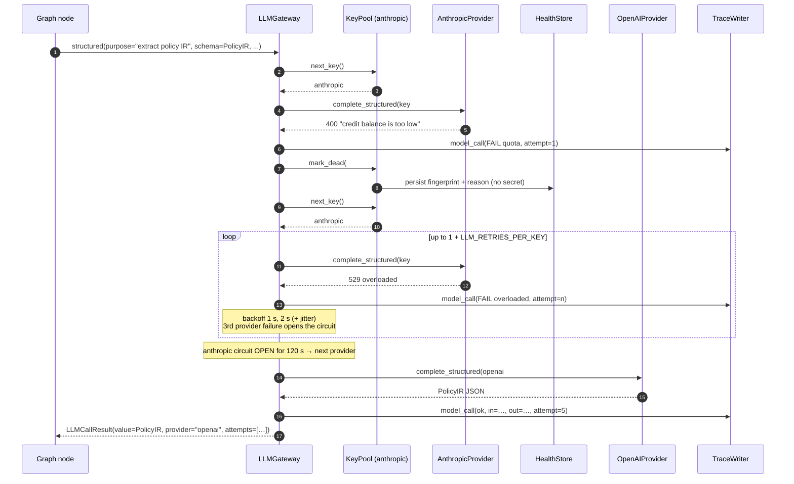
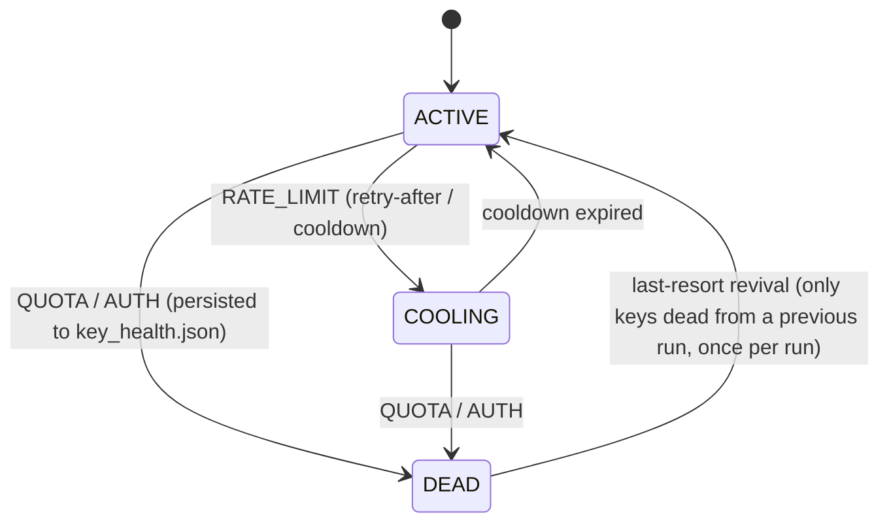

# LLM key changer (`builder/llm/`)

> "There should be key changer. For example if ANTHROPIC doesn't have the credits, then it should change to
> openai. [...] it should try it then try other api key."

Every LLM call the builder makes (rule ledger, policy extraction, prose drafting, repairs, walkthrough audits)
goes through one object, `LLMGateway`. The gateway rotates:

1. **keys within a provider**: `ANTHROPIC_API_KEY`, then `ANTHROPIC_API_KEY_2`, and so on. A key with no
   credits or an invalid key is marked **dead**. A rate-limited key **cools down**. In both cases the next key
   is tried straight away.
2. **providers in a chain**: by default `anthropic → openai → claude_code`. The gateway moves on when a
   provider has no usable key left, when its circuit breaker is open *and another provider can answer*, or
   when the provider rejects the request itself (unknown model, prompt too long, output that can't be parsed
   even after a repair).
3. **models within a key**: a key that is valid but may not use one particular model (a per-model 403,
   *"Project ... does not have access to model ..."*) is **not** dead. The gateway remembers that the model is off
   limits for that key (for this run only), tries another key for the model first, then the provider's other
   model tier (STRONG ↔ FAST), then the next provider.

The design follows the user's earlier projects: an adapter registry, an API key resolver and a circuit breaker
(Mitrailleuse), plus an LLM fallback chain with error classification, retry, rotation, and cost and latency
recording (Aletheia).

---

## Contents

1. [Module map](#1-module-map)
2. [Configuring keys](#2-configuring-keys)
3. [Provider order and models](#3-provider-order-and-models)
4. [Other settings](#4-other-settings)
5. [How one call is executed](#5-how-one-call-is-executed)
6. [Error classification → action](#6-error-classification--action)
7. [Key states, rotation order, circuit breaker](#7-key-states-rotation-order-circuit-breaker)
8. [Deadlines and timeouts](#8-deadlines-and-timeouts)
9. [Structured output](#9-structured-output)
10. [The key-health file `data/key_health.json`](#10-the-key-health-file-datakey_healthjson)
11. [Tracing](#11-tracing)
12. [Using the gateway from code](#12-using-the-gateway-from-code)
13. [Adding a provider](#13-adding-a-provider)
14. [Testing](#14-testing)
15. [Troubleshooting](#15-troubleshooting)

---

## 1. Module map

| Module | Responsibility |
|---|---|
| `builder/llm/errors.py` | `ErrorKind`, `classify_error(exc)`, recovery `POLICY` (`Action`, `KeyEffect`, `ErrorPolicy`), `retry_after_seconds`, `describe_error`, `scrub_secrets`, exceptions `ProviderError`, `ParseError`, `AllProvidersFailed` |
| `builder/llm/keys.py` | `ApiKey` (masked), `discover_keys` / `discover_all_keys` / `llm_secrets`, `claude_code_available`, `default_env`, `KeyPool` (ACTIVE / COOLING / DEAD + rotation), `HealthStore` (persistent dead keys) |
| `builder/llm/providers.py` | `LLMRole` (STRONG / FAST), the `Provider` protocol, `AnthropicProvider`, `OpenAIProvider`, `ClaudeCodeProvider`, `PROVIDER_REGISTRY`, `register_provider`, `create_provider` |
| `builder/llm/structured.py` | `schema_for_llm` (provider-friendly JSON schema), `extract_json`, `parse_json_model`, prompt helpers |
| `builder/llm/gateway.py` | `LLMGateway` (the fallback loop), `CircuitBreaker`, `AttemptRecord`, `LLMCallResult`, `GatewayConfig`, `build_gateway` |

Provider SDKs (`anthropic`, `openai`, `langchain_anthropic`, `langchain_openai`, `claude_agent_sdk`) are imported
lazily inside the adapters. `import builder.llm` works even when none of them is installed, and a test checks
this.

---

## 2. Configuring keys

Keys come from the environment: the real process environment overlaid on the repository's `.env` file. Values in
the process environment win. Settings ignores unknown variables such as `ANTHROPIC_API_KEY_2`, so the key changer
reads `.env` itself (`keys.default_env`). That way numbered keys work in `.env` as well.

### Naming convention

For a provider `p`, with prefix `P = p.upper()`, the keys are read in this order:

| Order | Variable | Notes |
|---|---|---|
| 1 | `P_API_KEY` | the usual single key |
| 2 | `P_API_KEY_1` … `P_API_KEY_20` | numbered keys, in numeric order (`_21` and above are ignored) |
| 3 | `P_API_KEYS` | a list separated by commas, semicolons or newlines |

Processing rules:

- Surrounding whitespace and quotes are stripped.
- Empty values and obvious placeholders are skipped: `<your key>`, anything ending in `...`, anything starting
  with `your` (`your_key_here`), `changeme`, `todo`, `none`, `null`, `xxxx`.
- Duplicates are removed. The first occurrence keeps its position.
- Keys are numbered from 1 in the final order. That number is what traces show: `anthropic#2(…9b1c)`.

### Examples (`.env` or exported variables)

```dotenv
# One key per provider
ANTHROPIC_API_KEY=sk-ant-api03-...f3a2
OPENAI_API_KEY=sk-proj-...77d0

# A second Anthropic key, tried when the first has no credits / is rate limited
ANTHROPIC_API_KEY_2=sk-ant-api03-...9b1c

# Or several at once (any separator: , ; newline)
ANTHROPIC_API_KEYS="sk-ant-api03-...aaaa,sk-ant-api03-...bbbb"
OPENAI_API_KEYS=sk-proj-...cccc;sk-proj-...dddd
```

With all of the above set, the Anthropic pool is
`anthropic#1(…f3a2), anthropic#2(…9b1c), anthropic#3(…aaaa), anthropic#4(…bbbb)`.

### The `claude_code` provider: the Claude Code login, no API key

`claude_code` runs Claude through the Claude Agent SDK (`claude_agent_sdk.query`), using the local Claude Code
login. It has a single pseudo key, `ApiKey("claude_code", 0, "login")`, shown as `claude_code#0(login)`. The
pseudo key is available when both of these hold:

- the `claude_agent_sdk` package is installed (`uv sync --extra agentic`, and the Docker image installs it), and
- a login exists: `~/.claude/.credentials.json` (or `$CLAUDE_CONFIG_DIR/.credentials.json`), **or**
  `CLAUDE_CODE_OAUTH_TOKEN` is set.

Set it up with `claude login` (Windows and Linux store the credentials file). On macOS the CLI keeps the login
in the Keychain, so run `claude setup-token` and export `CLAUDE_CODE_OAUTH_TOKEN`. In Docker, mount
`${HOME}/.claude` read-only or pass `CLAUDE_CODE_OAUTH_TOKEN`.

**A credentials file does not prove the login works.** The availability check only looks for the file or the
token, because it must not start a model call just to find out. If the login is missing, expired or revoked,
the bundled CLI answers with the sentence `Not logged in · Please run /login`, sometimes as an ordinary assistant
message with no error flag. The adapter turns every form of that reply into an `AUTH` failure (it is never
returned as model text). The key changer then:

1. marks `claude_code#0(login)` **dead** and writes it to the health file (§10), with no retry and no wait;
2. moves on to the next provider, or, as the last link of the default chain, raises `AllProvidersFailed`;
3. skips the login at the start of later builds for `LLM_DEAD_KEY_TTL_S`, until it is the last resort.

So an unusable `claude_code` costs at most one fast failed call per 6 hours, not one per stage. After `claude login`,
delete its entry from `data/key_health.json` (or the whole file) to use it again at once.

**The agentic track asks for proof.** A doomed agentic session burns minutes before it fails, so the agentic
fallback (`--track auto|agentic`, `builder/agentic/runner.py`) treats the login as a candidate only with evidence
(`claude_code_verified`): `CLAUDE_CODE_OAUTH_TOKEN` is set, **or** `data/key_health.json` holds an unexpired
successful call with the login (key under `"healthy"`; written by the first successful `claude_code` call of a
build and by a successful agentic session). A credentials file alone is no proof, and an `ANTHROPIC_API_KEY` is
none either (the login session blanks it; a real key is a candidate of its own). Without a live candidate the
agentic track is skipped and the trace says so (`DECISION agentic track skipped: no usable credential ...`); the
run continues on the compiled track. The login is still tried once by the gateway (a cheap failed call at worst),
and marking it dead removes its proof.

When the login pseudo key is used, the CLI subprocess gets `ANTHROPIC_API_KEY=""`. Without that, an API key in
the parent environment (perhaps one with no credits, the very reason we fell back) would take precedence over
the subscription login.

### Secrets are never shown

- `repr(key)`, `str(key)` and `key.label` show at most the last four characters, and only for secrets of 12 or
  more characters.
- `key.fingerprint` is the first 12 hex characters of SHA-256(secret). It identifies a key in files without
  revealing it.
- Error messages are passed through `scrub_secrets` (known keys plus `sk-…` / `sk-ant-…` / `Bearer …` patterns)
  before they reach the trace or the health file.
- `llm_secrets(env)` (also used by `builder.settings.secret_values`) lists every LLM credential so that
  `TraceWriter` can redact them. It deliberately leaves out the `login` pseudo secret, so the word "login" is
  never masked.

---

## 3. Provider order and models

`LLM_PROVIDERS` sets the chain. The default is `anthropic,openai,claude_code`. Commas, semicolons or spaces work
as separators, case doesn't matter, and `claude-code` is accepted. Unknown names are skipped with a warning.

```dotenv
LLM_PROVIDERS=anthropic,openai,claude_code   # default
LLM_PROVIDERS=openai,anthropic               # prefer OpenAI
LLM_PROVIDERS=claude_code                    # subscription login only
```

Each call asks for a **role**:

- `LLMRole.STRONG` is for extraction, drafting and repairs.
- `LLMRole.FAST` is for audits and probes.

The model comes from the settings field `<provider>_<role>_model`, which you can override through the
environment:

| Setting / env var | Default |
|---|---|
| `ANTHROPIC_STRONG_MODEL` / `ANTHROPIC_FAST_MODEL` | `claude-sonnet-5-5` / `claude-haiku-5-5` |
| `OPENAI_STRONG_MODEL` / `OPENAI_FAST_MODEL` | `gpt-5.6-terra` / `gpt-5.6-luna` |
| `CLAUDE_CODE_STRONG_MODEL` / `CLAUDE_CODE_FAST_MODEL` | `claude-sonnet-5-5` / `claude-haiku-5-5` |

The defaults are mid and small tiers (not the top tier of each vendor) on purpose, to save tokens and time.
Only one provider has been used for a live build so far (audit AUD-40): for the hidden briefs, set `LLM_PROVIDERS` in
`.env` to the chain that ran the accepted build, so the run does not start on an untested provider.
If a build needs a stronger model (for example for a very long brief), override a variable, such as
`ANTHROPIC_STRONG_MODEL=claude-opus-5-5` or `OPENAI_STRONG_MODEL=gpt-5.6-sol`. Nothing else changes: the
role (`STRONG` / `FAST`) a graph node asks for stays the same.

These models are for the **builder only**. The phone agent's model is fixed by the kit (`AGENT_LLM` in
`freya.py`) and is never touched.

---

## 4. Other settings

All of these live in `builder.settings.Settings`. Env var names are case-insensitive.

| Env var | Default | Meaning |
|---|---|---|
| `LLM_TIMEOUT_S` | `300` | Timeout of one attempt. A deadline can lower it (see §8). |
| `LLM_MAX_TOKENS` | `16000` | Default output cap per call. Not sent to OpenAI (see §9). |
| `LLM_RETRIES_PER_KEY` | `2` | Extra same-key attempts for transient errors (so 3 attempts per key). |
| `LLM_RATE_LIMIT_COOLDOWN_S` | `30` | Cooldown of a rate-limited key when the response has no `retry-after` header. |
| `LLM_MAX_COOLDOWN_WAIT_S` | `45` | Longest the gateway will sleep for a cooling key when nothing else can answer. |
| `LLM_KEY_HEALTH_FILE` | `data/key_health.json` | Where dead keys are remembered between runs. |
| `LLM_DEAD_KEY_TTL_S` | `21600` (6 h) | How long a remembered dead key is skipped. |

Built-in constants live in `gateway.py`:

| Constant | Value | Meaning |
|---|---|---|
| `CIRCUIT_FAILURE_THRESHOLD` | 3 | Consecutive provider-level failures that open a circuit |
| `CIRCUIT_OPEN_S` | 120 | How long the circuit stays open |
| `BACKOFF_BASE_S` | 1 | Backoff steps of 1, 2, 4 s, plus 0–25 % jitter |
| `MIN_ATTEMPT_TIMEOUT_S` | 10 | No attempt starts with less time than this before the deadline |
| `TIMEOUT_GRACE_S` | 5 | Our `asyncio.wait_for` allows the SDK timeout plus this |
| `MAX_COOLDOWN_WAITS` | 3 | Maximum number of cooldown pauses in one call |
| `MAX_ATTEMPTS_PER_CALL` | 40 | Safety cap on attempts in one call |

---

## 5. How one call is executed

```text
repeat (bounded):
    for provider in LLM_PROVIDERS order (skip providers already finished for this call):
        while the provider's circuit allows a call (or no other provider could answer) and a (key, model)
        pair is usable (the requested model on any key that may use it; else the other tier's model):
            attempt with that key, up to 1 + LLM_RETRIES_PER_KEY times for transient errors
            (or once more with a repair message for PARSE):
                timeout = min(LLM_TIMEOUT_S, time left before the deadline - 5 s)
                run the adapter  → trace.model_call(...)        # one MODEL line per attempt
                success → mark key ok, close the circuit, return LLMCallResult
                failure → classify_error → POLICY:
                          RETRY_SAME (backoff 1, 2, 4 s + jitter) | ROTATE_KEY | NEXT_MODEL | NEXT_PROVIDER
    nothing answered:
        if only cooling keys remain and the soonest cooldown ≤ LLM_MAX_COOLDOWN_WAIT_S → sleep, repeat
        elif keys were skipped only because a *previous run* marked them dead → revive them once, repeat
        else → raise AllProvidersFailed(attempts, reasons)
```

Two properties to remember:

- The gateway **never waits on a rate-limited key while another provider can answer**. If Anthropic is cooling
  and OpenAI is healthy, the call goes to OpenAI at once. The gateway sleeps only when every remaining key, in
  every remaining provider, is cooling.
- A key or provider that fails *for this call* (transient retries used up, unknown error, bad request) is not
  tried again within the same call. A later call starts fresh. Dead keys and open circuits carry over between
  calls.

### Sequence diagram

The scenario: Anthropic key #1 has no credits, key #2 is overloaded, and OpenAI answers.



---

## 6. Error classification → action

`classify_error(exc)` works on Anthropic and OpenAI SDK exceptions, their LangChain-wrapped subclasses
(`AnthropicRateLimitError`, `OpenAIContextOverflowError`, …), httpx / httpx2 transport errors, `asyncio`
timeouts, Claude Agent SDK errors (`ResultError.api_error_status`, `AssistantMessage.error`), and any exception
that carries `status_code`, `message`, `body`, `code` or `type`. It walks the exception chain (`__cause__`,
`__context__`, exception groups) in two passes. Pass 1 uses structured signals: our own `ProviderError.kind`,
quota and context-overflow markers, the HTTP status, the provider's error `type` / `code`, and the exception
class. Pass 2 uses message patterns. So a typed inner SDK error beats a vague wrapper message.

| Kind | Typical triggers | Key effect | Action | Counts for circuit |
|---|---|---|---|---|
| `QUOTA` | HTTP 402; Anthropic *"Your credit balance is too low to access the Anthropic API"* (a 400!); OpenAI 429 with `code: insufficient_quota` / *"You exceeded your current quota"*; `billing_error`; *"You have reached your specified API usage limits"*; Claude Code *"usage limit reached"* | **DEAD** (persisted) | `ROTATE_KEY` | no |
| `AUTH` | 401 / 403, *"invalid x-api-key"*, *"Incorrect API key provided"*, `permission_error`, *"Please run /login"*, Claude Code *"Not logged in"*, Claude Code CLI not installed | **DEAD** (persisted) | `ROTATE_KEY` | no |
| `MODEL_UNAVAILABLE` | 403 that names one model the key may not use: *"Project ... does not have access to model ..."*, or a 403 with `code: model_not_found`. A bare 403 stays `AUTH` | none (the model is remembered as off limits for that key, for this run) | `NEXT_MODEL` | no |
| `RATE_LIMIT` | 429 that is not a quota problem (`rate_limit_error`, `rate_limit_exceeded`, *"Rate limit reached for … tokens per min"*) | **COOLING** for `retry-after` / `retry-after-ms` seconds, else `LLM_RATE_LIMIT_COOLDOWN_S` | `ROTATE_KEY` | no |
| `OVERLOADED` | 529, 503, `overloaded_error` | none | `RETRY_SAME` with backoff, `LLM_RETRIES_PER_KEY` times, then `ROTATE_KEY` | yes |
| `SERVER` | other 5xx, `api_error`, `server_error` | none | same as OVERLOADED | yes |
| `TIMEOUT` | SDK timeouts, `asyncio.TimeoutError`, 408, 504 | none | same as OVERLOADED | yes |
| `CONNECTION` | connection reset / refused, DNS, `APIConnectionError` | none | same as OVERLOADED | yes |
| `BAD_REQUEST` | 400 / 404 / 409 / 422: model not found, unsupported parameter | none | `NEXT_PROVIDER` | no |
| `CONTEXT` | *"prompt is too long"*, `context_length_exceeded`, 413 | none | `NEXT_PROVIDER` | no |
| `PARSE` | structured output missing or invalid, empty text reply | none | `RETRY_SAME` **once** with a repair message (no backoff), then `NEXT_PROVIDER` | no |
| `UNKNOWN` | anything else | failure counted | `ROTATE_KEY` | yes |

Why each row:

- **QUOTA / AUTH**: another attempt with the same key can't succeed, and a different key might. Marking the key
  dead and persisting that saves a failed call in every later build (§10).
- **MODEL_UNAVAILABLE**: the key works, only this model is off limits to it. Killing the key would lock out
  every other model for `LLM_DEAD_KEY_TTL_S` (6 h by default) and in the next run too. Instead another key is
  tried for the model first; only when none can serve it does the provider's other tier answer (a FAST call may
  use the STRONG model and the other way round), unless a key that could serve the model is merely cooling: then
  the gateway waits for it. With no model left the call moves to the next provider. Nothing is written to the
  health file. The text must name the model: a 403 that just says *"no access"* cannot be told from a revoked key.
- **RATE_LIMIT**: the key is fine; it just needs a pause. Rotating keeps the build moving.
- **Transient errors**: they usually clear within seconds, so retry the same key. If the provider is truly down,
  the circuit breaker cuts the retries short.
- **BAD_REQUEST / CONTEXT**: every key of the same provider would get the same rejection. Another provider may
  have a different model, context window or parameter set.
- **PARSE**: the model answered, so a targeted repair prompt usually fixes it. If it fails twice, another model
  family gets a chance.

---

## 7. Key states, rotation order, circuit breaker



`KeyPool.next_key()` chooses in this order:

1. ACTIVE keys that have not cooled down during this run.
2. Keys whose cooldown has expired.
3. Within each group, the fewest consecutive failures first. Ties keep discovery order.

DEAD keys, keys still cooling, and keys excluded for the current call are never returned. A success resets the
key's failure count.

**Circuit breaker, one per provider and shared by all calls.** Three consecutive provider-level failures
(OVERLOADED, SERVER, TIMEOUT, CONNECTION, UNKNOWN) open the circuit for 120 s. While it is open the provider is
skipped. After 120 s it is HALF_OPEN and one trial is allowed: success closes the circuit, failure re-opens it.
Key-level failures (QUOTA, AUTH, RATE_LIMIT, MODEL_UNAVAILABLE) and request-level failures (BAD_REQUEST, CONTEXT,
PARSE) do not count, because they say nothing about the provider's health. When the circuit opens in the middle of
the retries on one key, the gateway moves to the next provider at once instead of trying the provider's other keys.

**The breaker only ever hands a call over to somebody else.** When no other provider could answer the call (a
single-provider setup such as only `OPENAI_API_KEY`, or every other provider dead, cooling or already tried), an
open circuit is ignored: the provider is tried with its normal retry budget and backoff, inside the call's
deadline. One transient burst therefore costs the retries of that call, not the next 120 s of model access. A
success closes the circuit; a failure keeps it open.

---

## 8. Deadlines and timeouts

Pass `deadline=` as a `time.monotonic()` value, normally `ctx.budget.deadline()`. The gateway then:

- caps each attempt at `min(LLM_TIMEOUT_S, deadline − now − 5 s)`. Our `asyncio.wait_for` adds the 5 s grace on
  top of the SDK's own timeout, so the call can never run past the deadline;
- starts no attempt with less than 10 s left. It raises `AllProvidersFailed` with the reason
  `"deadline reached"`;
- skips any backoff or cooldown sleep that would leave less than 10 s + 5 s for the attempt after it.

Without a deadline, every attempt gets `LLM_TIMEOUT_S`.

---

## 9. Structured output

`gateway.structured(schema=SomePydanticModel, ...)` always returns a **validated** instance. If an adapter hands
back a dict, the gateway validates it too, and a validation failure counts as `PARSE`.

`schema_for_llm(model)` turns the Pydantic model into a schema the providers accept:

- `$defs` are inlined; only recursive definitions stay as `$ref` (a recursive root is expanded once).
- `additionalProperties: false` goes on every object with declared properties.
- A single-value `const` becomes `enum`.
- Keywords Anthropic rejects are dropped: `minimum`, `maximum`, `exclusiveMinimum`, `exclusiveMaximum`,
  `multipleOf`, `minLength`, `maxLength`, `minItems` > 1, `maxItems`, `pattern`. So are nested `title`,
  `default` and `discriminator`.

Pydantic still enforces the dropped constraints when it validates the answer. Free-form maps (`dict[str, X]`)
stay open, because closing them would only allow `{}`.

| Provider | How |
|---|---|
| `anthropic` | `ChatAnthropic(model, api_key, max_tokens, timeout, max_retries=0)` — **never** temperature or top_p. `with_structured_output(schema_dict, method="json_schema", include_raw=True)`. If `parsed` is missing or invalid, it falls back to `parse_json_model(raw text)`. Schemas with free-form maps use prompt-instructed JSON, because Anthropic's constrained decoding closes every object. |
| `openai` | `ChatOpenAI(model, api_key, timeout, max_retries=0)`. `with_structured_output(schema_dict, method="json_schema", strict=False, include_raw=True)`, with the same fallback. `max_tokens` is not forwarded: reasoning models count hidden reasoning tokens against `max_completion_tokens` and would come back empty. |
| `claude_code` | `claude_agent_sdk.query` with `ClaudeAgentOptions(model, system_prompt, tools=[], allowed_tools=[], max_turns=1, setting_sources=[], permission_mode="default", env={CLAUDE_CODE_MAX_OUTPUT_TOKENS, ANTHROPIC_API_KEY: ""})`. The system prompt ends with *"Return ONLY JSON matching this JSON schema: …"* and the reply goes through `parse_json_model`. Token usage comes from `ResultMessage.usage`. |

`extract_json` accepts:

- plain JSON;
- a fenced `json` code block (or a fence with no language);
- leading prose before the first balanced `{…}` or `[…]`. The scan understands strings, and objects are
  preferred when an object is expected.

On a `PARSE` failure the retry appends to the user message:

```text
IMPORTANT - your previous reply could not be used because: JSON does not match PolicyIR: identity.max_wrong_total: Field required
Reply again with ONLY one JSON object that matches the required schema exactly: every required field present, correct types, no extra keys, no prose, no markdown fences.
```

---

## 10. The key-health file `data/key_health.json`

When a key is marked DEAD (QUOTA or AUTH), the pool writes it to the health file. The next build starts with
that key already dead and skips it, which saves a failed call (and its latency) at the start of every stage.

```json
{
  "version": 1,
  "entries": [
    {
      "provider": "anthropic",
      "fingerprint": "3f9c0a1b2c3d",
      "label": "anthropic#1(…f3a2)",
      "reason": "quota: BadRequestError: Error code: 400 - Your credit balance is too low to access the Anthropic API...",
      "marked_at": 1791712345.12,
      "marked_at_utc": "2026-10-11T08:32:25Z"
    }
  ]
}
```

- **Never a secret.** Only the provider, the 12-hex fingerprint, the masked label, a scrubbed reason and a
  timestamp are stored.
- **TTL.** Entries older than `LLM_DEAD_KEY_TTL_S` (6 h by default) are ignored and pruned on the next write.
- **Robustness.**
  - The file is written atomically (temp file plus `os.replace`).
  - A missing, unreadable or corrupt file counts as empty.
  - A write failure, such as a read-only volume, only logs a warning.
- **Last resort.** If a call fails *only* because keys were marked dead by a **previous** run, the gateway
  revives those keys once and tries them. If one works, its entry is removed. Keys that died in *this* run are
  never revived.
- **Reset.** Delete the file, or a single entry, after topping up credits or replacing a key.
- In Docker, mount `./data:/app/data` so the file persists between runs.

---

## 11. Tracing

Every attempt, successful or not, produces exactly one `trace.model_call(...)`. That is one `MODEL` line in
`traces/<slot>-<UTC>.log` and one JSON record in the `.jsonl` file. Key events (dead, cooling, rotation, cooldown
wait, revival) are written as `LLM` events. Example from the scenario in §5:

```text
2026-10-11T17:02:03.101Z | MODEL  | anthropic/claude-sonnet-5-5 | key=anthropic#1(…f3a2) | FAIL quota 0.4s attempt=1 | extract policy IR | error: BadRequestError: Error code: 400 - Your credit balance is too low to access the Anthropic API...
2026-10-11T17:02:03.102Z | LLM    | anthropic#1(…f3a2) marked dead (quota) | provider=anthropic
2026-10-11T17:02:03.102Z | LLM    | anthropic: rotating away from anthropic#1(…f3a2) | purpose=extract policy IR
2026-10-11T17:02:04.870Z | MODEL  | anthropic/claude-sonnet-5-5 | key=anthropic#2(…9b1c) | FAIL overloaded 1.7s attempt=2 | extract policy IR | error: OverloadedError: Error code: 529 - Overloaded
2026-10-11T17:02:07.912Z | MODEL  | anthropic/claude-sonnet-5-5 | key=anthropic#2(…9b1c) | FAIL overloaded 1.9s attempt=3 | extract policy IR | error: OverloadedError: Error code: 529 - Overloaded
2026-10-11T17:02:12.330Z | MODEL  | anthropic/claude-sonnet-5-5 | key=anthropic#2(…9b1c) | FAIL overloaded 2.2s attempt=4 | extract policy IR | error: OverloadedError: Error code: 529 - Overloaded
2026-10-11T17:02:44.016Z | MODEL  | openai/gpt-5.6-terra | key=openai#1(…77d0) | ok 31.7s in=12034 out=2981 attempt=5 | extract policy IR
```

A rate-limited key, followed by a cooldown wait because nothing else could answer:

```text
... | MODEL  | anthropic/claude-haiku-5-5 | key=anthropic#1(…f3a2) | FAIL rate_limit 0.3s attempt=1 | draft node prose | error: RateLimitError: Error code: 429 - ...
... | LLM    | anthropic#1(…f3a2) cooling for 20s (rate_limit) | provider=anthropic
... | LLM    | all usable keys are cooling; waiting 20.1s | purpose=draft node prose
... | MODEL  | anthropic/claude-haiku-5-5 | key=anthropic#1(…f3a2) | ok 18.2s in=8120 out=1544 attempt=2 | draft node prose
```

The run summary at the end of the trace counts model calls by `provider/model`, which the hackathon requires.
`LLMCallResult.attempts` carries the same `AttemptRecord`s (provider, model, key label, ok, error kind, error,
latency, attempt number, action taken) for code that wants them.

---

## 12. Using the gateway from code

```python
from builder.llm import AllProvidersFailed, LLMRole, build_gateway

llm = build_gateway(settings, trace)            # keys from .env + environment, providers from the registry

result = await llm.structured(
    purpose="extract policy IR",                 # one line, written to the trace for every attempt
    schema=PolicyIR,
    system=system_prompt,
    user=user_prompt,
    role=LLMRole.STRONG,
    max_tokens=16000,
    deadline=ctx.budget.deadline(),
)
ir: PolicyIR = result.value
print(result.provider, result.model, result.key_label, len(result.attempts), result.input_tokens)

text = (await llm.text(purpose="walkthrough audit", system="", user=prompt, role=LLMRole.FAST)).value

try:
    ...
except AllProvidersFailed as exc:               # every provider / key failed (or none was usable)
    trace.error(str(exc), attempts=len(exc.attempts), reasons=exc.reasons)
```

Diagnostics, which the build never calls:

```python
llm.describe()                 # order, models per role, key states (masked), circuit states, models a key may not use
llm.available_providers()      # providers with a live key and a closed circuit
await llm.probe()              # one tiny FAST call per provider → {provider: {ok, model, key, latency_s, ...}}
llm.secret_values()            # every credential, for TraceWriter.add_secrets(...)
```

Graph nodes should catch `AllProvidersFailed` and route through state (never-crash policy). They should not
retry by themselves: the gateway has already tried everything that made sense.

---

## 13. Adding a provider

1. **Write an adapter** that satisfies the `Provider` protocol: a `name`, `model_for(role, settings)`,
   `async complete_text(...)` and `async complete_structured(...)`. Do no retries inside it (use `max_retries=0`
   or the equivalent), and let the SDK's exceptions propagate. `classify_error` recognises most of them by
   status code, class name or message. When the SDK reports a failure *without* raising, raise
   `ProviderError(message, kind=ErrorKind.X, status_code=..., retry_after_s=...)`. Import the SDK inside the
   methods.

   ```python
   from builder.llm.providers import LLMRole, StructuredResult, TextResult, register_provider
   from builder.llm.structured import json_instruction, parse_json_model, schema_for_llm

   class MistralProvider:
       name = "mistral"

       def __init__(self, env):
           pass

       def model_for(self, role, settings):
           return getattr(settings, f"mistral_{LLMRole(role).value}_model", None) or "mistral-large-latest"

       async def complete_text(self, key, model, system, user, *, max_tokens, timeout_s):
           from langchain_mistralai import ChatMistralAI   # lazy import
           chat = ChatMistralAI(model=model, api_key=key.secret, max_tokens=max_tokens, timeout=timeout_s, max_retries=0)
           msg = await chat.ainvoke([("system", system), ("human", user)])
           usage = msg.usage_metadata or {}
           return TextResult(msg.text, usage.get("input_tokens"), usage.get("output_tokens"))

       async def complete_structured(self, key, model, schema, system, user, *, max_tokens, timeout_s):
           prompt = f"{system}\n\n{json_instruction(schema_for_llm(schema))}"
           result = await self.complete_text(key, model, prompt, user, max_tokens=max_tokens, timeout_s=timeout_s)
           return StructuredResult(parse_json_model(result.text, schema), result.text,
                                   result.input_tokens, result.output_tokens)

   register_provider("mistral", MistralProvider)
   ```

2. **Keys.** These are discovered automatically as `MISTRAL_API_KEY`, `MISTRAL_API_KEY_1..20` and
   `MISTRAL_API_KEYS`. For a keyless provider, such as a local model, give the adapter a
   `discover_keys(env) -> list[ApiKey]` method. The gateway uses it instead of the env convention.
3. **Order.** Add the name to `LLM_PROVIDERS`, for example `anthropic,openai,mistral,claude_code`. Add
   `mistral_strong_model` and `mistral_fast_model` to `Settings` if you want them configurable.
4. **Redaction.** If the new keys should be redacted from traces by name, add the provider to
   `DEFAULT_KEY_PROVIDERS` in `keys.py`. (`Settings.secret_values` already redacts every variable whose name
   looks like a credential.)
5. **Classification.** If the vendor uses unusual error texts, add them to the pattern tables in `errors.py`,
   and add a row to the table in `tests/unit/test_llm_errors.py`.
6. **Tests.** Fake the SDK class the way `tests/unit/test_llm_gateway.py` fakes `ChatAnthropic` (monkeypatch the
   lazy loader). Never call the real API from unit tests.

---

## 14. Testing

```bash
.venv/Scripts/python.exe -m pytest tests/unit/test_llm_errors.py tests/unit/test_llm_keys.py \
    tests/unit/test_llm_structured.py tests/unit/test_llm_gateway.py -q
.venv/Scripts/python.exe -m ruff check builder/llm tests/unit/test_llm_*.py
```

What the tests cover:

- **Errors.** A classification table built from constructed exceptions: duck-typed fakes with real-looking
  Anthropic and OpenAI texts; real SDK exception classes instantiated offline with an `httpx2` request and
  response; LangChain-wrapped errors; httpx transport errors; exception chains and groups. Also `retry-after`
  parsing, the policy table and secret scrubbing.
- **Keys.** Discovery order, dedupe and placeholders, masking, the claude_code login detection, `.env`
  precedence, rotation order, cooldown expiry, dead keys, health-file persistence, TTL, corruption handling and
  revival.
- **Structured.** Schema cleaning (inlining, closed objects, dropped keywords, property names that look like
  keywords, maps, recursion, compatibility with `anthropic.transform_schema` and LangChain's OpenAI conversion)
  and JSON extraction edge cases.
- **Gateway.** Every fallback scenario runs against scripted fake providers on a simulated clock:
  - quota on key 1 goes to key 2, and the next run skips key 1;
  - all Anthropic keys dead goes to OpenAI;
  - rate limit rotates without waiting, or waits and reuses the key when nothing else is left;
  - transient retry with backoff;
  - the circuit opens and later half-opens, and an open circuit never refuses the only provider;
  - a per-model 403 keeps the key alive and falls back to another key, the other model tier or the next provider;
  - BAD_REQUEST and CONTEXT go to the next provider;
  - PARSE gets one repair retry, then the next provider;
  - the deadline caps timeouts and stops new attempts;
  - revival as a last resort;
  - one MODEL line per attempt and no secret in the trace, checked against the real `NullTrace`.

  The adapters are also tested with fake `ChatAnthropic`, `ChatOpenAI` and `claude_agent_sdk` objects.
- **Lazy imports.** A subprocess check confirms `import builder.llm` loads no provider SDK.

---

## 15. Troubleshooting

| Symptom | Likely cause | Fix |
|---|---|---|
| `AllProvidersFailed ... no attempt could be made`, reasons `anthropic: no keys configured` | No key variables visible to the process | Check `.env` names (`ANTHROPIC_API_KEY`, `ANTHROPIC_API_KEY_2`, `ANTHROPIC_API_KEYS`). In Docker every variable must be passed explicitly (`docker-compose.yml` uses `${VAR:-}`); prefer `ANTHROPIC_API_KEYS` there. |
| A key is skipped right from the start of a build | It is listed as dead in `data/key_health.json` from an earlier run | After topping up or replacing it, delete the entry or the file. Entries expire after `LLM_DEAD_KEY_TTL_S` anyway, and a call that has nothing else revives them once. |
| `FAIL quota` on an Anthropic key that "has credits" | The organisation's monthly spend limit was reached (*"You have reached your specified API usage limits"*) | Raise the limit in the console, or let the chain fall back. |
| OpenAI answers although Anthropic keys exist | Anthropic keys are dead, cooling, or the circuit is open | Read the `MODEL` / `LLM` lines in the trace. `llm.describe()` shows each key's state and the circuit. |
| `claude_code: no keys configured` | `claude_agent_sdk` not installed, or no login | `uv sync --extra agentic`; run `claude login`, or set `CLAUDE_CODE_OAUTH_TOKEN` (macOS / Docker); in Docker mount `~/.claude` read-only. |
| `claude_code` fails with `auth` (*"Not logged in · Please run /login"*) | The credentials file or `CLAUDE_CODE_OAUTH_TOKEN` is missing, expired or revoked, or `CLAUDE_CONFIG_DIR` points elsewhere. The key changer marks the login dead and moves on | Check `$CLAUDE_CONFIG_DIR/.credentials.json`, run `claude login` again, then delete the `claude_code` entry from `data/key_health.json`. |
| Every provider fails right away with `auth` / `no keys configured` | No API key is set and the Claude login is dead | Put `OPENAI_API_KEY` (or `ANTHROPIC_API_KEY`) in `.env`. `build_gateway(settings, None).describe()` lists every provider's keys (masked) and their states. |
| Many `FAIL parse` lines | The schema is too large or ambiguous for one shot, or the output hit `max_tokens` (the error then says *"reply truncated at max_tokens"*) | Raise `max_tokens` for that call, or split the schema. The repair retry quotes the exact validation errors. |
| `FAIL bad_request` on every call to one provider | Wrong model id (`ANTHROPIC_STRONG_MODEL`, …) or a parameter the model rejects | Fix the model name. The gateway already falls through to the next provider for each call. |
| `FAIL model_unavailable`, then answers from the other model tier | The key's project has no access to the configured model (a per-model 403) | Request access, or set `OPENAI_STRONG_MODEL` / `ANTHROPIC_STRONG_MODEL` (…`_FAST_MODEL`) to a model the key may use. `llm.describe()` lists `unavailable_models` per key; the key itself stays alive. |
| Calls stop with `deadline reached` | The build budget is nearly used up | Expected: the graph finalises with what it has. Raise `--budget-s` / `BUILD_TIME_BUDGET_S` if you have the time. |
| A secret appears in a log | It should not: errors are scrubbed and `TraceWriter` redacts `secret_values` | Report it. Add the value pattern to `scrub_secrets` and a test in `test_llm_errors.py`. |
| Long pauses with `all usable keys are cooling; waiting …` | Every key of every provider is rate limited | Add keys (`*_API_KEYS`) or another provider. Lower `LLM_MAX_COOLDOWN_WAIT_S` to fail faster. |
