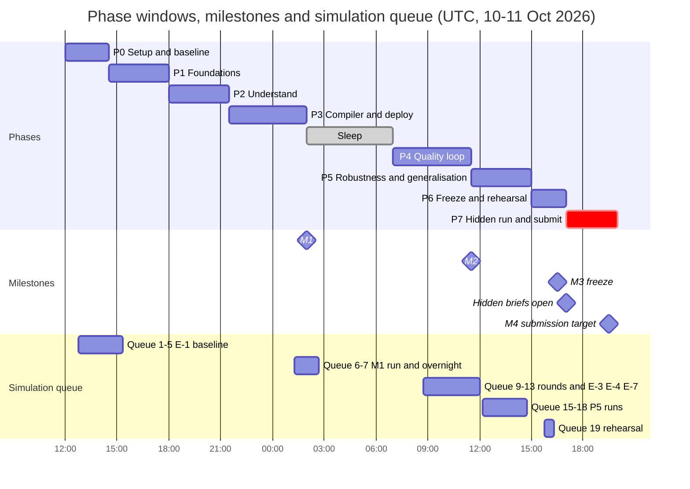

# TASKS — executable backlog for the Freya "Build the Builder" builder

Date: Sat 2026-10-10. Source of truth: decisions brief v2 (requirements R1–R9, ADR-01..16, phases P0–P7, milestones
M1–M4, experiments E-1..E-8, questions Q-1..Q-8, risks RK-1..RK-12). Companion documents:
[ARCHITECTURE](ARCHITECTURE.md), [FOLDER_STRUCTURE](FOLDER_STRUCTURE.md), [IMPLEMENTATION_PLAN](IMPLEMENTATION_PLAN.md).
Rules and kit facts: [11](research/11_hackathon_rules_and_kit.md); τ^τ-bench principles: [12](research/12_tau_tau_bench_lessons.md).
Kit docs are cited by their path after T0.4 copies the kit to the repo root:
[docs/api.md](api.md), [docs/workflow-format.md](workflow-format.md), [docs/tools-and-code.md](tools-and-code.md)
(until then they are at `data/build-the-builder-v3/build-the-builder/docs/`).

## Contents

- [Legend](#legend)
- [P0 — Setup & baseline](#p0--setup--baseline)
- [P1 — Foundations](#p1--foundations)
- [P2 — Understand](#p2--understand)
- [P3 — Compiler & deploy = M1](#p3--compiler--deploy--m1)
- [P4 — Quality loop = M2](#p4--quality-loop--m2)
- [P5 — Robustness & generalisation](#p5--robustness--generalisation)
- [P6 — Freeze & rehearsal = M3](#p6--freeze--rehearsal--m3)
- [P7 — Hidden run & submit = M4](#p7--hidden-run--submit--m4)
- [Cross-cutting tables](#cross-cutting-tables)
  - [Blocked on organizers or user](#blocked-on-organizers-or-user)
  - [Approvals by category](#approvals-by-category)
  - [Simulation queue](#simulation-queue)
  - [Critical path](#critical-path)
  - [Start here](#start-here)
  - [Cut list](#cut-list)
- [Traceability](#traceability)
- [Summary: hours per phase vs windows](#summary-hours-per-phase-vs-windows)

## Legend

| Field | Meaning |
|---|---|
| ID | `T<phase>.<n>`, phase 0–7 as in the brief (`T3.12` = 12th task of P3). IDs are stable; new tasks get the next free number. |
| Status | `[ ]` open, `[x]` done (the checkbox at the start of each task). The text after a task title says what is missing. Synced 10 Oct 2026. |
| Priority | `MUST` = needed for the phase exit, a milestone or compliance. `SHOULD` = clear score or robustness gain, dropped only under time pressure. `COULD` = first to drop (see [Cut list](#cut-list)). |
| Estimate | Hands-on hours for one developer working with Claude Code, in 0.25 h steps. Simulation wall time is **not** included; it is in the [Simulation queue](#simulation-queue). |
| deps | Task IDs that must be done first; `—` = none. |
| Tags | `[APPROVAL]` needs the user's go-ahead before it runs: it spends Freya credits, creates workspace objects or spends builder LLM budget (Q-7, Q-5). One standing approval per category may cover several tasks ([Approvals by category](#approvals-by-category)). `[BLOCKED:Q-n]` waits for that answer; the [Blocked](#blocked-on-organizers-or-user) table gives the default used if no answer comes. `[SIM]` runs a simulation: one at a time per workspace, so it goes through the [Simulation queue](#simulation-queue). `R1`–`R9` = requirement IDs. `paper:P1`–`paper:P8` = τ^τ-bench principles ([12](research/12_tau_tau_bench_lessons.md) §4); the `paper:` prefix keeps them apart from the phase IDs P0–P7. |
| Files | Paths from the brief §5 repo layout; [FOLDER_STRUCTURE](FOLDER_STRUCTURE.md) has the file-level tree. Kit files sit at the repo root after T0.4. |
| Accept | Testable acceptance criteria. Commands run from the repo root in Git Bash after `source env.sh`. On this Windows host the builder and tests run in the Python 3.13 venv (`.venv/Scripts/python.exe`); the literal `python3 builder/build.py …` is exercised in Docker and in the clean-clone run (T6.1, T6.2). The kit scripts (`freya.py`, `tools/run_cases.py`, `tools/score.py`) are standard library only and run with any `python3`. |

**Definition of done (every code task).** Code and tests in the listed files; `.venv/Scripts/python.exe -m pytest -q -m "not live and not sim"`
green; `.venv/Scripts/python.exe -m ruff check builder tests evals` clean; `.venv/Scripts/python.exe -m pytest tests/unit/test_compliance.py -q` green (no brief literal in
`builder/`, kit files unmodified); every new model call and Freya write emits a trace event (ADR-13); the user makes all git commits, none by the assistant.

**Fix protocol (P4, P5; P7 crash fixes only).** (1) The triage names the brief rule (ledger id) that the agent broke.
(2) The fix changes the builder (IR schema, extraction prompt, compiler, hook, codegen), never the exported workflow and
never a branch keyed on a practice case id. (3) It adds an offline regression test (unit test on a gold IR or a synthetic
variant). (4) The agent is rebuilt with `builder/build.py`; no manual edit on the platform. (5) A fix counts when its
target case passes 3/3 in the next queued round. (6) `public-test-set.json` and expected outcomes are never edited
(paper P6).

**Unverified platform facts** are tagged **[UNVERIFIED]** with the experiment (E-n) or task that settles them.

## P0 — Setup & baseline

> **Status (10 Oct sync):** done except T0.5 (partial), T0.8 (not recorded) and T0.11–T0.15 (E-1b and E-1c blocked: the Claude Code CLI is not logged in). Base agent baseline: 0/13 (`results/BASELINE.md` §1).

Window: Sat 12:00–14:30 UTC. Exit: baseline table in `results/BASELINE.md` (E-1).

| ID | Task | Prio | h | Depends on | Tags |
|---|---|---|---|---|---|---|
| T0.1 | Install uv and Python 3.13 | MUST | 0.25 | — | R7 |
| T0.2 | Start Docker Desktop and verify the daemon | MUST | 0.25 | — | R7 |
| T0.4 | Copy the kit to the repo root unmodified; verify VERSION | MUST | 0.25 | — | R8 |
| T0.5 | Remove the PyCharm scaffold and the 3.14 venv | MUST | 0.25 | — | R7 |
| T0.6 | env.sh and .env with the FREYA_API_KEY alias and FREYA_BANK_TEAM_KEY | MUST | 0.25 | T0.4 | R8 [BLOCKED:Q-6] |
| T0.7 | Smoke the Freya key with freya.workspace_id() | MUST | 0.25 | T0.6 | R8 |
| T0.8 | Post organizer questions Q-1..Q-4 | MUST | 0.25 | — | R8 paper:P2 |
| T0.9 | Get the user's answers Q-5..Q-8 | MUST | 0.25 | — | R8 |
| T0.10 | E-1a: base agent baseline on all 13 practice cases | MUST | 0.25 | T0.7, T0.9 | [APPROVAL] [SIM] paper:P3 paper:P6 |
| T0.11 | E-1b: run the example builder on Brief A | MUST | 0.5 | T0.7, T0.9 | [APPROVAL] [SIM] [BLOCKED:Q-5] paper:P3 |
| T0.12 | E-1c: measure the example Brief A agent with --reps 3 | MUST | 0.25 | T0.11 | [APPROVAL] [SIM] paper:P3 paper:P6 |
| T0.13 | E-1d: run the example builder on Brief A + B | SHOULD | 0.25 | T0.12 | [APPROVAL] [SIM] [BLOCKED:Q-5] paper:P3 |
| T0.14 | E-1e: measure the example A+B agent on all 13 cases with --reps 3 | SHOULD | 0.25 | T0.13 | [APPROVAL] [SIM] paper:P6 |
| T0.15 | Write results/BASELINE.md (P0 exit) | MUST | 0.5 | T0.10, T0.12 | paper:P3 paper:P6 |
| T0.16 | Read and annotate Brief A: every rule | MUST | 1 | T0.4 | R1 R2 R3 R4 paper:P1 |
| T0.17 | Annotate Brief B and its supersessions | MUST | 0.5 | T0.16 | R1 R4 paper:P1 paper:P2 |
| T0.18 | Map the 13 practice cases to rules and fix families | SHOULD | 0.25 | T0.17 | paper:P6 |
| T0.19 | Study the seed: example skill, example agent and trace, base agent | SHOULD | 0.5 | T0.11 | paper:P3 |
| T0.20 | Kit VERSION watch and re-sync procedure | SHOULD | 0.25 | T0.4 | R8 |

Phase load: 20 tasks, 7 h; compared with the window in the [Summary](#summary-hours-per-phase-vs-windows).

- [x] **T0.1 · Install uv and Python 3.13** — `MUST` · 0.25 h · deps: — · tags: `R7`
  - **Do:** The host has CPython 3.14.6 (current `.venv`) and 3.12; `uv` is not on PATH (checked 10 Oct). Install uv
    0.12.24 (research 06 §5.1: avoid 0.13.0, one day old) with the versioned installer
    `powershell -c "irm https://astral.sh/uv/0.12.24/install.ps1 | iex"`, then `uv python install 3.13`. On a second
    developer machine repeat T0.1–T0.2.
  - **Files:** none (host toolchain).
  - **Accept:**
    - `uv --version` prints `uv 0.12.24`.
    - `uv python find 3.13` prints an interpreter path.
    - `uv run --no-project --python 3.13 python -c "import sys; assert sys.version_info[:2] == (3, 13)"` exits 0.

- [x] **T0.2 · Start Docker Desktop and verify the daemon** — `MUST` · 0.25 h · deps: — · tags: `R7`
  - **Do:** Docker CLI 29.6.1 is installed but the engine was not running (research 06 §0). Start Docker Desktop with the
    Linux engine; keep it running for the weekend.
  - **Files:** none.
  - **Accept:** `docker info --format '{{.ServerVersion}}'` prints a version;
    `docker run --rm python:3.13-slim-trixie python -V` prints `Python 3.13.x`.

- [x] **T0.4 · Copy the kit to the repo root unmodified; verify VERSION** — `MUST` · 0.25 h · deps: — · tags: `R8` — *kit copied to the repo root*
  - **Do:** `cp -p` (byte-exact) from `data/build-the-builder-v3/build-the-builder/`: `freya.py`, `VERSION`,
    `env.example`, `public-test-set.json`, `tools/openapi.json`, `tools/run_cases.py`, `tools/score.py`, `docs/api.md`,
    `docs/workflow-format.md`, `docs/tools-and-code.md`, `briefs/brief-a.md`, `briefs/brief-b.md`,
    `examples/base-agent.json`, `examples/agent_builder.py`, `.claude/skills/build-phone-agent/SKILL.md` (ADR-02). The kit
    `README.md` is not copied: the root `README.md` is ours (T6.7); the kit README stays in `data/` as the kit changelog.
    Write a sha256 manifest of the copied files for T1.18.
  - **Files:** the kit paths above; `tests/fixtures/kit_manifest.sha256`.
  - **Accept:**
    - `cat VERSION` prints `3`.
    - For every copied path `cmp "data/build-the-builder-v3/build-the-builder/$f" "$f"` prints nothing.
    - `sha256sum -c tests/fixtures/kit_manifest.sha256` reports every file `OK`.

- [ ] **T0.5 · Remove the PyCharm scaffold and the 3.14 venv** — `MUST` · 0.25 h · deps: — · tags: `R7` — *partial: main.py and test_main.http deleted; .venv-py314-old, .idea and .junie still present*
  - **Do:** delete `main.py` and `test_main.http` (FastAPI hello-world, not part of the builder; already gone from the working tree, the user stages the removal). Delete `.venv` (CPython 3.14.6;
    LangGraph classifiers stop at 3.13, research 06 §2.1); `uv sync` in T1.1 recreates it on 3.13. `.idea/` stays local.
  - **Files:** `main.py`, `test_main.http` (removed), `.venv/` (recreated).
  - **Accept:** `main.py` and `test_main.http` are absent from the folder; after T1.1 `.venv/Scripts/python -V` prints
    `Python 3.13.x`.

- [x] **T0.6 · env.sh and .env with the FREYA_API_KEY alias and FREYA_BANK_TEAM_KEY** — `MUST` · 0.25 h · deps: T0.4 · tags: `R8` `[BLOCKED:Q-6]` — *keys in `.env` (no env.sh); values not recorded here*
  - **Do:** The user's `.env` holds the Freya key as `FREYA_KEY`; the kit reads `FREYA_API_KEY`, and `freya.py` builds
    its headers at import time. `cp env.example env.sh`; set `FREYA_API_KEY` to the `FREYA_KEY` value,
    `FREYA_API_URL=https://staging-app.freyavoice.ai`, and `FREYA_BANK_TEAM_KEY` = the team's secret (16+ characters, the
    same for the whole event; if Q-6 has no answer by 13:00, generate one with
    `python3 -c "import secrets; print(secrets.token_urlsafe(24))"` and keep it). Add the same two lines to `.env`.
    Rewrite `.env.example` with every variable of brief §5 (`FREYA_API_KEY`, `FREYA_KEY` alias, `FREYA_API_URL`,
    `FREYA_BANK_TEAM_KEY`, `FREYA_WORKSPACE_ID`, `ANTHROPIC_API_KEY`, `OPENAI_API_KEY`, `BUILDER_TRACK`,
    `BUILD_TIME_BUDGET_S`, `SELF_TEST`, `BUILD_SLOT`, `DRY_RUN`) and empty values. Never print a key value.
  - **Files:** `env.sh` (local, ignored), `.env` (local, ignored), `.env.example`.
  - **Accept:**
    - `source env.sh && python3 -c "import os; k=os.environ['FREYA_API_KEY']; t=os.environ['FREYA_BANK_TEAM_KEY']; assert k.startswith('fak_') and len(t) >= 16"` exits 0.
    - `git check-ignore env.sh .env` lists both; `grep -E '=.+' .env.example` prints nothing.

- [x] **T0.7 · Smoke the Freya key with freya.workspace_id()** — `MUST` · 0.25 h · deps: T0.6 · tags: `R8`
  - **Do:** One read-only call (`GET /api/v2/workspaces`) proves key, base URL and User-Agent. No write.
  - **Files:** `env.sh` (optional `FREYA_WORKSPACE_ID` line).
  - **Accept:** `source env.sh && python3 -c "import freya; print(freya.workspace_id())"` prints an id (no HTML
    `error code: 1010`, no 401).

- [ ] **T0.8 · Post organizer questions Q-1..Q-4** — `MUST` · 0.25 h · deps: — · tags: `R8` `paper:P2` — *no record that the organizer questions were posted*
  - **Do:** The user posts one message in the organizers' support channel:
    - Q-1: Will the hidden briefs come with practice cases or practice sessions? Can the mock bank create practice
      sessions for cases we write ourselves, so the builder can self-test on a new brief?
    - Q-2: Is a Docker command acceptable as `run_command` for the top-10 re-run, and which Python version and OS do you
      use for the native command?
    - Q-3: Can a hidden brief consist of several files or build on another brief, as Brief B builds on Brief A? Is
      `now` always local time without a timezone?
    - Q-4: Are there rate limits on the Freya API or on simulations that a builder's self-tests must respect?
  - **Files:** none (answers go into the [Blocked](#blocked-on-organizers-or-user) table).
  - **Accept:** message posted (time noted in the Blocked table); each answer copied into that table within 30 min of
    arrival and the affected tasks re-prioritised.

- [x] **T0.9 · Get the user's answers Q-5..Q-8** — `MUST` · 0.25 h · deps: — · tags: `R8` — *Q-5 partly answered, Q-8 solo, plan approved; see the blocked table*
  - **Do:** Ask: Q-5 builder LLM access (`ANTHROPIC_API_KEY` and budget, or a Claude login for the Agent SDK); Q-6
    `FREYA_BANK_TEAM_KEY` and repo visibility; Q-7 approval for E-1 and the planned [Simulation queue](#simulation-queue)
    (ask for a standing approval with a ceiling: number of simulations, Anthropic spend); Q-8 solo or two people.
  - **Files:** none.
  - **Accept:** four answers recorded in the Blocked table; a standing approval, if given, has its scope written there.

- [x] **T0.10 · E-1a: base agent baseline on all 13 practice cases** — `MUST` · 0.25 h · deps: T0.7, T0.9 · tags: `[APPROVAL]` `[SIM]` `paper:P3` `paper:P6` — *base agent 0/13, `results/BASELINE.md` §1*
  - **Do:** `python3 -c "import freya,json; print(freya.save_workflow('base', json.load(open('examples/base-agent.json'))))"`
    (dev slot `base`: created once, updated in place) → `agent_id`; then
    `python3 tools/run_cases.py <agent_id> --reps 3 --out results/e1-base.json` (no `--brief` = all 13 cases). Queue
    position 5: run it after the example-builder runs (see T0.11).
  - **Files:** `results/e1-base.json`, `results/log.jsonl`.
  - **Accept:** `results/e1-base.json` has `"runs": 3` and 13 entries in `final`; one new line in `results/log.jsonl`;
    the printed slowest-turn median noted for T0.15.

- [ ] **T0.11 · E-1b: run the example builder on Brief A** — `MUST` · 0.5 h · deps: T0.7, T0.9 · tags: `[APPROVAL]` `[SIM]` `[BLOCKED:Q-5]` `paper:P3` — *blocked: the Claude Code CLI is not logged in*
  - **Do:** Run it inside the pristine kit copy so its slot state (`.freya-agents.json`), `out/`, `traces/` and `results/`
    stay apart from ours: `cd data/build-the-builder-v3/build-the-builder && source ../../../env.sh &&
    uv run --no-project --python 3.13 --with claude-agent-sdk python examples/agent_builder.py briefs/brief-a.md`. Its
    inner commands call `python3` (standard library only; resolves to the host 3.14 in Git Bash). Its Bash commands time
    out after 15 min by default and 20 min at most (`BASH_DEFAULT_TIMEOUT_MS=900000`, `BASH_MAX_TIMEOUT_MS=1200000` in
    `examples/agent_builder.py`): start no other simulation in the workspace while it runs, or its test can time out
    waiting in the queue. Record wall time, turns, cost (the `done:`
    line), `workflow_id`, `agent_id` and the trace path.
  - **Files:** `data/build-the-builder-v3/build-the-builder/{traces,out,results}/` (ignored), notes for T0.15.
  - **Accept:** the run ends with `done: … turns, … s, $…`; its `traces/<start time>.jsonl` exists; `agent_id`
    recorded for T0.12.

- [ ] **T0.12 · E-1c: measure the example Brief A agent with --reps 3** — `MUST` · 0.25 h · deps: T0.11 · tags: `[APPROVAL]` `[SIM]` `paper:P3` `paper:P6` — *blocked by T0.11*
  - **Do:** From the repo root: `python3 tools/run_cases.py <agent_id> --brief A --reps 3 --out results/e1-example-a.json`;
    export the agent for node and tool counts:
    `python3 -c "import freya; freya.export_workflow('<workflow_id>', 'results/e1-example-a.workflow.json')"` (GET only).
  - **Files:** `results/e1-example-a.json`, `results/e1-example-a.workflow.json`.
  - **Accept:** JSON has `"runs": 3` and 10 `final` entries; the export loads and has `workflow.nodes`.

- [ ] **T0.13 · E-1d: run the example builder on Brief A + B** — `SHOULD` · 0.25 h · deps: T0.12 · tags: `[APPROVAL]` `[SIM]` `[BLOCKED:Q-5]` `paper:P3` — *blocked by T0.11*
  - **Do:** As T0.11 with `briefs/brief-a.md briefs/brief-b.md` (the kit skill then tests with `--brief B`, 3 cases).
  - **Files:** as T0.11.
  - **Accept:** `done:` line; `agent_id` and `workflow_id` recorded.

- [ ] **T0.14 · E-1e: measure the example A+B agent on all 13 cases with --reps 3** — `SHOULD` · 0.25 h · deps: T0.13 · tags: `[APPROVAL]` `[SIM]` `paper:P6` — *blocked by T0.13*
  - **Do:** `python3 tools/run_cases.py <agent_id> --reps 3 --out results/e1-example-ab.json`; export to
    `results/e1-example-ab.workflow.json`.
  - **Files:** `results/e1-example-ab.json`, `results/e1-example-ab.workflow.json`.
  - **Accept:** JSON has `"runs": 3` and 13 `final` entries.

- [ ] **T0.15 · Write results/BASELINE.md (P0 exit)** — `MUST` · 0.5 h · deps: T0.10, T0.12 · tags: `paper:P3` `paper:P6` — *written with E-1a only; the P0 exit waits for E-1b and E-1c*
  - **Do:** One row per measured agent (base, example-A, example-AB if run): cases, passed 3/3, per-case passes x/3,
    failures per `family`, slowest-turn median, build wall time, builder turns and cost, workflow nodes and tools (from
    the exports). Below: shortened top failure reasons from the `run_cases` output; kit `VERSION`; date. Add an empty
    "Progress" table (date, slot, plan, passed 3/3) that later rounds append to. State the M2 target as numbers: example
    builder cases passed 3/3 on Brief A (x/10) and on A+B (y/13).
  - **Files:** `results/BASELINE.md`.
  - **Accept:** the numbers equal the `passed` fields of `results/e1-*.json` (spot-check each row); the M2 target is
    written as two numbers.

- [x] **T0.16 · Read and annotate Brief A: every rule** — `MUST` · 1.0 h · deps: T0.4 · tags: `R1` `R2` `R3` `R4` `paper:P1` — *`docs/research/13_brief_rule_mechanism_map.md`, `tests/fixtures/policy/brief_a_ledger.json`*
  - **Do:** Read Brief A in full. Write one entry per numbered rule (1–47), per table row (band table, outcome table) and
    per unnumbered normative sentence (call-variable table, the business-day and holiday sentence, the
    transfer-after-promise sentence, the sentence that Brief A never uses `add_note`): `{id, kind, quote (verbatim),
    category (ADR-06 PolicyIR section), mechanism_hint (code|route|tool_schema|hook|prompt), pub_cases}`. Ids follow the
    ledger scheme of T2.3 (file stem + rule number, or `L<line>` for unnumbered text). Test data: brief literals are
    allowed in `tests/`.
  - **Files:** `tests/fixtures/brief_a_rules.json`, `tests/unit/test_fixture_quotes.py`.
  - **Accept:** 47 `numbered` entries; `uv run pytest tests/unit/test_fixture_quotes.py` proves every `quote` is a
    substring of `briefs/brief-a.md` after whitespace normalisation; every `category` is an ADR-06 section name.

- [x] **T0.17 · Annotate Brief B and its supersessions** — `MUST` · 0.5 h · deps: T0.16 · tags: `R1` `R4` `paper:P1` `paper:P2` — *`docs/research/13_brief_rule_mechanism_map.md`, `tests/fixtures/policy/brief_ab_ledger.json`*
  - **Do:** Same for Brief B rules 1–11 and its closing paragraph; add `supersedes`: the Brief A ids each Brief B rule
    replaces or narrows (example of what the SupersessionLog captures: B rule 4 narrows A rules 28 and 30 per product).
  - **Files:** `tests/fixtures/brief_b_rules.json`.
  - **Accept:** 11 numbered entries + the closing paragraph; quotes grounded by the same test; every `supersedes` id
    exists in `brief_a_rules.json`.

- [ ] **T0.18 · Map the 13 practice cases to rules and fix families** — `SHOULD` · 0.25 h · deps: T0.17 · tags: `paper:P6`
  - **Do:** `PUB-01..PUB-13` → rule ids exercised (from each case's `script` and `checks`) and one fix family: identity,
    dates, amounts, persuasion, intents, multi-product, closing. Used by triage (T4.2) to route failures to T4.6–T4.12.
  - **Files:** `tests/fixtures/pub_case_rules.json`.
  - **Accept:** 13 entries; every rule id exists in the two rule fixtures.

- [x] **T0.19 · Study the seed: example skill, example agent and trace, base agent** — `SHOULD` · 0.5 h · deps: T0.11 · tags: `paper:P3` — *`docs/research/04` and `05`*
  - **Do:** Read `.claude/skills/build-phone-agent/SKILL.md`, `examples/base-agent.json` (2 conversation nodes, 4 tools,
    `close_call` as a workflow-level `end_of_call` lifecycle tool), the E-1 example export and its trace. List patterns
    that passed (node split, hooks, `what_to_do_next` wording, extraction settings, prompt lines) and defects. Write the
    section "Borrow / avoid" in `results/BASELINE.md`.
  - **Files:** `results/BASELINE.md`.
  - **Accept:** ≥ 5 borrow items, each with a JSON path in the export and the module that will reproduce it
    (`builder/compiler/hooks.py`, `builder/compiler/profiles/staged.py`, `builder/prompts/agent/*`).

- [ ] **T0.20 · Kit VERSION watch and re-sync procedure** — `SHOULD` · 0.25 h · deps: T0.4 · tags: `R8`
  - **Do:** At each phase start compare the published kit version with `VERSION` (kit README lists changes; RK-11). On
    a bump: download into a new folder under `data/`, diff against the root copies, re-copy unmodified, regenerate
    `tests/fixtures/kit_manifest.sha256`, re-run the unit and compliance suites. Kit changes are never hand-merged into
    `builder/` (ADR-02). The procedure text goes into `README.md` (T6.7).
  - **Files:** `tests/fixtures/kit_manifest.sha256` (on a bump).
  - **Accept:** the first check is done in P0; every phase exit gate (T1.20, T2.16, T3.23, T4.22, T5.19, T6.8, T7.1)
    repeats `cat VERSION` against the published version.

## P1 — Foundations

> **Status (10 Oct sync):** code in place. Open: T1.4 (SDK inside the image), T1.18 (kit-manifest check) and T1.20 (the offline suite was red at sync: 7 failures in `tests/unit/test_compile_staged.py`).

Window: Sat 14:30–18:00 UTC. Exit: `python3 builder/build.py briefs/brief-a.md tools/openapi.json --dry-run` writes a
trace; the Docker image builds.

| ID | Task | Prio | h | Depends on | Tags |
|---|---|---|---|---|---|---|
| T1.1 | pyproject.toml, .python-version, uv.lock, requirements.txt | MUST | 0.5 | T0.1, T0.5 | R7 |
| T1.2 | Dockerfile and .dockerignore | MUST | 0.5 | T1.1 | R7 |
| T1.3 | docker-compose.yml: services builder, evals, tests | MUST | 0.25 | T1.2 | R7 R8 |
| T1.4 | Check the Claude Agent SDK inside the image (ADR-15) | SHOULD | 0.5 | T1.2 | R7 [APPROVAL] [BLOCKED:Q-5] |
| T1.5 | builder/settings.py: env aliases and defaults | MUST | 0.25 | T1.1 | R8 |
| T1.6 | builder/budget.py | MUST | 0.25 | T1.5 | R8 paper:P8 |
| T1.7 | builder/trace.py with a LangChain callback | MUST | 0.75 | T1.5 | R8 paper:P8 |
| T1.8 | LLM key changer (`builder/llm/`): providers, keys, errors, structured output | MUST | 0.75 | T1.5, T1.7 | R7 [APPROVAL] [BLOCKED:Q-5] |
| T1.9 | claude_code provider (Claude Agent SDK, local login) | SHOULD | 0.5 | T1.8 | R7 [APPROVAL] [BLOCKED:Q-5] |
| T1.10 | builder/freya/client.py: wrapper over the root freya.py | MUST | 0.5 | T1.5, T1.7 | R8 paper:P4 |
| T1.11 | builder/inputs.py: classify args, derive the slot | MUST | 0.25 | T1.5 | R8 |
| T1.12 | builder/ingest/brief_loader.py | MUST | 0.75 | T1.11 | R9 paper:P1 |
| T1.13 | builder/ingest/tool_api.py: OpenAPI → ToolContract | MUST | 0.75 | T1.11 | R5 paper:P4 |
| T1.14 | builder/compiler/workflow_model.py: Pydantic mirror of the workflow JSON | MUST | 1 | T1.1 | R8 |
| T1.15 | builder/checks/lint.py: core rules | MUST | 0.75 | T1.14 | R8 |
| T1.16 | Graph skeleton: state, context, routing, stub nodes | MUST | 0.75 | T1.6, T1.7 | R7 |
| T1.17 | builder/build.py: entry point and --dry-run | MUST | 0.5 | T1.16, T1.11 | R7 R8 |
| T1.18 | Compliance tests: brief literals and unmodified kit | MUST | 0.5 | T0.4, T1.1 | R8 |
| T1.19 | Test scaffolding and lint config | MUST | 0.25 | T1.1 | R7 |
| T1.21 | Guardrail flow: `builder/guardrails/`, guard nodes | MUST | 1.0 | T1.16 | R8 |
| T1.22 | Observability: `builder/observability/` (JSONL always, Langfuse when keys are set) | MUST | 0.75 | T1.7 | R8 |
| T1.23 | LLM and Freya rate limiting | MUST | 0.5 | T1.8 | R8 |
| T1.20 | P1 exit gate | MUST | 0.25 | T1.3, T1.17, T1.18, T1.19 | R7 |

Phase load: 20 tasks, 10.5 h; compared with the window in the [Summary](#summary-hours-per-phase-vs-windows).

- [x] **T1.1 · pyproject.toml, .python-version, uv.lock, requirements.txt** — `MUST` · 0.5 h · deps: T0.1, T0.5 · tags: `R7` — *no requirements.txt; uv.lock is the only lock file*
  - **Do:** Hatchling project with the `builder` package; `requires-python = ">=3.12,<3.14"` (lower bound revisited after
    Q-2); `.python-version` = `3.13`. Runtime deps: `langgraph` 1.2.x, `langchain-core`, `langchain-anthropic`,
    `claude-agent-sdk`, `pydantic` 2, `pydantic-settings`, `jinja2`, `pypdf` (PDF briefs), `pyyaml` (YAML OpenAPI
    files). Dev extra: `pytest`, `ruff`. Lock with uv; export the native install file with
    `uv export --no-dev --no-hashes -o requirements.txt`.
  - **Files:** `pyproject.toml`, `.python-version`, `uv.lock`, `requirements.txt`.
  - **Accept:**
    - `uv sync --locked` exits 0 and creates `.venv` on 3.13.
    - `uv run python -c "import langgraph, langchain_anthropic, claude_agent_sdk, pydantic, jinja2, pypdf, yaml"` exits 0.
    - In a fresh 3.13 venv `pip install -r requirements.txt` succeeds.

- [x] **T1.2 · Dockerfile and .dockerignore** — `MUST` · 0.5 h · deps: T1.1 · tags: `R7`
  - **Do:** `python:3.13-slim-trixie` base; uv copied from the pinned `ghcr.io/astral-sh/uv:0.12.24` image;
    `uv sync --locked --no-dev`; non-root user; `WORKDIR /app` holds the repo (kit files at the root + `builder/`);
    `ENTRYPOINT ["python3", "builder/build.py"]` (ADR-15). `.dockerignore`: `.venv`, `.env`, `env.sh`, `.git`, `.idea`,
    `.junie`, `data/`, `results/`, `traces/`, `out/`, caches. No secret in the image.
  - **Files:** `Dockerfile`, `.dockerignore`.
  - **Accept:**
    - `docker build -t freya-builder .` succeeds.
    - `docker run --rm --entrypoint id freya-builder -u` prints a non-zero uid.
    - `docker run --rm --entrypoint sh freya-builder -c 'ls -a /app'` lists no `.env` or `env.sh`.

- [x] **T1.3 · docker-compose.yml: services builder, evals, tests** — `MUST` · 0.25 h · deps: T1.2 · tags: `R7` `R8` — *builder and tests services; no evals service in the compose file*
  - **Do:** `builder` (args = brief files + tool API file, e.g.
    `docker compose run --rm builder briefs/brief-a.md tools/openapi.json`), `evals` (`evals/run_matrix.py`,
    `tools/run_cases.py`), `tests` (`pytest -m "not live and not sim"`). Env passed explicitly under `environment:`
    (the brief §5 variables); never `env_file: .env` (ADR-15). Bind mounts so Docker and native runs share state and
    update the same workflows: `out/`, `traces/`, `results/`, `data/` (read-only) and the slot state file
    `.freya-agents.json`. That file must exist and hold valid JSON before the first Docker run
    (`test -s .freya-agents.json || echo '{}' > .freya-agents.json`): Docker may create a directory for a missing
    single-file mount, and `freya.save_workflow` cannot parse an empty file.
  - **Files:** `docker-compose.yml`.
  - **Accept:**
    - `docker compose config | grep -c env_file` prints `0`.
    - `docker compose run --rm builder briefs/brief-a.md tools/openapi.json --dry-run` exits 0 and the trace appears in
      `./traces` on the host (after T1.17).
    - `docker compose run --rm tests` passes.

- [ ] **T1.4 · Check the Claude Agent SDK inside the image (ADR-15)** — `SHOULD` · 0.5 h · deps: T1.2 · tags: `R7` `[APPROVAL]` `[BLOCKED:Q-5]` — *not verified inside the image*
  - **Do:** ADR-15 says the SDK may need the Claude Code CLI or Node in the image **[UNVERIFIED → this task]**. Run one
    minimal `claude_agent_sdk.query(prompt="Reply with OK")` in the container with the chosen auth (Q-5). If it fails
    for a missing CLI or Node, add them to the image and retry; if a Claude login cannot be passed into a container,
    record that the agentic track runs natively only. MUST when Q-5 = Claude login only and Docker is the run path.
  - **Files:** `Dockerfile` (if changed), ADR-15 status in `docs/ARCHITECTURE.md`.
  - **Accept:** the container prints a result message, or the failure and the chosen fallback are recorded as ADR-15
    status.

- [x] **T1.5 · builder/settings.py: env aliases and defaults** — `MUST` · 0.25 h · deps: T1.1 · tags: `R8`
  - **Do:** Settings from the process env (and `.env` when present natively): `FREYA_API_KEY` (fallback `FREYA_KEY`),
    `FREYA_API_URL`, `FREYA_BANK_TEAM_KEY`, `FREYA_WORKSPACE_ID`, `ANTHROPIC_API_KEY`, `OPENAI_API_KEY`, the per-provider model settings (`ANTHROPIC_STRONG_MODEL` = `claude-sonnet-5-5`, `OPENAI_STRONG_MODEL` = `gpt-5.6-terra`, …), `BUILDER_TRACK` (`compiled|agentic|auto`, default `auto`), `BUILD_TIME_BUDGET_S` (1680),
    `SELF_TEST` (`auto|none|smoke|practice`), `BUILD_SLOT`, `DRY_RUN`. Secrets as `SecretStr`.
    `export_for_kit()` writes `FREYA_API_KEY`/`FREYA_API_URL` into `os.environ` before anything imports the root
    `freya.py`, which reads them at import time.
  - **Files:** `builder/settings.py`, `tests/unit/test_settings.py`.
  - **Accept:**
    - In a subprocess with only `FREYA_KEY=fak_x` set, after `export_for_kit()`
      `import freya; freya.HEADERS["Authorization"] == "Bearer fak_x"`.
    - `repr(settings)` contains no key value; `SELF_TEST=foo` raises an error listing the allowed values.

- [x] **T1.6 · builder/budget.py** — `MUST` · 0.25 h · deps: T1.5 · tags: `R8` `paper:P8`
  - **Do:** `Budget(start, total_s)`: deadline, `remaining()`, a reserve for deploy + finalize, `can_afford(stage)` from
    per-stage estimates (understand, extract, compile, remote_validate, deploy, smoke, walkthrough, practice ≥ 12 min per
    ADR-12), stage timers that emit trace events; injectable clock (ADR-13).
  - **Files:** `builder/budget.py`, `tests/unit/test_budget.py`.
  - **Accept:** with a fake clock and a 1680 s budget, `can_afford("practice")` is False at 20 min and True at 2 min;
    `remaining()` never negative; stage durations appear as trace events.

- [x] **T1.7 · builder/trace.py with a LangChain callback** — `MUST` · 0.75 h · deps: T1.5 · tags: `R8` `paper:P8` — *explicit TraceWriter calls; no LangChain callback*
  - **Do:** `TraceWriter(slot)` writes `traces/<slot>-<UTC timestamp>.log` (plain text) and `.jsonl` (ADR-13). Events:
    `start` (UTC, args, git commit, kit VERSION, settings without secrets), `model_call` (model, one-line purpose,
    tokens, duration; from a `BaseCallbackHandler` attached to every LLM call, purpose passed as run metadata),
    `freya_write` (operation, workflow_id, agent_id, version, node count, tool count), `test` (kind, result), `decision`,
    `ambiguity`, `supersession`, `error`, `end` (UTC, status, duration). Redact `fak_…`, `sk-ant-…`, `Bearer …` and the
    team key value. Flush after every event so a crash still leaves a trace.
  - **Files:** `builder/trace.py`, `tests/unit/test_trace.py`.
  - **Accept:**
    - A test emitting every event kind gives a `.log` with START … END in order and one MODEL line per call with model
      and purpose; every `.jsonl` line parses.
    - With real-looking keys in the env, `grep -E 'fak_|sk-ant-' traces/*` finds nothing.
    - A process killed mid-run leaves a readable `.log`.

- [x] **T1.8 · LLM key changer (`builder/llm/`): providers, keys, errors, structured output** — `MUST` · 0.75 h · deps: T1.5, T1.7 · tags: `R7` `[APPROVAL]` `[BLOCKED:Q-5]` — *LLM key changer in `builder/llm/` (anthropic, openai, claude_code); see `docs/LLM_KEY_CHANGER.md`*
  - **Do (spec, superseded by `builder/llm/gateway.py`):** `builder/llm/factory.py` `get_llm(purpose, tier)` → `claude-opus-5-5` (understand, extract, repair, audit) or
    `claude-sonnet-5-5` (cheaper passes); backend `anthropic|agent_sdk` (ADR-14). `anthropic_backend.py` builds
    `ChatAnthropic` with explicit `max_tokens` and no `temperature`/`top_p`. `structured.py`
    `structured_call(schema, prompt, purpose)` uses `with_structured_output(schema, method="json_schema")`, re-validates
    with Pydantic, logs through the trace callback. LLM-facing schemas: `extra="forbid"`, no numeric or length
    constraints (research 06 §2.6).
  - **Files (built):** `builder/llm/{errors,keys,providers,structured,gateway,ratelimit}.py`, `tests/unit/test_llm_*.py`. The planned `factory.py`, `*_backend.py` and `tests/integration/test_llm_live.py` were not created.
  - **Accept:**
    - With a fake chat model, `structured_call` returns a parsed object and writes one MODEL trace line.
    - `grep -rnE "temperature|top_p" builder/llm` prints nothing.
    - `uv run pytest -m live tests/integration/test_llm_live.py` ([APPROVAL], small spend) returns a 2-field model in < 60 s.

- [x] **T1.9 · claude_code provider (Claude Agent SDK, local login)** — `SHOULD` · 0.5 h · deps: T1.8 · tags: `R7` `[APPROVAL]` `[BLOCKED:Q-5]` — *claude_code provider implemented; unusable until the Claude Code login exists*
  - **Do (spec, superseded by `ClaudeCodeProvider` in `builder/llm/providers.py`):** `builder/llm/agent_sdk_backend.py` with the same `structured_call` interface over `claude_agent_sdk.query`
    (no tools; JSON answer validated by Pydantic; one retry on a validation error); one MODEL trace line per SDK
    assistant turn. MUST when Q-5 = Claude login only.
  - **Files:** `builder/llm/agent_sdk_backend.py`, `tests/unit/test_llm_factory.py`.
  - **Accept:** unit test with a stubbed `query`; the live smoke of T1.8 also passes with `agent_sdk` selected.

- [x] **T1.10 · builder/freya/client.py: wrapper over the root freya.py** — `MUST` · 0.5 h · deps: T1.5, T1.7 · tags: `R8` `paper:P4`
  - **Do:** Import the root `freya.py` only after `settings.export_for_kit()`. Wrap `freya.api`: keep the browser-like
    User-Agent (`Mozilla/5.0 (build-the-builder)`; a builder name may be added inside the parentheses); retry GET only
    (3 tries with backoff on 5xx, timeouts, `URLError`); never retry POST/PUT (a retried write can record twice); emit a
    `freya_write` trace event per write; under `DRY_RUN` every write raises `DryRunBlocked` before any network I/O; map an
    HTML `error code: 1010` body to a clear error.
  - **Files:** `builder/freya/client.py`, `tests/unit/test_freya_client.py`.
  - **Accept:** with a patched `urlopen`: GET retried 3× on 502 then succeeds; POST fails after 1 attempt; the
    User-Agent starts with `Mozilla/5.0`; `DRY_RUN` blocks `save_workflow` with zero `urlopen` calls.

- [x] **T1.11 · builder/inputs.py: classify args, derive the slot** — `MUST` · 0.25 h · deps: T1.5 · tags: `R8`
  - **Do:** `classify(argv)`: a file that parses as JSON or YAML with a top-level `openapi` key is the tool API file;
    every other file is a brief file, kept in the given order; a directory expands to its files (sorted). Exactly one
    tool API file is required. Slot = `BUILD_SLOT`, else derived from the brief stems (one file: its stem; several:
    common prefix + distinguishing suffixes, so `brief-a` + `brief-b` → `brief-ab`), sanitised to `[a-z0-9-]`.
  - **Files:** `builder/inputs.py`, `tests/unit/test_inputs.py`.
  - **Accept:**
    - `classify(["briefs/brief-a.md", "briefs/brief-b.md", "tools/openapi.json"])` and the same list with the OpenAPI
      file first both give 2 briefs, 1 tool API file and slot `brief-ab`.
    - `BUILD_SLOT=hidden-1` overrides the slot.
    - No tool API file → exit code 2 with a message naming the expected file kind (and a trace error event).

- [x] **T1.12 · builder/ingest/brief_loader.py** — `MUST` · 0.75 h · deps: T1.11 · tags: `R9` `paper:P1`
  - **Do:** Load `.md`/`.txt` (UTF-8, BOM and CRLF tolerant), `.eml` (stdlib `email`: headers, text parts, attachments
    recursively), `.csv` (rendered as a Markdown table with its header), `.json` (pretty-printed), `.pdf` (`pypdf`, text
    per page) into `BriefDoc(path, kind, text, sha256, line index, metadata)`; mail metadata = subject, date, from. Never
    drop content silently: an unknown type is read as text with a warning event.
  - **Files:** `builder/ingest/brief_loader.py`, `tests/unit/test_brief_loader.py`, `tests/fixtures/ingest/`
    (synthetic `sample.eml` with a `.csv` attachment, `codes.csv`, `extract.pdf`, `memo.txt`).
  - **Accept:** each fixture loads with its expected strings; `briefs/brief-a.md` loads with 47 numbered-rule lines
    detected; an unknown binary yields a warning event, not an exception.

- [x] **T1.13 · builder/ingest/tool_api.py: OpenAPI → ToolContract** — `MUST` · 0.75 h · deps: T1.11 · tags: `R5` `paper:P4`
  - **Do:** `ToolContract(name, url = servers[0].url + path, method, summary, request fields {name, type, format, enum,
    required, description}, response fields incl. array item fields, ok/error semantics from the descriptions)` (ADR-04).
    Resolve local `$ref`s (components); name = the path's last segment unless an `operationId` is present; a missing
    `servers` entry is an error event, not a crash. Contracts are frozen and JSON-serialisable for the graph state.
  - **Files:** `builder/ingest/tool_api.py`, `tests/unit/test_tool_api.py`, `tests/fixtures/openapi_ref_variant.json`
    (synthetic: `$ref`s, renamed fields, other enums).
  - **Accept:** `tools/openapi.json` → 7 contracts, each url starting with the `servers` url; enums and required lists
    equal the file's (asserted in the test only); the `$ref` fixture parses to the same structure.

- [x] **T1.14 · builder/compiler/workflow_model.py: Pydantic mirror of the workflow JSON** — `MUST` · 1.0 h · deps: T1.1 · tags: `R8`
  - **Do:** Typed models for [docs/workflow-format.md](workflow-format.md) and [docs/tools-and-code.md](tools-and-code.md):
    `Workflow` (`initial_node`, `nodes`, `system_prompt`, `global_nodes`, `test_variables`, `tools`; no `agent_config`),
    one node model per `node_type` (`conversation`, `api_request`, `code`, `end_call`) holding only the fields that type
    keeps, `Transition`, `Condition` (`always`, `matches_intent`, grouped `or`/`and`, bare variable), `ExtractionVar`,
    `ToolFunction` (+ `config`, `response_mapping`, `pre_process_code`, `post_process_code`), `Terminal`.
    `extra="forbid"`; dump with `exclude_none` so no `null` leaves the builder (RK-12).
  - **Files:** `builder/compiler/workflow_model.py`, `tests/unit/test_workflow_model.py`.
  - **Accept:**
    - `examples/base-agent.json` and the complete clinic example JSON block of `docs/workflow-format.md` load and dump
      back equal (dict compare).
    - A `null` value, `tools` on a `code` node, `pre_actions` on a `conversation` node and an `agent_config` key are each
      rejected.

- [x] **T1.15 · builder/checks/lint.py: core rules** — `MUST` · 0.75 h · deps: T1.14 · tags: `R8`
  - **Do:** `LintReport(errors, warnings)` with rule ids, from the kit checklist: L01 no `null`; L02 `initial_node`
    exists; L03 every `target_node` exists (`__previous__` only in global nodes); L04 a passthrough node has
    `passthrough_default_transition` and ends with an `always` transition; L05 `tools` only on `conversation`,
    `pre_actions` only on `api_request`/`code`; L06 `response_mapping` paths start with `data.` and sit at node level for
    `pre_actions`; L07 no `{{` or `}}` in `code_exec` code or hooks; L08 `end_call` nodes: `transitions: []`, terminal
    handler `__function__:end_call`, silent `on_enter`, `disable_inactivity_monitor: true`; L09 every extraction variable
    sets `min_confidence`; L10 no top-level `"logic": "and"`; L11 no `const`; L12 `max_node_turns` comes with
    `max_turn_transition`; L13 `api_call` body fields are leaves under `body.properties`, each with a `default`; L14
    `maxRetries: 0` on every model-called tool; L15 a boolean result is compared with both `"true"` and `"True"`.
  - **Files:** `builder/checks/lint.py`, `tests/unit/test_lint.py`, `tests/fixtures/workflows/` (one broken fixture per rule).
  - **Accept:** each rule's fixture yields exactly that rule id and its fixed copy yields none; `examples/base-agent.json`
    gives 0 errors, or each error is listed in the test as a known defect of the example.

- [x] **T1.16 · Graph skeleton: state, context, routing, stub nodes** — `MUST` · 0.75 h · deps: T1.6, T1.7 · tags: `R7` — *18 node modules, including `draft_prose` and the three guard nodes*
  - **Do:** `graph/state.py` `BuilderState` TypedDict exactly as brief §4 (`run_id`, `slot`, `started_at`, `deadline_at`,
    `inputs`, `tool_contracts`, `rule_ledger`, `supersessions`, `ambiguities`, `policy_ir`, `policy_errors`, `workflow`,
    `lint_report`, `sandbox_report`, `remote_validation`, `deploy`, `self_tests`, `repairs`, `track`, `trace_events`
    (Annotated list, `operator.add`), `status`); `graph/context.py` `Context` dataclass (llm factory, freya client, trace
    writer, budget, settings); `graph/build_graph.py` with the canonical nodes and edges of brief §4;
    `graph/routing.py` with try counters (< 2) and the unrecoverable → `agentic_build` branches; one stub module per node;
    `InMemorySaver` checkpointer (ADR-16).
  - **Files:** `builder/graph/state.py`, `builder/graph/context.py`, `builder/graph/build_graph.py`,
    `builder/graph/routing.py`, `builder/graph/nodes/{load_inputs,understand_brief,extract_policy,validate_policy,repair_policy,compile_workflow,static_checks,repair_compile,remote_validate,deploy,self_test,decide,finalize,agentic_build}.py`,
    `tests/graph/test_skeleton.py`.
  - **Accept:**
    - `set(graph.get_graph().nodes)` contains the 14 node names.
    - A stubbed run reaches END with `status == "dry_run"`.
    - Routing tests: policy errors with tries 0 or 1 → `repair_policy`, tries 2 → `agentic_build`; lint failure with
      tries 2 → `agentic_build`.

- [x] **T1.17 · builder/build.py: entry point and --dry-run** — `MUST` · 0.5 h · deps: T1.16, T1.11 · tags: `R7` `R8`
  - **Do:** `python3 builder/build.py <brief>... <tool_api> [--dry-run]`. Put the repo root first on `sys.path` and drop
    `builder/`: run as a script, `sys.path[0]` is `builder/`, where the `builder/freya/` package would shadow the root
    `freya.py`. Then settings → `export_for_kit()` → classify inputs → trace start → graph → print
    `workflow_id=… agent_id=… export=…` → exit 0 when an agent was exported (or a dry run finished), non-zero otherwise.
    `--dry-run` or `DRY_RUN=1`: no Freya writes and no remote validation; LLM calls still happen once real nodes replace
    the stubs.
  - **Files:** `builder/build.py`, `builder/__init__.py`, `tests/unit/test_entrypoint.py`.
  - **Accept:**
    - `uv run python builder/build.py briefs/brief-a.md tools/openapi.json --dry-run` exits 0 and writes
      `traces/brief-a-<ts>.log` with START, every visited node, END.
    - The test asserts `freya.__file__` is the root `freya.py` inside a run started as a script.
    - No arguments → usage text and exit code 2; with stub nodes no socket is opened (network guard of T1.19).

- [ ] **T1.18 · Compliance tests: brief literals and unmodified kit** — `MUST` · 0.5 h · deps: T0.4, T1.1 · tags: `R8` — *brief-literal test exists; kit-manifest check (`tests/fixtures/kit_manifest.sha256`) not created*
  - **Do:** `test_no_brief_literals.py` builds a deny-list from every file in `briefs/` and `evals/synthetic_briefs/**`
    (ISO dates, backticked identifiers, quoted sentences, `HH:MM` times, numbers in tables) plus the enum values of
    `tools/openapi.json`, and scans `builder/**` (Python string constants via `ast`, template text) and
    `.claude/skills/collections-workflow-patterns/` (ADR-16). Single common words (e.g. an outcome name that is also an
    English word) match only as whole string constants. `allowed_literals.txt` lists exceptions with a one-line reason
    each (the seven tool names, fixed by the rules). `test_kit_unmodified.py` checks `tests/fixtures/kit_manifest.sha256`,
    which also pins `AGENT_LLM` in `freya.py`.
  - **Files:** `tests/compliance/test_no_brief_literals.py`, `tests/compliance/test_kit_unmodified.py`,
    `tests/compliance/allowed_literals.txt`.
  - **Accept:**
    - `.venv/Scripts/python.exe -m pytest tests/unit/test_compliance.py -q` passes on the skeleton.
    - A test-of-the-test plants an ISO holiday date from a brief into a temp copy of a builder file and the suite reports
      it with file:line; editing `freya.py` fails the manifest test.

- [x] **T1.19 · Test scaffolding and lint config** — `MUST` · 0.25 h · deps: T1.1 · tags: `R7`
  - **Do:** `tests/conftest.py`: repo-root paths, a fake LLM fixture, a network guard that fails any socket use unless the
    test is marked `live` or `sim`; markers `live` and `sim` in `pyproject.toml`; ruff config (line length 100).
  - **Files:** `tests/conftest.py`, `pyproject.toml`.
  - **Accept:** `.venv/Scripts/python.exe -m pytest -q -m "not live and not sim"` green; `.venv/Scripts/python.exe -m ruff check builder tests evals` clean; a test
    that opens a socket without a marker fails.

- [x] **T1.21 · Guardrail flow (`builder/guardrails/`, guard nodes)** — `MUST` · 1.0 h · deps: T1.16 · tags: `R8` — *done; see [GUARDRAILS](GUARDRAILS.md)*
  - **Files:** `builder/guardrails/`, `builder/graph/nodes/guard_inputs.py`, `guard_policy.py`, `guard_workflow.py`.

- [x] **T1.22 · Observability: JSONL always, Langfuse when keys are set** — `MUST` · 0.75 h · deps: T1.7 · tags: `R8` — *done; see [OBSERVABILITY](OBSERVABILITY.md)*
  - **Files:** `builder/observability/`, `docker-compose.langfuse.yml`.

- [x] **T1.23 · LLM and Freya rate limiting** — `MUST` · 0.5 h · deps: T1.8 · tags: `R8` — *done*
  - **Files:** `builder/llm/ratelimit.py`, `builder/freya/ratelimit.py`.

- [ ] **T1.20 · P1 exit gate** — `MUST` · 0.25 h · deps: T1.3, T1.17, T1.18, T1.19 · tags: `R7` — *waits for a green offline suite; 7 failures in `test_compile_staged.py` at sync*
  - **Do:** Run the P1 exit commands natively and in Docker; check kit `VERSION` (T0.20).
  - **Files:** none.
  - **Accept:** native dry run writes a trace; `docker compose build builder` succeeds and the compose dry run writes a
    trace on the host; unit and compliance suites green.

## P2 — Understand

> **Status (10 Oct sync):** understand, extraction, validation, repair and gold IR fixtures exist. Open: variants v01–v03 (T2.12–T2.14) and the live understand tests (T2.15, T2.16).

Window: Sat 18:00–21:30 UTC. Exit: Brief A, A+B and the variants produce valid grounded IRs; coverage 100% of numbered
rules.

| ID | Task | Prio | h | Depends on | Tags |
|---|---|---|---|---|---|---|
| T2.1 | builder/policy/ir.py: the PolicyIR model | MUST | 1 | T1.13 | R1 R2 R3 R4 R5 paper:P1 |
| T2.2 | builder/policy/intents.py: intent catalog seed | MUST | 0.25 | T2.1 | R3 R5 |
| T2.3 | Rule ledger: builder/understand/ledger.py and its prompt | MUST | 1 | T1.8, T1.12 | R1 R2 R3 R4 R5 paper:P1 paper:P2 [APPROVAL] |
| T2.4 | builder/understand/grounding.py | MUST | 0.5 | T1.12 | paper:P1 |
| T2.5 | builder/understand/coverage.py | MUST | 0.75 | T2.4 | paper:P1 |
| T2.6 | Policy extraction: builder/understand/extract.py and its prompts | MUST | 1.25 | T2.1, T2.2, T2.3 | R1 R2 R3 R4 R5 paper:P1 [APPROVAL] |
| T2.7 | validate_policy: semantic checks | MUST | 0.75 | T2.5, T2.6 | R1 R4 R5 paper:P4 |
| T2.8 | Repair: builder/understand/repair.py and the repair_policy node | SHOULD | 0.75 | T2.7 | paper:P2 [APPROVAL] |
| T2.9 | Wire understand, extract and validate into the graph | MUST | 0.5 | T2.3, T2.6, T2.7 | R8 [APPROVAL] |
| T2.10 | Gold IR for Brief A | MUST | 1 | T2.1, T0.16 | paper:P6 |
| T2.11 | Gold IR for Brief A + B | MUST | 0.5 | T2.10, T0.17 | paper:P6 |
| T2.12 | Variant v01: clean spec with other numbers | MUST | 0.75 | T2.1 | R9 paper:P6 |
| T2.13 | Variant v02: base brief + addendum (multi-file) | SHOULD | 0.5 | T2.12 | R9 paper:P2 |
| T2.14 | Variant v03: raw bank material with an amending memo | MUST | 1 | T2.12 | R9 paper:P1 paper:P2 |
| T2.15 | Live understand tests on Brief A and A + B | MUST | 0.5 | T2.9, T2.10, T2.11 | paper:P6 [APPROVAL] |
| T2.16 | Live understand tests on variants v01–v03 (P2 exit) | MUST | 0.5 | T2.15, T2.12, T2.14 | R9 paper:P6 [APPROVAL] |

Phase load: 16 tasks, 11.5 h; compared with the window in the [Summary](#summary-hours-per-phase-vs-windows).

- [x] **T2.1 · builder/policy/ir.py: the PolicyIR model** — `MUST` · 1.0 h · deps: T1.13 · tags: `R1` `R2` `R3` `R4` `R5` `paper:P1`
  - **Do:** Pydantic models for every ADR-06 section: `call_variables`, `opening`, `right_party`, `third_party`,
    `identity`, `disclosure`, `calendar`, `bands`, `promise_dates`, `amounts`, `persuasion`, `intents`, `confirmation`,
    `recording`, `multi_product`, `closing` (outcome rows `{outcome, reason, situation, rule_ids}`, precedence rules,
    goodbye before close), `residual_rules`. Every field group carries `rule_ids` and evidence quotes. A section the brief
    does not use stays absent or disabled, so the compiler adds no behaviour the brief does not allow. Tool-facing values
    reference contracts (field name + enum value), never literals. LLM-facing: `extra="forbid"`, no numeric or length
    constraints, no recursion.
  - **Files:** `builder/policy/ir.py`, `tests/unit/test_ir_schema.py`.
  - **Accept:** a test walks `PolicyIR.model_json_schema()`: every object has `additionalProperties: false`, no
    `minimum`/`maximum`/`minLength`/`maxLength`, no recursion; a minimal IR validates; after T2.10
    `tests/fixtures/expected_ir_brief_a.json` validates.

- [x] **T2.2 · builder/policy/intents.py: intent catalog seed** — `MUST` · 0.25 h · deps: T2.1 · tags: `R3` `R5`
  - **Do:** Catalog: `hardship`, `already_paid`, `dispute`, `restructuring`, `human_request`, `scam_question`,
    `unknown_question`, `refuse_to_talk`, `robot_question`, plus the R5 taxonomy `forgot`, `cant_afford`,
    `will_pay_later`, `wrong_person`. Each entry: a generic detection description (used in extraction enum
    descriptions), default action none. An intent is active only when the IR maps it to brief `rule_ids`; the extractor
    may add intents the brief defines.
  - **Files:** `builder/policy/intents.py`, `tests/unit/test_intents.py`.
  - **Accept:** catalog keys as listed; `active_intents(ir)` returns only intents with `rule_ids`; no entry contains an
    outcome, queue or reason literal (compliance test).

- [x] **T2.3 · Rule ledger: builder/understand/ledger.py and its prompt** — `MUST` · 1.0 h · deps: T1.8, T1.12 · tags: `R1` `R2` `R3` `R4` `R5` `paper:P1` `paper:P2` `[APPROVAL]`
  - **Do:** Structured call(s) on the strong role over **all** input files in full, each with path and line numbers,
    plus the tool contracts (ADR-05). Output: `RuleLedger` entries `{id (file stem + rule number, or L<line>),
    source_file, lines, verbatim quote, category (ADR-06 section), scope (pre_verification | post_verification |
    third_party | per_product | call), effect}`; `SupersessionLog {rule, superseded_by, justification, quotes}`;
    `AmbiguityRegister {topic, readings, chosen, why}`, choosing the reading that keeps the call inside the brief and the
    conservative close (paper P2). Split by file only above a size threshold; never by keyword search (paper P1).
  - **Files:** `builder/understand/ledger.py`, `builder/prompts/understand/ledger.v1.j2`,
    `builder/graph/nodes/understand_brief.py`.
  - **Accept:**
    - Live on Brief A: ≥ 1 entry per numbered rule 1–47, compared with `tests/fixtures/brief_a_rules.json`.
    - Live on A+B: entries for Brief B rules 1–11 and the closing paragraph; ≥ 1 supersession per `supersedes` pair of
      `brief_b_rules.json`.
    - Every quote grounded (T2.4); one MODEL trace line per call; wall time recorded.

- [x] **T2.4 · builder/understand/grounding.py** — `MUST` · 0.5 h · deps: T1.12 · tags: `paper:P1`
  - **Do:** Normalise (NFKC, quotes and dashes, whitespace, Markdown emphasis and backticks, table pipes) and check that
    every ledger quote and IR evidence quote is a substring of the normalised inputs; return ungrounded items with the
    nearest real line (`difflib`) for the repair prompt.
  - **Files:** `builder/understand/grounding.py`, `tests/unit/test_grounding.py`.
  - **Accept:** curly vs straight quotes and backticked vs plain tokens match; a fabricated quote is reported with its
    closest line; every quote in `tests/fixtures/brief_a_rules.json` grounds.

- [x] **T2.5 · builder/understand/coverage.py** — `MUST` · 0.75 h · deps: T2.4 · tags: `paper:P1`
  - **Do:** Deterministic audit (ADR-05): segment the inputs into units (numbered list items, table rows, normative
    sentences of prose; headings and examples excluded by rule); each unit → ≥ 1 ledger entry (quote overlap); each ledger
    entry → ≥ 1 IR `rule_ids` reference. Report uncovered units and orphan entries; the result feeds `validate_policy`.
  - **Files:** `builder/understand/coverage.py`, `tests/unit/test_coverage.py`.
  - **Accept:** a ledger built from `brief_a_rules.json` covers 47/47 numbered rules and every table row; removing one
    entry reports exactly that unit.

- [x] **T2.6 · Policy extraction: builder/understand/extract.py and its prompts** — `MUST` · 1.25 h · deps: T2.1, T2.2, T2.3 · tags: `R1` `R2` `R3` `R4` `R5` `paper:P1` `[APPROVAL]`
  - **Do:** Ledger + full inputs + tool contracts → `PolicyIR`, one structured call per section group (opening, right
    party, third party, identity; calendar, bands, dates, amounts, persuasion; intents, confirmation, recording, multi
    product; closing), run concurrently. The model maps brief words to contract values (identity question →
    `verify_identity` field enum value; transfer reason → `transfer_to_agent` queue value; note reason → `add_note` reason
    value; outcome names → `close_call` outcome values); `validate_policy` checks the mapping. Rules that fit no section go
    verbatim into `residual_rules`.
  - **Files:** `builder/understand/extract.py`, `builder/prompts/extract/*.v1.j2`, `builder/graph/nodes/extract_policy.py`.
  - **Accept:** live on Brief A: a valid `PolicyIR`; the key fields listed in the test equal
    `tests/fixtures/expected_ir_brief_a.json` (bands, holidays, identity order, outcome rows, floor per product type);
    understand + extract wall time ≤ 4 min; one MODEL trace line per call.

- [x] **T2.7 · validate_policy: semantic checks** — `MUST` · 0.75 h · deps: T2.5, T2.6 · tags: `R1` `R4` `R5` `paper:P4`
  - **Do:** Beyond Pydantic: every enum value used in the IR exists in its contract enum; band ranges contiguous,
    non-overlapping and covering the brief's range; floor fields exist in the `get_account` response contract; holidays
    parse as dates; deadlines and attempt counts positive; outcome table complete (situation and `rule_ids` per row,
    precedence rules reference existing outcomes); grounding and coverage results included; every IR section has
    `rule_ids`. Output: `policy_errors` with section paths for targeted repair.
  - **Files:** `builder/graph/nodes/validate_policy.py`, `tests/unit/test_validate_policy.py`.
  - **Accept:** gold IR A → 0 errors; mutated copies (overlapping bands, queue not in the enum, ungrounded evidence,
    missing outcome row, floor field missing from the contract) each give one specific error with its path.

- [x] **T2.8 · Repair: builder/understand/repair.py and the repair_policy node** — `SHOULD` · 0.75 h · deps: T2.7 · tags: `paper:P2` `[APPROVAL]` — *`understand/repair.py` and the `repair_policy` node*
  - **Do:** Re-extract only the failing sections, given the errors and the nearest grounded quotes; tries < 2
    (`routing.py`); unrecoverable → `agentic_build`. Each repair recorded in `repairs` and in the trace.
  - **Files:** `builder/understand/repair.py`, `builder/prompts/repair/policy.v1.j2`,
    `builder/graph/nodes/repair_policy.py`, `tests/graph/test_repair_paths.py`.
  - **Accept:** graph test with a fake LLM: invalid → repaired → valid after 1 try; two failures → `agentic_build`; the
    trace shows `repair 1/2`.

- [x] **T2.9 · Wire understand, extract and validate into the graph** — `MUST` · 0.5 h · deps: T2.3, T2.6, T2.7 · tags: `R8` `[APPROVAL]`
  - **Do:** Replace the stubs; write ledger counts, supersessions and ambiguities (interpretation + why) to the trace;
    write the IR as one `.jsonl` event for debugging.
  - **Files:** `builder/graph/nodes/understand_brief.py`, `builder/graph/nodes/extract_policy.py`,
    `builder/graph/nodes/validate_policy.py`.
  - **Accept:** `uv run python builder/build.py briefs/brief-a.md tools/openapi.json --dry-run` ends with an IR event in
    the `.jsonl` and ambiguity lines in the `.log`.

- [x] **T2.10 · Gold IR for Brief A** — `MUST` · 1.0 h · deps: T2.1, T0.16 · tags: `paper:P6` — *`tests/fixtures/policy/brief_a_ir.json`*
  - **Do:** Hand-label the expected IR from `brief_a_rules.json`, not from extractor output (paper P6). It lets the
    compiler (P3) proceed before extraction is stable.
  - **Files:** `tests/fixtures/expected_ir_brief_a.json`.
  - **Accept:** validates against `PolicyIR`; every `rule_ids` value exists in `brief_a_rules.json`; reviewed by a second read after a break (solo).

- [x] **T2.11 · Gold IR for Brief A + B** — `MUST` · 0.5 h · deps: T2.10, T0.17 · tags: `paper:P6` — *`tests/fixtures/policy/brief_ab_ir.json`*
  - **Do:** As T2.10 for the two-file input, with `multi_product`, the Brief B closing precedence and the supersessions.
  - **Files:** `tests/fixtures/expected_ir_brief_ab.json`.
  - **Accept:** validates; `multi_product` populated; supersessions listed match `brief_b_rules.json`.

- [ ] **T2.12 · Variant v01: clean spec with other numbers** — `MUST` · 0.75 h · deps: T2.1 · tags: `R9` `paper:P6`
  - **Do:** A fictional bank, same kind of call, written from scratch: other holidays, three bands with other day ranges,
    deadlines and attempt counts, another callback window, other outcome names. `openapi.json` = kit tool API with the
    `close_call` outcome enum and `add_note` reasons changed to match. `expected_ir.json` hand-labelled (key fields).
  - **Files:** `evals/synthetic_briefs/v01-alt-numbers/{brief.md,openapi.json,expected_ir.json}`.
  - **Accept:** `expected_ir.json` validates; the brief has numbered rules; the compliance deny-list (T1.18) includes its
    literals.

- [ ] **T2.13 · Variant v02: base brief + addendum (multi-file)** — `SHOULD` · 0.5 h · deps: T2.12 · tags: `R9` `paper:P2`
  - **Do:** Two files: a base brief and an addendum that "applies unless replaced" (multi-product, per-product deadlines,
    notes for unpromised products); `openapi.json`; `expected_ir.json` with the expected supersessions.
  - **Files:** `evals/synthetic_briefs/v02-addendum/{brief-1-base.md,brief-2-addendum.md,openapi.json,expected_ir.json}`.
  - **Accept:** as T2.12, plus the expected supersessions are listed.

- [ ] **T2.14 · Variant v03: raw bank material with an amending memo** — `MUST` · 1.0 h · deps: T2.12 · tags: `R9` `paper:P1` `paper:P2`
  - **Do:** A mail forwarding the policy, a policy extract, a later-dated memo that changes ≥ 2 values (e.g. a deadline
    and a reason name), a code list of outcomes and reasons as CSV; `openapi.json`; `expected_ir.json` with the amended
    values and the SupersessionLog entries. The file names extend the `brief*.md` pattern to the other formats
    `brief_loader` reads.
  - **Files:** `evals/synthetic_briefs/v03-raw-memo/{brief-1-mail.eml,brief-2-policy-extract.md,brief-3-memo.txt,brief-4-codes.csv,openapi.json,expected_ir.json}`.
  - **Accept:** every file loads with `brief_loader` (T1.12); `expected_ir.json` validates; each expected supersession
    quotes text present in the files.

- [ ] **T2.15 · Live understand tests on Brief A and A + B** — `MUST` · 0.5 h · deps: T2.9, T2.10, T2.11 · tags: `paper:P6` `[APPROVAL]` — *no live understand run recorded*
  - **Do:** Run understand → extract → validate on `briefs/brief-a.md` and on `brief-a.md` + `brief-b.md`; assert 100%
    numbered-rule coverage, 0 validation errors and key-field equality with the gold IRs (paths listed in the test);
    save the outputs as recorded fixtures for offline compiler tests.
  - **Files:** `tests/integration/test_understand.py`, `tests/fixtures/recorded/`.
  - **Accept:** `uv run pytest -m live tests/integration/test_understand.py -k "brief_a or brief_ab"` passes twice in a
    row (variance check).

- [ ] **T2.16 · Live understand tests on variants v01–v03 (P2 exit)** — `MUST` · 0.5 h · deps: T2.15, T2.12, T2.14 · tags: `R9` `paper:P6` `[APPROVAL]`
  - **Do:** Same assertions on the variants against their `expected_ir.json`. A failure becomes a builder issue; the
    expected IR is never edited to match the output.
  - **Files:** `tests/integration/test_variants.py`.
  - **Accept:** `uv run pytest -m live tests/integration/test_variants.py -k "v01 or v02 or v03"` → valid grounded IRs,
    100% numbered-rule coverage, key fields equal.

## P3 — Compiler & deploy = M1

> **Status (10 Oct sync):** compiler, codegen, lint, graph and deploy code exist. Open: the staged parity tests (T3.10–T3.12 are not checked off while they fail), the M1 build (T3.23), the first practice run (T3.24), the overnight queue (T3.25) and the SQLite checkpointer (T3.26).

Window: Sat 21:30–Sun 02:00 UTC. Exit (**M1**): one command builds, publishes and exports an agent for Brief A; the first
`run_cases --brief A` score is logged.

| ID | Task | Prio | h | Depends on | Tags |
|---|---|---|---|---|---|---|
| T3.1 | builder/policy/calendar.py with test vectors | MUST | 0.75 | T2.1 | R4 |
| T3.2 | builder/policy/money.py | MUST | 0.5 | T2.1 | R4 |
| T3.3 | builder/policy/outcomes.py | MUST | 0.5 | T2.1 | R1 |
| T3.4 | codegen: setup and account_facts snippets | MUST | 0.75 | T3.1, T3.2 | R4 paper:P5 |
| T3.5 | codegen: decide_outcome snippet | MUST | 0.5 | T3.3, T3.4 | R1 paper:P5 |
| T3.6 | builder/checks/code_sandbox.py | MUST | 0.75 | T3.4 | R4 |
| T3.7 | builder/compiler/nodes.py: node and condition helpers | MUST | 0.5 | T1.14 | R8 |
| T3.8 | builder/compiler/tools.py: tool JSON from contracts | MUST | 0.75 | T1.13, T1.14, T2.1 | R5 paper:P4 |
| T3.9 | builder/compiler/hooks.py: pre and post hooks | MUST | 0.75 | T3.8, T3.6 | R1 R4 paper:P4 paper:P5 |
| T3.10 | Staged profile: setup, opening, third_party, identity | MUST | 1 | T3.4, T3.7, T3.8, T3.9 | R1 R2 R6 |
| T3.11 | Staged profile: load_account, account_facts, negotiate | MUST | 1 | T3.10 | R1 R2 R3 R4 R5 R6 |
| T3.12 | Staged profile: decide_outcome, close, end nodes, global interrupts | MUST | 0.5 | T3.5, T3.11 | R1 paper:P5 |
| T3.13 | Agent prompts: builder/prompts/agent/*.j2 and compiler/prompts.py | MUST | 0.75 | T3.10 | R6 paper:P5 |
| T3.14 | compile.py, the compile_workflow node and the mechanism map | MUST | 0.5 | T3.12, T3.13 | R1 paper:P1 |
| T3.15 | builder/checks/reachability.py | MUST | 0.5 | T1.14 | R1 |
| T3.16 | builder/checks/variables.py | MUST | 0.75 | T1.14 | R8 |
| T3.17 | builder/checks/coverage_map.py | MUST | 0.5 | T3.14 | paper:P1 |
| T3.18 | Lint: compiler-level rules | SHOULD | 0.5 | T1.15, T3.8 | R5 R8 |
| T3.19 | static_checks and repair_compile nodes | MUST | 0.5 | T3.6, T3.15, T3.16, T3.17 | paper:P5 |
| T3.20 | remote_validate node (dry run) | MUST | 0.25 | T1.10, T3.14 | R8 |
| T3.21 | builder/freya/deploy.py and the deploy node | MUST | 0.75 | T3.20 | R8 [APPROVAL] |
| T3.22 | finalize node and the trace summary | MUST | 0.25 | T3.21 | R8 paper:P8 |
| T3.23 | M1 build: Brief A and A + B end to end | MUST | 0.5 | T2.9, T3.19, T3.21, T3.22 | R7 R8 [APPROVAL] |
| T3.24 | First practice run (M1 score) | MUST | 0.25 | T3.23 | paper:P6 [APPROVAL] [SIM] |
| T3.25 | Overnight queue before sleep | SHOULD | 0.25 | T3.24 | [APPROVAL] [SIM] |
| T3.26 | SQLite checkpointer for dev resume | COULD | 0.25 | T1.16 | R7 |

Phase load: 26 tasks, 14.75 h; compared with the window in the [Summary](#summary-hours-per-phase-vs-windows).

- [x] **T3.1 · builder/policy/calendar.py with test vectors** — `MUST` · 0.75 h · deps: T2.1 · tags: `R4`
  - **Do:** Reference implementation driven only by `IR.calendar`, `IR.bands` and `IR.promise_dates` (ADR-08): parse
    `now` (ISO local, no timezone; Q-3), business-day predicate (weekday set + holidays), nth business day after today,
    last business day of this and of next week, this/next weekday with the IR's semantics, weekend/holiday shift to the
    next business day, deadline per band, allowed-date check, callback window check (today or next business day, time
    window inclusive, later than `now`), spoken date (weekday + day + month) and ISO output. Vectors over two calendars
    (the gold Brief A calendar as an example, and v01's) and several `now` values: a Monday, a Wednesday, a Friday, the
    day before a holiday, a holiday, the last business day of a month, a year end with a holiday (RK-6).
  - **Files:** `builder/policy/calendar.py`, `tests/unit/test_calendar.py`, `tests/fixtures/calendar_vectors.json`.
  - **Accept:**
    - ≥ 40 vectors pass, including "next <weekday>" said on that weekday → +7 days and an nth business day that skips a
      holiday.
    - Example vectors from the practice set (test data only): `now` = 2026-10-14T11:00, late band → deadline
      2026-10-23 (PUB-04); a holiday named by the customer shifts to the next business day 2026-10-27 (PUB-07); attempt-1
      date = Friday 2026-10-16 (PUB-06).

- [x] **T3.2 · builder/policy/money.py** — `MUST` · 0.5 h · deps: T2.1 · tags: `R4`
  - **Do:** Floor per product type from the IR (the field name comes from the `get_account` contract), accepted range
    `[floor, full]` inclusive, below-floor and above-full classification, 2-decimal rounding, spoken amount text, total
    across products.
  - **Files:** `builder/policy/money.py`, `tests/unit/test_money.py`.
  - **Accept:** tests with synthetic contracts using other floor field names; both boundaries inclusive; a missing floor
    value yields a `no_floor` flag, never an exception.

- [x] **T3.3 · builder/policy/outcomes.py** — `MUST` · 0.5 h · deps: T2.1 · tags: `R1`
  - **Do:** Resolver (ADR-09): (situation enum, verification state, reach state, promises recorded, transfer queue, notes
    per product in account order, refusals) + IR outcome table + precedence → `(outcome, reason | None)`. Reference for
    the `decide_outcome` snippet; situation values generated from the IR outcome rows.
  - **Files:** `builder/policy/outcomes.py`, `tests/unit/test_outcomes.py`.
  - **Accept:** table-driven tests from the gold IRs: every outcome row reachable by one fixture; precedence examples
    (asserted in tests only): a recorded promise wins; a transfer after a promise closes as the transfer; A+B: every
    product noted `paid` → `paid`, else the first non-paid note's reason; a reason-less outcome returns `None`, not `""`.

- [x] **T3.4 · codegen: setup and account_facts snippets** — `MUST` · 0.75 h · deps: T3.1, T3.2 · tags: `R4` `paper:P5`
  - **Do:** `compiler/codegen.py` emits self-contained Python for code nodes (ADR-08): `setup` (today ISO and spoken,
    weekday, last business day of this/next week, date facts text block) and `account_facts` (reads the product list
    defensively — list, JSON string or flattened keys; per product: name in words from the IR naming template,
    past_due, days_late, band, deadline ISO + spoken, floor, attempts; product id list; facts text block; string flags).
    IR data is embedded as a JSON string literal with every `{{`/`}}` broken up (`}}` → `} }`); only `json`, `re`,
    `datetime`; the whole body in `try`/`except` writing a fallback for every variable a later prompt or condition reads.
  - **Files:** `builder/compiler/codegen.py`, `tests/unit/test_codegen.py`.
  - **Accept:** for gold IR A and AB the generated code passes `ast.parse`, contains no `{{` or `}}`, imports only the
    three modules, and matches `calendar.py`/`money.py` on every vector in the sandbox (T3.6); with `vars` lacking the
    products it writes fallbacks and raises nothing.

- [x] **T3.5 · codegen: decide_outcome snippet** — `MUST` · 0.5 h · deps: T3.3, T3.4 · tags: `R1` `paper:P5`
  - **Do:** Snippet equivalent to `outcomes.py`, reading the extracted situation and intent enums, the engine counters
    (`<tool>_success_count`, `<tool>_failure_count`), `<tool>_args.*` and mapped variables. It writes `final_outcome`
    and, only for outcomes that have a reason, `final_reason`. For a reason-less outcome the key is never written, so the
    engine drops the `reason` field from `close_call` (docs/workflow-format.md: a field whose value is exactly one unset
    placeholder is dropped) instead of sending `""`, which would not equal the expected `null` reason in the ledger check.
  - **Files:** `builder/compiler/codegen.py`, `tests/unit/test_codegen.py`.
  - **Accept:** sandbox equivalence with `outcomes.py` on every fixture; for a reason-less outcome
    `'final_reason' not in vars`.

- [x] **T3.6 · builder/checks/code_sandbox.py** — `MUST` · 0.75 h · deps: T3.4 · tags: `R4`
  - **Do:** Execute generated snippets and hooks locally: `exec` with a `vars` dict (plus `result` or `config` for
    hooks), import whitelist `json`/`re`/`datetime`, 5 s timeout, exceptions captured; vectors generated from the
    reference libraries; report per snippet `{passed, failed vectors, exceptions}` (ADR-08).
  - **Files:** `builder/checks/code_sandbox.py`, `tests/unit/test_code_sandbox.py`.
  - **Accept:** a snippet importing `os` is rejected; a raising snippet yields a report entry, not a crash;
    `setup`/`account_facts`/`decide_outcome` for gold A and AB pass 100% of vectors.

- [x] **T3.7 · builder/compiler/nodes.py: node and condition helpers** — `MUST` · 0.5 h · deps: T1.14 · tags: `R8`
  - **Do:** Builders for `conversation`, `api_request`, `code` and `end_call` nodes and for conditions: `always()`,
    `intent(desc)`, `var_eq(var, *values)` (OR group), `bool_true(var)` (`"true"` and `"True"`), `all_of(...)` (AND
    nested in the top-level OR), `gt(var, n)`. Passthrough nodes always get `passthrough_default_transition` and a
    trailing `always`; `end_call` nodes follow the kit pattern (silent `on_enter`, terminal `message_mode`,
    `disable_inactivity_monitor`, `transitions: []`).
  - **Files:** `builder/compiler/nodes.py`, `tests/unit/test_compiler_nodes.py`.
  - **Accept:** helper output validates against `workflow_model`; lint L04, L08, L10, L15 pass on helper-built nodes.

- [x] **T3.8 · builder/compiler/tools.py: tool JSON from contracts** — `MUST` · 0.75 h · deps: T1.13, T1.14, T2.1 · tags: `R5` `paper:P4`
  - **Do:** Per `ToolContract` (ADR-04): `function.name` = tool name; handler `__function__:api_call`; `url`, `method`
    and the `Content-Type` header as baked defaults; body leaves under `body.properties`. Fields whose name equals an IR
    call variable are baked as ``; model-filled fields get `"default": ""`, renamed when a
    variable of that name is already set (T3.16). `type`, `description`, `enum` copied from the contract (enum also
    listed in the description); `required` from the contract. `config`: `timeoutMs` 10000, `maxRetries` 0 for
    model-called tools, 2 for the read-only `pre_action`. Descriptions are call instructions ("CALL it when …") built
    from IR + contract. Tool-level `response_mapping` with `data.` paths.
  - **Files:** `builder/compiler/tools.py`, `tests/unit/test_tools.py`.
  - **Accept:** `tools/openapi.json` → 7 tool objects that validate; every leaf has a `default`; enums equal the
    contract's; `tests/fixtures/openapi_ref_variant.json` yields its renamed fields with no code change; lint L11, L13,
    L14 pass.

- [x] **T3.9 · builder/compiler/hooks.py: pre and post hooks** — `MUST` · 0.75 h · deps: T3.8, T3.6 · tags: `R1` `R4` `paper:P4` `paper:P5`
  - **Do:** `pre_process_code`: normalise answers per the IR identity rules (dates → `YYYY-MM-DD` with the IR's
    day-month-year reading; digit-only fields stripped to digits); inject product ids (one product → its id; several →
    map the model's value by id, type, last digits or position against the product list in `vars`; unknown → keep and set
    a flag); round amounts. `post_process_code` on every tool: pop `header`; add `data.what_to_do_next` built from IR
    rules (identity: `verified`, `all_verified`, `wrong_answers_left`, `hint`; promise: `ok: true` → say it is recorded +
    the IR post-record sentence, `ok: false` → retry per the IR, then the failure line; transfer, callback, note
    confirmations); an honesty line (never say recorded unless `ok` is true) (ADR-10). Everything in `try`/`except` with
    `isinstance` checks; no `{{`/`}}`.
  - **Files:** `builder/compiler/hooks.py`, `tests/unit/test_hooks.py`.
  - **Accept:** sandbox runs on recorded result shapes (`ok` true/false, `hint`, `wrong_answers_left` 0, a 500 envelope)
    give the expected `what_to_do_next`; with one product a made-up product id is replaced by the real one; lint L07
    passes.

- [ ] **T3.10 · Staged profile: setup, opening, third_party, identity** — `MUST` · 1.0 h · deps: T3.4, T3.7, T3.8, T3.9 · tags: `R1` `R2` `R6` — *staged profile exists; reference-parity tests in `test_compile_staged.py` failing at sync*
  - **Do:** `compiler/profiles/staged.py` (ADR-07): `setup` (code, `initial_node`, passthrough → `opening`); `opening`
    (conversation; opening line from the IR; extraction enum `who_answered` with values generated from the IR
    right-party and third-party rules; ask counter; routes: confirmed → `identity`, someone else → `third_party`, unclear
    after the IR's max asks → `decide_outcome`); `third_party` (no disclosure; `schedule_callback` tool with the window
    check in hooks and precomputed facts; wrong number and deceased per the IR); `identity` (`verify_identity` tool +
    post-hook; routes on `all_verified` in both spellings, wrong answers exhausted, decline count per the IR).
  - **Files:** `builder/compiler/profiles/staged.py`, `tests/unit/test_staged_profile.py`.
  - **Accept:** compiling gold IR A gives valid nodes with 0 lint errors; reachability (T3.15) finds opening → third_party
    → close and identity → load_account; the IR's words forbidden before verification appear only as prohibitions in the
    opening and identity prompts.

- [ ] **T3.11 · Staged profile: load_account, account_facts, negotiate** — `MUST` · 1.0 h · deps: T3.10 · tags: `R1` `R2` `R3` `R4` `R5` `R6` — *same as T3.10*
  - **Do:** `load_account` (api_request; `get_account` pre_action; node-level `response_mapping` `data.products`;
    failure path per the IR); `account_facts` (code from T3.4); `negotiate` (conversation: disclose every product,
    ask-today question, dates and amounts only from precomputed facts, read-back + single confirmation; tools
    `create_promise`, `add_note`, `transfer_to_agent` with hooks, only those the IR activates; extraction enums `intent`
    (active intents), `situation` (from the IR outcome rows), `confirmation` (yes/no/change); per-product attempt
    counters; `max_node_turns` with `max_turn_transition` → `decide_outcome`).
  - **Files:** `builder/compiler/profiles/staged.py`, `tests/unit/test_staged_profile.py`.
  - **Accept:** variables check (T3.16) proves every `negotiate` placeholder is set by `account_facts` or earlier; with
    gold IR A, `add_note` is absent (Brief A never uses it — example of an IR-driven tool set); lint 0 errors.

- [ ] **T3.12 · Staged profile: decide_outcome, close, end nodes, global interrupts** — `MUST` · 0.5 h · deps: T3.5, T3.11 · tags: `R1` `paper:P5` — *same as T3.10*
  - **Do:** `decide_outcome` (code, T3.5); `close` (api_request; `close_call` with `{{final_outcome}}`/`{{final_reason}}`
    baked; passthrough → the end node of the outcome family); `end_*` (`end_call`, silent, `message_mode: none`, terminal
    `function.name` per outcome family; the goodbye is said earlier, per the IR); global nodes only for interrupts valid
    anywhere that the IR defines (human request, robot and scam questions), with `excluded_nodes` = `setup`, `close`,
    every `end_*`, and nodes where the IR forbids the interrupt (ADR-07, ADR-09).
  - **Files:** `builder/compiler/profiles/staged.py`, `tests/unit/test_staged_profile.py`.
  - **Accept:** every path from `initial_node` passes `close` and then an end node; `close` is the only node calling
    `close_call`; each global node excludes `close` and all end nodes.

- [x] **T3.13 · Agent prompts: builder/prompts/agent/*.j2 and compiler/prompts.py** — `MUST` · 0.75 h · deps: T3.10 · tags: `R6` `paper:P5`
  - **Do:** `system.v1.j2` (role from the IR opening, English, short turns, one question per turn, amounts and dates
    stated clearly, read-back before recording, speak after every tool result, follow `what_to_do_next`, never invent
    terms, figures or reasons, `residual_rules` verbatim) and one template per staged conversation node. Brief content
    comes only from IR fields; templates hold generic instructions. Jinja `StrictUndefined`. Tool-less nodes say that no
    tool call is allowed in this turn (kit rule). Prompt size per node is logged (input to E-6).
  - **Files:** `builder/compiler/prompts.py`, `builder/prompts/agent/{system,opening,third_party,identity,negotiate}.v1.j2`.
  - **Accept:** rendering with gold IR A and AB raises no Jinja error; the compliance test passes on the templates; no
    `task_message` contains a node key; each node prompt is under the configured character budget (value logged).

- [x] **T3.14 · compile.py, the compile_workflow node and the mechanism map** — `MUST` · 0.5 h · deps: T3.12, T3.13 · tags: `R1` `paper:P1`
  - **Do:** `compile(ir, contracts, profile="staged")` → `(Workflow, mechanism_map)` with `mechanism_map` = rule id →
    JSON paths. `rule_ids` live only in the map and the trace: the platform silently strips unknown fields. Output is
    deterministic (stable node order, sorted keys).
  - **Files:** `builder/compiler/compile.py`, `builder/graph/nodes/compile_workflow.py`, `tests/unit/test_compile.py`.
  - **Accept:** compiling the same IR twice gives byte-identical JSON; the map covers every rule id referenced in the IR.

- [x] **T3.15 · builder/checks/reachability.py** — `MUST` · 0.5 h · deps: T1.14 · tags: `R1` — *folded into `checks/lint.py` (L005, L006), no separate module*
  - **Do:** From `initial_node`: every node reachable; every non-end node reaches an end node; no passthrough deadlock
    (trailing `always`); every IR outcome row reachable (some path enters `decide_outcome` with its situation); no path
    calls `close_call` twice.
  - **Files:** `builder/checks/reachability.py`, `tests/unit/test_reachability.py`.
  - **Accept:** fixtures with an orphan node, a dead end, a passthrough without `always` and an unreachable outcome are
    each flagged; the gold compile is clean.

- [x] **T3.16 · builder/checks/variables.py** — `MUST` · 0.75 h · deps: T1.14 · tags: `R8` — *folded into `checks/lint.py` (L014), no separate module*
  - **Do:** Collect every `{{var}}` in prompts, `on_enter` text, transition descriptions, tool defaults and terminal
    messages; prove each is set before use on every path by: IR call variables, `test_variables`, extraction schemas,
    `response_mapping`, code writes (`vars['x'] = …` via `ast`), engine keys (`<tool>_response.*`, `<tool>_args.*`,
    `<tool>_success_count`, `<tool>_failure_count`, `<node>_success_count`). Flag model-filled body fields whose
    placeholder name is set earlier (it would be baked and the model would never fill it) and mixed text + placeholder
    fields in engine-run calls whose variable may be unset (RK-12).
  - **Files:** `builder/checks/variables.py`, `tests/unit/test_variables.py`.
  - **Accept:** an injected `{{unknown_var}}` is reported with its node path; the placeholder-collision fixture is
    flagged; the gold compile is clean.

- [x] **T3.17 · builder/checks/coverage_map.py** — `MUST` · 0.5 h · deps: T3.14 · tags: `paper:P1` — *folded into `checks/coverage.py` (`coverage_report`), no separate module*
  - **Do:** Every ledger rule id → ≥ 1 mechanism in `mechanism_map` (code node, route, tool schema, hook, prompt line);
    a residual rule counts only if its verbatim text is in a prompt; uncovered ids go to `repair_compile` and the trace
    (ADR-05).
  - **Files:** `builder/checks/coverage_map.py`, `tests/unit/test_coverage_map.py`.
  - **Accept:** gold A compile: 100%; removing a node lists exactly the rules it carried.

- [x] **T3.18 · Lint: compiler-level rules** — `SHOULD` · 0.5 h · deps: T1.15, T3.8 · tags: `R5` `R8` — *compiler-level lint rules in `checks/lint.py`*
  - **Do:** L16 every baked enum value is in the contract enum; L17 every body field is a contract field and every
    contract-required field is present; L18 no `task_message` names a node key; L19 every tool-less conversation node
    says that no tool call is allowed; L20 exactly one node fires `close_call`.
  - **Files:** `builder/checks/lint.py`, `tests/unit/test_lint.py`, `tests/fixtures/workflows/`.
  - **Accept:** one failing fixture per new rule; the gold compile gives 0 errors.

- [x] **T3.19 · static_checks and repair_compile nodes** — `MUST` · 0.5 h · deps: T3.6, T3.15, T3.16, T3.17 · tags: `paper:P5`
  - **Do:** `static_checks` runs lint, reachability, variables, code sandbox and coverage map → `lint_report`,
    `sandbox_report`. `repair_compile` applies deterministic fixes first (add a missing `always`, rename a colliding
    placeholder), then sends IR-caused issues back through repair (tries < 2); unrecoverable → `agentic_build`.
  - **Files:** `builder/graph/nodes/static_checks.py`, `builder/graph/nodes/repair_compile.py`,
    `tests/graph/test_repair_paths.py`.
  - **Accept:** graph test: an injected lint error → `repair_compile` → `compile_workflow` → pass; two failures →
    `agentic_build`.

- [x] **T3.20 · remote_validate node (dry run)** — `MUST` · 0.25 h · deps: T1.10, T3.14 · tags: `R8` — *code only; no live dry run recorded*
  - **Do:** `freya.validate_workflow(name, workflow)` = `POST /api/v2/workflow?dryRun=true` (stores nothing). An HTTP
    error body goes into `remote_validation` and on to `repair_compile`. Skipped under `DRY_RUN`.
  - **Files:** `builder/graph/nodes/remote_validate.py`, `tests/unit/test_remote_validate.py`.
  - **Accept:** live: the gold A compile validates; a copy with a `null` value is rejected and the error is traced.

- [x] **T3.21 · builder/freya/deploy.py and the deploy node** — `MUST` · 0.75 h · deps: T3.20 · tags: `R8` `[APPROVAL]` — *deploy in `freya/client.py` and `graph/nodes/deploy.py`; no live deploy recorded*
  - **Do:** `freya.save_workflow(slot, wf, state_file=<repo root>/.freya-agents.json)` (create the first time, then
    PUT + publish via `update_workflow`, which also re-sets the agent model to `AGENT_LLM`); confirm the newest version
    is published (`GET /api/v2/versions/workflow/{id}`, publish if not); read back `GET /api/v2/workflow/{id}` and diff
    with what was sent (ignore `agent_config` and platform-added keys; a key that is missing = a silently stripped field
    → error, RK-12); export with `freya.export_workflow(workflow_id, <repo root>/out/<slot>.workflow.json)`; trace
    `freya_write` with workflow id, agent id, version, node count, tool count. Absolute paths: `freya.py` resolves both
    files against the current directory. Stale slot: if the PUT for a stored id returns 404, create once and rewrite the
    slot.
  - **Files:** `builder/freya/deploy.py`, `builder/graph/nodes/deploy.py`, `tests/unit/test_deploy.py`,
    `tests/integration/test_compile_deploy.py`.
  - **Accept:** live: deploying the gold A compile to slot `brief-a` twice keeps the same `workflow_id` with version + 1
    and the newest version published; `out/brief-a.workflow.json` parses and its node keys equal the compiled ones; the
    read-back diff is empty; `.freya-agents.json` holds one `brief-a` entry.

- [x] **T3.22 · finalize node and the trace summary** — `MUST` · 0.25 h · deps: T3.21 · tags: `R8` `paper:P8`
  - **Do:** Summary block: start and end UTC, duration, model calls by model and purpose, Freya objects (workflow id,
    agent id, version, nodes, tools), self-tests and results, repairs, ambiguity count, track, export path. Last stdout
    line `workflow_id=… agent_id=… export=…`.
  - **Files:** `builder/graph/nodes/finalize.py`, `builder/trace.py`.
  - **Accept:** `traces/<slot>-*.log` ends with the summary and END; its counts equal the `.jsonl` event counts.

- [ ] **T3.23 · M1 build: Brief A and A + B end to end** — `MUST` · 0.5 h · deps: T2.9, T3.19, T3.21, T3.22 · tags: `R7` `R8` `[APPROVAL]` — *no M1 build recorded in `out/` or `traces/`*
  - **Do:** `SELF_TEST=none`: `uv run python builder/build.py briefs/brief-a.md tools/openapi.json` (slot `brief-a`) and
    `uv run python builder/build.py briefs/brief-a.md briefs/brief-b.md tools/openapi.json` (slot `brief-ab`). Check kit
    `VERSION` (T0.20).
  - **Files:** `out/brief-a.workflow.json`, `out/brief-ab.workflow.json`, `traces/`.
  - **Accept:** both exit 0; both exports exist; each trace has start, end, model calls with purposes and the Freya
    objects; build wall time noted (target ≤ 8 min each without simulation, ADR-13).

- [ ] **T3.24 · First practice run (M1 score)** — `MUST` · 0.25 h · deps: T3.23 · tags: `paper:P6` `[APPROVAL]` `[SIM]`
  - **Do:** `python3 tools/run_cases.py <brief-a agent_id> --brief A --out results/m1-brief-a.json` (one rep).
  - **Files:** `results/m1-brief-a.json`, `results/log.jsonl`, `results/BASELINE.md` (Progress row).
  - **Accept:** the result file and a log line exist; the score is in the Progress table → **M1**.

- [ ] **T3.25 · Overnight queue before sleep** — `SHOULD` · 0.25 h · deps: T3.24 · tags: `[APPROVAL]` `[SIM]`
  - **Do:** Before 02:00, in one terminal:
    `python3 tools/run_cases.py <brief-a> --brief A --reps 3 --out results/night-brief-a.json && python3 tools/run_cases.py <brief-ab> --reps 3 --out results/night-brief-ab.json`
    (≈ 55 min unattended; no builder change after starting).
  - **Files:** `results/night-brief-a.json`, `results/night-brief-ab.json`.
  - **Accept:** both files exist at 07:00 with `"runs": 3`.

- [ ] **T3.26 · SQLite checkpointer for dev resume** — `COULD` · 0.25 h · deps: T1.16 · tags: `R7` — *not built: `build_graph` takes an optional checkpointer, none is wired*
  - **Do:** Optional `SqliteSaver` behind a dev flag (ADR-16) so a crashed dev build resumes after the expensive
    understand step; hidden runs keep `InMemorySaver`.
  - **Files:** `builder/graph/build_graph.py`.
  - **Accept:** a dev build interrupted after `extract_policy` resumes without new understand/extract model calls.

## P4 — Quality loop = M2

> **Status (10 Oct sync):** the hand-authored reference agent (T4.24) and the triage tool (T4.2) exist; the lean profile exists (T4.18) but E-4 is not measured. Rounds (T4.5, T4.13), builder fix families (T4.6–T4.12) and experiments E-2, E-3, E-5 to E-8 are open.

Window: Sun 07:00–11:30 UTC. Exit (**M2**): at least the example builder's pass rate with 3/3 reps on A and on A+B
(numbers from `results/BASELINE.md`); no rule-coverage gaps. All fixes follow the [fix protocol](#legend).

| ID | Task | Prio | h | Depends on | Tags |
|---|---|---|---|---|---|---|
| T4.24 | Hand-authored reference agent, Brief A and B (dev fixture, never submitted) | MUST | — | T0.16, T0.17 | R1 R2 R3 R4 R5 R6 |
| T4.1 | builder/freya/calls.py: call event parser | MUST | 0.5 | T1.10 | paper:P6 |
| T4.2 | Failure triage report | MUST | 0.75 | T4.1, T0.18 | paper:P6 |
| T4.3 | evals/run_matrix.py: serial plan runner | MUST | 0.5 | T4.2 | paper:P6 paper:P8 |
| T4.4 | evals/compare_tracks.py | SHOULD | 0.5 | T4.3 | paper:P7 |
| T4.5 | Round 1: triage the overnight runs | MUST | 0.5 | T3.25, T4.2 | paper:P6 [APPROVAL] [SIM] |
| T4.6 | Fix family: identity and right party | MUST | 0.75 | T4.5 | R1 R6 paper:P5 |
| T4.7 | Fix family: dates | MUST | 0.75 | T4.5 | R4 |
| T4.8 | Fix family: amounts | MUST | 0.5 | T4.5 | R4 |
| T4.9 | Fix family: persuasion and refusals | MUST | 0.5 | T4.5 | R2 paper:P5 |
| T4.10 | Fix family: intents | MUST | 0.75 | T4.5 | R3 R5 |
| T4.11 | Fix family: multi-product | MUST | 0.75 | T4.5 | R1 R4 |
| T4.12 | Fix family: closing and honesty | MUST | 0.5 | T4.5 | R1 paper:P4 |
| T4.13 | Round 2 run | MUST | 0.25 | T4.6, T4.7, T4.8, T4.9, T4.10, T4.11, T4.12 | [APPROVAL] [SIM] |
| T4.14 | E-5 probe: chat API with an initial code node | MUST | 0.25 | T3.21 | [APPROVAL] |
| T4.15 | E-8 probe: post-hook mutation and flattened variables | SHOULD | 0.25 | T4.14 | [APPROVAL] |
| T4.16 | E-2 probe: model-called code_exec tool | COULD | 0.5 | T4.14 | [APPROVAL] |
| T4.17 | E-3: close strategy A/B | SHOULD | 0.75 | T4.13, T4.4 | paper:P7 [APPROVAL] [SIM] |
| T4.18 | builder/compiler/profiles/lean.py | SHOULD | 1 | T3.14 | paper:P7 |
| T4.19 | E-4: staged vs lean | SHOULD | 0.25 | T4.18, T4.17 | paper:P7 [APPROVAL] [SIM] |
| T4.20 | E-6: latency analysis | SHOULD | 0.5 | T4.13 | paper:P8 |
| T4.21 | E-7: style runs | SHOULD | 0.25 | T4.13 | R6 [APPROVAL] [SIM] |
| T4.22 | Round 3 = M2 gate | MUST | 0.25 | T4.13, T4.17, T4.19 | [APPROVAL] [SIM] |
| T4.23 | Record experiment decisions | SHOULD | 0.25 | T4.17, T4.19, T4.20 | paper:P7 |

Phase load: 23 tasks, 11.75 h; compared with the window in the [Summary](#summary-hours-per-phase-vs-windows).

- [x] **T4.24 · Hand-authored reference agent, Brief A and B (dev fixture, never submitted)** — `MUST` · deps: T0.16, T0.17 · tags: `R1` `R2` `R3` `R4` `R5` `R6` — *done: Brief A strict 9/10 (v4, reps 3); Brief B 3/3 in two consecutive runs; later talkative-customer runs not yet clean (ARCHITECTURE §9.12)*
  - **Files:** `evals/reference/brief_a_ref.py`, `results/ref_*`.

- [ ] **T4.1 · builder/freya/calls.py: call event parser** — `MUST` · 0.5 h · deps: T1.10 · tags: `paper:P6` — *`builder/freya/calls.py` not created; `evals/triage.py` reads call timelines*
  - **Do:** `get_call(call_id)` through the client (GET, retried). Parse `messages`: assistant and user turns and the
    system events `node_enter` (`node`, `from_node`, `reason`), `function_call_start` (`function`, `args`),
    `function_call_complete` (`result`), `route_evaluated` (`matched`, `branches`, `variable_table`), `error`. Derive the
    node path, the tool sequence, per-turn latency (user → next assistant) and the last variable table.
  - **Files:** `builder/freya/calls.py`, `tests/unit/test_calls.py`, `tests/fixtures/calls/` (recorded calls from E-1/M1,
    no secrets).
  - **Accept:** on a recorded call: node path and tool list returned; unknown event kinds tolerated.

- [x] **T4.2 · Failure triage report** — `MUST` · 0.75 h · deps: T4.1, T0.18 · tags: `paper:P6` — *`evals/triage.py`*
  - **Do:** `python3 evals/run_matrix.py triage results/<run>.json` reads `rows`/`all_rows` (`failed` reasons, `call_id`,
    `tools`), fetches each failed call and writes `evals/reports/<UTC ts>-triage.md`: per failed case its id and family,
    the ledger diff lines from `run_cases`, the judge reason, node path, tool calls with args and results, the last
    `route_evaluated` branches, key variables (`who_answered`, `intent`, `situation`, `final_outcome`, counters), suspected
    rule ids (`tests/fixtures/pub_case_rules.json`) and the fix task (T4.6–T4.12). GET calls only.
  - **Files:** `evals/run_matrix.py`, `evals/reports/`.
  - **Accept:** on `results/m1-brief-a.json` the report has one section per failed case with a node path and a family;
    cases passing every rep appear only in the summary.

- [ ] **T4.3 · evals/run_matrix.py: serial plan runner** — `MUST` · 0.5 h · deps: T4.2 · tags: `paper:P6` `paper:P8`
  - **Do:** `python3 evals/run_matrix.py run --plan <name>` runs planned steps (slot, `--brief` filter, `--style`,
    `--reps`) one after another through `tools/run_cases.py`, never two at once; resolves agent ids from
    `.freya-agents.json`; writes `results/<plan>-<step>.json`; prints the expected duration; writes
    `evals/reports/<ts>-matrix.md` (x/3 per case, per family, per style, slowest-turn median) (RK-9).
  - **Files:** `evals/run_matrix.py`.
  - **Accept:** `--dry-run` prints the commands and an ETA; a 1-step plan reproduces a `run_cases` result file; Ctrl-C
    leaves completed step files intact.

- [ ] **T4.4 · evals/compare_tracks.py** — `SHOULD` · 0.5 h · deps: T4.3 · tags: `paper:P7`
  - **Do:** Compare result files: per-case x/3, cases passing 3/3, families, slowest-turn median, and total promised
    amount on passed cases (tie-break #1) read from the practice ledger with `tools/score.py`'s
    `http("/v1/practice/ledger/<customer_id>")` (GET, team key). Verdict line with a small-sample caveat.
  - **Files:** `evals/compare_tracks.py`.
  - **Accept:** `python3 evals/compare_tracks.py results/a.json results/b.json` prints the table and a verdict.

- [ ] **T4.5 · Round 1: triage the overnight runs** — `MUST` · 0.5 h · deps: T3.25, T4.2 · tags: `paper:P6` `[APPROVAL]` `[SIM]`
  - **Do:** Triage `results/night-*.json`. If they are missing, queue `run_matrix.py run --plan round` (slot
    `brief-ab`, all 13, `--reps 3`) first. Assign every failure to one of T4.6–T4.12.
  - **Files:** `evals/reports/<ts>-triage.md`, `results/BASELINE.md` (Progress row).
  - **Accept:** each failing case has a fix task and suspected rule ids.

- [ ] **T4.6 · Fix family: identity and right party** — `MUST` · 0.75 h · deps: T4.5 · tags: `R1` `R6` `paper:P5`
  - **Do:** As the triage shows: right-party confirmation and the second ask; third party with no disclosure and the
    callback window; question order; answer normalisation (dates in words, day-month-year); hint retry not counted; total
    wrong answers; decline once-explain-then-close; one question at a time; re-ask only the failed question.
  - **Files:** `builder/compiler/profiles/staged.py`, `builder/compiler/hooks.py`, `builder/prompts/agent/*.j2`,
    `builder/prompts/extract/*.v1.j2`, tests.
  - **Accept:** target cases pass 3/3 in the next round; one offline regression test per fix; compliance green.

- [ ] **T4.7 · Fix family: dates** — `MUST` · 0.75 h · deps: T4.5 · tags: `R4`
  - **Do:** Deadline per band; weekend/holiday shift offer; vague period → ask once → propose the deadline; date after
    the deadline → offer the deadline; this/next weekday; attempt-1 date; dates said in words or in two parts (extraction
    `type: "date"` + code check) (RK-6).
  - **Files:** `builder/policy/calendar.py`, `builder/compiler/codegen.py`, `builder/compiler/profiles/staged.py`, tests.
  - **Accept:** as T4.6.

- [ ] **T4.8 · Fix family: amounts** — `MUST` · 0.5 h · deps: T4.5 · tags: `R4`
  - **Do:** Full amount first; never ask how much the customer can pay; floor offered once with the IR's note; below-floor
    handling; range acceptance; amounts in two parts or in words.
  - **Files:** `builder/policy/money.py`, `builder/compiler/codegen.py`, `builder/compiler/hooks.py`,
    `builder/prompts/agent/negotiate.v1.j2`, tests.
  - **Accept:** as T4.6.

- [ ] **T4.9 · Fix family: persuasion and refusals** — `MUST` · 0.5 h · deps: T4.5 · tags: `R2` `paper:P5`
  - **Do:** Refusal and non-answer definitions; attempts counted in code per band and product; no repeated refused
    offer; refuse-to-talk counted; no invented pressure or consequences.
  - **Files:** `builder/compiler/profiles/staged.py`, `builder/compiler/codegen.py`, `builder/prompts/agent/*.j2`, tests.
  - **Accept:** as T4.6.

- [ ] **T4.10 · Fix family: intents** — `MUST` · 0.75 h · deps: T4.5 · tags: `R3` `R5`
  - **Do:** Hardship (the IR's sympathy line, zero persuasion, support offer, a customer-named promise still recorded),
    already paid, dispute, restructuring transfer, human request (ask once, then transfer), scam and robot answers,
    unknown question.
  - **Files:** `builder/policy/intents.py`, `builder/compiler/profiles/staged.py`, `builder/prompts/extract/*.v1.j2`, tests.
  - **Accept:** as T4.6.

- [ ] **T4.11 · Fix family: multi-product** — `MUST` · 0.75 h · deps: T4.5 · tags: `R1` `R4`
  - **Do:** State every product first; ask about all of them today once; per-product order and attempts; one date for
    all capped at each product's deadline and both dates named in the read-back; one confirmation; one `create_promise`
    per product with injected ids; a note per unpromised product with its reason; no notes on a transfer; the
    service-error note after a double failure.
  - **Files:** `builder/compiler/codegen.py`, `builder/compiler/hooks.py`, `builder/compiler/profiles/staged.py`, tests.
  - **Accept:** as T4.6.

- [ ] **T4.12 · Fix family: closing and honesty** — `MUST` · 0.5 h · deps: T4.5 · tags: `R1` `paper:P4`
  - **Do:** `decide_outcome` precedence; goodbye before the close; `close_call` once and last; nothing called recorded
    before `ok: true`; the retry-once service-error path; the post-record sentence.
  - **Files:** `builder/policy/outcomes.py`, `builder/compiler/codegen.py`, `builder/compiler/hooks.py`, tests.
  - **Accept:** as T4.6.

- [ ] **T4.13 · Round 2 run** — `MUST` · 0.25 h · deps: T4.6, T4.7, T4.8, T4.9, T4.10, T4.11, T4.12 · tags: `[APPROVAL]` `[SIM]`
  - **Do:** Rebuild `brief-ab` (and `brief-a` when an A-only rule changed) with `builder/build.py`; run plan `round`
    (`brief-ab`, all 13, `--reps 3`); triage. Fix tasks without failures are closed as "no change".
  - **Files:** `results/round2-*.json`, `evals/reports/`.
  - **Accept:** result file + triage report; regressions against Round 1 listed.

- [ ] **T4.14 · E-5 probe: chat API with an initial code node** — `MUST` · 0.25 h · deps: T3.21 · tags: `[APPROVAL]`
  - **Do:** Dev slot `probe`: a 3-node workflow — `setup` code node (initial, writes `probe_fact`) → conversation node
    whose `on_enter` is `{"type": "tts", "text": "{{probe_fact}}"}` → end. One `POST /api/v2/chat/message` turn, then
    `POST /api/v2/chat/end`; read the call with `get_call`. The kit says the chat route may skip an initial code step
    ("seen in tests, not guaranteed") **[UNVERIFIED → E-5]**. Decides the smoke-test design (T5.10).
  - **Files:** E-5 outcome in `docs/ARCHITECTURE.md` (ADR-12 note).
  - **Accept:** the outcome (fact spoken, or literal placeholder / empty) recorded; exactly one workflow (slot `probe`)
    exists for E-2/E-5/E-8.

- [ ] **T4.15 · E-8 probe: post-hook mutation and flattened variables** — `SHOULD` · 0.25 h · deps: T4.14 · tags: `[APPROVAL]`
  - **Do:** Slot `probe`: an `api_request` node calling `get_account` with the chat's synthetic `customer_id` (the result
    content is irrelevant) and a post-hook that adds `data.probe_flag = "x"`; one chat turn; read `variable_table` in the
    `route_evaluated` events. Answers two open points **[UNVERIFIED → E-8]**: whether hook-added keys appear in the
    flattened `…_response.data.*` variables, and how the automatic result keys of an `api_request` node are named (node
    id or tool name).
  - **Files:** E-8 outcome in `docs/ARCHITECTURE.md`.
  - **Accept:** outcome recorded; routes keep using mapped variables and counters unless E-8 is positive.

- [ ] **T4.16 · E-2 probe: model-called code_exec tool** — `COULD` · 0.5 h · deps: T4.14 · tags: `[APPROVAL]`
  - **Do:** Slot `probe`: a conversation node with a `code_exec` tool (top-level argument `proposed_date`, no `default`)
    that checks a date against precomputed facts and returns a verdict; 3 chat turns proposing a valid date, a weekend
    and a date after the deadline. The kit verifies nothing about this form **[UNVERIFIED → E-2]**. Adopt only if the tool
    is called every time and its verdict is spoken.
  - **Files:** E-2 outcome in `docs/ARCHITECTURE.md`.
  - **Accept:** transcript evidence for the 3 turns and a recorded decision; if adopted, an A/B run is added to the P5
    queue.

- [ ] **T4.17 · E-3: close strategy A/B** — `SHOULD` · 0.75 h · deps: T4.13, T4.4 · tags: `paper:P7` `[APPROVAL]` `[SIM]`
  - **Do:** Compile option `close_strategy=model`: `close_call` as a model-called tool (outcome/reason enums from the
    contract) in the conversation nodes, no `close` node; default `computed` (ADR-09). Deploy the model variant to
    `brief-ab`, run all 13 `--reps 3`, compare with Round 2 via `compare_tracks.py`, redeploy the winner.
  - **Files:** `builder/compiler/compile.py`, `builder/compiler/profiles/staged.py`, `evals/reports/<ts>-e3.md`.
  - **Accept:** report with both columns; decision recorded as ADR-09 status; `brief-ab` holds the winner.

- [x] **T4.18 · builder/compiler/profiles/lean.py** — `SHOULD` · 1.0 h · deps: T3.14 · tags: `paper:P7` — *`profiles/lean.py` exists; E-4 not measured*
  - **Do:** Lean profile (ADR-07): `setup` code → 2–3 conversation nodes (opening + identity, negotiate + close) reusing
    the same tool, hook and codegen library; model-called `close_call`; same static checks.
  - **Files:** `builder/compiler/profiles/lean.py`, `tests/unit/test_lean_profile.py`.
  - **Accept:** gold A and AB compile with 0 lint errors and 100% coverage map; the dry run validates.

- [ ] **T4.19 · E-4: staged vs lean** — `SHOULD` · 0.25 h · deps: T4.18, T4.17 · tags: `paper:P7` `[APPROVAL]` `[SIM]`
  - **Do:** Deploy lean to `brief-ab`, run all 13 `--reps 3`, compare with the best staged result, redeploy the winner;
    both profiles stay selectable.
  - **Files:** `evals/reports/<ts>-e4.md`.
  - **Accept:** report and decision recorded as ADR-07 status.

- [ ] **T4.20 · E-6: latency analysis** — `SHOULD` · 0.5 h · deps: T4.13 · tags: `paper:P8`
  - **Do:** From every P4 run: slowest-turn median per run (printed by `run_cases`) against prompt characters per node,
    node count and tools per node (from the exports) (RK-4). Optional (COULD, cut first): if our median is above 10 s,
    trim prompts to a lower budget and run all 13 once more `[SIM]`.
  - **Files:** `evals/reports/<ts>-e6.md`, `builder/compiler/prompts.py` (budget value).
  - **Accept:** table in the report; prompt budget value set in code.

- [ ] **T4.21 · E-7: style runs** — `SHOULD` · 0.25 h · deps: T4.13 · tags: `R6` `[APPROVAL]` `[SIM]`
  - **Do:** Plan `styles`: `brief-ab`, all 13, `--style` `pieces`, `corrects`, `talkative`, `asks_back`, `in_words`,
    `--reps 1` each (≈ 50 min); the two weakest styles get `--reps 3` in T5.18.
  - **Files:** `results/styles-*.json`, `evals/reports/<ts>-matrix.md`.
  - **Accept:** per-style pass table; failures triaged into T4.6–T4.12.

- [ ] **T4.22 · Round 3 = M2 gate** — `MUST` · 0.25 h · deps: T4.13, T4.17, T4.19 · tags: `[APPROVAL]` `[SIM]`
  - **Do:** Rebuild both slots with the chosen options; `run_cases --brief A --reps 3` on `brief-a` and all 13
    `--reps 3` on `brief-ab`; check the coverage map in both traces. Check kit `VERSION`.
  - **Files:** `results/m2-brief-a.json`, `results/m2-brief-ab.json`, `results/BASELINE.md`.
  - **Accept:** cases passing 3/3 ≥ the example builder's numbers on both slots; coverage 100% in both traces →
    **M2**.

- [ ] **T4.23 · Record experiment decisions** — `SHOULD` · 0.25 h · deps: T4.17, T4.19, T4.20 · tags: `paper:P7`
  - **Do:** ADR statuses (ADR-07 profile, ADR-09 close strategy, ADR-12 smoke design from E-5) in
    `docs/ARCHITECTURE.md`; defaults in `builder/settings.py` and the compile options.
  - **Files:** `docs/ARCHITECTURE.md`, `builder/settings.py`, `builder/compiler/compile.py`.
  - **Accept:** code defaults equal the recorded decisions; tests green.

## P5 — Robustness & generalisation

> **Status (10 Oct sync):** agentic runner, self-test modules, the skill and the budget manager exist; none is verified live. Variants (T5.3–T5.7) and the regression run (T5.19) are open.

Window: Sun 11:30–15:00 UTC (overlaps P4 while simulations are queued). Exit: every variant compiles and passes static
checks; worst-case build < 30 min; fallback track proven.

| ID | Task | Prio | h | Depends on | Tags |
|---|---|---|---|---|---|---|
| T5.1 | Raw-material ingestion hardening | MUST | 0.75 | T1.12, T2.14 | R9 paper:P1 |
| T5.2 | Supersession and conflicts on the v03 memo variant | MUST | 0.75 | T5.1, T2.8 | paper:P2 [APPROVAL] |
| T5.3 | Variant v04: other identity questions, business customer | MUST | 0.75 | T2.12 | R9 paper:P6 |
| T5.4 | Variant v05: other calendar and outcome table | SHOULD | 0.75 | T2.12 | R9 paper:P6 |
| T5.5 | Variant v06: tool API change and a code list | SHOULD | 0.75 | T2.12 | R5 R9 paper:P4 |
| T5.6 | Tool field and enum changes handled by the compiler | MUST | 0.75 | T5.5, T3.18 | R5 paper:P4 |
| T5.7 | Variant suite: compile and static checks on every variant | MUST | 0.5 | T5.3, T5.4, T5.5 | R9 paper:P6 [APPROVAL] |
| T5.8 | Our skill for the agentic track | MUST | 0.75 | T0.19, T4.23 | R9 paper:P3 |
| T5.9 | Agentic track: builder/agentic/runner.py and the agentic_build node | MUST | 1.5 | T5.8, T1.9 | R7 paper:P3 [APPROVAL] [BLOCKED:Q-5] |
| T5.10 | Self-test smoke: selftest/smoke.py and freya/chat.py | MUST | 0.5 | T4.14, T3.21 | paper:P6 [APPROVAL] |
| T5.11 | Self-test walkthrough audit | SHOULD | 0.75 | T3.17 | paper:P1 paper:P6 [APPROVAL] |
| T5.12 | Self-test practice, decide node and bounded repair | SHOULD | 0.75 | T5.10, T5.11, T4.3 | paper:P6 paper:P8 [BLOCKED:Q-1] |
| T5.13 | Budget manager: skip logic and timing tests | MUST | 0.5 | T1.6, T5.12 | R8 paper:P8 |
| T5.14 | Never-crash policy and the minimal valid agent | MUST | 1 | T5.9, T3.21 | R8 |
| T5.15 | Multi-file inputs end to end (B builds on A) | MUST | 0.5 | T5.2, T2.13 | R8 paper:P2 [APPROVAL] |
| T5.16 | Worst-case build timing | MUST | 0.5 | T5.13, T5.14, T5.7 | R8 paper:P8 [APPROVAL] |
| T5.17 | Fallback track proven on practice cases | SHOULD | 0.25 | T5.9 | paper:P6 [APPROVAL] [SIM] |
| T5.18 | E-7 follow-up: weakest styles with --reps 3 | COULD | 0.25 | T4.21 | R6 [APPROVAL] [SIM] |
| T5.19 | P5 regression run | MUST | 0.25 | T5.6, T5.14, T5.15 | [APPROVAL] [SIM] |
| T5.20 | HTML mail bodies and .docx briefs | COULD | 0.5 | T5.1 | R9 paper:P1 |

Phase load: 20 tasks, 13 h; compared with the window in the [Summary](#summary-hours-per-phase-vs-windows).

- [ ] **T5.1 · Raw-material ingestion hardening** — `MUST` · 0.75 h · deps: T1.12, T2.14 · tags: `R9` `paper:P1`
  - **Do:** `brief_loader`: mail threads (quoted replies kept and marked as quoted, signatures kept), attachments in any
    supported format, several documents inside one file (split on mail or memo headers, order kept), document dates and
    authors as metadata for supersession, CSV code lists with header detection, encodings UTF-8/UTF-16/latin-1 (RK-2).
  - **Files:** `builder/ingest/brief_loader.py`, `tests/unit/test_brief_loader.py`, `tests/fixtures/ingest/`.
  - **Accept:** v03 loads with the expected document count, metadata dates and the full code table; a UTF-16 fixture
    loads.

- [ ] **T5.2 · Supersession and conflicts on the v03 memo variant** — `MUST` · 0.75 h · deps: T5.1, T2.8 · tags: `paper:P2` `[APPROVAL]`
  - **Do:** Ledger prompt and `SupersessionLog`: a later-dated or explicitly amending document overrides earlier values,
    with justification and both quotes; a conflict without an explicit override goes to the AmbiguityRegister with the
    conservative reading; the IR uses the amended values; `validate_policy` reports two active rules that set one IR field
    differently.
  - **Files:** `builder/understand/ledger.py`, `builder/prompts/understand/ledger.v1.j2`, `builder/graph/nodes/validate_policy.py`.
  - **Accept:** `uv run pytest -m live tests/integration/test_variants.py -k v03` passes twice in a row: amended fields
    equal `expected_ir.json`, supersessions present and listed in the trace.

- [ ] **T5.3 · Variant v04: other identity questions, business customer** — `MUST` · 0.75 h · deps: T2.12 · tags: `R9` `paper:P6`
  - **Do:** Identity by postcode then birth year for a person, or company number then founded year for a business (the
    field names hinted in `tools/run_cases.py`); `verify_identity` field enum changed in `openapi.json`; other answer
    normalisation rules; `expected_ir.json`.
  - **Files:** `evals/synthetic_briefs/v04-identity-business/{brief.md,openapi.json,expected_ir.json}`.
  - **Accept:** expected IR validates; offline compile of it passes static checks.

- [ ] **T5.4 · Variant v05: other calendar and outcome table** — `SHOULD` · 0.75 h · deps: T2.12 · tags: `R9` `paper:P6`
  - **Do:** Another business-day definition (e.g. a working Saturday) and holiday list, deadlines counted differently
    (e.g. calendar days, end of month), another callback window, an outcome table with other names and an extra reason,
    notes on single-product calls; enums aligned in `openapi.json`.
  - **Files:** `evals/synthetic_briefs/v05-calendar-outcomes/{brief.md,openapi.json,expected_ir.json}`,
    `tests/fixtures/calendar_vectors.json`.
  - **Accept:** as T5.3; v05 calendar vectors added and passing.

- [ ] **T5.5 · Variant v06: tool API change and a code list** — `SHOULD` · 0.75 h · deps: T2.12 · tags: `R5` `R9` `paper:P4`
  - **Do:** Renamed and added body fields (e.g. the promise amount field renamed, an extra required field), new enum
    values for queue, note reason and outcome, a renamed floor field in the `get_account` response; the brief as raw
    material with a CSV code list (RK-5).
  - **Files:** `evals/synthetic_briefs/v06-tool-api-change/{brief-1-mail.eml,brief-2-codes.csv,openapi.json,expected_ir.json}`.
  - **Accept:** as T5.3.

- [ ] **T5.6 · Tool field and enum changes handled by the compiler** — `MUST` · 0.75 h · deps: T5.5, T3.18 · tags: `R5` `paper:P4`
  - **Do:** Every tool field, enum and response path from contracts; IR → contract mapping errors (value not in enum,
    floor field missing) are validation errors routed to repair; a contract-required field without an IR source becomes a
    model-filled leaf with the contract's description; lint L16/L17 enforced.
  - **Files:** `builder/compiler/tools.py`, `builder/compiler/hooks.py`, `builder/graph/nodes/validate_policy.py`, tests.
  - **Accept:** v06 compiles with 0 lint errors and no code change for it; the compliance test finds no tool field name
    literal in `builder/`.

- [ ] **T5.7 · Variant suite: compile and static checks on every variant** — `MUST` · 0.5 h · deps: T5.3, T5.4, T5.5 · tags: `R9` `paper:P6` `[APPROVAL]`
  - **Do:** Extend `tests/integration/test_variants.py`: for v01–v06 (a) offline: `expected_ir.json` → compile → static
    checks (no LLM); (b) live: understand → IR → compile → static checks → dry run.
  - **Files:** `tests/integration/test_variants.py`.
  - **Accept:** the offline part is green under `-m "not live and not sim"`; the live part is green on ≥ 5 of 6
    variants, each failure filed as a fix task.

- [x] **T5.8 · Our skill for the agentic track** — `MUST` · 0.75 h · deps: T0.19, T4.23 · tags: `R9` `paper:P3` — *`.claude/skills/collections-workflow-patterns/SKILL.md`*
  - **Do:** `.claude/skills/collections-workflow-patterns/SKILL.md`: generic patterns from the kit docs and our compiler
    (staged node split, hooks with `what_to_do_next`, code nodes for dates and amounts, extraction enums for routing,
    `close_call` once and last, honesty, no brief literals), pointing to [docs/workflow-format.md](workflow-format.md)
    and [docs/tools-and-code.md](tools-and-code.md). `builder/agentic/skills_sync.py` copies the kit skill and ours into
    the SDK working directory.
  - **Files:** `.claude/skills/collections-workflow-patterns/SKILL.md`, `builder/agentic/skills_sync.py`.
  - **Accept:** the compliance test passes on the skill; an SDK session lists both skills (trace).

- [ ] **T5.9 · Agentic track: builder/agentic/runner.py and the agentic_build node** — `MUST` · 1.5 h · deps: T5.8, T1.9 · tags: `R7` `paper:P3` `[APPROVAL]` `[BLOCKED:Q-5]` — *runner implemented; not run live*
  - **Do:** An upgraded `examples/agent_builder.py` inside the graph (ADR-03): Claude Agent SDK with our skills; input =
    brief files + tool API file + the ledger, IR and errors of the compiled track when present; output = a workflow JSON
    read back into `state.workflow` → `static_checks` → `remote_validate` → `deploy` (same gates). No simulation inside
    the agentic run (budget, and the SDK's 15–20 min Bash timeout); max turns and time capped by the budget; one MODEL trace line per
    SDK assistant turn.
  - **Files:** `builder/agentic/runner.py`, `builder/graph/nodes/agentic_build.py`.
  - **Accept:** `BUILDER_TRACK=agentic uv run python builder/build.py briefs/brief-a.md tools/openapi.json` deploys an
    agent that passes static checks; wall time < 15 min; trace shows `track=agentic`.

- [ ] **T5.10 · Self-test smoke: selftest/smoke.py and freya/chat.py** — `MUST` · 0.5 h · deps: T4.14, T3.21 · tags: `paper:P6` `[APPROVAL]` — *code in `selftest/smoke.py` and `freya/client.py`; not run live*
  - **Do:** 1–3 turns via `POST /api/v2/chat/message` with synthetic call variables (customer id, names, `now`), then
    `POST /api/v2/chat/end`: no 500 (the workflow can start a call), the first line holds the IR opening elements and
    no word the IR forbids before verification. Design per the E-5 result (if chat skips the initial code node, assert
    only on content that does not depend on it). One 504 tolerated (ADR-12).
  - **Files:** `builder/selftest/smoke.py`, `builder/freya/chat.py`, `tests/unit/test_smoke.py`.
  - **Accept:** smoke passes on the `brief-a` agent and is traced as a test with its result; a test build with a
    forbidden word inserted in the opening prompt fails it.

- [ ] **T5.11 · Self-test walkthrough audit** — `SHOULD` · 0.75 h · deps: T3.17 · tags: `paper:P1` `paper:P6` `[APPROVAL]` — *code in `selftest/walkthrough.py`; not run live*
  - **Do:** The fast role reviews the compiled workflow scenario by scenario against the ledger (one scenario per
    outcome row and per active intent) and returns findings `{rule_id, node path, problem, severity}`; only high-severity
    findings trigger repair.
  - **Files:** `builder/selftest/walkthrough.py`, `builder/prompts/audit/walkthrough.v1.j2`.
  - **Accept:** the gold A compile gives no high finding; a compile with one transition removed gives a high finding
    naming the rule it carried.

- [ ] **T5.12 · Self-test practice, decide node and bounded repair** — `SHOULD` · 0.75 h · deps: T5.10, T5.11, T4.3 · tags: `paper:P6` `paper:P8` `[BLOCKED:Q-1]` — *code in `selftest/practice.py` and the decide node; not run live*
  - **Do:** `selftest/practice.py` + `freya/simulate.py`: run the kit `run_cases` flow only when practice cases exist for
    the given brief (dev briefs; hidden briefs only if Q-1 says so) and ≥ 12 min remain. `decide`: findings and time →
    `repair_policy` (≤ 2 iterations in total) → recompile → redeploy; otherwise `finalize`.
  - **Files:** `builder/selftest/practice.py`, `builder/freya/simulate.py`, `builder/graph/nodes/self_test.py`,
    `builder/graph/nodes/decide.py`, `tests/graph/test_self_test.py`.
  - **Accept:** graph tests: practice cases and 25 min left → practice runs (mocked); 10 min left → skipped with a
    traced reason; the repair loop stops at 2.

- [x] **T5.13 · Budget manager: skip logic and timing tests** — `MUST` · 0.5 h · deps: T1.6, T5.12 · tags: `R8` `paper:P8`
  - **Do:** Every optional stage gated by `budget.can_afford`; hard stop at deadline minus reserve → `finalize` with the
    last deployed workflow, or the never-crash chain if none (RK-7). Tests with a fake clock and slow fakes.
  - **Files:** `builder/budget.py`, `builder/graph/routing.py`, `tests/graph/test_budget_paths.py`.
  - **Accept:** (a) 1680 s budget, fast stages → smoke and walkthrough run, practice skipped for an unknown brief;
    (b) a stalled LLM → `finalize` before the deadline with a deployed agent; (c) simulated total time never exceeds
    `BUILD_TIME_BUDGET_S`.

- [ ] **T5.14 · Never-crash policy and the minimal valid agent** — `MUST` · 1.0 h · deps: T5.9, T3.21 · tags: `R8`
  - **Do:** Fallback chain: compiled track → agentic track → minimal valid agent (contracts + whatever IR sections
    validated: opening, identity via `verify_identity`, `get_account` disclosure, promise for the full amount, close with
    outcomes from the `close_call` enum and the IR when present) → deploy + export. Top-level guard in `build.py`: an
    exception → trace error → next fallback; exit 0 when an agent was exported (RK-1).
  - **Files:** `builder/build.py`, `builder/graph/routing.py`, `builder/compiler/compile.py`,
    `tests/graph/test_never_crash.py`.
  - **Accept:** injected faults (extract raises; agentic raises; dry run rejects) each end with an exported minimal agent
    (mocked deploy) with 0 lint errors and the fallback path in the trace; a real minimal agent passes the remote dry run.

- [ ] **T5.15 · Multi-file inputs end to end (B builds on A)** — `MUST` · 0.5 h · deps: T5.2, T2.13 · tags: `R8` `paper:P2` `[APPROVAL]`
  - **Do:** Base + addendum ("every rule applies unless replaced"): one ledger across files, supersessions, `multi_product`
    only when the brief defines it; command-line order irrelevant (document order from content and dates; ties keep
    command-line order) (Q-3).
  - **Files:** `builder/understand/ledger.py`, `builder/inputs.py`, `tests/integration/test_understand.py`.
  - **Accept:** A+B with the files in either order gives the same key IR fields; v02 passes live.

- [ ] **T5.16 · Worst-case build timing** — `MUST` · 0.5 h · deps: T5.13, T5.14, T5.7 · tags: `R8` `paper:P8` `[APPROVAL]`
  - **Do:** Time full builds (`SELF_TEST=auto`) on A, A+B and v01–v06; per-stage times from the traces.
  - **Files:** `evals/reports/<ts>-timing.md`, `builder/budget.py` (estimates).
  - **Accept:** worst case < 25 min (5 min margin on the 30-min limit); typical build without simulation ≤ 8 min, else
    budget estimates adjusted and re-timed.

- [ ] **T5.17 · Fallback track proven on practice cases** — `SHOULD` · 0.25 h · deps: T5.9 · tags: `paper:P6` `[APPROVAL]` `[SIM]`
  - **Do:** Deploy the agentic-track agent to `brief-a`, `run_cases --brief A` (1 rep), then redeploy the compiled agent.
  - **Files:** `results/p5-agentic-a.json`, `results/BASELINE.md`.
  - **Accept:** the agentic build deploys a valid, statically clean agent that passes > 0 practice cases; score in the
    Progress table.

- [ ] **T5.18 · E-7 follow-up: weakest styles with --reps 3** — `COULD` · 0.25 h · deps: T4.21 · tags: `R6` `[APPROVAL]` `[SIM]`
  - **Do:** The two weakest styles from T4.21 on `brief-ab`, all 13, `--reps 3`.
  - **Files:** `results/styles-*.json`.
  - **Accept:** per-style 3/3 table updated.

- [ ] **T5.19 · P5 regression run** — `MUST` · 0.25 h · deps: T5.6, T5.14, T5.15 · tags: `[APPROVAL]` `[SIM]`
  - **Do:** Rebuild `brief-ab`; all 13 `--reps 3`. Check kit `VERSION`.
  - **Files:** `results/p5-brief-ab.json`.
  - **Accept:** no case that passed 3/3 at M2 fails; otherwise fix or revert before the freeze.

- [ ] **T5.20 · HTML mail bodies and .docx briefs** — `COULD` · 0.5 h · deps: T5.1 · tags: `R9` `paper:P1`
  - **Do:** HTML mail parts → text (stdlib `html.parser`); `.docx` → text from `word/document.xml` via `zipfile` (no new
    dependency).
  - **Files:** `builder/ingest/brief_loader.py`, `tests/fixtures/ingest/`.
  - **Accept:** synthetic HTML-mail and `.docx` fixtures load with their text.

## P6 — Freeze & rehearsal = M3

> **Status (10 Oct sync):** open. The freeze (M3) is the user's commit and tag, not an assistant task.

Window: Sun 15:00–17:00 UTC; freeze at 16:30 (ADR-16). Exit (**M3**): the user's freeze commit and tag; rehearsal within limits.

| ID | Task | Prio | h | Depends on | Tags |
|---|---|---|---|---|---|---|
| T6.1 | Clean-clone native run | MUST | 0.5 | T5.19 | R7 R8 [APPROVAL] |
| T6.2 | Clean-clone Docker run | MUST | 0.5 | T6.1 | R7 [APPROVAL] |
| T6.3 | Rehearsal 1: Brief A as if hidden | MUST | 0.5 | T6.1 | R8 [APPROVAL] |
| T6.4 | Rehearsal 2: A + B as if hidden | MUST | 0.25 | T6.3 | R8 [APPROVAL] |
| T6.5 | Rehearsal agents on the practice cases; move rehearsal artefacts | SHOULD | 0.25 | T6.3, T6.4 | [APPROVAL] [SIM] |
| T6.6 | Compliance grep and trace content check (R8 list) | MUST | 0.5 | T6.3 | R8 |
| T6.7 | README.md | MUST | 0.5 | T6.2 | R7 R8 |
| T6.8 | SUBMISSION.md | MUST | 0.25 | T6.6 | R8 |

Phase load: 9 tasks, 3.5 h; compared with the window in the [Summary](#summary-hours-per-phase-vs-windows).

- [ ] **T6.1 · Clean-clone native run** — `MUST` · 0.5 h · deps: T5.19 · tags: `R7` `R8` `[APPROVAL]`
  - **Do:** the user clones the remote into a fresh directory (the assistant runs no git) under Linux (WSL, or the `python:3.13-slim-trixie` container
    with the clone mounted); `python3 -m venv .venv && . .venv/bin/activate && pip install -r requirements.txt`; copy
    `env.sh` and `.freya-agents.json`; `python3 builder/build.py briefs/brief-a.md tools/openapi.json`.
  - **Files:** none in the repo.
  - **Accept:** exit 0 with the literal organizers' command; export and trace written inside the clone; slot `brief-a`
    updated in place (same `workflow_id`).

- [ ] **T6.2 · Clean-clone Docker run** — `MUST` · 0.5 h · deps: T6.1 · tags: `R7` `[APPROVAL]`
  - **Do:** In the clone: `docker compose build builder && docker compose run --rm builder briefs/brief-a.md tools/openapi.json`.
  - **Files:** none in the repo.
  - **Accept:** exit 0; trace and export on the host mount; same `workflow_id` as T6.1.

- [ ] **T6.3 · Rehearsal 1: Brief A as if hidden** — `MUST` · 0.5 h · deps: T6.1 · tags: `R8` `[APPROVAL]`
  - **Do:** Follow the P7 procedure (T7.1 checklist), then
    `BUILD_SLOT=hidden-1 SELF_TEST=auto python3 builder/build.py briefs/brief-a.md tools/openapi.json` with the practice
    self-test unavailable, as for the hidden briefs unless Q-1 says otherwise; time it. Using the hidden slot names
    creates those workflows now, so the P7 runs update them in place.
  - **Files:** `out/hidden-1.workflow.json`, `traces/hidden-1-*.log/.jsonl` (moved away in T6.5).
  - **Accept:** wall time < 30 min (target ≤ 8 min + smoke); export and trace present; trace passes T6.6.

- [ ] **T6.4 · Rehearsal 2: A + B as if hidden** — `MUST` · 0.25 h · deps: T6.3 · tags: `R8` `[APPROVAL]`
  - **Do:** `BUILD_SLOT=hidden-2 … python3 builder/build.py briefs/brief-a.md briefs/brief-b.md tools/openapi.json`.
  - **Files:** `out/hidden-2.workflow.json`, `traces/hidden-2-*`.
  - **Accept:** as T6.3.

- [ ] **T6.5 · Rehearsal agents on the practice cases; move rehearsal artefacts** — `SHOULD` · 0.25 h · deps: T6.3, T6.4 · tags: `[APPROVAL]` `[SIM]`
  - **Do:** `hidden-1` agent `--brief A --reps 3`; `hidden-2` agent all 13 `--reps 1`. Then move `traces/hidden-*` and
    `out/hidden-*` to `results/rehearsal/`, so only P7 artefacts carry `hidden-*` names.
  - **Files:** `results/rehearsal-*.json`, `results/rehearsal/`.
  - **Accept:** scores within one case of M2; `ls traces/hidden-* out/hidden-*` finds nothing afterwards.

- [ ] **T6.6 · Compliance grep and trace content check (R8 list)** — `MUST` · 0.5 h · deps: T6.3 · tags: `R8`
  - **Do:** `tests/compliance/test_trace_content.py` on the rehearsal traces: start and end time; every model call with
    model and one-line purpose (count = LLM call events); Freya objects (workflow id, agent id, node count, tool count);
    every self-test with its result; no secrets (`fak_`, `sk-ant-`, the team key). R8 checklist: run command, ≤ 30 min,
    export file, update in place (slot id unchanged), `AGENT_LLM` untouched (manifest), no hidden-brief content
    (deny-list), only documented endpoints in the trace (no probing), synthetic data only.
  - **Files:** `tests/compliance/test_trace_content.py`, `SUBMISSION.md` (R8 checklist).
  - **Accept:** `.venv/Scripts/python.exe -m pytest tests/unit/test_compliance.py -q` green on the rehearsal traces; R8 checklist ticked.

- [ ] **T6.7 · README.md** — `MUST` · 0.5 h · deps: T6.2 · tags: `R7` `R8`
  - **Do:** Purpose; run command; inputs (several brief files + one tool API file; supported formats); env vars (brief
    §5); native and Docker usage; outputs (`out/`, `traces/`); architecture summary linking the docs; tests and evals;
    kit-update procedure (T0.20); compliance rules.
  - **Files:** `README.md`.
  - **Accept:** a fresh Claude session given only the clean clone and `README.md` produces a dry-run trace.

- [ ] **T6.8 · SUBMISSION.md** — `MUST` · 0.25 h · deps: T6.6 · tags: `R8`
  - **Do:** Form fields: team, repo URL, commit (filled in P7), `run_command` = `python3 builder/build.py {brief_path}
    {tool_api_path}` (+ Docker alternative per Q-2), workflows (`out/hidden-1.workflow.json`,
    `out/hidden-2.workflow.json`), traces (`traces/hidden-1-<ts>.log/.jsonl`, `traces/hidden-2-<ts>.log/.jsonl`); R8
    checklist; pre-flight checklist (T7.1).
  - **Files:** `SUBMISSION.md`.
  - **Accept:** every field present; placeholders only for P7 values.

## P7 — Hidden run & submit = M4

> **Status (10 Oct sync):** open. Commits, tags and the submission are the user's.

Window: Sun 17:00–20:00 UTC; target form submission 19:30. Exit (**M4**): form sent.

| ID | Task | Prio | h | Depends on | Tags |
|---|---|---|---|---|---|---|
| T7.1 | Pre-flight checklist | MUST | 0.25 | T6.8 | R8 |
| T7.2 | Fetch the hidden inputs | MUST | 0.25 | T7.1 | R8 |
| T7.3 | Run hidden-1 | MUST | 0.5 | T7.2 | R8 [APPROVAL] |
| T7.4 | Run hidden-2 | MUST | 0.5 | T7.3 | R8 [APPROVAL] |
| T7.5 | Crash-fix protocol (only if a run fails) | MUST | 1 | T7.3 | R8 |
| T7.6 | Verify both exports (export_workflow) | MUST | 0.25 | T7.3, T7.4 | R8 |
| T7.8 | Submit the form | MUST | 0.25 | T7.6 | R8 [APPROVAL] [BLOCKED:Q-6] |
| T7.9 | Post-submit verification | MUST | 0.25 | T7.8 | R8 |

Phase load: 9 tasks, 3.5 h; compared with the window in the [Summary](#summary-hours-per-phase-vs-windows).

- [ ] **T7.1 · Pre-flight checklist** — `MUST` · 0.25 h · deps: T6.8 · tags: `R8`
  - **Do:** At 16:45 (user): the freeze tag `m3-freeze` is checked out and the tree is clean; `source env.sh`; `freya.workspace_id()` works; Anthropic
    access works (one tiny call, or the SDK login); Docker running if used; `.freya-agents.json` holds `hidden-1` and
    `hidden-2`; no simulation running in the workspace; disk space; kit `VERSION` unchanged; terminal output logged to a
    file; a timer ready; crash-fix plan (T7.5) read.
  - **Files:** `SUBMISSION.md` (checklist ticks).
  - **Accept:** every item ticked.

- [ ] **T7.2 · Fetch the hidden inputs** — `MUST` · 0.25 h · deps: T7.1 · tags: `R8`
  - **Do:** Download each hidden brief's files and its tool API file into `data/hidden-1/` and `data/hidden-2/`
    (gitignored, unmodified, sha256 noted). Their content never goes into code, prompts, tests, skills or docs.
  - **Files:** `data/hidden-1/`, `data/hidden-2/`, `SUBMISSION.md` (checksums).
  - **Accept:** files present; checksums noted; `git status` shows no new tracked file.

- [ ] **T7.3 · Run hidden-1** — `MUST` · 0.5 h · deps: T7.2 · tags: `R8` `[APPROVAL]`
  - **Do:** `BUILD_SLOT=hidden-1 python3 builder/build.py data/hidden-1/<brief files> data/hidden-1/<tool API file>`
    (or `docker compose run --rm builder …` with the same paths); no manual step; watch for a crash only.
  - **Files:** `out/hidden-1.workflow.json`, `traces/hidden-1-<ts>.log/.jsonl`.
  - **Accept:** exit 0; the export's `updated_at` is after the run start and its `workflow_id` equals the `hidden-1`
    slot; the trace ends with the summary and END; wall time < 30 min.

- [ ] **T7.4 · Run hidden-2** — `MUST` · 0.5 h · deps: T7.3 · tags: `R8` `[APPROVAL]`
  - **Do:** As T7.3 for `hidden-2`, after hidden-1 has finished (one simulation at a time if a self-test needs one).
  - **Files:** `out/hidden-2.workflow.json`, `traces/hidden-2-<ts>.log/.jsonl`.
  - **Accept:** as T7.3.

- [ ] **T7.5 · Crash-fix protocol (only if a run fails)** — `MUST` · 1.0 h · deps: T7.3 · tags: `R8`
  - **Do:** Only when a run crashes or ends without an exported agent: (1) read the trace and stack trace; (2) classify:
    crash (may be fixed) or quality (may not); (3) fix generically, e.g. a parser for an unexpected table layout, an
    encoding, an unknown file type, with no rule, value or name from the hidden brief; (4) add a regression test on a
    synthetic fixture, never hidden text; (5) unit and compliance suites green; (6) the user commits `fix: <generic cause>` on top of the freeze; (7) re-run the builder in full, no manual step. The submitted agent and trace come from the same
    run. Last start of a fix: 19:00 UTC; after that submit the best complete run (RK-8).
  - **Files:** whatever the crash requires in `builder/`; a test in `tests/unit/`.
  - **Accept:** the user's fix commit names the generic cause; compliance green; the re-run trace shows the fix commit.

- [ ] **T7.6 · Verify both exports (export_workflow)** — `MUST` · 0.25 h · deps: T7.3, T7.4 · tags: `R8`
  - **Do:** The builder exports automatically; if a file is missing re-export with
    `python3 -c "import freya; freya.export_workflow('<id>', 'out/hidden-1.workflow.json')"` (GET only; not an edit).
  - **Files:** `out/hidden-1.workflow.json`, `out/hidden-2.workflow.json`.
  - **Accept:** both load as JSON with `workflow_id`, `agent_id`, `updated_at`, `workflow`; node and tool counts equal the
    traces.

- [ ] **T7.8 · Submit the form** — `MUST` · 0.25 h · deps: T7.6 · tags: `R8` `[APPROVAL]` `[BLOCKED:Q-6]`
  - **Do:** The user submits team, repo, commit, `run_command`, workflows and traces before 19:30 UTC (closes 20:00;
    earlier submission is tie-break #3).
  - **Files:** `SUBMISSION.md` (submission time).
  - **Accept:** confirmation received; time noted → **M4**.

- [ ] **T7.9 · Post-submit verification** — `MUST` · 0.25 h · deps: T7.8 · tags: `R8`
  - **Do:** From a logged-out browser or a fresh clone: repo accessible to organizers (Q-6), commit sha resolves,
    `builder/build.py` exists at that commit, exports and traces open, `SUBMISSION.md` matches the form.
  - **Files:** none.
  - **Accept:** checklist ticked; a mismatch is corrected by re-submitting before 20:00 if the form allows it.

## Cross-cutting tables

### Blocked on organizers or user

| Blocker | Asked in | Blocks | Default if no answer |
|---|---|---|---|
| Q-1 (O) practice cases for hidden briefs; practice sessions for our own cases | T0.8 | T5.12, T6.3, T6.4, T7.3, T7.4 (self-test mode) | No practice self-test on hidden briefs; practice only on dev briefs A/B. Smoke + walkthrough only. |
| Q-2 (O) Docker `run_command` acceptable; organizers' Python/OS | T0.8 | T1.1 (`requires-python`), T1.3, T6.8 | Native `python3 builder/build.py …` is the submitted command; Docker documented as an alternative. |
| Q-3 (O) several brief files per run; `now` timezone | T0.8 | T1.11, T3.1, T5.15 | Accept any number of brief files; `now` is naive local time. |
| Q-4 (O) rate limits on API and simulations | T0.8 | T4.3, T5.10, T5.12 | ≤ 3 chat turns per smoke, ≤ 1 simulation per build, no parallel requests, GET retries with backoff only. |
| Q-5 (U) builder LLM access | T0.9 | T0.11, T0.13, T1.4, T5.9 | Partly answered (10 Oct): OpenAI key in `.env`, no Anthropic key, Claude Code login not active. The key changer runs anthropic → openai → claude_code, so the builder can run on OpenAI. T0.11 and T0.13 stay blocked until the Claude login exists. |
| Q-6 (U) team key; repo and visibility | T0.9 | T0.6, T7.8 | Generate the team key locally (T0.6); keep the repo private until organizers' access is clarified. |
| Q-7 (U) approval for E-1 and the simulation queue | T0.9 | every `[APPROVAL]` task | No simulation, no Freya write, no paid model call until approved. |
| Q-8 (U) solo or two people | T0.9 | — | Answered: solo. The user does all git work and integrates. |

Answers (fill in when they arrive):

| Question | Answer | Date (UTC) | Tasks re-prioritised |
|---|---|---|---|
| Q-1 | | | |
| Q-2 | | | |
| Q-3 | | | |
| Q-4 | | | |
| Q-5 | Partly: OpenAI key added to `.env`; no Anthropic key; Claude Code login not active. The builder runs on the key changer (anthropic → openai → claude_code). | 2026-10-10 | T0.11, T0.13 stay blocked |
| Q-6 | | | |
| Q-7 | Plan approved by the user (chat). Simulation approvals per `[APPROVAL]` task. | 2026-10-10 | |
| Q-8 | Solo. | 2026-10-10 | lane split removed |

### Approvals by category

| Category | Tasks | Planned volume | Suggested approval |
|---|---|---|---|
| Freya simulations (`[SIM]`) | T0.10, T0.11, T0.12, T0.13, T0.14, T3.24, T3.25, T4.5, T4.13, T4.17, T4.19, T4.21, T4.22, T5.17, T5.18, T5.19, T6.5 | Each rep is one simulation of 10–13 customers: about 60 simulations and about 9.3 h of queue time as planned (+ about 40 min optional). `run_cases.py` creates one persona per case and style once and caches the ids in `.personas.json`; the example builder keeps its own cache in the kit folder. | Q-7: approve the [Simulation queue](#simulation-queue) as planned, with the right to stop it at any time. |
| Freya workflows, publishes and chat calls | T0.10, T0.11, T0.13, T3.21, T3.23, T4.13, T4.14, T4.15, T4.16, T4.17, T4.19, T4.22, T5.9, T5.10, T5.16, T5.17, T5.19, T6.1, T6.2, T6.3, T6.4, T7.3, T7.4 | Workflows: `base`, the example builder's A and A+B agents (kit-folder state), `brief-a`, `brief-ab`, `probe`, `hidden-1`, `hidden-2`: about 8–9 of the 200 cap, each updated in place afterwards. One build = one create or one PUT + publish. Chat turns for E-2, E-5, E-8 and the smoke tests. | Q-7: approve these slots; a new slot needs a new approval. |
| Builder LLM spend (all providers) | T0.11, T0.13, T1.4, T1.8, T1.9, T2.3, T2.6, T2.8, T2.9, T2.15, T2.16, T3.23, T4.13, T4.17, T4.22, T5.2, T5.7, T5.9, T5.11, T5.15, T5.16, T5.17, T5.19, T6.1, T6.2, T6.3, T6.4, T7.3, T7.4 | Every live build, live understand test and agentic run. The cost per build is measured in T3.23 and stated in each trace summary. | Q-5: a budget ceiling; stop and ask at 80% of it. |
| Submission | T7.8 | The organizers' form, sent by the user. | Explicit go-ahead at T7.8. |

### Simulation queue

> **Status (10 Oct sync):** this is the Saturday plan. Row 5 (T0.10) ran early and the base agent scored 0/13. Rows 1–4 are blocked by the Claude Code login (T0.11). The reference runs in `results/` (v2 to v10) are outside this queue. Re-plan before the next round.

One simulation runs at a time per workspace; a second `run_cases.py` waits for the first. Planning durations: 10 cases
(`--brief A`) ≈ 8 min per rep (kit: 3–11 min per ten-customer run), all 13 cases ≈ 10 min per rep, 3 cases
(`--brief B`) ≈ 5 min per rep; these are planning estimates, not measurements. Rule: nothing is queued while an agentic
builder (example builder, T5.9) runs its own tests, because its Bash commands time out after 15 min by default and
20 min at most.

| # | Task | Agent / slot | Command (after `source env.sh`) | Est. min | Planned start (UTC) |
|---|---|---|---|---|---|
| 1 | T0.11 | example builder, Brief A | `examples/agent_builder.py briefs/brief-a.md` (its own ≤ 4 test runs) | 40 | Sat 12:45 |
| 2 | T0.12 | example A agent | `run_cases <id> --brief A --reps 3` | 25 | Sat 13:25 |
| 3 | T0.13 | example builder, A + B | `examples/agent_builder.py briefs/brief-a.md briefs/brief-b.md` | 30 | Sat 13:50 |
| 4 | T0.14 | example A+B agent | `run_cases <id> --reps 3` (13 cases) | 30 | Sat 14:20 |
| 5 | T0.10 | `base` | `run_cases <id> --reps 3` (13 cases) | 30 | Sat 14:50 |
| 6 | T3.24 | `brief-a` | `run_cases <id> --brief A` | 8 | Sun 01:15 |
| 7 | T3.25 | `brief-a`, `brief-ab` | `--brief A --reps 3`, then all 13 `--reps 3` (unattended) | 55 | Sun 01:45 |
| 8 | T4.5 | `brief-ab` | only if #7 did not finish: all 13 `--reps 3` | (30) | Sun 07:15 |
| 9 | T4.13 | `brief-ab` | Round 2: all 13 `--reps 3` | 30 | Sun 08:45 |
| 10 | T4.17 | `brief-ab` (model-close variant) | E-3: all 13 `--reps 3` | 30 | Sun 09:15 |
| 11 | T4.19 | `brief-ab` (lean) | E-4: all 13 `--reps 3` | 30 | Sun 09:45 |
| 12 | T4.21 | `brief-ab` | E-7: 5 styles × all 13 × 1 rep | 50 | Sun 10:15 |
| 13 | T4.22 | `brief-a`, `brief-ab` | M2 gate: `--brief A --reps 3`, all 13 `--reps 3` | 55 | Sun 11:05 |
| 14 | T4.20 | `brief-ab` | E-6 optional trimmed-prompt run, all 13 × 1 | (10) | Sun 12:00 |
| 15 | T5.12 | `brief-a` | builder with `SELF_TEST=practice` (its practice run) | 12 | Sun 12:10 |
| 16 | T5.17 | `brief-a` (agentic agent) | `--brief A` × 1 | 8 | Sun 12:25 |
| 17 | T5.18 | `brief-ab` | E-7 follow-up: 2 styles × all 13 `--reps 3` | 60 | Sun 12:35 |
| 18 | T5.19 | `brief-ab` | P5 regression: all 13 `--reps 3` | 30 | Sun 14:15 |
| 19 | T6.5 | `hidden-1`, `hidden-2` (rehearsal) | `--brief A --reps 3`; all 13 × 1 | 35 | Sun 15:45 |
| — | T7.3, T7.4 | `hidden-1`, `hidden-2` | none planned; a practice self-test only if Q-1 provides cases (≤ 12 min each, serial) | 0–24 | Sun 17:00 |

Queue load per window: P0–P1 ≈ 155 min (runs to ~15:20, inside P1); night ≈ 63 min; P4 ≈ 195 min from 08:45, so the
M2 gate ends ≈ 12:00, about 30 min into P5 (**overload**); P5 ≈ 110 min (+10 optional); P6 ≈ 35 min. E-2, E-5 and E-8
(T4.14–T4.16) use the chat API, not simulations, and do not enter the queue.

### Critical path

```mermaid
flowchart LR
    subgraph M1["to M1 (Sun 02:00)"]
        T01[T0.1 uv + 3.13] --> T11[T1.1 pyproject] --> T15[T1.5 settings] --> T17[T1.7 trace] --> T18[T1.8 LLM factory]
        T18 --> T116[T1.16 graph skeleton] --> T117[T1.17 build.py] --> T113[T1.13 tool_api] --> T21[T2.1 PolicyIR]
        T21 --> T22[T2.2 intents] --> T23[T2.3 ledger] --> T26[T2.6 extract] --> T27[T2.7 validate] --> T29[T2.9 wire]
        T29 --> T31[T3.1 calendar] --> T34[T3.4 codegen] --> T310[T3.10 staged 1] --> T311[T3.11 staged 2]
        T311 --> T312[T3.12 staged 3] --> T313[T3.13 prompts] --> T314[T3.14 compile] --> T319[T3.19 static checks]
        T319 --> T323[T3.23 M1 build] --> T324[T3.24 first run]
        LB1[parallel: T1.14 model, T1.15 lint, T2.10 gold IR, T3.6 sandbox, T3.8 tools, T3.9 hooks] -.-> T310
        LB2[parallel: T3.15-T3.17 checks, T3.20 dry run, T3.21 deploy] -.-> T323
    end
    subgraph M2["to M2 (Sun 11:30)"]
        T324 --> T45[T4.5 round 1 triage] --> FIX[T4.6-T4.12 fixes] --> T413[T4.13 round 2] --> T422[T4.22 M2 gate]
    end
    subgraph M3["to M3 (Sun 16:30)"]
        T422 --> T58[T5.8 skill] --> T59[T5.9 agentic track] --> T514[T5.14 never-crash] --> T519[T5.19 regression]
        T519 --> T61[T6.1 clean clone] --> T63[T6.3 rehearsal] --> T69[user freeze commit and tag]
    end
    subgraph M4["to M4 (Sun 19:30)"]
        T69 --> T71[T7.1 pre-flight] --> T72[T7.2 fetch inputs] --> T73[T7.3 hidden-1] --> T74[T7.4 hidden-2]
        T74 --> T76[T7.6 exports] --> T78[T7.8 submit by user]
    end
```

| Milestone | Window | Available h | Chain (one person, in order) | Hands-on h | Queue wait on the chain | Chain total h | Status |
|---|---|---|---|---|---|---|---|
| M1 | Sat 12:00 → Sun 02:00 | 14 | T0.1 → T1.1 → T1.5 → T1.7 → T1.8 → T1.16 → T1.17 → T1.13 → T2.1 → T2.2 → T2.3 → T2.6 → T2.7 → T2.9 → T3.1 → T3.4 → T3.10 → T3.11 → T3.12 → T3.13 → T3.14 → T3.19 → T3.23 → T3.24 | 15.75 | 8 min | 16 | tight |
| M2 | Sun 07:00 → 11:30 | 4.5 | T4.5 → T4.6 → T4.7 → T4.8 → T4.9 → T4.10 → T4.11 → T4.12 → T4.13 → T4.22 | 5.5 | 85 min | 7 | **over** |
| M3 | Sun 11:30 → 16:30 | 5 | T5.8 → T5.9 → T5.14 → T5.19 → T6.1 → T6.3 | 4.75 | 30 min | 5.25 | tight |
| M4 | Sun 17:00 → 19:30 | 2.5 | T7.1 → T7.2 → T7.3 → T7.4 → T7.6 → T7.8 | 2.25 | 0 min | 2.25 | fits |

Notes: the M1 chain includes these items on its path (T1.14, T1.15, T2.10, T3.6, T3.8, T3.9, T3.15–T3.17, T3.20, T3.21) add 7.75 h to the chain. The M2 chain counts all seven fix families; in practice only families with failures are worked, each time-boxed, and the E-3/E-4/E-7 runs are off the chain. The M4 chain grows by up to 1 h (T7.5) if a hidden run crashes, which still ends before the 20:00 close.

Items that should land early for M1: T1.14 → T1.15 (model + lint), T2.10 (gold IR, lets P3 start before
extraction is stable), T3.6, T3.8, T3.9, T3.15, T3.16, T3.17, T3.20, T3.21. Start T3.1–T3.3 as soon as T2.1 and T2.10
exist, even inside the P2 window.

### Start here

First tasks after the plan was approved (the 10 Oct list; status in each task):

| Order | Task | Why first |
|---|---|---|---|
| 1 | T0.9 — user answers Q-5..Q-8 | Unblocks every `[APPROVAL]`, the LLM backend and the solo decision (Q-8). |
| 2 | T0.8 — post Q-1..Q-4 | Organizer answers take hours; ask early. |
| 3 | T0.1 — uv + Python 3.13 | Every code task needs it. |
| 4 | T0.2 — Docker daemon | Needed by T1.2 and the 3.13 check. |
| 5 | T0.4 — kit to root | `freya.py`, `tools/`, briefs at the paths every task uses. |
| 6 | T0.5 — remove scaffold | Clears `main.py` and the 3.14 venv. |
| 7 | T0.6 — env.sh / .env | Key alias for `freya.py` and `run_cases.py`. |
| 8 | T0.7 — workspace smoke | Proves the key before any simulation. |
| 9 | T0.11 — E-1 example builder on A | First item of the simulation queue; the queue is the scarcest resource. |

### Cut list

Drop in this order when behind schedule; each line says what is lost.

| Order | Task | Hours saved | Queue min saved | What is lost |
|---|---|---|---|---|
| 1 | T4.16 E-2 probe (COULD) | 0.5 | 0 | Model-called date check stays untested; extraction + code node is used. |
| 2 | T5.18 E-7 follow-up (COULD) | 0.25 | 60 | Style robustness known from 1 rep only. |
| 3 | T4.20 optional re-run (COULD part) | 0 | 10 | Latency fix unconfirmed by a run. |
| 4 | T3.26 SQLite resume (COULD) | 0.25 | 0 | Dev resumes re-run understand. |
| 5 | T5.20 HTML/.docx ingestion (COULD) | 0.5 | 0 | Such files are read as plain text with a warning (fixable after 17:00 as a crash fix if needed). |
| 6 | T0.10 reduced to `--reps 1` | 0 | 20 | Base-agent variance unknown (it passed 2/13 in the kit's run). |
| 7 | T0.13 + T0.14 example builder on A+B (SHOULD) | 0.5 | 60 | M2 target for A+B taken from the A run only. |
| 8 | T4.18 + T4.19 lean profile / E-4 (SHOULD) | 1.25 | 30 | Only one architecture measured (paper P7 weakened). |
| 9 | T4.17 E-3 (SHOULD) | 0.75 | 30 | Close strategy not A/B tested; ADR-09 default kept. |
| 10 | T5.11 walkthrough audit (SHOULD) | 0.75 | 0 | In-build self-test limited to static checks + smoke. |
| 11 | T5.4 + T5.5 variants v05, v06 (SHOULD) | 1.5 | 0 | Calendar and tool-API changes covered by v01 and the `$ref` fixture only. |
| 12 | T2.13 variant v02 (SHOULD) | 0.5 | 0 | Multi-file input tested on A+B only. |
| 13 | T6.5 rehearsal practice runs (SHOULD) | 0.25 | 35 | Rehearsal checked for time and trace, not for score. |

Never cut: compliance (T1.18, T6.6), never-crash (T5.14), budget manager (T5.13), deploy read-back (T3.21), the freeze
(user commit and tag at M3) and anything in P7.

## Traceability

Requirements → tasks (from the tags):

| Requirement | Tasks |
|---|---|
| R1 Gates compiled from the brief | T0.16, T0.17, T2.1, T2.3, T2.6, T2.7, T3.3, T3.5, T3.9, T3.10, T3.11, T3.12, T3.14, T3.15, T4.6, T4.11, T4.12 |
| R2 Persistence within the brief | T0.16, T2.1, T2.3, T2.6, T3.10, T3.11, T4.9 |
| R3 Understanding: hardship and similar intents | T0.16, T2.1, T2.2, T2.3, T2.6, T3.11, T4.10 |
| R4 Money and date consistency | T0.16, T0.17, T2.1, T2.3, T2.6, T2.7, T3.1, T3.2, T3.4, T3.6, T3.9, T3.11, T4.7, T4.8, T4.11 |
| R5 Prior art: intent taxonomy, promise extraction, callbacks | T1.13, T2.1, T2.2, T2.3, T2.6, T2.7, T3.8, T3.11, T3.18, T4.10, T5.5, T5.6 |
| R6 Conversation style for text simulations | T3.10, T3.11, T3.13, T4.6, T4.21, T5.18 |
| R7 LangGraph builder, Docker and native | T0.1, T0.2, T0.5, T1.1, T1.2, T1.3, T1.4, T1.8, T1.9, T1.16, T1.17, T1.19, T1.20, T3.23, T3.26, T5.9, T6.1, T6.2, T6.7 |
| R8 Hackathon compliance | T0.4, T0.6, T0.7, T0.8, T0.9, T0.20, T1.3, T1.5, T1.6, T1.7, T1.10, T1.11, T1.14, T1.15, T1.17, T1.18, T2.9, T3.7, T3.16, T3.18, T3.20, T3.21, T3.22, T3.23, T5.13, T5.14, T5.15, T5.16, T6.1, T6.3, T6.4, T6.6, T6.7, T6.8, T7.1, T7.2, T7.3, T7.4, T7.5, T7.6, T7.8, T7.9 |
| R9 τ^τ-bench principles (next table) | T1.12, T2.12, T2.13, T2.14, T2.16, T5.1, T5.3, T5.4, T5.5, T5.7, T5.8, T5.20 — plus the 71 tasks with a `paper:` tag |

τ^τ-bench principles → tasks:

| Principle | Tasks |
|---|---|
| P1 Read the whole brief; atomic rules; prove coverage | T0.16, T0.17, T1.12, T2.1, T2.3, T2.4, T2.5, T2.6, T2.14, T3.14, T3.17, T5.1, T5.11, T5.20 |
| P2 Resolve conflicts and amendments; log interpretations | T0.8, T0.17, T2.3, T2.8, T2.13, T2.14, T5.2, T5.15 |
| P3 Measure the seed; reuse what works | T0.10, T0.11, T0.12, T0.13, T0.15, T0.19, T5.8, T5.9 |
| P4 Tool contracts from the tool API file; tool failures handled in code | T1.10, T1.13, T2.7, T3.8, T3.9, T4.12, T5.5, T5.6 |
| P5 Rules in routes and code; short prompts; deterministic guards | T3.4, T3.5, T3.9, T3.12, T3.13, T3.19, T4.6, T4.9 |
| P6 Ground truth we did not author + generalisation suite | T0.10, T0.12, T0.14, T0.15, T0.18, T2.10, T2.11, T2.12, T2.15, T2.16, T3.24, T4.1, T4.2, T4.3, T4.5, T5.3, T5.4, T5.7, T5.10, T5.11, T5.12, T5.17 |
| P7 At least two architectures, measured | T4.4, T4.17, T4.18, T4.19, T4.23 |
| P8 Budgets: budget manager and trace | T1.6, T1.7, T3.22, T4.3, T4.20, T5.12, T5.13, T5.16 |

Experiments:

| Experiment | Tasks | Settles | Decision recorded in |
|---|---|---|---|
| E-1 seed baseline | T0.10–T0.15 | pass rates, failure families, build time and cost of the seed | `results/BASELINE.md` |
| E-2 model-called `code_exec` | T4.16 | **[UNVERIFIED]** in kit docs | ADR notes in `docs/ARCHITECTURE.md` |
| E-3 close strategy | T4.17 | computed close node vs model-called `close_call` | ADR-09 status |
| E-4 architecture | T4.18, T4.19 | staged vs lean | ADR-07 status |
| E-5 chat + initial code node | T4.14 | whether chat skips an initial code node **[UNVERIFIED]** | ADR-12 note; T5.10 design |
| E-6 latency | T4.20 | prompt size / node count vs slowest-turn median | prompt budget in `builder/compiler/prompts.py` |
| E-7 style robustness | T4.21, T5.18 | pass rate per `--style` | `evals/reports/` |
| E-8 post-hook mutation | T4.15 | hook-added keys in flattened `…_response.*`; result-key naming of `api_request` nodes **[UNVERIFIED]** | ADR-10 note |

Risks → mitigating tasks:

| Risk | Tasks |
|---|---|
| RK-1 concept outside the PolicyIR | T2.1 (`residual_rules`), T2.12, T5.3–T5.5, T5.9, T5.14 |
| RK-2 raw material misread | T2.5, T2.14, T5.1, T5.2 |
| RK-3 variance, 3/3 required | T3.4 (code over prompts), T4.13, T4.21, T4.22 |
| RK-4 latency | T3.13 (prompt budget), T4.20 |
| RK-5 tool API changes | T1.13, T3.8, T3.18, T5.5, T5.6 |
| RK-6 calendar logic | T3.1, T3.4, T3.6, T4.7 |
| RK-7 build time | T1.6, T5.13, T5.16 |
| RK-8 compliance violation | T1.18, T6.6, T7.5 |
| RK-9 one simulation at a time | [Simulation queue](#simulation-queue), T3.25, T4.3, T5.10 |
| RK-10 builder LLM access and cost | T0.9, T1.8, T1.9, T3.26 |
| RK-11 kit update mid-event | T0.20, T1.18 |
| RK-12 field stripping, `null`, unresolved `{{var}}` | T1.14, T1.15, T3.16, T3.21 |

## Summary: hours per phase vs windows

| Phase | Window (UTC) | Window h | Tasks | MUST h | SHOULD h | COULD h | Total h | Solo load | Flag |
|---|---|---|---|---|---|---|---|---|---|---|---|---|---|
| P0 — Setup & baseline | Sat 12:00–14:30 | 2.5 | 20 | 5.5 | 1.5 | 0 | 7 | 2.8× | **OVERLOAD** |
| P1 — Foundations | Sat 14:30–18:00 | 3.5 | 20 | 9.5 | 1 | 0 | 10.5 | 3.0× | **OVERLOAD** |
| P2 — Understand | Sat 18:00–21:30 | 3.5 | 16 | 10.25 | 1.25 | 0 | 11.5 | 3.3× | **OVERLOAD** |
| P3 — Compiler & deploy = M1 | Sat 21:30–Sun 02:00 | 4.5 | 26 | 13.75 | 0.75 | 0.25 | 14.75 | 3.3× | **OVERLOAD** |
| P4 — Quality loop = M2 | Sun 07:00–11:30 | 4.5 | 23 | 7.5 | 3.75 | 0.5 | 11.75 | 2.6× | **OVERLOAD** |
| P5 — Robustness & generalisation | Sun 11:30–15:00 | 3.5 | 20 | 9 | 3.25 | 0.75 | 13 | 3.7× | **OVERLOAD** |
| P6 — Freeze & rehearsal = M3 | Sun 15:00–17:00 | 2 | 9 | 3.25 | 0.25 | 0 | 3.5 | 1.8× | ok |
| P7 — Hidden run & submit = M4 | Sun 17:00–20:00 | 3 | 9 | 3.5 | 0 | 0 | 3.5 | 1.2× | ok |
| **Total** | | 27 | 143 | 62.25 | 11.75 | 1.5 | 75.5 | 2.8× | |

Load = hands-on hours / window hours (solo: all hours of the phase). MUST-only drops SHOULD and COULD tasks.
Flag: ok ≤ 1.0×, tight ≤ 1.25×, **OVERLOAD** above. Simulation wall time is not in these hours (see
[Simulation queue](#simulation-queue)); the sleep window (Sun 02:00–07:00) is not counted as capacity, only the
unattended overnight queue (T3.25).

**Overload flags (solo).**

1. The backlog is ≈ 75.5 h of hands-on work (62.25 h MUST) against 27 h of phase windows. The brief budgets
   ≈ 18–20 working hours per person: the plan is 2.8× over, and MUST tasks alone are 2.3×.
2. P5 is the worst phase (3.7×). It overlaps P4 while simulations run, so the variants (T5.3–T5.5) and the ingestion
   work (T5.1) can start during the P4 queue waits; the P5 SHOULD/COULD tasks are the first cuts.
3. The M1 chain is 15.75 h of work (+ 8 min queue) against 14 h. The extraction path (T2.2–T2.9) and the compiler path
   (T3.1–T3.19) both depend only on T2.1 and the gold IR (T2.10), so Claude Code sessions can run them side by side.
4. The M2 chain is 5.5 h + 85 min of queue against 4.5 h, and the queued P4 runs end ≈ 12:00, 30 min into P5. Only
   failing fix families are worked; E-3, E-4 and E-7 are off the chain and on the cut list.
5. P0 spills into P1. The E-1 queue runs until ≈ 15:20; `results/BASELINE.md` (P0 exit) lands ≈ 15:30.

**What makes the plan fit.**

- The estimates assume one developer working with Claude Code. The gap to the windows (≈ 1.4× after cuts) has to come
  from sessions that run in parallel under the user's supervision.
- The [Cut list](#cut-list) frees ≈ 7 h of hands-on work and ≈ 245 min of queue time without touching compliance,
  never-crash, budget, deploy read-back, freeze or P7.
- Checkpoint at every phase exit: compare hours done with this table; when more than 1 h behind, apply the next cut-list
  items and record the cut in the phase's exit task. Decision points: Sat 18:00 (P1 exit: check the hours against this
  table), Sun 02:00 (M1 reached or the overnight queue skipped), Sun 11:30 (M2 numbers vs the E-1 baseline), Sun 16:30
  (freeze regardless of open SHOULD tasks).
