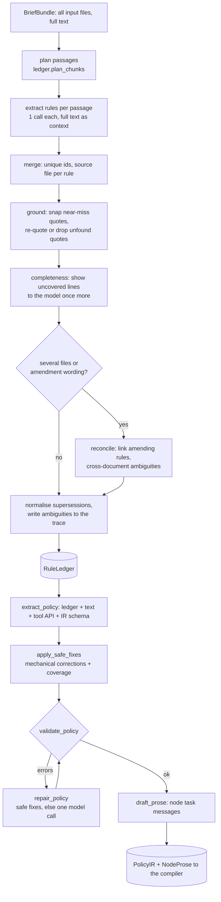

# Understanding a brief

How the builder turns the bank's documents into something a compiler can build from: the **rule ledger** (every atomic
rule, quoted verbatim) and the **policy IR** (the structured, computable part of the policy). Code lives in
`builder/understand/`, prompts in `builder/prompts/`, the data models in `builder/policy/ir.py`.

Nothing in this stage knows a particular brief. Brief values (holidays, bands, sentences, outcome names, queues) enter
only as data: the documents, the ledger, the IR. The prompts explain what every field *means*, never which value it has.

## Pipeline

| Step | Function | Model call | Role |
| --- | --- | --- | --- |
| Rule ledger | `ledger.build_rule_ledger(llm, bundle, tool_api, trace)` | one per passage (+ re-quote, completeness, reconcile only when needed) | strong (re-quote: fast) |
| Quote check | `grounding.check_grounding(ledger, bundle)` | none | - |
| IR extraction | `extract.extract_policy(llm, bundle, tool_api, ledger, trace)` | one | strong |
| Validation | `validate.validate_policy(ir, ledger, tool_api)` | none | - |
| Repair | `repair.repair_policy(llm, ir, issues, bundle, ledger, trace, tool_api=...)` | none if the safe fixes suffice, else one | strong |
| Node prose | `prose.draft_prose(llm, ir, ledger, profile, trace)` | one | fast |

The `llm` argument is the key-changer gateway (`builder.llm.gateway.LLMGateway`); only its `structured` coroutine is
used. Every call passes a one-line `purpose` (it appears in the trace's MODEL lines), `max_tokens=16000` for the big
answers, and an optional `deadline` (the budget's `deadline()`), and uses the configured tier of model (the cheaper
defaults, see `docs/LLM_KEY_CHANGER.md`). `AllProvidersFailed` propagates to the graph node, which decides the fallback
(for prose: the compiler's template-only prose).

## The rule ledger

`RuleLedger` (`builder/policy/ir.py`):

| Field | Meaning |
| --- | --- |
| `rules[]` | `RuleEntry`: `id`, `source` (file), `quote` (verbatim), `category`, `statement` (one imperative sentence), `scope` (agent stages), `supersedes[]`, `superseded_by` |
| `ambiguities[]` | `Ambiguity`: `id`, `rule_ids`, `question`, `options`, `chosen`, `rationale` |
| `supersessions[]` | human-readable log, e.g. `B-0 replaces A-JOB-a: customers are late on one to three products` |
| `source_files[]` | the input file names, in order |

Rules the extraction prompt (`understand/rule_ledger.v1.j2`) enforces, following the lessons of the tau-bench papers
("read everything", atomic rules, never invent):

* **Read all of every file**, including tables, footnotes and "what changes" lists.
* **Atomic**: one entry per obligation, prohibition, permission, definition, number, fixed sentence or table row. A numbered
  rule with several obligations is split with letter suffixes (`A-26a`, `A-26b`); every branch of an if/else and every
  table row is its own entry.
* **Verbatim quote** from one contiguous place of the source; the plain-language reading goes into `statement`.
* **Ids** follow the document's own numbering, prefixed per file (`brief-a.md` gives `A-30`, `A-30a`; unnumbered
  material gets topic tags such as `A-BANDS`). The prefix is derived from the file name (`document_prefixes`).
* **Categories**: opening, right_party, third_party, callback, identity, disclosure, calendar, deadline, promise_date,
  amount, persuasion, intent, confirmation, recording, multi_product, closing, conduct, other.
* **Scopes** (agent stages): global, opening, third_party, identity, disclosure, negotiation, confirmation, recording,
  closing. The compiler pulls `ledger.for_scope(...)` into the node that needs the rule.

### Why passages, and how big output stays bounded

A dense brief has 100+ rules with quotes, more than one 16 000-token answer. `plan_chunks` splits each document at
paragraph boundaries (default 5 500 characters per passage; a heading starts a new passage once the current one is 70 %
full; passages never cross files). Each passage is one call that receives the **full text of all files as read-only
context** plus the target passage, so cross references and amendments stay visible while the output stays small. The
calls run concurrently (default 3 at a time).

### Grounding and coverage (`grounding.py`)

* **Grounding.** `check_grounding(ledger, bundle)` returns one string per rule whose quote is not in the briefs; an empty
  list means every quote is grounded. Text is compared *normalised*: case, white space, curly quotes, dash variants,
  Markdown emphasis and table pipes are ignored. A quote that is not an exact substring falls back to a fuzzy match
  (difflib ratio >= 0.9 on windows of the same length around the quote's rarest words).
  `snap_quotes` replaces fuzzy quotes by the exact source text and corrects a wrong `source` file.
* **Unfound quotes** (probably invented rules) go through one cheap *re-quote* call: the model either gives the real
  quote or says the rule does not exist, in which case the rule is **dropped** and the drop is traced as an error. If more
  than 40 % of the quotes are unfound the check is considered unreliable for this input (odd text extraction) and nothing
  is dropped.
* **Coverage.** `uncovered_passages(ledger, bundle)` lists lines of the documents whose word trigrams no quote
  overlaps (headings, table separators and very short lines are ignored). The ledger builder shows them to the model
  once (`understand/ledger_complete.v1.j2`); an empty answer is fine (most uncovered lines are introductions or table
  headers). This is the guard against the commonest failure: one skipped rule.
* **Fixed sentences of the IR.** `check_phrase_grounding(ir, bundle)` checks that every sentence the IR claims the brief
  prescribes (opening, robot/scam answers, recorded sentence, identity questions, confirmation question, first ask) can be
  found in the documents once its `{placeholders}` are cut out. Findings are traced as warnings.

### Raw bank material and amendments

Input may be a brief, a specification, a memo, an e-mail (`.eml`: headers From/To/Date/Subject and text parts),
a chat or call-note export, CSV or JSON. The prompts tell the model to ignore greetings, signatures, disclaimers and quoted
reply history, to keep instructions, thresholds, dates, exceptions and sentences to be spoken, and that of two
conflicting statements the more recent or explicitly overriding one wins.

**Supersession.** A later memo or a second brief can replace rules ("unless a rule below replaces it", "from now on",
"ignore the previous", a "what changes" list). The *reconcile* call
(`understand/ledger_reconcile.v1.j2`) receives the full text and a compact list of all rules (`id | file | category |
statement`) and returns links `{new_rule, replaces[], note}`. It runs when there is more than one file or amendment wording
(replace, supersede, override, no longer, amend, correction, disregard, from now on, ...) occurs in a single file. Results:

* the replaced rule gets `superseded_by`, the amending rule `supersedes` (both directions are kept consistent; links to
  unknown ids and links that would close a cycle are dropped);
* the replaced rule **stays in the ledger** (audit trail) but is marked `[SUPERSEDED by X]` in every prompt and does not
  count for coverage; the IR must not cite it (`RULE_SUPERSEDED_USED` is an error);
* a line in `supersessions` and a `decision` event in the trace.

File order is **not** precedence (directory expansion sorts by name). The texts decide: explicit replacement wording,
dates, and which document declares itself an amendment. A conflict nothing resolves becomes an ambiguity.

### Ambiguity policy

An ambiguity is registered only where two reasonable readings would make the agent behave differently on a call. Each has
`options` (>= 2), `chosen`, `rationale` and the rules involved. `chosen` is always the **brief-faithful, conservative**
reading: closest to the exact words, does only what the text asks, discloses less, promises less, adds no term that is not
written. The extraction prompt of the IR receives the register and must follow the chosen reading; every ambiguity is
written to the trace (`AMBIGUITY` line: rules, question, chosen, because) so a reviewer can follow the decision.

## The policy IR

`PolicyIR` (`builder/policy/ir.py`) is the structured policy. Every section carries `rule_ids` (the ledger rules it
implements), so coverage can be audited and the compiler can place a rule's verbatim text in the node that enforces it.

| Section | Holds |
| --- | --- |
| `bank_name`, `language`, `currency_word` | identity of the bank; the currency word only if the documents name one |
| `call_variables` | variables every call starts with |
| `phrases` | sentences the documents prescribe, with `{placeholder}` slots |
| `right_party`, `third_party` | who is on the line; callback window rules; wrong-number / deceased outcomes |
| `identity` | questions (`field` from the `verify_identity` enum), failure limit, hints, failure / decline handling |
| `disclosure` | how the debt is stated; spoken product names |
| `calendar` | business weekdays, holidays, date input order |
| `bands`, `promise_dates`, `amounts`, `persuasion` | deadline bands, promise-date rules, floors, the persuasion ladder |
| `intents` | customer intents with response, actions, outcome, precedence |
| `confirmation`, `recording`, `multi_product` | read-back, promise recording, several late products and notes |
| `closing` | the outcome table (rows keyed by situation), precedence, transfer-after-promise rule |
| `forbidden_before_verification`, `residual_rules`, `notes` | never-say list; rules with no structured home; remarks |

`extract_policy` (prompt `extract/policy_ir.v1.j2`) gives the model: the full text, the tool API contracts and an explicit
list of the closed vocabularies (`validate.tool_vocabulary(tool_api).describe()`), the active ledger with ids and the
superseded rules marked, the ambiguity register, the intent catalog (`builder/policy/intents.py`), the generic situation keys
(`builder/policy/outcomes.py`), and the PolicyIR JSON schema (`schema_for_llm(PolicyIR)`). The system prompt contains the
generic field guide. Ground rules: never invent; cite rule ids; copy quoted sentences verbatim with single-brace
placeholders; **compose** a short sentence (exactly the elements the rule names, nothing else) for every `phrases` field whose
content a rule only *describes*; avoid words that another rule restricts (a recording notice reads "We record this call.");
only vocabulary from the tool API; every active rule appears in some `rule_ids` or in `residual_rules`. The user message also
carries `phrase_checklist` (`validate.phrase_checklist(ledger)`): the `phrases` fields the ledger certainly prescribes.

### Safe fixes (`fixes.apply_safe_fixes`)

Run after extraction and after every repair; no model call, no change of meaning:

* `rule_ids` lose duplicates and unknown ids;
* intent keys take the catalog spelling (`canonical_intent_key`); references follow;
* tool vocabulary is matched case/separator-insensitively (`Date_Of_Birth` -> `date_of_birth`, `Transfer:General` ->
  `transfer:general`);
* every active ledger rule that no section cites becomes a `ResidualRule` (statement + scope) - so nothing in the documents is
  silently dropped.

### Validation (`validate.validate_policy`)

Returns `PolicyIssue(code, message, rule_ids, severity, path)`; `error` triggers the repair loop, `warning` goes to the trace.

| Code | Severity | Check |
| --- | --- | --- |
| `IDENTITY_FIELD`, `IDENTITY_NO_QUESTIONS`, `IDENTITY_LIMIT` | error | identity fields in the `verify_identity.field` enum; questions and a failure limit exist |
| `OUTCOME_UNKNOWN`, `REASON_UNKNOWN`, `REASON_MISSING` | error | outcomes in `close_call.outcome`; reasons in its enum when listed; a reason where the API says one is required (parsed from "required for every outcome except ...") |
| `NOTE_REASON`, `QUEUE_UNKNOWN`, `TOOL_UNKNOWN`, `ACTION_PARAM` | error | `add_note` reasons, `transfer_to_agent` queues (also in `transfer:<queue>` situations), tool names and parameters of intent actions |
| `PRODUCT_TYPE`, `PRODUCT_FIELD` | error | product types and fields in `disclosure` / `amounts` exist in the `get_account` response |
| `BANDS_EMPTY`, `BANDS_OVERLAP`, `BAND_NAME_DUPLICATE`, `BAND_NAME_UNKNOWN` | error | bands exist, do not overlap, have unique names, persuasion steps name real bands |
| `HOLIDAY_RANGE`, `CLOSING_EMPTY`, `LEDGER_EMPTY` | error | plausible holiday years; an outcome table; a ledger |
| `RULE_SUPERSEDED_USED` | error | the IR cites a superseded rule (the message names the replacing rule) |
| `PHRASE_MISSING` | error | an active ledger rule prescribes a sentence (quoted or only described: opening, who is on the line, robot / scam answer, identity failure, deceased, already paid, goodbye) but the matching `phrases` field is empty; the repair prompt asks the model to quote or compose it |
| `BANDS_GAP`, `PERSUASION_STEPS_SHORT`, `DEADLINE_CUSTOM` | warning | days late in no band; fewer ladder steps than attempts; a deadline the compiler cannot compute |
| `REASON_UNEXPECTED`, `OUTCOME_NOT_IN_TABLE`, `PRECEDENCE_UNKNOWN`, `PLACEHOLDER_UNKNOWN`, `PRODUCT_TYPE_UNCOVERED`, `INTENT_DUPLICATE`, `MULTI_PRODUCT_NOTES`, `HOLIDAY_WEEKEND`, `HOLIDAY_SPREAD`, `IDENTITY_FORMAT`, `IDENTITY_FIELD_DUPLICATE` | warning | consistency notes |
| `RULE_UNCOVERED`, `RULE_ID_UNKNOWN`, `SUPERSESSION_DANGLING`, `LEDGER_DUPLICATE_ID` | warning | coverage and ledger hygiene (the first is auto-fixed by `apply_safe_fixes`) |

### Repair (`repair.repair_policy`)

1. `apply_safe_fixes`; 2. re-validate; if no error remains, done **without a model call**; 3. otherwise one call with the
remaining issues (errors first), the current IR, the documents, the ledger and the allowed values
(`repair/policy_repair.v1.j2`) returning the complete corrected IR; 4. safe fixes again. The graph repeats validate/repair at
most `max_policy_repairs` times and then continues or falls back to the agentic track.

### Node prose (`prose.draft_prose`)

The compiler builds each node prompt from IR phrases, computed facts and the verbatim ledger rules scoped to the node.
`draft_prose` adds glue: for the nodes `opening`, `third_party`, `identity`, `negotiate` a short bullet list ("do this
first, then that, stop when ...") where every bullet ends with the ids of the rules it comes from, plus
`system_prompt_extra` from the global rules. The model sees only the node's own active rules and IR sections and is told
to add no number, sentence or policy that they lack. `sanitize_prose` then removes ids that are not active ledger rules,
caps lengths and traces numbers found in neither the rules nor the IR. The result type is the compiler's
`builder.compiler.prose.NodeProse(system_prompt_extra, per_node)`.

## Prompts

`builder/prompts/__init__.py`: `render_prompt_parts(name, **ctx)` -> `PromptParts(system, user)` (templates define
`` and ``), `render_prompt(name, **ctx)` -> one string, `prompt_id(name)`. Rendering is
strict (a missing variable raises). Filters `json_compact`, `json_pretty`.

| Template | Used by | Context variables |
| --- | --- | --- |
| `understand/rule_ledger.v1.j2` | `build_rule_ledger` | files, tool_api_text, prefix, source, part_index, part_total, full_text, target_text, target_is_all, categories, scopes |
| `understand/ledger_reconcile.v1.j2` | reconcile step | files, full_text, rule_lines, existing_ambiguities |
| `understand/ledger_complete.v1.j2` | completeness step | files, prefix_hint, passages, categories, scopes, known_ids |
| `understand/ledger_requote.v1.j2` | re-quote step | files, full_text, items |
| `extract/policy_ir.v1.j2` | `extract_policy` | files, full_text, tool_api_text, vocabulary_text, intent_catalog, situation_keys, ledger_lines, phrase_checklist, supersession_lines, ambiguity_lines, schema_json |
| `repair/policy_repair.v1.j2` | `repair_policy` | the same plus issues_text, ir_json, attempt |
| `compile/node_prose.v1.j2` | `draft_prose` | profile, nodes, global_rules, phrases_json, forbidden_json |
| `audit/walkthrough.v1.j2` | walkthrough self-test (graph part) | rules_text, workflow_text, rule_map_text, call_variables |

The walkthrough template asks a fast model to compare the compiled workflow's text with the active rules and answers
`{"issues": [{"rule_id", "verdict": "missing|contradicted|unclear", "where", "explanation"}], "checked": n}`. Bump the
version in the file name (`.v2.j2`) when a prompt changes meaning, and keep the old file only if a trace must stay
reproducible.

## Trace output

The stage writes (via `TraceWriter`): `ledger` events (passage sizes, completeness, ready summary), `grounding` events
(snapped quotes, phrase warnings), `AMBIGUITY` lines, `decision` events for every supersession, `repair` events (safe fixes,
number of issues sent to the model), `prose` events, and `error` events for dropped rules or failed optional calls. Model calls
are traced by the gateway with the purpose strings used here (`rule ledger: brief-a.md passage 1/3`, `extract policy IR from
the rule ledger`, `repair policy IR (round 1, 2 errors)`, `draft node prose (staged profile)`).

## Failure behaviour

* A passage call that fails on every provider raises `AllProvidersFailed` (the ledger would be incomplete).
* The optional calls (re-quote, completeness, reconcile) fail soft: the error is traced and the ledger is used as it is.
* An empty ledger raises `UnderstandError`.
* The builder never keeps an unquoted rule silently: it is re-quoted, dropped, or (when grounding is unreliable) reported.

## Extending the IR

1. Add the field (or section) to `builder/policy/ir.py` with a default, so old fixtures stay valid, and a docstring.
2. Explain the field generically in the field guide of `builder/prompts/extract/policy_ir.v1.j2`. Keep it free of any brief
   value; if the field takes values from the tool API, add the vocabulary to `validate.tool_vocabulary`.
3. Add the check to `validate._Checker` (one method per concern, a stable issue `code`, error vs warning) and, if a
   mechanical fix is always safe, to `fixes.py`.
4. Teach the compiler (`builder/compiler`) to use it, and update `tests/fixtures/policy/*.json`.
5. Tests: `tests/unit/test_validate_policy.py` (a failing and a passing IR), `tests/unit/test_policy_ir.py`.

To support a new intent: add it to `builder/policy/intents.py` (key, neutral description, generic examples); a catalog entry
only names what to detect, behaviour still comes from the brief.

## Tests

`tests/unit/test_grounding.py` (normalisation, fuzzy match, snapping, coverage, kit fixtures grounded in the kit briefs),
`tests/unit/test_validate_policy.py` (kit IRs validate clean; each issue code; safe fixes),
`tests/unit/test_understand_fake_llm.py` (the whole stage against a fake gateway that answers from
`tests/fixtures/policy/*.json`: passages, completeness, re-quote, reconcile, extraction prompt content, repair, prose).
No test calls a model or the network.
