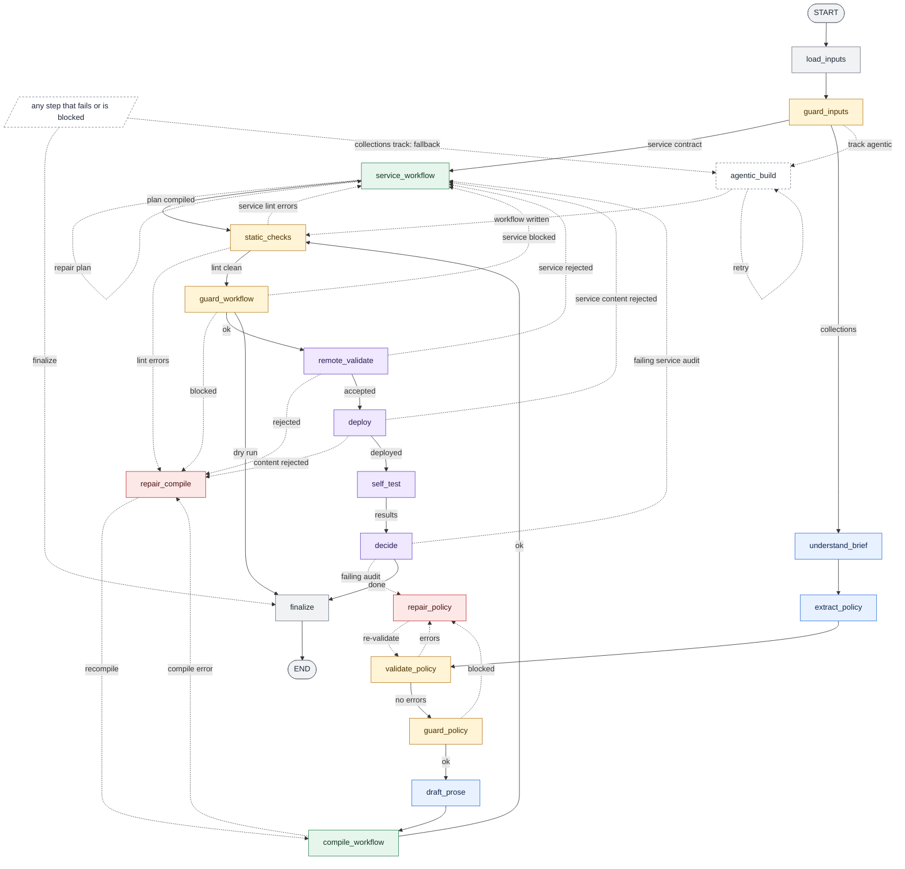

# Diagrams

Mermaid diagrams of the two graphs in this project, generated from the code by [`builder/viz.py`](../../builder/viz.py).
GitHub and VS Code render them. The `.mmd` files in this folder are the sources; `tests/unit/test_viz.py` fails when a
builder diagram is stale or when a diagram embedded in the docs differs from its `.mmd` file.

## The builder pipeline

Source: [`builder_graph.mmd`](builder_graph.mmd), drawn from the real compiled LangGraph (`build_graph().get_graph()`).

<!-- mmd: builder_graph.mmd -->


Solid arrows are forward progress; dotted arrows are repair loops, the agentic fallback and the failure exits. Blue steps call a
model, amber steps check or guard, red steps repair, green compiles, purple talks to the platform or judges the self-tests. Most
steps can also end in `finalize` or hand over to `agentic_build`; the note box stands for those exits.
[`builder_graph_full.mmd`](builder_graph_full.mmd) draws every edge.

## The generated phone agent, Brief A

Source: [`agent_brief_a.mmd`](agent_brief_a.mmd), a dry run on the public Brief A with answers from `tests/fixtures/policy`.

```mermaid
flowchart TD
    _start(["START"]):::plain
    opening("opening")
    callback_stop_third_party("callback_stop_third_party")
    callback_fix_say_third_party("callback_fix_say_third_party")
    third_party("third_party<br/><i>schedule_callback</i>")
    callback_done("callback_done")
    identity("identity<br/><i>verify_identity</i>")
    identity_failed("identity_failed")
    load_account{{"load_account<br/><i>get_account</i>"}}
    account_unavailable("account_unavailable")
    negotiate("negotiate<br/><i>create_promise</i>")
    promise_done("promise_done")
    promise_fix_say("promise_fix_say")
    rescue_identity_bye("rescue_identity_bye")
    rescue_third_party_bye("rescue_third_party_bye")
    rescue_negotiate_bye("rescue_negotiate_bye")
    grp_end["end_*<br/><i>16 nodes</i>"]
    grp_handoff{{"handoff_*<br/><i>3 nodes</i>"}}
    guard_restructuring_say("guard_restructuring_say")
    close{{"close<br/><i>close_call</i>"}}
    hangup(["hangup"])
    _start --> setup
    setup -.->|"always"| opening
    opening -->|"tool:transition_to_identity"| identity
    opening -->|"tool:transition_to_third_party"| third_party
    opening -->|"tool:transition_to_end_* x4; max turns"| grp_end
    opening -->|"tool:transition_to_handoff_general"| grp_handoff
    callback_stop_third_party -.->|"always"| grp_end
    callback_fix_third_party -->|"callback_guard_stop = yes"| callback_stop_third_party
    callback_fix_third_party -.->|"always"| callback_fix_say_third_party
    callback_fix_say_third_party -.->|"always"| third_party
    third_party -->|"callback_guard contains blocked"| callback_fix_third_party
    third_party -->|"callback_acked = yes"| callback_done
    third_party -->|"transition_to_end_callback_booked_response contains..."| rescue_third_party
    third_party -->|"tool:transition_to_end_* x4; intent: The agent already said..."| grp_end
    third_party -->|"tool:transition_to_identity"| identity
    callback_done -.->|"always"| grp_end
    identity -->|"verify_identity_response.data.all_verified = true"| load_account
    identity -->|"verify_identity_response.data.wrong_answers_left = 0"| identity_failed
    identity -->|"transition_to_end_identity_declined_response contains..."| rescue_identity
    identity -->|"tool:transition_to_end_* x3; max turns"| grp_end
    identity -->|"tool:transition_to_third_party"| third_party
    identity -->|"tool:transition_to_handoff_general"| grp_handoff
    identity_failed -.->|"always"| grp_end
    load_account -.->|"always"| account_facts
    account_unavailable -.->|"always"| grp_end
    account_facts -->|"account_state = empty or account_state contains error"| account_unavailable
    account_facts -.->|"always"| negotiate
    negotiate -->|"promise_guard contains blocked"| promise_fix
    negotiate -->|"promise_acked = yes and product_count = 1"| promise_done
    negotiate -->|"transition_to_end_promise_recorded_response contains..."| rescue_negotiate
    negotiate -->|"tool:transition_to_end_* x7; intent: The agent already said..."| grp_end
    negotiate -->|"tool:transition_to_handoff_* x2"| grp_handoff
    negotiate -->|"tool:transition_to_guard_restructuring"| guard_restructuring
    promise_done -.->|"always"| grp_end
    promise_fix -.->|"always"| promise_fix_say
    promise_fix_say -.->|"always"| negotiate
    rescue_identity_bye -.->|"always"| rescue_identity_go
    rescue_identity_go -->|"rescue_target = end_identity_declined; rescue_target =..."| grp_end
    rescue_identity_go -->|"rescue_target = handoff_general"| grp_handoff
    rescue_identity_go -.->|"always"| identity
    rescue_identity -->|"rescue_target = third_party"| third_party
    rescue_identity -->|"rescue_ending = yes"| rescue_identity_bye
    rescue_identity -.->|"always"| identity
    rescue_third_party_bye -.->|"always"| rescue_third_party_go
    rescue_third_party_go -->|"rescue_target = end_callback_booked; rescue_target =..."| grp_end
    rescue_third_party_go -.->|"always"| third_party
    rescue_third_party -->|"rescue_target = identity"| identity
    rescue_third_party -->|"rescue_ending = yes"| rescue_third_party_bye
    rescue_third_party -.->|"always"| third_party
    rescue_negotiate_bye -.->|"always"| rescue_negotiate_go
    rescue_negotiate_go -->|"rescue_target = end_promise_recorded; rescue_target =..."| grp_end
    rescue_negotiate_go -->|"rescue_target = handoff_support; rescue_target = handoff_general"| grp_handoff
    rescue_negotiate_go -.->|"always"| negotiate
    rescue_negotiate -->|"rescue_target = guard_restructuring"| guard_restructuring
    rescue_negotiate -->|"rescue_ending = yes"| rescue_negotiate_bye
    rescue_negotiate -.->|"always"| negotiate
    grp_end -.->|"always"| decide
    grp_handoff -.->|"always"| decide
    guard_restructuring -->|"restructuring_blocked = yes"| guard_restructuring_say
    guard_restructuring -.->|"always"| grp_handoff
    guard_restructuring_say -.->|"always"| negotiate
    decide -.->|"always"| close
    close -.->|"always"| hangup
    linkStyle 2,3,5,14,20,21,31,32 stroke:#2f6fdb,color:#2f6fdb
    classDef conv fill:#e8f1ff,stroke:#2f6fdb,color:#10264d
    classDef say fill:#e8f1ff,stroke:#2f6fdb,stroke-dasharray:4 3,color:#10264d
    classDef code fill:#fff4d6,stroke:#b7791f,color:#4a3200
    classDef api fill:#e6f6ec,stroke:#2f855a,color:#12351f
    classDef term fill:#fde8e8,stroke:#c53030,color:#4a1010
    classDef plain fill:#f1f2f4,stroke:#6b7280,color:#1f2937
    class setup,callback_fix_third_party,account_facts,promise_fix,rescue_identity_go,rescue_identity,rescue_third_party_go,rescue_third_party,rescue_negotiate_go,rescue_negotiate,grp_end,guard_restructuring,decide code
    class opening,third_party,identity,negotiate conv
    class callback_stop_third_party,callback_fix_say_third_party,callback_done,identity_failed,account_unavailable,promise_done,promise_fix_say,rescue_identity_bye,rescue_third_party_bye,rescue_negotiate_bye,guard_restructuring_say say
    class load_account,grp_handoff,close api
    class hangup term
```

<!-- mmd: agent_brief_a.mmd -->


Rounded boxes are conversation nodes (dashed: one fixed line, then on), rectangles are code, hexagons call the bank's tool API,
the red box ends the call. Blue arrows are tool-call transitions (the model calls `transition_to_<node>` and says goodbye in the
same message); black arrows test a variable or the customer's intent; dashed arrows are passthrough and max-turn edges. The compact
view folds the 16 `end_*` and 3 `handoff_*` nodes into one box each; [`agent_brief_a_full.mmd`](agent_brief_a_full.mmd) draws all 49 nodes.

## The generated phone agent, Brief A and B

Source: [`agent_brief_ab.mmd`](agent_brief_ab.mmd), a dry run on both briefs. The skeleton is the same; `negotiate` also
offers `add_note` and the folded `end_*` family has 13 nodes. The multi-product rules change what the code nodes compute,
not the shape of the graph. [`agent_brief_ab_full.mmd`](agent_brief_ab_full.mmd) draws all 46 nodes.

```mermaid
flowchart TD
    _start(["START"]):::plain
    opening("opening")
    callback_stop_third_party("callback_stop_third_party")
    callback_fix_say_third_party("callback_fix_say_third_party")
    third_party("third_party<br/><i>schedule_callback</i>")
    callback_done("callback_done")
    identity("identity<br/><i>verify_identity</i>")
    identity_failed("identity_failed")
    load_account{{"load_account<br/><i>get_account</i>"}}
    account_unavailable("account_unavailable")
    negotiate("negotiate<br/><i>create_promise, add_note</i>")
    promise_done("promise_done")
    promise_fix_say("promise_fix_say")
    rescue_identity_bye("rescue_identity_bye")
    rescue_third_party_bye("rescue_third_party_bye")
    rescue_negotiate_bye("rescue_negotiate_bye")
    grp_end["end_*<br/><i>13 nodes</i>"]
    grp_handoff{{"handoff_*<br/><i>3 nodes</i>"}}
    guard_restructuring_say("guard_restructuring_say")
    close{{"close<br/><i>close_call</i>"}}
    hangup(["hangup"])
    _start --> setup
    setup -.->|"always"| opening
    opening -->|"tool:transition_to_identity"| identity
    opening -->|"tool:transition_to_third_party"| third_party
    opening -->|"tool:transition_to_end_* x4; max turns"| grp_end
    opening -->|"tool:transition_to_handoff_general"| grp_handoff
    callback_stop_third_party -.->|"always"| grp_end
    callback_fix_third_party -->|"callback_guard_stop = yes"| callback_stop_third_party
    callback_fix_third_party -.->|"always"| callback_fix_say_third_party
    callback_fix_say_third_party -.->|"always"| third_party
    third_party -->|"callback_guard contains blocked"| callback_fix_third_party
    third_party -->|"callback_acked = yes"| callback_done
    third_party -->|"transition_to_end_callback_booked_response contains..."| rescue_third_party
    third_party -->|"tool:transition_to_end_* x4; intent: The agent already said..."| grp_end
    third_party -->|"tool:transition_to_identity"| identity
    callback_done -.->|"always"| grp_end
    identity -->|"verify_identity_response.data.all_verified = true"| load_account
    identity -->|"verify_identity_response.data.wrong_answers_left = 0"| identity_failed
    identity -->|"transition_to_end_identity_declined_response contains..."| rescue_identity
    identity -->|"tool:transition_to_end_* x3; max turns"| grp_end
    identity -->|"tool:transition_to_third_party"| third_party
    identity -->|"tool:transition_to_handoff_general"| grp_handoff
    identity_failed -.->|"always"| grp_end
    load_account -.->|"always"| account_facts
    account_unavailable -.->|"always"| grp_end
    account_facts -->|"account_state = empty or account_state contains error"| account_unavailable
    account_facts -.->|"always"| negotiate
    negotiate -->|"promise_guard contains blocked"| promise_fix
    negotiate -->|"promise_acked = yes and product_count = 1"| promise_done
    negotiate -->|"transition_to_end_promise_recorded_response contains..."| rescue_negotiate
    negotiate -->|"tool:transition_to_end_* x4; intent: The agent already said..."| grp_end
    negotiate -->|"tool:transition_to_handoff_* x2"| grp_handoff
    negotiate -->|"tool:transition_to_guard_restructuring"| guard_restructuring
    promise_done -.->|"always"| grp_end
    promise_fix -.->|"always"| promise_fix_say
    promise_fix_say -.->|"always"| negotiate
    rescue_identity_bye -.->|"always"| rescue_identity_go
    rescue_identity_go -->|"rescue_target = end_identity_declined; rescue_target =..."| grp_end
    rescue_identity_go -->|"rescue_target = handoff_general"| grp_handoff
    rescue_identity_go -.->|"always"| identity
    rescue_identity -->|"rescue_target = third_party"| third_party
    rescue_identity -->|"rescue_ending = yes"| rescue_identity_bye
    rescue_identity -.->|"always"| identity
    rescue_third_party_bye -.->|"always"| rescue_third_party_go
    rescue_third_party_go -->|"rescue_target = end_callback_booked; rescue_target =..."| grp_end
    rescue_third_party_go -.->|"always"| third_party
    rescue_third_party -->|"rescue_target = identity"| identity
    rescue_third_party -->|"rescue_ending = yes"| rescue_third_party_bye
    rescue_third_party -.->|"always"| third_party
    rescue_negotiate_bye -.->|"always"| rescue_negotiate_go
    rescue_negotiate_go -->|"rescue_target = end_promise_recorded; rescue_target =..."| grp_end
    rescue_negotiate_go -->|"rescue_target = handoff_support; rescue_target = handoff_general"| grp_handoff
    rescue_negotiate_go -.->|"always"| negotiate
    rescue_negotiate -->|"rescue_target = guard_restructuring"| guard_restructuring
    rescue_negotiate -->|"rescue_ending = yes"| rescue_negotiate_bye
    rescue_negotiate -.->|"always"| negotiate
    grp_end -.->|"always"| decide
    grp_handoff -.->|"always"| decide
    guard_restructuring -->|"restructuring_blocked = yes"| guard_restructuring_say
    guard_restructuring -.->|"always"| grp_handoff
    guard_restructuring_say -.->|"always"| negotiate
    decide -.->|"always"| close
    close -.->|"always"| hangup
    linkStyle 2,3,5,14,20,21,31,32 stroke:#2f6fdb,color:#2f6fdb
    classDef conv fill:#e8f1ff,stroke:#2f6fdb,color:#10264d
    classDef say fill:#e8f1ff,stroke:#2f6fdb,stroke-dasharray:4 3,color:#10264d
    classDef code fill:#fff4d6,stroke:#b7791f,color:#4a3200
    classDef api fill:#e6f6ec,stroke:#2f855a,color:#12351f
    classDef term fill:#fde8e8,stroke:#c53030,color:#4a1010
    classDef plain fill:#f1f2f4,stroke:#6b7280,color:#1f2937
    class setup,callback_fix_third_party,account_facts,promise_fix,rescue_identity_go,rescue_identity,rescue_third_party_go,rescue_third_party,rescue_negotiate_go,rescue_negotiate,grp_end,guard_restructuring,decide code
    class opening,third_party,identity,negotiate conv
    class callback_stop_third_party,callback_fix_say_third_party,callback_done,identity_failed,account_unavailable,promise_done,promise_fix_say,rescue_identity_bye,rescue_third_party_bye,rescue_negotiate_bye,guard_restructuring_say say
    class load_account,grp_handoff,close api
    class hangup term
```

<!-- mmd: agent_brief_ab.mmd -->


## Regenerate

From the repository root, with the interpreter that has the dependencies (`uv run python` or `.venv/Scripts/python.exe`):

```sh
python -m builder.viz builder --out docs/graphs/builder_graph.mmd                       # add --view full for every edge
python -m builder.viz agent out/<slot>.workflow.json --out docs/graphs/agent_brief_a.mmd   # any workflow JSON or export
```

The agent diagrams come from offline dry runs (no keys, no Freya call). Delete the `docs-*` files they leave in `out/`,
`traces/` and `results/` afterwards if you do not want them:

```sh
python builder/build.py briefs/brief-a.md tools/openapi.json --dry-run --fake-llm tests/fixtures/policy --slot docs-a
python builder/build.py briefs/brief-a.md briefs/brief-b.md tools/openapi.json --dry-run --fake-llm tests/fixtures/policy --slot docs-ab
```

Then copy the new files into the diagram blocks of this file, of [`docs/HOW_IT_WORKS.md`](../HOW_IT_WORKS.md) and of
[`builder/graph/README.md`](../../builder/graph/README.md) (each block sits under a `<!-- mmd: file.mmd -->` marker):

```sh
python -m builder.viz sync            # --check only reports; exit code 1 when a block is out of date
```

Options of `python -m builder.viz builder|agent`: `--view compact|full`, `--direction TD|LR|...`, `--out FILE` (default:
standard output).
