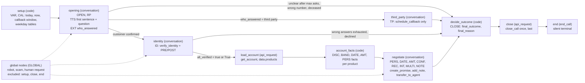
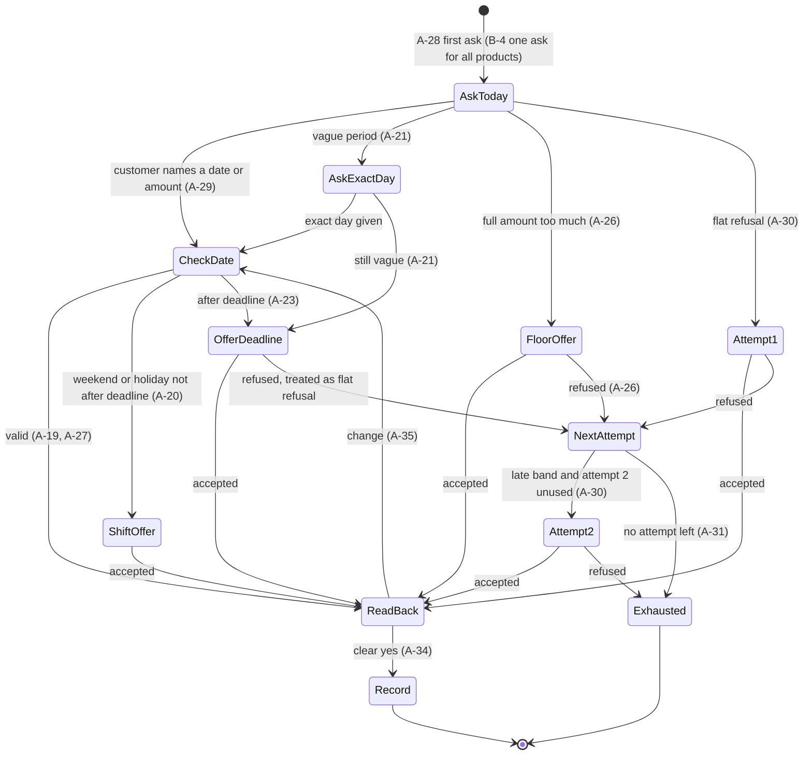

# 13 — Brief rule → mechanism map (Brief A, Brief B)

Status: research note feeding P2 (understand), P3 (compiler, M1) and P5 (generalisation). Written Sat 2026-10-10.
Inputs: decisions brief v2 (ADR-05 ledger + coverage, ADR-06 PolicyIR, ADR-07 staged profile, ADR-08 code for dates and
money, ADR-09 deterministic close, ADR-10 honesty, ADR-11 evaluation, ADR-16 compliance), kit v3 (`briefs/brief-a.md`,
`briefs/brief-b.md`, `tools/openapi.json`, `public-test-set.json`, `tools/run_cases.py`, `tools/score.py`,
`docs/workflow-format.md`, `docs/tools-and-code.md`, `docs/api.md`), [11](11_hackathon_rules_and_kit.md),
[12](12_tau_tau_bench_lessons.md).

> **Nothing in this file is a builder constant.** Brief A/B values (holiday dates, outcome and reason names, queue names,
> amounts, phrases) appear here only as *examples of what the builder extracts into the PolicyIR* and as *test fixtures*.
> Fixtures live under `tests/` and `evals/` only (ADR-16 grep test). The hidden briefs bring other numbers, identity
> questions, outcome tables and calendars ([11](11_hackathon_rules_and_kit.md) §2).

## Contents

- [1. Purpose and conventions](#1-purpose-and-conventions)
- [2. Legend](#2-legend)
  - [2.1 Rule families](#21-rule-families)
  - [2.2 PolicyIR leaves used in this map](#22-policyir-leaves-used-in-this-map)
  - [2.3 Enforcement mechanisms](#23-enforcement-mechanisms)
  - [2.4 Where the families live in the staged graph](#24-where-the-families-live-in-the-staged-graph)
- [3. Brief A rule map](#3-brief-a-rule-map)
  - [3.1 Scope and call variables](#31-scope-and-call-variables)
  - [3.2 Opening and who is on the line](#32-opening-and-who-is-on-the-line)
  - [3.3 Someone else answers](#33-someone-else-answers)
  - [3.4 Identity](#34-identity)
  - [3.5 Stating the debt](#35-stating-the-debt)
  - [3.6 Dates: calendar, bands, promise dates](#36-dates-calendar-bands-promise-dates)
  - [3.7 Amounts](#37-amounts)
  - [3.8 Getting the promise](#38-getting-the-promise)
  - [3.9 Confirming and recording](#39-confirming-and-recording)
  - [3.10 Other things customers say](#310-other-things-customers-say)
  - [3.11 Closing](#311-closing)
- [4. Brief B rule map and supersession log](#4-brief-b-rule-map-and-supersession-log)
  - [4.1 Rule table](#41-rule-table)
  - [4.2 Supersession log (example of the SupersessionLog)](#42-supersession-log-example-of-the-supersessionlog)
  - [4.3 Close computation for A plus B](#43-close-computation-for-a-plus-b)
- [5. Practice-case index](#5-practice-case-index)
- [6. Generalisation notes per family](#6-generalisation-notes-per-family)
- [7. Worked computations (fixtures)](#7-worked-computations-fixtures)
- [8. Ambiguity register](#8-ambiguity-register)
- [9. Coverage checklist for the automatic audit](#9-coverage-checklist-for-the-automatic-audit)
- [10. Unverified items and open points](#10-unverified-items-and-open-points)

---

## 1. Purpose and conventions

This map is used for three things, never for hard-coding:

1. **PolicyIR design** (`builder/policy/ir.py`, ADR-06). Every rule of the two public briefs must land in a typed IR field
   or, failing that, in `residual_rules`. If a public-brief rule needs a field that ADR-06 does not list, that is a gap in
   the IR, not a reason for a special case in the compiler.
2. **Compiler design** (`builder/compiler/*`, ADR-07..ADR-10). Every rule needs at least one enforcement mechanism in the
   compiled workflow. Rules in code and routes beat rules in prompts ([12](12_tau_tau_bench_lessons.md) principle 5;
   kit skill: "Prefer rules in routes and code over rules in prompts").
3. **Test fixtures** (`tests/fixtures/`, `evals/synthetic_briefs/`, ADR-11). The worked computations in §7 become the
   reference vectors for `builder/policy/calendar.py`, `builder/policy/money.py` and `builder/policy/outcomes.py`, and the
   same vectors run against the generated code snippets in `builder/checks/code_sandbox.py` (ADR-08).

Conventions:

- **Rule ids** are this document's. `A-1`…`A-47` are the numbered rules of `briefs/brief-a.md`. Extra ids: `A-JOB` (§1 "The
  job"), `A-VARS` (§2 call-variable table), `A-CAL` (business-day paragraph of §7), `A-BAND` (band table), `A-OUT` (outcome
  table), `A-OUT-T` (sentence "If a transfer follows a recorded promise…"), `A-NONOTE` ("Brief A never uses
  `add_note`"). Brief B: `B-0` (preamble "Every rule of Brief A applies unless a rule below replaces it"), `B-1`…`B-11`,
  `B-CLOSE-1`…`B-CLOSE-3` (the Closing paragraph, split into its three sentences). The builder's RuleLedger assigns its
  own ids at run time (source file + locator, ADR-05); these ids are only for this document and the fixtures.
- **IR field paths** are written `<ADR-06 section>.<leaf>`. Section names are fixed by ADR-06. Leaf names are proposals
  for `builder/policy/ir.py`; `docs/ARCHITECTURE.md` and `ir.py` are canonical once written. Every IR field carries
  `rule_ids` and evidence quotes (ADR-06).
- **Node names** are ADR-07's staged profile: `setup`, `opening`, `third_party`, `identity`, `load_account`,
  `account_facts`, `negotiate`, `decide_outcome`, `close`, `end`.
- **Kit docs** are cited by repo-root path (`docs/workflow-format.md`, `docs/tools-and-code.md`, `docs/api.md`,
  `tools/openapi.json`). They are copied to the repo root in P0; until then they live under
  `data/build-the-builder-v3/build-the-builder/`. Links in this file are relative to `docs/research/`.
- **[UNVERIFIED]** marks a platform or mock behaviour that the kit does not confirm, with the experiment (E-n) that
  settles it. **FIXTURE** marks a value that may only appear in `tests/` or `evals/`.
- "PUB" column: practice cases from `public-test-set.json` that exercise the rule. "none" means no practice case does;
  §5 lists those gaps.

---

## 2. Legend

### 2.1 Rule families

| Code | Family | Brief A sections | Brief B rules |
|---|---|---|---|
| SCOPE | Scope, supersession | §1 | B-0 |
| VAR | Call variables | §2 | — |
| OPEN | Opening sentence, pre-verification disclosure gate | §3 rule 1 | — |
| RP | Right-party check | §3 rules 2–3 | — |
| TP | Third party, callback, wrong number, deceased | §4 | — |
| ID | Identity verification | §5 | — |
| DISC | Stating the debt | §6 | B-1, B-2 |
| CAL | Calendar (business days, holidays, week) | §7 paragraph | — |
| BAND | Bands and deadlines | §7 rule 18 + table | B-3 |
| DATE | Promise-date rules | §7 rules 19–23 | B-6 |
| AMT | Amounts and floors | §8 | — |
| PERS | First ask and persuasion ladder | §9 rules 28–31 | B-4, B-5 |
| INT | Intents ("other things customers say", hardship, robot, scam) | §3 rule 4, §9 rules 32–33, §11 | B-9, B-10 |
| CONF | Read-back and confirmation | §10 rules 34–35 | B-7 |
| REC | Recording and honesty | §10 rules 36–38 | B-11 |
| MULTI | Multi-product handling | — | B-1…B-7 |
| NOTE | Notes per unpromised product | §12 (never) | B-8, B-11 |
| CLOSE | Outcome table, precedence, goodbye, `close_call` | §12 | B-CLOSE-1..3, B-10 |

### 2.2 PolicyIR leaves used in this map

| ADR-06 section | Leaves used below (proposed names) | Filled from (Brief A/B example) |
|---|---|---|
| `call_variables` | `[]{name, meaning, example}` | §2 table |
| `opening` | `first_sentence`, `recording_notice`, `forbidden_before_verification[]`, `robot_answer`, `scam_answer` | rules 1, 4, 43 |
| `right_party` | `question_template`, `confirmation_phrases[]`, `non_confirmations[]`, `max_asks`, `unclear_outcome` | rules 2, 3 |
| `third_party` | `no_disclosure`, `ask_when_reachable`, `callback_window{day_rules[], start, end, inclusive_start, inclusive_end, after_now}`, `window_retries`, `wrong_number`, `deceased_line`, `relative_restrictions` | rules 5–10 |
| `identity` | `questions[]{order, field, spoken, answer_format, normalisation}`, `max_wrong_total`, `retry_same_question`, `hints{value → {action, counts_as_wrong}}`, `failure_message`, `failure_outcome`, `decline{explain_once_line, max_declines, purpose_question_counts, outcome}` | rules 11–15 |
| `disclosure` | `trigger`, `team_phrase`, `product_naming{type → template}`, `state_amount`, `state_days_late` | rules 16–17, B-2 |
| `calendar` | `business_weekdays[]`, `holidays[]`, `week_start`, `now_variable`, `timezone` | §7 paragraph, §2 |
| `bands` | `[]{name, days_late_min, days_late_max, deadline{kind, n}, attempts}` | rule 18 + table |
| `promise_dates` | `min`, `business_day_only`, `max`, `non_business_shift`, `vague{examples[], ask_times, fallback}`, `weekday_semantics{this, next}`, `after_deadline{say_latest, offer, refusal}` | rules 19–23 |
| `amounts` | `ask_full_first`, `never_ask_capacity`, `agent_proposes_amounts`, `floor_field{type → field}`, `floor_offer{times, required_line, refusal}`, `accept_range{min, max, inclusive}`, `below_floor`, `forbidden_offers[]` | rules 24–27, 33 |
| `persuasion` | `first_ask`, `flat_refusal_definition`, `steps[]{n, bands[], amount_rule, date_rule}`, `on_exhausted` | rules 28–31 |
| `intents` | `[]{id, triggers[], stages[], line, actions[{tool, params}], outcomes, precedence, persuasion_allowed}` | rules 4, 32, 39–45 |
| `confirmation` | `read_back_fields[]`, `confirm_question`, `change_handling`, `single_for_all` | rules 34–35, B-7 |
| `recording` | `one_per_product`, `immutable_line`, `say_recorded_only_on_ok`, `retries`, `failure_outcome`, `post_record_sentence` | rules 36–38, B-11 |
| `multi_product` | `max_products`, `statement`, `order`, `first_ask_all_today`, `start_attempt`, `per_product_attempts`, `one_date_after_deadline`, `notes{enabled, reasons[], when}`, `continue_after_product_claims`, `on_transfer{keep_recorded, drop_unrecorded, no_notes}`, `closing_reason_rule` | B-1…B-11, B-CLOSE, `A-NONOTE` |
| `closing` | `outcome_table[]{outcome, reason, situation, rule_ids}`, `precedence[]`, `goodbye_before_close`, `exactly_once_last`, `queue_to_reason{}` | rules 46–47, outcome table |
| `residual_rules` | `[]{rule_ids, verbatim}` | anything not captured |

### 2.3 Enforcement mechanisms

| Tag | Mechanism | Where in the staged profile (ADR-07) | Generated by |
|---|---|---|---|
| CODE | Python in a `code` node (`code_exec` pre_action) computing facts into `vars` | `setup`, `account_facts`, `decide_outcome` | `builder/compiler/codegen.py` from `builder/policy/calendar.py`, `money.py`, `outcomes.py` |
| ROUTE | Deterministic transition (`equals`, `greater_than`, `less_than`, `is_set`) on tool results, counters or extracted enums | every node | `builder/compiler/nodes.py`, `compiler/profiles/staged.py` |
| ENUM | Tool schema enum or baked `default` generated from the ToolContract | model tools in `third_party`, `identity`, `negotiate`; pre_actions of `load_account`, `close` | `builder/ingest/tool_api.py`, `builder/compiler/tools.py` |
| PRE | `pre_process_code` on an `api_call` tool (normalise, inject product ids, guard) | model-called tools | `builder/compiler/hooks.py` |
| POST | `post_process_code` adding `what_to_do_next` (and code-kept counters) | every tool | `builder/compiler/hooks.py` |
| EXT | `extraction_schema` variable (string enum preferred; typed where safe) | `opening`, `third_party`, `identity`, `negotiate` | `builder/compiler/nodes.py` |
| PROMPT | Line in `system_prompt` or a node `task_message` | conversation nodes | `builder/compiler/prompts.py` |
| TTS | Fixed `on_enter` `tts` text (no model call) or a fixed closing line | `opening`, entry of `negotiate`, closing step | `builder/compiler/prompts.py` |
| CLOSE | `decide_outcome` computes `final_outcome`, `final_reason` (and the closing line); `close` fires `close_call` once | `decide_outcome`, `close`, `end` | `builder/policy/outcomes.py` + codegen |
| GLOBAL | Global interrupt node with `excluded_nodes` | `global_nodes` | `builder/compiler/nodes.py` |
| LINT | Static check before deploy (build plane, not runtime) | — | `builder/checks/lint.py`, `variables.py`, `coverage_map.py`, `code_sandbox.py` |

In the lean profile (E-4) the same IR fields and most tags apply; CLOSE becomes a model-called `close_call` guarded by
PRE, and ROUTE between stages collapses into PROMPT plus POST. The coverage audit (§9) must accept either profile's tag
set.

Platform facts the mechanisms rely on (kit docs): routing runs after a tool result in the same turn
(`docs/workflow-format.md`, "Order of evaluation"); booleans arrive as `"true"` or `"True"` (test both); `extraction_schema`
`date` type applies built-in relative-date rules that turn "next week" into a concrete date (`docs/workflow-format.md`,
"Extraction schema"); an engine-run field whose value is exactly one unset placeholder is dropped, while `""` is sent
empty (`docs/tools-and-code.md`); code must contain no `{{`/`}}` and never raise; the mock "does not enforce the brief: it
records a promise on a holiday or past the deadline without complaint" (`tools/openapi.json` `info.description`).

### 2.4 Where the families live in the staged graph



---

## 3. Brief A rule map

Columns: **ID** · **Rule** (one-line paraphrase) · **Fam** (family) · **PolicyIR field** · **Mechanism** (tags from §2.3,
node in brackets) · **PUB** (practice cases, number only) · **Main failure risk on `experimental-5`**.

### 3.1 Scope and call variables

| ID | Rule | Fam | PolicyIR field | Mechanism | PUB | Main failure risk |
|---|---|---|---|---|---|---|
| A-JOB | The bank calls customers 1–45 days late on one product: find the customer, verify, state the debt, get a promise where possible, close with the correct outcome. | SCOPE | `bands[]` cover `days_late` 1–45; `multi_product.max_products` = 1 | Graph shape of the staged profile; CODE band lookup in `account_facts` with an out-of-range fallback (AMB-09) | all A | No direct risk; a `days_late` outside every band must not crash the code node. |
| A-VARS | Call variables: `customer_id` (pass to every tool), `first_name`, `last_name`, `title` (address as title + last name), `now` (all date rules use it, never the real clock). | VAR | `call_variables[]`; `calendar.now_variable` | ENUM: every tool body has `customer_id` baked as `"{{customer_id}}"`; CODE `setup` reads `vars.get("now")`; TTS/PROMPT address form `{{title}} {{last_name}}`; LINT: no `{{system.todays_date_*}}` or `{{system.iso_utc_now}}` anywhere, `test_variables` mirror the declared variables | all | Model addresses the customer by first name; a prompt that shows the real clock; chat smoke turns may skip the initial code node so `now`-derived facts are empty **[UNVERIFIED, E-5]**. |

### 3.2 Opening and who is on the line

| ID | Rule | Fam | PolicyIR field | Mechanism | PUB | Main failure risk |
|---|---|---|---|---|---|---|
| A-1 | First sentence: you are a digital assistant calling from Freya Bank and the call is recorded. Before identity is verified never say "collections", "debt", "payment" or the product, to anyone, relatives included. | OPEN | `opening.first_sentence`, `opening.recording_notice`, `opening.forbidden_before_verification[]` (+ humanised product types from the `get_account` `type` enum, because the rule says "or the product") | TTS: fixed `on_enter` line of `opening` compiled from the IR; PROMPT: prohibition in `opening`, `third_party`, `identity`; LINT: pre-verification nodes contain no account variables and no facts block | 01 (check), 02, 03 | Asked "what is this about?", the model says "about a payment on your card"; a model-written opening drops the recording notice. |
| A-2 | Ask "Am I speaking with {title} {last_name}?". | RP | `right_party.question_template` (verbatim, with variables) | TTS: second sentence of the `opening` line | all | Model rephrases with the first name or full name. |
| A-3 | Only "yes", "that's me", "speaking" or the customer's own name confirm; "hello", "go ahead", "who is this" do not. Ask once more; still unclear after the second ask → `not_reached`/`unclear`. A customer question (rules 4, 43) is answered first; the ask that follows is the second ask. | RP | `right_party.confirmation_phrases[]`, `.non_confirmations[]`, `.max_asks` = 2, `.unclear_outcome` → outcome row | EXT `who_answered` on `opening` (values generated from IR; Brief A example: `customer`, `third_party`, `wrong_number`, `deceased`, `unclear`); ROUTE on `who_answered` and on `{{opening.total_turns}}` reaching `max_asks` → `decide_outcome`; CLOSE | none | Routing accepts "hello?" as confirmation and enters `identity`; or closes after a single unclear reply. Using the system variable `opening.total_turns` as a condition variable, and its count when a global node interrupts `opening`, are **[UNVERIFIED, E-7]** (fallback: an ask counter kept by extraction; keep robot/scam answers inside `opening`). |
| A-4 | Asked whether it is a robot or an AI → say it is Freya Bank's digital assistant and continue. | INT | `opening.robot_answer`; `intents` entry `robot_question` | PROMPT in `system_prompt` (valid in every node); optional GLOBAL passthrough with a fixed line and `__previous__` | 04 (check) | Says "I am an AI language model…" or claims to be human; loses its place after answering. |

### 3.3 Someone else answers

| ID | Rule | Fam | PolicyIR field | Mechanism | PUB | Main failure risk |
|---|---|---|---|---|---|---|
| A-5 | Someone else answers: do not say why you call, say nothing beyond the rule-1 sentence, ask when the customer can be reached. | TP | `third_party.no_disclosure`, `.ask_when_reachable` | ROUTE `who_answered` = third party → `third_party`; PROMPT; LINT: `third_party` holds no account variable and only the `schedule_callback` tool | 02 | Says "it's about her loan"; hints at the purpose when the relative insists. |
| A-6 | A callback is today or the next business day, 10:00–19:00 both included, later than `now`. Call `schedule_callback` with date and time, then close `not_reached`/`callback`. | TP, CAL | `third_party.callback_window{day_rules: [today, next_business_day], start, end, inclusive_start, inclusive_end, after_now}`; outcome row | CODE `setup`: today and next business day (ISO + spoken), earliest valid time today; EXT callback date and time; PRE normalises date to `YYYY-MM-DD` and time to `HH:MM` (the scorer compares the exact strings, `tools/score.py`); validity check before the call (E-2 mechanism); POST `what_to_do_next`; ROUTE `schedule_callback_success_count` > 0 → `decide_outcome`; CLOSE | 02 | "Tomorrow" on a Friday booked for Saturday; time sent as `11` or `11am`; 09:30 accepted (the mock accepts any slot). |
| A-7 | Offered day or time outside the window → ask once for another time; if that is also outside, do not schedule; close `not_reached`/`no_callback`. | TP | `third_party.window_retries` = 1; outcome row | CODE validity check + out-of-window counter; ROUTE; CLOSE | none | Books the invalid slot anyway; asks a third time. |
| A-8 | The person says the number is not the customer's → `not_reached`/`wrong_number`. | TP | `third_party.wrong_number` → outcome row | EXT `who_answered` = wrong number; ROUTE; CLOSE | none | "She is not here" taken as wrong number, or the reverse (AMB-01). |
| A-9 | The person says the customer has died → say "I am sorry for your loss.", ask nothing else, close `not_reached`/`deceased`. | TP | `third_party.deceased_line` (verbatim) → outcome row | EXT `who_answered` = deceased; ROUTE → `decide_outcome`; CLOSE emits the verbatim line plus goodbye as fixed text (TTS) | none | Adds a question (callback, next of kin) or paraphrases the line. |
| A-10 | A relative may not answer the security questions and may not be told anything, even if they offer to pay. | TP | `third_party.relative_restrictions` | ROUTE: no path from `third_party` to `identity`; LINT: `verify_identity` and `get_account` absent from `third_party`; PROMPT | 02 (husband offers to pay) | Takes the relative's payment offer or asks him the date of birth; `tools/score.py` fails any identity or account tool call on a not-reached case. |

### 3.4 Identity

| ID | Rule | Fam | PolicyIR field | Mechanism | PUB | Main failure risk |
|---|---|---|---|---|---|---|
| A-11 | Two security questions, one at a time: date of birth first, then the last four digits of the phone on file. Call `verify_identity` with each answer. Date of birth as `YYYY-MM-DD` however said; digits-only dates read day, month, year. | ID | `identity.questions[]{order, field, spoken, answer_format, normalisation}` (Brief A example: `date_of_birth` → `date_iso` with `dmy_numeric`; `phone_last4` → `digits_n`, n = 4) | ENUM `field` values from the `verify_identity` contract; PRE normalises `answer` (words → ISO date, numeric D/M/Y → ISO, spoken digits → digits); POST names the next question; PROMPT one question per turn | 01, 03, 12 | Sends "14 March 1988" raw or reads `03/04/1988` as M/D/Y; asks both questions in one turn; in `pieces` style calls the tool with two digits **[UNVERIFIED: how the mock counts a non-4-digit phone answer, E-7]**. |
| A-12 | A wrong answer may be asked again. Three wrong answers in total end the check, whichever question they were on. | ID | `identity.max_wrong_total` = 3, `.retry_same_question` = true | POST `what_to_do_next` from `verified`, `wrong_answers_left` and the current `field` ("ask the same question again"); ROUTE `verify_identity_response.data.wrong_answers_left` equals `"0"` → `decide_outcome` (route on service fields, not on hook-added keys, E-8) | 03, 12 | Re-asks the date of birth after a wrong phone answer (PUB-12 check); moves on after a wrong answer; gives up after two. |
| A-13 | `verify_identity` returns `hint: "day_month_swapped"` → ask the customer to say the month as a word. That retry is not a wrong answer. | ID | `identity.hints{day_month_swapped: {action, counts_as_wrong: false}}` | ENUM hint values from the response schema; POST maps the hint to the instruction; ROUTE uses only the service counter | none (`in_words` style may trigger) | Tells the customer the answer was wrong; resends the same swapped date. |
| A-14 | After three wrong answers: do not state the debt, tell the customer to use the mobile app or a branch, close `not_verified`/`failed`. | ID, CLOSE | `identity.failure_message`, `.failure_outcome` → outcome row | ROUTE → `decide_outcome` (`load_account` unreachable); CLOSE closing line carries the app-or-branch sentence | 03 | Answers "how much do I owe?" (PUB-03 script); omits the app or branch. |
| A-15 | Customer does not want to answer → explain once that the questions protect their account; still declining → `not_verified`/`declined`. Asking what the call is about instead of answering counts as declining. A second refusal or second such question closes. | ID, INT | `identity.decline{explain_once_line, max_declines: 2, purpose_question_counts: true, outcome}` | EXT `identity_reply` (answer, decline, purpose_question, other_question); decline counter (extraction over recent turns or a counter code node, compiler choice); ROUTE → `decide_outcome`; PROMPT | none (`asks_back` style) | Closes on a clarifying question that the customer then answers (AMB-05); reveals the purpose to get an answer. |

### 3.5 Stating the debt

| ID | Rule | Fam | PolicyIR field | Mechanism | PUB | Main failure risk |
|---|---|---|---|---|---|---|
| A-16 | After both questions pass, call `get_account`. | DISC | `disclosure.trigger` = all identity questions verified | ROUTE `verify_identity_response.data.all_verified` equals `"true"` or `"True"` → `load_account` (api_request, engine-fired, node-level `response_mapping` `data.products`) | all verified | Boolean route never fires (case mismatch); in the lean profile the model calls `get_account` early (`score.py` fails "identity not verified"). |
| A-17 | Say you are calling from the collections team about a late payment. Name the product in words ("credit card ending 4821", "personal loan", "car loan"). State the past-due amount and the days late. | DISC | `disclosure.team_phrase`, `.product_naming{type → template}` (Brief A example: `credit_card` → "credit card ending {card_last4}"), `.state_amount`, `.state_days_late` | CODE `account_facts` builds the disclosure sentence per product from templates and spoken amounts; TTS or PROMPT first line of `negotiate` uses it | 01 (+ all verified) | Says `p1` or `credit_card`; reads `2125.1` as "two thousand one hundred twenty-five point one"; wrong card digits. |

### 3.6 Dates: calendar, bands, promise dates

| ID | Rule | Fam | PolicyIR field | Mechanism | PUB | Main failure risk |
|---|---|---|---|---|---|---|
| A-CAL | Business days are Monday to Friday except the bank's holidays (a list of dates). | CAL | `calendar.business_weekdays[]`, `calendar.holidays[]`, `calendar.week_start` (assumed Monday, AMB-02) | CODE: codegen writes the IR lists into the `setup` and `account_facts` snippets; `code_sandbox` runs the §7 vectors on the generated code | 07, 13 (a holiday inside the count) | Model doing date arithmetic itself; a holiday missed in a count. |
| A-18 | The deadline depends on how late the customer is (band table). | BAND | `bands[]` | CODE `account_facts` per product: band, deadline ISO, spoken weekday + date | 04, 06, 07, 10–13 | Off-by-one (today counted as day 1). |
| A-BAND | 1–7 days late: early, deadline = 12th business day after today, 1 attempt. 8–45: late, 7th business day after today, 2 attempts. | BAND | `bands[]{name, days_late_min, days_late_max, deadline{kind: nth_business_day_after_today, n}, attempts}` | CODE as A-18; `attempts` feeds the persuasion counter | 04, 06, 07, 12, 13 | Boundary misassigned (PUB-12 car loan at 7 days is early). |
| A-19 | A promise date must be today or later, a business day, and not after the deadline. | DATE | `promise_dates.min` = today, `.business_day_only` = true, `.max` = deadline | CODE allowed-date set per product in the facts block; EXT proposed date; validation by the E-2 mechanism (code node loop or `code_exec` tool); PRE guard on `create_promise` | 04, 07, 13 | The mock records any date, so an accepted invalid date is a ledger failure. |
| A-20 | Weekend or holiday not after the deadline → offer the next business day. After the deadline → A-23. | DATE | `promise_dates.non_business_shift` = next_business_day | CODE precomputed shift table for every non-business day up to the deadline; PROMPT "look the date up" | 07 | Accepts the holiday; offers the previous business day. |
| A-21 | Vague period ("next week", "end of the month", "when my salary comes") → ask once for the exact day; still none → propose the deadline. | DATE | `promise_dates.vague{examples[], ask_times: 1, fallback: propose_deadline}` | EXT `date_said_kind` as a string enum (exact, vague, none); never rely on the `date` type here, its built-in rules turn "next week" into a date; ask counter; PROMPT | 07 | The extractor resolves "the week after next" to a date and the agent never asks; asks twice. |
| A-22 | "Next <weekday>" = that weekday in the following calendar week; "this <weekday>" = the one in the current week; "next Friday" said on a Friday = Friday of the following week. | DATE | `promise_dates.weekday_semantics{this: current_week, next: following_week}` | CODE `setup` precomputes `this`/`next` tables for the seven weekdays (ISO + spoken) into the facts; PROMPT tells the model to look up, never compute | 06, 10, 11 ("this Friday") | Model takes "next Friday" said on Wednesday as the coming Friday (common English usage). |
| A-23 | Date after the deadline → say the latest date you can record is the deadline and offer it; refusal of the deadline = flat refusal (A-30). | DATE, PERS | `promise_dates.after_deadline{say_latest: true, offer: deadline, refusal: flat_refusal}` | CODE spoken deadline; PROMPT; EXT reply; persuasion counter | 04 | Records the customer's late date; treats her own date as a refusal (PUB-04 check). |

### 3.7 Amounts

| ID | Rule | Fam | PolicyIR field | Mechanism | PUB | Main failure risk |
|---|---|---|---|---|---|---|
| A-24 | Ask for the full past-due amount first. Never ask "how much can you pay?". The agent proposes every amount. | AMT | `amounts.ask_full_first`, `.never_ask_capacity`, `.agent_proposes_amounts` | TTS first ask states the full amount; PROMPT (system + `negotiate`); LINT: no capacity question in any prompt or example | 06 ("you tell me"), 01 | The usual collections-LLM habit: "How much could you manage?" |
| A-25 | Floor = `minimum_payment` for a credit card, `instalment_amount` for a personal or car loan. | AMT | `amounts.floor_field{type → response field}` | CODE `account_facts` floor per product; LINT: each named field exists in the `get_account` response contract | 06, 12 | Wrong field; calls a loan floor "minimum payment". |
| A-26 | Full amount too much → offer the floor once and say the rest stays overdue. Refusal of the floor = flat refusal. Attempt 2 may name the floor again, on the deadline. | AMT, PERS | `amounts.floor_offer{times: 1, required_line, refusal: flat_refusal}` | EXT `amount_too_much`; per-product "floor offered" flag; CODE spoken floor; PROMPT | 06 | Floor offered twice or an invented middle amount; "rest stays overdue" missing (PUB-06 check). |
| A-27 | Customer amount from the floor to the full amount, both included → accept. Below the floor → say it cannot be recorded, offer the floor once; not accepted → flat refusal. | AMT | `amounts.accept_range{min: floor, max: full, inclusive: true}`, `.below_floor` | EXT proposed amount; CODE validation (E-2); PRE guard on `create_promise`; PROMPT | none (`in_words`) | Accepts a below-floor amount; misparses an amount said in words. |

### 3.8 Getting the promise

| ID | Rule | Fam | PolicyIR field | Mechanism | PUB | Main failure risk |
|---|---|---|---|---|---|---|
| A-28 | First ask: "Can you make this payment today?". | PERS | `persuasion.first_ask` (verbatim) | TTS appended to the disclosure line on entry to `negotiate` | 01, all verified | Asks "When can you pay?" instead. |
| A-29 | A date or amount the customer proposes is never a refusal; handle it with §7 and §8. | PERS | `persuasion.flat_refusal_definition` (exclusions) | EXT reply classification (proposal vs refusal); PROMPT | 04 (check) | Counts a late date as a refusal and jumps to the attempts. |
| A-30 | A flat refusal or a non-answer uses one attempt. "No" to today with no date and no amount is a flat refusal. Attempt 1: full amount (floor if "too much" was said) on the last business day of this week, or of next week if today is that day. Attempt 2, late band only: floor on the deadline. | PERS | `persuasion.steps[]{n, bands[], amount_rule, date_rule}`; `bands[].attempts` | CODE per product: attempt dates and amounts (ISO + spoken); EXT reply; per-product `attempts_used` counter; ROUTE when exhausted → `decide_outcome` | 06, 10, 12 | Early band gets a second attempt; wrong "this week" date; today asked again. |
| A-31 | Attempts used up → stop; never repeat an offer already refused; close `no_promise`/`refused`. | PERS, CLOSE | `persuasion.on_exhausted` → outcome row | ROUTE + CLOSE | 12 (per product) | Keeps pushing; the judge fails pressure that the brief does not allow. |
| A-32 | Illness, a death in the family or job loss → one short sentence of sympathy, no persuasion attempt, offer the customer support team. Accept → `transfer_to_agent` queue `support`, `transferred`/`support`. Decline → `no_promise`/`hardship`. Comes before A-30 and A-41. A date or amount the customer still names is recorded under §7–8. | INT | `intents` entry `hardship{triggers[], line, actions: [transfer_to_agent(queue)], outcomes{accept, decline}, precedence over persuasion and restructuring, persuasion_allowed: false, self_offer_recordable: true}` | EXT `customer_intent` = hardship; flag disables the attempt plan; PRE bakes the queue value from the IR (checked against the tool enum); ROUTE on transfer success; CLOSE | 05 | Persuades anyway (late band); two sympathy sentences; support offered twice; discount talk. |
| A-33 | Never offer a discount, a waiver, an instalment plan or any term not in the brief. | AMT, INT | `amounts.forbidden_offers[]` | PROMPT (system); LINT on generated prompts | 05, 09 | A helpful model offers a payment plan. |

The per-product negotiation that A-26 and A-28…A-31 define, with the B-4/B-5 changes:



The diagram is the Brief A/B instance of `persuasion.steps[]` plus `promise_dates` and `amounts`; the compiler renders
it as facts plus counters, not as nodes (ADR-07 keeps the negotiation in one `negotiate` node). Intent exits (A-32,
A-39…A-45) can leave from any state.

### 3.9 Confirming and recording

| ID | Rule | Fam | PolicyIR field | Mechanism | PUB | Main failure risk |
|---|---|---|---|---|---|---|
| A-34 | Read the product, the amount and the date back and ask "Do you confirm?". Call `create_promise` only after a clear yes. | CONF | `confirmation.read_back_fields[]`, `.confirm_question` (verbatim) | PROMPT; EXT `confirmation` (yes, no, change, unclear); tool description "CALL only after a clear yes"; PRE injects `product_id` and the validated values | 01, 04, 06, 07, 10 | Calls the tool before the yes; read-back without the product. |
| A-35 | The customer changes the date or amount at this step → check it against §7–8 and read it back again. | CONF | `confirmation.change_handling` = revalidate + read back | EXT `confirmation` = change; revalidation (E-2); PROMPT | none (`corrects` style) | Records the old value. |
| A-36 | One promise per product. A recorded promise cannot be changed or cancelled in the same call; a change request → the mobile app. | REC | `recording.one_per_product`, `.immutable_line` | POST records the product id on success; PRE guard against a second call for a recorded product; PROMPT | 10 (one promise after the retry) | A second `create_promise` after the retry succeeded (ledger has two). |
| A-37 | Say the promise is recorded only after `ok: true`. On failure try once more; on a second failure say it could not be recorded and close `no_promise`/`service_error`. | REC | `recording.say_recorded_only_on_ok`, `.retries` = 1, `.failure_outcome` | POST `what_to_do_next` for `ok: true`, `ok: false` and a 500 envelope; code-kept failure counter per product (the semantics of `create_promise_failure_count` for an HTTP 200 with `ok: false` are not documented); ROUTE → `decide_outcome`; CLOSE | 10 (fault `fail_first_n: 1`) | Says "recorded" before the result; no retry; a third try. |
| A-38 | After a recorded promise say: "You will receive a text message confirming this promise." | REC | `recording.post_record_sentence` (verbatim) | POST puts the exact sentence in `what_to_do_next`; alternatively CLOSE puts it in the fixed closing line **[UNVERIFIED: whether a fixed `on_enter` line is spoken before the node's pre_actions run, E-3]** | 01 (check) | Paraphrases or forgets the sentence. |

### 3.10 Other things customers say

| ID | Rule | Fam | PolicyIR field | Mechanism | PUB | Main failure risk |
|---|---|---|---|---|---|---|
| A-39 | "I already paid" → say payments can take one business day to appear, take no promise, close `paid`. | INT | `intents` entry `already_paid{line, outcome: paid}` | EXT; ROUTE; CLOSE (no reason sent) | 08 | Asks for proof; pushes for a promise; sends a reason with `paid`. |
| A-40 | "This debt is not mine" / "I never had this product" → do not argue, no promise, `no_promise`/`dispute`. A claim that the product was closed or paid off in the past is a dispute; A-39 covers only a payment of this past-due amount. | INT | `intents` entry `dispute{triggers incl. past closure or pay-off, outcome}` | EXT enum with mutually exclusive descriptions for `already_paid` and `dispute`; ROUTE; CLOSE | none | "I paid that loan off last year" classified as paid. |
| A-41 | Request for a new payment plan or lower instalments → do not describe a plan; `transfer_to_agent` queue `restructuring`; `transferred`/`restructuring`. | INT | `intents` entry `restructuring{actions: [transfer_to_agent(queue)], outcome}` | EXT; PRE bakes the queue; ROUTE `transfer_to_agent_success_count` > 0 → `decide_outcome`; CLOSE | 09 | Describes a plan; wrong queue; keeps negotiating. |
| A-42 | Request for a human → ask once whether you can help first; if they insist, transfer queue `general`, `transferred`/`human`. | INT | `intents` entry `human_request{ask_once, queue, outcome, stages: [before, after verification]}` | GLOBAL or per-node EXT with an ask-once flag; PRE queue; CLOSE; note queue `general` maps to reason `human` (`closing.queue_to_reason`) | none | Transfers at once, or never; closes with reason `general`. |
| A-43 | "Is this a scam?" → they can verify the call by phoning Freya Bank's customer service number; continue. | INT | `opening.scam_answer`; `intents` entry `scam_question` | PROMPT (system); optional GLOBAL fixed line | none | Invents a phone number; states the debt to prove the call is real. |
| A-44 | A question the tools cannot answer → say you do not have that information; invent no figures, dates or reasons. | INT | `intents` entry `unknown_question` | PROMPT (system); the facts block holds only tool data and computed facts | none (`talkative`, `asks_back`) | Invented fees, interest or consequences. |
| A-45 | Says twice they do not want to talk → `no_promise`/`refused`; before verification → `not_verified`/`declined`. A-42 applies before and after verification. | INT | `intents` entry `refuse_to_talk{count: 2, outcome_by_stage}` | EXT + counter; ROUTE; CLOSE reads the stage (verified or not) | none | Closes after the first; keeps persuading after the second. |

### 3.11 Closing

| ID | Rule | Fam | PolicyIR field | Mechanism | PUB | Main failure risk |
|---|---|---|---|---|---|---|
| A-46 | Every call ends with exactly one `close_call` with an outcome and, where the table lists one, a reason. It is the last tool call. | CLOSE | `closing.exactly_once_last` | CLOSE: the `close` api_request node is the only place `close_call` exists (never in a `tools` array); LINT: every path reaches `close` then `end`, no tool after it; `reason` dropped for rows without a reason (leave `final_reason` unset so the single-placeholder field is dropped, plus a PRE that pops an empty reason as in `examples/base-agent.json`) **[UNVERIFIED: PRE honoured on a pre_actions call, E-3]** | all | Lean profile: the model forgets `close_call` or calls a tool after it. |
| A-OUT | Outcome table: `promise` (no reason), `paid` (no reason), `transferred` (restructuring, human, support), `no_promise` (refused, hardship, dispute, service_error), `not_verified` (failed, declined), `not_reached` (callback, no_callback, wrong_number, deceased, unclear). | CLOSE | `closing.outcome_table[]{outcome, reason, situation, rule_ids}` | ENUM: outcomes cross-checked with the `close_call.outcome` enum in the contract; CLOSE mapping; EXT `situation` values generated from the rows | all | Reason typo; a reason sent with `promise` or `paid`. |
| A-OUT-T | If a transfer follows a recorded promise, close `transferred` with that transfer's reason. | CLOSE | `closing.precedence[]` (transfer before promise) | CLOSE | none | Closes `promise`. |
| A-NONOTE | Brief A never uses `add_note`. | NOTE | `multi_product.notes.enabled` = false | Compiler leaves `add_note` out of every node; LINT | all A | Model notes a refusal; the ledger's notes list must be empty. |
| A-47 | Thank the customer and say goodbye before `close_call`. | CLOSE | `closing.goodbye_before_close` | TTS fixed closing line computed by `decide_outcome` and spoken on the closing step **[UNVERIFIED ordering vs pre_actions, E-3]**, or PROMPT farewell in the last conversation turn before the route | all | Silent hang-up; goodbye after the `close_call` event. |

Brief A outcome table as the IR captures it (example data, not a constant):

| `outcome` | `reason` | `situation` (generated enum value) | `rule_ids` |
|---|---|---|---|
| `promise` | — | `promise_recorded` | A-OUT, A-37 |
| `paid` | — | `already_paid` | A-39 |
| `transferred` | `restructuring` / `human` / `support` | `transfer_restructuring` / `transfer_human` / `transfer_support` | A-41, A-42, A-32, A-OUT-T |
| `no_promise` | `refused` / `hardship` / `dispute` / `service_error` | `refused` / `hardship_declined_support` / `dispute` / `record_failed_twice` | A-31, A-45, A-32, A-40, A-37 |
| `not_verified` | `failed` / `declined` | `identity_failed` / `identity_declined` | A-14, A-15, A-45 |
| `not_reached` | `callback` / `no_callback` / `wrong_number` / `deceased` / `unclear` | `callback_booked` / `no_callback` / `wrong_number` / `deceased` / `unclear` | A-6, A-7, A-8, A-9, A-3 |

---

## 4. Brief B rule map and supersession log

### 4.1 Rule table

| ID | Rule | Fam | PolicyIR field | Mechanism | PUB | Main failure risk |
|---|---|---|---|---|---|---|
| B-0 | Brief B is Brief A for customers late on up to three products; every A rule applies unless a B rule replaces it. | SCOPE | SupersessionLog entries (ADR-05); all A fields inherited | `understand` merges the two files into one ledger; §4.2 | 11–13 | A rule replaced by B kept in force, or an A rule dropped because B is silent. |
| B-1 | `get_account` returns one to three products, each with its own `past_due`, `days_late` and floor. | MULTI, DISC | `multi_product.max_products` = 3 | CODE `account_facts` iterates the list; reads it defensively (list, JSON string, flattened keys: the in-`vars` form of a mapped list is not confirmed, `docs/tools-and-code.md`) | 11–13 | Code that assumes one product; a list that arrives as a string. |
| B-2 | State every late product, one sentence each, before asking for anything. | MULTI, DISC | `multi_product.statement` = all, one sentence each, before any ask | CODE builds the ordered sentences; TTS/PROMPT on entry to `negotiate` | 11 (check) | States only the first product, or asks after the first. |
| B-3 | Band and deadline per product, from its own `days_late`; two products can have different deadlines. | MULTI, BAND | `bands[]` applied per product (`multi_product` flag) | CODE per product | 12, 13 | One deadline used for all products. |
| B-4 | First ask whether the customer can pay all products today. If not, go product by product in `get_account` order; do not ask about today again; each product starts at attempt 1 of A-30. | MULTI, PERS | `multi_product.first_ask_all_today`, `.order` = response order, `.start_attempt` = 1 | TTS first ask; CODE ordered product plan (attempt dates and amounts per product); EXT `current_product`; per-product counters | 11, 12 | Asks "today?" per product; wrong order. |
| B-5 | Persuasion attempts are counted per product. | MULTI, PERS | `multi_product.per_product_attempts` = true | CODE/EXT per-product counters | 12 (check: 2 on the late loan, 1 on the early car loan) | A shared counter across products. |
| B-6 | One date named for everything and it is after one product's deadline → record that product on its own deadline and say so in the read-back; the other products keep the named date. | MULTI, DATE | `multi_product.one_date_after_deadline` = clamp_and_tell | CODE per-product clamp table; PROMPT read-back names each product's date | 13 | Applies A-23 (offers the deadline for all); records the loan on the named date. |
| B-7 | Read all promises back together, ask for one confirmation, then call `create_promise` once per product. | MULTI, CONF | `confirmation.single_for_all` = true | PROMPT; EXT `confirmation`; PRE maps the model's product reference (index or name) to the real `product_id` from the facts and validates it | 11, 13 | Three separate confirmations; one product's call missing; invented product id ("unknown product_id", kit README). |
| B-8 | For each product without a promise call `add_note` with that `product_id` and a reason (`refused`, `hardship`, `dispute`, `paid`, `service_error`), also when no product gets a promise. | MULTI, NOTE | `multi_product.notes{enabled: true, reasons[] (from the `add_note.reason` enum), when: every unpromised product}` | ENUM reason enum from the contract; PRE product id; CODE decides which products need which note; notes deferred until the outcome is final (AMB-18) | 12 | Missing notes; a note on a promised product; wrong reason. |
| B-9 | A dispute or an "already paid" claim on one product does not end the call: note it and continue with the others. | MULTI, INT | `multi_product.continue_after_product_claims` = true; `intents` `dispute`, `already_paid` scoped per product | EXT per-product intent; PROMPT; deferred notes | none | Ends the call as in A-39/A-40. |
| B-10 | A restructuring request still transfers (A-41). Promises recorded before it stay; agreed but unrecorded ones are not recorded. Close `transferred`/`restructuring`. On any transfer (restructuring, support, human) add no notes at all, before or after it. | MULTI, INT, CLOSE | `multi_product.on_transfer{keep_recorded, drop_unrecorded, no_notes}` | ROUTE transfer success → `decide_outcome` without the notes step; notes deferred so none exist before a late transfer; CLOSE | none | Notes written before the transfer; pending promises recorded after the request. |
| B-11 | One `create_promise` fails twice → keep the recorded promises and call `add_note` with reason `service_error` for the failed product. | MULTI, REC, NOTE | `recording.retries` (inherited) + note `service_error` per failed product | POST per-product failure counters; CODE notes plan; CLOSE | none (PUB-10 fault is single product) | Closes `no_promise`/`service_error` although another promise was recorded; a third try. |
| B-CLOSE-1 | No promise recorded and every product noted `paid` → close `paid`. | CLOSE | `multi_product.closing_reason_rule` (all-paid branch) | CLOSE | none | Closes `no_promise`/`paid`. |
| B-CLOSE-2 | Otherwise (no promise) → `no_promise` with the reason of the first product, in `get_account` order, whose note is not `paid`. | CLOSE | `multi_product.closing_reason_rule` = first_non_paid_in_response_order | CLOSE | none | Reason taken from the last event or the most recent note. |
| B-CLOSE-3 | With several products, `promise` wins whenever at least one promise was recorded, except rule 10. | CLOSE | `closing.precedence[]` | CLOSE | 11, 12, 13 | Closes `no_promise` because some products were refused. |

### 4.2 Supersession log (example of the SupersessionLog)

This is the shape `understand` must produce for an amending document (ADR-05). For the hidden raw-material brief the
same mechanism handles "a memo that changes it" ([11](11_hackathon_rules_and_kit.md) §2).

| B rule | Replaces or modifies | Effect on the IR | Effect on the compiled workflow |
|---|---|---|---|
| B-1 | A-JOB (one product) | `multi_product.max_products` 1 → 3 | `account_facts` iterates; facts per product |
| B-2 | A-17 (one statement) | `multi_product.statement` | one sentence per product before the first ask |
| B-4 | A-28 (today ask per call) | `first_ask_all_today`, `start_attempt` = 1 | one today ask; no per-product today ask |
| B-5 | A-30 counter scope | `per_product_attempts` | counters keyed by product |
| B-6 | A-23 for the one-date-for-all case | `one_date_after_deadline` = clamp_and_tell | clamp table; read-back names the clamped date |
| B-7 | A-34 (one read-back per promise) | `confirmation.single_for_all` | one read-back, one yes, N tool calls |
| B-8 | A-NONOTE | `notes.enabled` false → true | `add_note` compiled into `negotiate` |
| B-9 | A-39, A-40 (end of call) | per-product scope of two intents | intents note and continue |
| B-10 | A-41, A-OUT-T | `on_transfer{keep_recorded, drop_unrecorded, no_notes}` | transfer path skips notes |
| B-11 | A-37 (close on second failure) | `service_error` becomes a note in multi mode | per-product failure counters |
| B-CLOSE-1..3 | A-OUT (single-product reasons) | `closing_reason_rule`, `precedence` | `decide_outcome` order of checks |

### 4.3 Close computation for A plus B

Reference logic for `builder/policy/outcomes.py` and the `decide_outcome` snippet (ADR-09). It reads IR data only; the
names in comments are Brief A/B examples.

```text
inputs : stage flags (right_party_confirmed, verified), situation enum, tool success counters and args,
         per-product state {promised, recorded, note_reason}, IR.closing, IR.multi_product
1. pre-account path (no get_account): the row selected by the path that reached decide_outcome
   (e.g. unclear, callback, no_callback, wrong_number, deceased, failed, declined)
2. any successful transfer -> (transferred, closing.queue_to_reason[queue of that transfer])
   # A-OUT-T, B-10, AMB-06; queue "general" -> reason "human" in Brief A
3. at least one promise recorded -> (promise, no reason)                           # A-OUT, B-CLOSE-3
4. notes enabled (multi-product brief):
     all products noted paid -> (paid, no reason)                                  # B-CLOSE-1
     else -> (no_promise, note_reason of first product in response order with note != paid)   # B-CLOSE-2
5. notes disabled (Brief A): situation -> row
   already_paid -> (paid); hardship declined -> (no_promise, hardship); dispute -> (no_promise, dispute);
   record failed twice -> (no_promise, service_error); refused or exhausted -> (no_promise, refused)
6. fallback (never raise): the IR's designated conservative row, logged in a string flag
```

---

## 5. Practice-case index

| Case | Brief | Family | Rules exercised | Expected ledger (from `public-test-set.json`) | Computed facts the agent needs |
|---|---|---|---|---|---|
| PUB-01 | A | Happy path | A-VARS, A-1, A-2, A-3, A-11, A-16, A-17, A-24, A-28, A-34, A-37, A-38, A-46, A-47, A-NONOTE | `promise`; p1 420.00 @ 2026-10-14 | today = Wed 14 Oct; early band (6 days) |
| PUB-02 | A | Third party | A-1, A-2, A-5, A-6, A-10, A-46, A-47 | `not_reached`/`callback`; callback 2026-10-15 11:00 | next business day = Thu 15 Oct; window 10:00–19:00 |
| PUB-03 | A | Identity | A-11, A-12, A-14, A-OUT | `not_verified`/`failed` | none (no account call) |
| PUB-04 | A | Dates | A-4, A-18, A-BAND, A-19, A-23, A-29, A-34, A-37, A-38 | `promise`; p1 1250.00 @ 2026-10-23 | late band (14 days), deadline Fri 23 Oct (§7.2) |
| PUB-05 | A | Hardship | A-32, A-33, A-BAND (late band, no attempt) | `no_promise`/`hardship` | none beyond disclosure |
| PUB-06 | A | Amounts | A-24, A-25, A-26, A-30, A-22, A-34, A-38 | `promise`; p1 637.50 @ 2026-10-16 | floor 637.50; attempt 1 date Fri 16 Oct (§7.3) |
| PUB-07 | A | Dates | A-CAL, A-18, A-BAND, A-19, A-20, A-21, A-34 | `promise`; p1 540.00 @ 2026-10-27 | early deadline Mon 2 Nov; 26 Oct holiday → Tue 27 Oct (§7.4) |
| PUB-08 | A | Already paid | A-39 | `paid` (no reason) | none |
| PUB-09 | A | Restructuring | A-41, A-33 | `transferred`/`restructuring`; transfer `restructuring` | none |
| PUB-10 | A | Tool failure | A-28, A-30, A-22, A-34, A-36, A-37, A-38 | `promise`; p1 365.00 @ 2026-10-16 (one promise after the retry) | late band; attempt 1 date Fri 16 Oct |
| PUB-11 | B | Multi-product | B-1, B-2, B-3, B-4, B-7, A-22, B-CLOSE-3 | `promise`; p1 220.00, p2 640.00, p3 75.00 all @ 2026-10-16 | "this Friday" = 16 Oct ≤ every deadline |
| PUB-12 | B | Multi-product | A-11, A-12, B-1, B-3, B-4, B-5, B-8, A-30, A-31, B-CLOSE-3 | `promise`; p1 510.00 @ 2026-10-15; notes p2 `refused`, p3 `refused` | per-product attempt plan (§7.5) |
| PUB-13 | B | Multi-product | A-CAL, A-18, B-3, B-6, B-7 | `promise`; p1 300.00 @ 2026-10-30; p2 900.00 @ 2026-10-23 | per-product deadlines (§7.6) |

All 13 practice cases run on Wed 2026-10-14 11:00. Every expected ledger above also requires `close_call` last
(`tools/score.py`).

**Rules with no practice case** (need offline fixtures in `tests/` and synthetic variants in `evals/synthetic_briefs/`;
`tools/run_cases.py` creates mock sessions by practice case id (`/v1/practice/sessions` with `{"case": id}`), so online
tests of these paths depend on Q-1): A-3 (unclear), A-7 (no callback), A-8 (wrong number), A-9 (deceased), A-13 (day/month hint), A-15 (decline),
A-27 (amount between floor and full, below floor), A-35 (change at read-back), A-36 (change after recording), A-40
(dispute), A-42 (human), A-43 (scam), A-44 (unknown question), A-45 (refuses to talk), A-OUT-T (transfer after
promise), B-9, B-10, B-11, B-CLOSE-1, B-CLOSE-2. The `run_cases.py` styles touch some of them indirectly: `corrects`
(A-35), `asks_back` (A-15, A-44), `in_words` (A-11, A-13, A-27), `pieces` (A-11), `talkative` (A-21, A-44).

---

## 6. Generalisation notes per family

What the hidden briefs can change comes from the kit: "other numbers and limits, other identity questions, another
outcome table, another calendar", raw material in one of them ("a mail, a policy extract, a memo that changes it, a code
list"), tool fields and enums that change while the seven tool names stay (kit `README.md`, "The final"). Concrete hints:
`tools/run_cases.py` knows identity keys `postcode`, `birth_year`, `company_number`, `founded_year` and falls back to
"Your <field> is …" for any other key; `tools/score.py` treats `not_reached`, `no_contact` and `unreached` as the
"not on the line" outcome family. Each family below lists what may change and how the IR stays generic.

### 6.1 Call variables (VAR)

- May change: other names (a contact name, a company name, no `title`), `now` with seconds or an offset (Q-3).
- IR: `call_variables[]` read from the brief's table or prose; templates may reference only declared variables (LINT);
  `calendar.now_variable` names the clock variable; generated code parses it defensively (date = first 10 characters,
  optional time, optional offset ignored or applied per `calendar.timezone`).
- Variant to author: business customer with `company_name` + `contact_name`, no `title`.

### 6.2 Opening and right party (OPEN, RP)

- May change: the caller-identity sentence, recording notice present or absent, an AI disclosure demanded up front,
  the forbidden-word list, the confirmation phrases, the number of asks, the name of the "unclear" outcome.
- IR: verbatim lines and lists; `max_asks` as an integer; outcomes referenced by row, never by name. The forbidden list is
  extended at compile time with humanised product types from the contract's `type` enum ("or the product" generalises).

### 6.3 Third party and callback (TP)

- May change: window hours, inclusive or exclusive bounds, allowed days (today only, within N business days), retry
  count, callback tool fields (a single datetime field, an extra phone or reason field), formats (from the contract
  descriptions, e.g. `"HH:MM"`), extra situations (voicemail), deceased handled by a transfer.
- IR: `callback_window` as data (`day_rules[]` from an enum of implemented kinds, bounds, inclusivity, `after_now`);
  callback field mapping from the ToolContract; formatter chosen from the field's `format`/description.

### 6.4 Identity (ID) — the most likely change

- May change: the questions (postcode, birth year, company number, founded year, or any field the contract enum lists),
  their number and order, total vs per-question wrong limits, the hint enum and its handling, the lockout message,
  decline handling.
- IR: `questions[]` ordered, each with `field` = a value of the `verify_identity.field` enum and an `answer_format` class
  derived from the contract's `answer` description plus the brief (`date_iso`, `digits_n`, `year4`, `postcode`,
  `alnum_code`, `free_text`). PRE normalisers are generated per class. The `in_words` style says codes and years are said
  digit by digit, so `year4` must accept both "nineteen eighty-eight" and "one nine eight eight".
- `hints{}` keys come from the response schema's `hint` enum; a hint the brief does not explain becomes "ask the same
  question again" plus a residual rule and an AmbiguityRegister entry.
- **[UNVERIFIED]** whether the mock normalises postcode spacing and case: keep the customer's characters, uppercase,
  single spaces (settle in E-7 runs of an identity variant if practice sessions exist, Q-1).

### 6.5 Stating the debt (DISC)

- May change: team phrase, product types (the contract enum may add types), naming fields (account last digits),
  whether minimum or deadline must be stated, currency.
- IR: `product_naming{type → template}`; a type without a template falls back to the humanised enum value (logged as an
  ambiguity); template placeholders are validated against the `get_account` response schema (LINT).

### 6.6 Calendar (CAL)

- May change: business weekdays, holiday list (possibly in a code list or CSV, possibly added or removed by a memo),
  timezone, week start.
- IR: lists only; supersession applies to holidays like any rule. Codegen writes them into snippets; `code_sandbox` runs
  vectors over a grid of `now` dates, because the final runs "on several calendar days" (RK-6).

### 6.7 Bands and deadlines (BAND)

- May change: number of bands, boundaries, per-product-type bands, attempts (0–3), deadline kinds (nth business day,
  nth calendar day, end of month, last business day of month, fixed day of month), effective dates.
- IR: `deadline{kind, n}` where `kind` is an enum of what `calendar.py` implements; an unknown kind goes to
  `residual_rules` and triggers the agentic fallback (RK-1). Out-of-table `days_late` uses the nearest band (AMB-09).

### 6.8 Promise dates (DATE)

- May change: earliest date (today, tomorrow, today + n), allowed weekdays, shift direction (next or previous business
  day), vague handling (ask count, fallback = deadline or attempt-1 date), weekday semantics ("next Friday" = nearest
  upcoming Friday), after-deadline policy (offer the deadline, refuse, transfer).
- IR: every choice is an enum value, not code. Code precomputes the lookup tables from those enums.

### 6.9 Amounts (AMT)

- May change: floor definition (a field per type, a percentage of `past_due`, a fixed minimum, the larger of two),
  rounding, accepted range, whether partial amounts are allowed at all, split payments.
- IR: `floor` as `{kind: field | percent_of_past_due | fixed | max_of, …}` implemented in `money.py`; an unsupported
  kind → residual + fallback.

### 6.10 Persuasion (PERS)

- May change: step sequence and content (e.g. attempt 1 = deadline full amount), counting rules, per band and per product.
- IR: `steps[]{n, bands[], amount_rule ∈ {full, floor, floor_if_too_much}, date_rule ∈ {today, last_business_day_this_week, deadline, nth_business_day}}`;
  new rule kinds extend the enums in `builder/policy/` (before the freeze only).

### 6.11 Intents (INT)

- May change: new intents (complaint, bankruptcy, legal representative, language request), queue enum values (from the
  `transfer_to_agent.queue` enum), reason names, precedence, stage applicability.
- IR: open catalog (`builder/policy/intents.py`): each intent the brief defines → triggers, stages, line, actions, outcome,
  precedence. The R5 seed intents (forgot, cant_afford, will_pay_later, wrong_person) activate only when the brief gives
  them a behaviour: in Brief A `cant_afford` maps to A-26, `will_pay_later` to A-21, `wrong_person` to A-8 (before
  verification) or A-40 (after); `forgot` has no rule and gets no special line (the judge fails added behaviour).
- `closing.queue_to_reason` is explicit because queue and reason names differ (Brief A: queue `general` → reason
  `human`).

### 6.12 Confirmation and recording (CONF, REC)

- May change: confirmation wording, per-product vs single confirmation, retry count, post-record sentence, change policy.
- IR: verbatim lines; integers; enums. The honesty rule ("recorded" only after success) stays a POST mechanism whatever
  the brief says, because the judge scores honesty on every case (kit `README.md`, "How you are scored").

### 6.13 Multi-product and notes (MULTI, NOTE)

- May change: product order (e.g. by `days_late`), today ask per product, clamp vs offer for a too-late shared date,
  note reasons (from the `add_note.reason` enum), whether `text` is required, closing-reason rule (first non-paid, most
  severe, last), notes on transfer.
- IR: `order` enum, `closing_reason_rule` enum, `notes.reasons` from the contract; any field the contract marks required
  must be filled by PRE or by a compiled default (LINT).

### 6.14 Closing (CLOSE)

- May change: outcome names (`no_contact`, `unreached` hinted by `tools/score.py`), reasons possibly as an enum in the
  contract (in kit v3 `reason` is a free string described as "Required for every outcome except promise and paid"),
  reason-required set, precedence.
- IR: `outcome_table[]` from the brief, cross-checked against the contract enum (LINT fails on a mismatch, the ambiguity
  is logged); `precedence[]` as ordered data.

### 6.15 Raw-material form (cross-cutting)

- A mail, a policy extract, an amending memo and a code list: the ledger records each rule with its source file; the
  SupersessionLog orders amendments by date and authority; a memo with an "effective from" date becomes a rule with a
  validity window evaluated in code against `now` (the final runs on several days); a code list (e.g. outcome or reason
  codes) becomes an enum mapping that must agree with the contract. Contradictions without a resolution go to the
  AmbiguityRegister with the conservative choice (ADR-05; [12](12_tau_tau_bench_lessons.md) principle 2).

---

## 7. Worked computations (fixtures)

All values in this section are **FIXTURE** data derived from Brief A/B and `public-test-set.json`. They go into
`tests/fixtures/` (proposed names: `brief_a_calendar_vectors.json`, `brief_a_money_vectors.json`,
`pub_negotiation_vectors.json`; `docs/FOLDER_STRUCTURE.md` is canonical) and are passed to `calendar.py`/`money.py` as
parameters together with the calendar data, so the functions stay generic. Holidays used: 2026-10-26, 2026-11-11,
2026-11-26, 2026-12-25, 2027-01-01. Week = Monday to Sunday (AMB-02).

### 7.1 Brief A calendar strip from Wed 2026-10-14

| Date | Day | Status | Business days after today |
|---|---|---|---|
| 2026-10-14 | Wed | today (business day) | 0 |
| 2026-10-15 | Thu | business day | 1 |
| 2026-10-16 | Fri | business day | 2 |
| 2026-10-17 | Sat | weekend | — |
| 2026-10-18 | Sun | weekend | — |
| 2026-10-19 | Mon | business day | 3 |
| 2026-10-20 | Tue | business day | 4 |
| 2026-10-21 | Wed | business day | 5 |
| 2026-10-22 | Thu | business day | 6 |
| 2026-10-23 | Fri | business day | **7 → late-band deadline** |
| 2026-10-24 | Sat | weekend | — |
| 2026-10-25 | Sun | weekend | — |
| 2026-10-26 | Mon | **holiday** | — |
| 2026-10-27 | Tue | business day | 8 |
| 2026-10-28 | Wed | business day | 9 |
| 2026-10-29 | Thu | business day | 10 |
| 2026-10-30 | Fri | business day | 11 |
| 2026-10-31 | Sat | weekend | — |
| 2026-11-01 | Sun | weekend | — |
| 2026-11-02 | Mon | business day | **12 → early-band deadline** |

"After today" means counting starts the day after `now`'s date, whether or not today is a business day.

### 7.2 PUB-04 — date after the deadline

1. Product p1 `car_loan`, `past_due` 1250.00, `days_late` 14 → band late (8–45), attempts 2 (A-BAND).
2. Deadline = 7th business day after Wed 14 Oct = **Fri 2026-10-23** (§7.1).
3. Customer: salary on 6 November, will pay then. 6 Nov 2026 is a Friday, a business day, but 2026-11-06 > 2026-10-23 →
   A-23: "the latest date I can record is Friday 23 October", offer it. Not a refusal (A-29), no attempt used.
4. Robot question mid-call → A-4 line, continue.
5. Accepts → read-back "car loan, 1,250, Friday 23 October" → yes → `create_promise(p1, 1250.0, "2026-10-23")` → ok →
   A-38 sentence.

FIXTURE: `nth_business_day_after(now="2026-10-14T11:00", n=7) = "2026-10-23"`; `validate_date("2026-11-06") = after_deadline`.

### 7.3 PUB-06 — floor 637.50 on Friday 16 October

1. Product p1 `credit_card`, `past_due` 2125.10, `days_late` 12 → late, deadline Fri 23 Oct, attempts 2.
2. Floor = `minimum_payment` = 637.50 (A-25). Accepted range [637.50, 2125.10].
3. First ask (A-28) for the full 2,125.10 today → "too much right now" → amount objection, handled by A-26.
4. A-30: attempt 1 is for the floor because the customer already said the full amount is too much; date = last business
   day of this week. Today Wed 14 Oct; the week Mon 12–Sun 18 Oct has its last business day on Fri 16 Oct; today is not
   that day → **Fri 2026-10-16**. The agent makes one offer that is both the A-26 floor offer and attempt 1 (AMB-08):
   "637.50 on Friday 16 October; the rest stays overdue".
5. If she asks the agent to name an amount ("you tell me"), the agent already proposes amounts (A-24) and never asks how
   much she can pay.
6. Accepts → read-back → yes → `create_promise(p1, 637.5, "2026-10-16")`.
7. If she had refused: flat refusal → attempt 2 (late band) = floor 637.50 on the deadline Fri 23 Oct; refused again →
   `no_promise`/`refused`.

FIXTURE: `floor(product) = 637.5`; `attempt_date(n=1, now="2026-10-14T11:00") = "2026-10-16"`; `attempt_date(n=2) = "2026-10-23"`;
`attempt_amount(n=1, too_much=true) = 637.5`; `spoken(637.5) = "637.50"`, `spoken(2125.1) = "2,125.10"`.

### 7.4 PUB-07 — vague period, then a holiday

1. Product p1 `personal_loan`, `past_due` 540.00, `days_late` 5 → early (1–7), attempts 1.
2. Deadline = 12th business day after Wed 14 Oct. Counting skips Sat 17, Sun 18, Sat 24, Sun 25, the holiday Mon 26, Sat
   31 Oct and Sun 1 Nov → **Mon 2026-11-02** (§7.1).
3. "Cannot pay today" + "the week after next" → a vague period (A-21; not a flat refusal per AMB-03) → ask once for the
   exact day.
4. "Monday the 26th" → 2026-10-26 is a holiday and not after the deadline → A-20 → offer the next business day **Tue
   2026-10-27** (≤ 2026-11-02).
5. Accepts → read-back → `create_promise(p1, 540.0, "2026-10-27")`.
6. If no exact day had come after the one ask: propose the deadline, Mon 2 Nov.

FIXTURE: `nth_business_day_after(n=12) = "2026-11-02"`; `is_business_day("2026-10-26") = false`;
`next_business_day("2026-10-26") = "2026-10-27"`; `classify("the week after next") = vague`.

### 7.5 PUB-12 — attempt counts per band

Identity: date of birth correct → `verified: true`; phone `4401` → wrong (one wrong answer; re-ask the phone question
only, A-12); `4410` → `all_verified` → `get_account`.

| Product | `type` | `past_due` | `days_late` | Band | Deadline | Attempts | Floor | Attempt 1 | Attempt 2 | Customer | Ledger |
|---|---|---|---|---|---|---|---|---|---|---|---|
| p1 | credit_card | 510.00 | 16 | late | Fri 2026-10-23 | 2 | 153.00 (`minimum_payment`) | not needed | — | "tomorrow" = Thu 2026-10-15: business day, ≤ deadline → valid (A-19) | promise 510.00 @ 2026-10-15 |
| p2 | personal_loan | 1320.00 | 16 | late | Fri 2026-10-23 | 2 | 440.00 (`instalment_amount`) | 1,320.00 on Fri 2026-10-16 → refused | 440.00 on Fri 2026-10-23 → refused | exhausted (A-31) | note `refused` |
| p3 | car_loan | 140.00 | 7 | early | Mon 2026-11-02 | 1 | 46.00 (`instalment_amount`) | 140.00 on Fri 2026-10-16 → refused | — (early band) | exhausted | note `refused` |

Sequence: one today ask for all (B-4) → p1 named for tomorrow → p2 at attempt 1 → attempt 2 → p3 at attempt 1 → read
back the p1 promise (B-7) → yes → `create_promise(p1)` → `add_note(p2, refused)`, `add_note(p3, refused)` → close
`promise` (B-CLOSE-3). Offers made: p2 two, p3 one (case check). Ledger order of notes vs promise is not scored
(`tools/score.py` compares sorted lists).

FIXTURE: `band(16) = late`, `band(7) = early`, `attempts(late) = 2`, `attempts(early) = 1`;
`resolve("tomorrow", now="2026-10-14T11:00") = "2026-10-15"`; `close([p1 recorded, p2 refused, p3 refused]) = (promise, none)`.

### 7.6 PUB-13 — per-product deadlines

| Product | `type` | `past_due` | `days_late` | Band | Deadline | Named date | Rule | Recorded |
|---|---|---|---|---|---|---|---|---|
| p1 | credit_card | 300.00 | 4 | early | Mon 2026-11-02 | Fri 2026-10-30 | business day, ≤ deadline (A-19) | 300.00 @ 2026-10-30 |
| p2 | personal_loan | 900.00 | 20 | late | Fri 2026-10-23 | Fri 2026-10-30 | after its deadline → own deadline, said in the read-back (B-6) | 900.00 @ 2026-10-23 |

Read-back names both dates, one confirmation (B-7), two `create_promise` calls, close `promise`.

FIXTURE: `clamp_shared_date("2026-10-30", deadlines={p1: "2026-11-02", p2: "2026-10-23"}) = {p1: "2026-10-30", p2: "2026-10-23", clamped: [p2]}`.

### 7.7 Other practice-case vectors

| Case | Computation | Result |
|---|---|---|
| PUB-01 | "today" on Wed 14 Oct, a business day | p1 420.00 @ 2026-10-14 |
| PUB-02 | "tomorrow morning around eleven" at Wed 11:00 → Thu 15 Oct = next business day; 11:00 within 10:00–19:00 and later than `now` | `schedule_callback(date="2026-10-15", time="11:00")` |
| PUB-10 | late band (8 days); flat no to today → attempt 1 full 365.00 on the last business day of this week = Fri 16 Oct; first `create_promise` fails, retry once (A-37) | one promise 365.00 @ 2026-10-16 |
| PUB-11 | "this Friday" on Wed 14 Oct = Fri 16 Oct (A-22); deadlines p1, p2 late Fri 23 Oct, p3 early Mon 2 Nov → no clamp | three promises @ 2026-10-16 |

### 7.8 Calendar vectors for other `now` dates (Brief A calendar)

The final runs on several calendar days; these vectors protect against RK-6.

| `now` date | Business day? | Late deadline (7th) | Early deadline (12th) | Attempt-1 date | Next business day |
|---|---|---|---|---|---|
| Wed 2026-10-14 | yes | Fri 2026-10-23 | Mon 2026-11-02 | Fri 2026-10-16 | Thu 2026-10-15 |
| Thu 2026-10-15 | yes | Tue 2026-10-27 | Tue 2026-11-03 | Fri 2026-10-16 | Fri 2026-10-16 |
| Fri 2026-10-16 | yes | Wed 2026-10-28 | Wed 2026-11-04 | Fri 2026-10-23 (today is the last business day) | Mon 2026-10-19 |
| Sat 2026-10-17 | no | Wed 2026-10-28 | Wed 2026-11-04 | Fri 2026-10-23 (AMB-10) | Mon 2026-10-19 |
| Sun 2026-10-18 | no | Wed 2026-10-28 | Wed 2026-11-04 | Fri 2026-10-23 (AMB-10) | Mon 2026-10-19 |
| Thu 2026-10-22 | yes | Tue 2026-11-03 | Tue 2026-11-10 | Fri 2026-10-23 | Fri 2026-10-23 |
| Fri 2026-10-23 | yes | Wed 2026-11-04 | Thu 2026-11-12 | Fri 2026-10-30 | Tue 2026-10-27 (Mon 26 holiday) |
| Mon 2026-10-26 (holiday) | no | Wed 2026-11-04 | Thu 2026-11-12 | Fri 2026-10-30 | Tue 2026-10-27 |
| Mon 2026-11-09 | yes | Thu 2026-11-19 | Fri 2026-11-27 | Fri 2026-11-13 | Tue 2026-11-10 |
| Tue 2026-11-10 | yes | Fri 2026-11-20 | Mon 2026-11-30 | Fri 2026-11-13 | Thu 2026-11-12 (Wed 11 holiday) |
| Wed 2026-11-25 | yes | Mon 2026-12-07 | Mon 2026-12-14 | Fri 2026-11-27 | Fri 2026-11-27 (Thu 26 holiday) |
| Wed 2026-12-23 | yes | Tue 2027-01-05 | Tue 2027-01-12 | Thu 2026-12-24 (Fri 25 holiday) | Thu 2026-12-24 |
| Thu 2026-12-24 | yes | Wed 2027-01-06 | Wed 2027-01-13 | Thu 2026-12-31 (today is the last business day; next week's Fri 1 Jan is a holiday) | Mon 2026-12-28 |
| Thu 2026-12-31 | yes | Tue 2027-01-12 | Tue 2027-01-19 | Fri 2027-01-08 (today is the last business day of its week) | Mon 2027-01-04 |

### 7.9 Weekday-phrase vectors (A-20, A-22)

| `now` | Phrase | Resolution (A-22) | Then |
|---|---|---|---|
| Wed 2026-10-14 | this Friday | Fri 2026-10-16 | valid |
| Wed 2026-10-14 | next Friday | Fri 2026-10-23 | valid (= late deadline) |
| Wed 2026-10-14 | next Monday | Mon 2026-10-19 | valid |
| Wed 2026-10-14 | this Monday | Mon 2026-10-12 | before today → not allowed (A-19, AMB-02) |
| Wed 2026-10-14 | this Saturday | Sat 2026-10-17 | weekend → offer Mon 2026-10-19 (A-20) |
| Wed 2026-10-14 | next Sunday | Sun 2026-10-25 | weekend. Early band (deadline Mon 2 Nov): not after the deadline → offer Tue 2026-10-27 (Mon 26 holiday). Late band (deadline Fri 23 Oct): after the deadline → A-23 |
| Wed 2026-10-14 | this Wednesday | Wed 2026-10-14 | today, valid |
| Fri 2026-10-16 | this Friday | Fri 2026-10-16 | today, valid |
| Fri 2026-10-16 | next Friday | Fri 2026-10-23 | the example in A-22 |
| Thu 2026-10-22 | next Monday | Mon 2026-10-26 | holiday → offer Tue 2026-10-27 |
| Wed 2026-12-23 | this Friday | Fri 2026-12-25 | holiday → offer Mon 2026-12-28 |
| Wed 2026-12-23 | next Friday | Fri 2027-01-01 | holiday → offer Mon 2027-01-04 |
| Sun 2026-10-18 | this Friday | Fri 2026-10-16 | before today → not allowed |
| Sun 2026-10-18 | next Friday | Fri 2026-10-23 | valid |

### 7.10 Callback-window vectors (A-6, A-7)

| `now` | Offered | Valid? | Why |
|---|---|---|---|
| Wed 2026-10-14 11:00 | tomorrow around eleven | yes → 2026-10-15 11:00 | PUB-02 |
| Wed 2026-10-14 11:00 | today 15:00 | yes → 2026-10-14 15:00 | today, inside window, later than `now` |
| Wed 2026-10-14 11:00 | today 10:30 | no | not later than `now` |
| Wed 2026-10-14 11:00 | tomorrow 09:00 | no | before 10:00 |
| Wed 2026-10-14 11:00 | tomorrow 19:00 | yes → 2026-10-15 19:00 | end bound included |
| Wed 2026-10-14 11:00 | Friday 12:00 | no | not today and not the next business day |
| Wed 2026-10-14 19:30 | today 19:00 | no | not later than `now`; only the next business day remains |
| Fri 2026-10-23 18:00 | Monday 11:00 | no | Mon 26 is a holiday; the next business day is Tue 27 |
| Fri 2026-10-23 18:00 | Tuesday 11:00 | yes → 2026-10-27 11:00 | next business day |
| Fri 2026-10-23 18:00 | today 18:30 | yes → 2026-10-23 18:30 | today, inside window, later than `now` |

Time strings are sent as `HH:MM` exactly; `tools/score.py` compares `(date, time)` as strings.

### 7.11 Money vectors (A-24…A-27)

| Product | `past_due` | Floor | Customer proposes | Result |
|---|---|---|---|---|
| PUB-06 card | 2125.10 | 637.50 | 2125.10 | accept (full) |
| PUB-06 card | 2125.10 | 637.50 | 1000 | accept (inside range) |
| PUB-06 card | 2125.10 | 637.50 | 637.50 | accept (bound included) |
| PUB-06 card | 2125.10 | 637.50 | 500 | below floor → "cannot be recorded", offer 637.50 once |
| PUB-06 card | 2125.10 | 637.50 | 2200 | above full → offer the full amount (AMB-12) |
| synthetic | 20.00 | 25.00 | — | effective floor = 20.00 (floor capped at full, AMB-12) |
| synthetic card without `minimum_payment` | 300.00 | none | "too much" | no floor offer; treated as flat refusal path (AMB-12) |

Spoken form: thousands separator, two decimals when the cents are non-zero (`1250.0` → "1,250", `637.5` → "637.50");
no currency word unless the brief or the contract names one (AMB-13). Tool payloads send numbers (`637.5`); the scorer
rounds to two decimals.

### 7.12 Fixture record shape

```json
{
  "id": "FX-CAL-PUB04-DEADLINE",
  "source": "Brief A rule 18 + band table; PUB-04",
  "calendar": {"business_weekdays": [0, 1, 2, 3, 4], "holidays": ["2026-10-26", "2026-11-11", "2026-11-26", "2026-12-25", "2027-01-01"], "week_start": 0},
  "now": "2026-10-14T11:00",
  "fn": "nth_business_day_after",
  "args": {"n": 7},
  "expect": "2026-10-23"
}
```

The calendar travels with the vector, so `calendar.py` and the generated snippet are tested as pure functions of IR data
plus `now` (ADR-08). The same records run against the codegen output in `builder/checks/code_sandbox.py`.

---

## 8. Ambiguity register

Interpretations the builder should choose (brief-faithful first, then conservative: keep the call inside the brief,
prefer the close that the brief names, never add behaviour). Each one must also appear in the AmbiguityRegister of a
build of Brief A/B and in its trace (ADR-05). For hidden briefs, `understand` must find the analogous ambiguities itself.

| ID | Where | Ambiguity | Interpretation chosen | Why |
|---|---|---|---|---|
| AMB-01 | A-5, A-6, A-8 | A relative answers, then says the number is not the customer's (or the reverse). | `wrong_number` only on an explicit statement that the number does not belong to the customer ("she doesn't live here, this isn't her number"); "she is not here / not available" → callback path. The latest explicit statement wins until a callback is booked; after a successful `schedule_callback` the outcome is `callback`. | A-8's trigger is an explicit statement; the ledger already holds the callback, so a later `wrong_number` close would contradict it. |
| AMB-02 | A-22, A-19 | Edge cases of "this/next <weekday>": a "this" weekday already past; week start; a bare weekday; a phrase that conflicts with a stated day of month; a bare weekday equal to today. | Week = Monday–Sunday (`calendar.week_start`). A past "this <weekday>" → say that day has passed, ask for a day from today on (it is a date proposal, A-29, no attempt used). A bare weekday = the next occurrence after today; a bare weekday equal to today = the following week's (read back with the full date). An explicit day of month beats the weekday word; the read-back states weekday and date so the customer can correct. | A-22 defines only "next" and "this"; A-19 forbids past dates; the read-back (A-34) is the safety net. |
| AMB-03 | A-21, A-29, A-30 | Refusal vs vague date: "not today, maybe later", "when I get paid", "I don't know". | Any time reference (a period, an event, "later") → vague (A-21): ask once for the exact day; none → propose the deadline. A "no" with no time reference ("no", "I can't", "I don't know when") → flat refusal (A-30). Refusing the proposed deadline → flat refusal → next unused attempt; the refused deadline is not offered again (A-31). | A-29: a date the customer proposes is never a refusal; A-30 defines a flat refusal as a no "with no date and no amount"; A-23 treats a refused deadline as a flat refusal. |
| AMB-04 | A-36, A-41, B-10, A-OUT-T | Restructuring requested after a recorded promise. | Transfer to the restructuring queue anyway; the recorded promise stays; close `transferred`/`restructuring`. A request to change the recorded promise itself ("move my payment to Monday") is A-36 (mobile app), not a transfer. Agreed-but-unrecorded promises are not recorded, in single-product calls too. | A-41 is unconditional; A-OUT-T sets the close; B-10 states "promises agreed but not yet recorded are not recorded", and recording then transferring is not needed for anything the brief asks. |
| AMB-05 | A-15 vs the `asks_back` style | "Asking what the call is about instead of answering counts as declining"; `run_cases.py` `asks_back` customers ask "why do you need that?" or "which account is this about?" twice per call and then answer. | A question counts as declining only when the customer withholds the answer. First such question: give the one-line explanation (the questions protect the account) and re-ask the same question. The call closes `declined` on a second explicit refusal or when the customer again refuses to answer until told the purpose. | The rule says "instead of answering"; the style keeps the facts (and the expected ledger) of the case; closing on a clarifying question fails every `asks_back` run. |
| AMB-06 | B-CLOSE-3 vs A-OUT-T | B says promise wins "except rule 10" (restructuring); A says any transfer after a recorded promise closes `transferred`. Support or human transfer after a recorded promise in a multi-product call? | Any successful transfer after a recorded promise → `transferred` with that transfer's reason. | B-10's last sentence covers all transfers; B does not explicitly replace A-OUT-T; B-0 keeps A rules unless replaced. |
| AMB-07 | A-32 vs A-41 | Hardship and a plan request in the same call ("I lost my job, can I have lower instalments?"). | A-32 first: one sympathy sentence, offer support; accept → `support`; decline → `no_promise`/`hardship`. No restructuring transfer. | A-32: "This rule comes before rules 30 and 41." |
| AMB-08 | A-26 vs A-30 | Does the floor offer consume an attempt, and on which date is it offered? | "Too much" in answer to the today ask → the next offer is attempt 1 with the floor on the attempt-1 date, plus "the rest stays overdue" (one offer satisfies A-26 and A-30). "Too much" after attempt 1 → the floor once on the same date. A refused floor is a flat refusal → next attempt (late: floor on the deadline, which A-26 allows) or stop. | A-30: "Attempt 1 is … for the floor if the customer already said the full amount is too much"; A-26: "Attempt 2 may name the floor again, on the deadline." PUB-06 expects the floor on Fri 16 Oct. |
| AMB-09 | A-JOB, A-BAND | `days_late` outside every band (0, 46+). | Use the nearest band; the code writes a string flag; never raise. | The brief scopes calls to 1–45 days; the agent still has to behave. |
| AMB-10 | A-30, A-19 | Attempt-1 date when today is after the last business day of the week (weekend call) or a week has no business day left; attempt-1 date after a short deadline (possible in a hidden brief). | Use the last business day of next week; if the computed date is after the product's deadline, use the deadline. A "yes" to today on a non-business day → A-20 offers the next business day. | A-19 caps every promise date at the deadline; "this week" has no future business day left. |
| AMB-11 | A-6, A-7 | Callback "today" on a non-business day; a vague time ("in the morning"); the person does not know or will not say. | "Today" is allowed on any day (literal "today or the next business day"); "later than `now`" is strict. A vague time → ask for a specific time (not counted as an out-of-window offer). No time at all after asking → no callback, close `not_reached`/`no_callback`. | Literal reading of A-6; A-7 is the only no-callback path the brief names. |
| AMB-12 | A-25…A-27 | Amount above the full amount; floor above the past-due amount; floor field missing. | Above full → offer the full amount. Effective floor = min(floor, past_due). No floor field → no floor offer; "too much" then follows the flat-refusal path. | A-24 "the agent proposes every amount"; A-27 bounds the range at the full amount; no invented floor (A-33). |
| AMB-13 | A-17 | No currency is named in the briefs or the contract. | State amounts as numbers without a currency word unless a brief or the contract names one. | A-44: do not invent facts. |
| AMB-14 | A-3, A-45 | "I don't want to talk" before the right party is confirmed. | Before right-party confirmation it is an unclear answer (A-3): second ask, then `not_reached`/`unclear`. After confirmation and before verification: A-45 → `not_verified`/`declined`. | A-45 speaks of "the same customer"; before confirmation the person is not known to be the customer. |
| AMB-15 | A-10, A-7 | A third party refuses to say when the customer can be reached, or insists on paying. | No disclosure, no payment; no time obtained → `not_reached`/`no_callback`. | A-10 forbids any account talk; no callback can be booked. |
| AMB-16 | A-32 last sentence | Hardship customer who declines support but names a date or amount. | Record the promise under §7–8 (no persuasion before or after); close `promise`. If the customer then accepts the support transfer → `transferred`/`support` (A-OUT-T). | A-32: "If the customer still names a date or an amount themselves, record the promise." |
| AMB-17 | B-8, B-1 | Notes for a single-product customer when Brief B is in force. | Notes apply whenever the multi-product brief is in force, one product included; with Brief A alone, never. | B-1: one to three products; B-8: "This also applies when no product gets a promise"; `A-NONOTE` is replaced by B-8. |
| AMB-18 | B-8, B-9, B-10 | When to call `add_note`: B-9 says "note it and continue"; B-10 forbids notes "before or after" any transfer, and a transfer request can come late. | Defer every `add_note` until the outcome is final (after the last product, with no transfer), then note each unpromised product. | Deferral satisfies B-8/B-9 in the ledger (order is not scored) and is the only way to satisfy B-10 when a transfer request comes after a dispute or refusal. |
| AMB-19 | B-6 | A shared date that is a weekend or holiday, or after every deadline; the customer rejects a clamped date at read-back. | Shift first (A-20), then clamp per product to its own deadline; name every clamped product in the read-back. A rejected clamped date → A-23 for that product (flat refusal → that product's next attempt). | Shift-then-clamp never yields a non-business day (deadlines are business days); A-23 governs refusal of a deadline. |
| AMB-20 | A-21, A-22 vs the platform | The extraction `date` type applies built-in relative-date rules ("next week" → a date) that differ from A-21/A-22. | Never use the extractor's resolution for vague or relative weekday phrases: extract the phrase class as a string enum and resolve in code tables (`setup`), or use a custom `extraction_prompt` that carries the tables (it must keep `{{extractor.speech}}` and the other required placeholders). | `docs/workflow-format.md` "Extraction schema" documents both the built-in rules and the custom-prompt override; which of the two is more reliable is part of E-2. |

---

## 9. Coverage checklist for the automatic audit

`builder/understand/coverage.py` (ledger side) and `builder/checks/coverage_map.py` (workflow side) must reproduce this
checklist for any brief, and the trace records the result (ADR-05, ADR-13). The compiler keeps a side map from rule id to
mechanism locations (node, tool, hook, prompt line, code variable), because the platform silently strips fields that do
not belong to a node type (`docs/workflow-format.md`, `docs/api.md`), so tags are not kept in the workflow JSON itself.

### 9.1 Audit checks (generic, run on every build)

| Check | What it verifies | Pass criterion |
|---|---|---|
| CA-01 | Every numbered rule, table row and policy sentence of every input file has ≥ 1 RuleLedger entry | 100% of detected units (numbered items, table rows, sentences with a modal or an imperative) |
| CA-02 | Every ledger quote is grounded | Normalised quote is a substring of its source file |
| CA-03 | Every ledger rule is referenced by an IR field's `rule_ids` or by `residual_rules` | No orphan rule |
| CA-04 | Every ledger rule has ≥ 1 mechanism location in the compiled workflow | No rule without a location; residual rules at least as a PROMPT line |
| CA-05 | Required mechanism kinds per family are present | CAL, BAND, DATE, AMT: ≥ 1 CODE; CLOSE: CLOSE; tool-value rules: ENUM or PRE; verbatim lines: TTS, PROMPT or POST containing the exact text |
| CA-06 | Outcome table ↔ contract | Every IR outcome is in the `close_call.outcome` enum; every enum value used by the IR exists; every row is reachable on some path to `close` |
| CA-07 | Tool values ↔ contract | Queues, note reasons, identity fields, hint values and product types used by the IR exist in the contract enums |
| CA-08 | Verbatim lines | The first ask, confirm question, post-record sentence, deceased line, sympathy and explanation lines appear unchanged in the compiled strings |
| CA-09 | Pre-verification gate | No forbidden word, account variable or facts block in `opening`, `third_party`, `identity` strings (the prohibition list itself excepted) |
| CA-10 | Code vectors | Every calendar/money/outcome vector generated from the IR and a grid of `now` dates passes in `code_sandbox.py`; snippets contain no `{{`/`}}`, never raise |
| CA-11 | Supersession | Every replacing rule has a SupersessionLog entry; replaced mechanisms are gone (e.g. `add_note` compiled iff `multi_product.notes.enabled`) |
| CA-12 | Ambiguities | Every AmbiguityRegister entry has a chosen interpretation that is written to the trace |
| CA-13 | Close discipline | `close_call` appears exactly once (in `close`), never in a `tools` array; every path ends `close` → `end` |
| CA-14 | Compliance (repo-level, ADR-16) | No brief literal in `builder/` (separate test in `tests/compliance/`) |

### 9.2 Per-rule matrix (Brief A + B instance)

Columns: rule · IR field that must be non-empty · minimum mechanism kinds (from §2.3) · evidence (PUB case or FIXTURE
vector from §7; "SYN" = needs a synthetic fixture).

| Rule | IR field | Min. mechanisms | Evidence |
|---|---|---|---|
| A-JOB | `bands[]` range | CODE | §7.8 |
| A-VARS | `call_variables[]` | ENUM, CODE, TTS | PUB-01 |
| A-1 | `opening.first_sentence`, `.forbidden_before_verification` | TTS, LINT | PUB-01 |
| A-2 | `right_party.question_template` | TTS | PUB-01 |
| A-3 | `right_party.max_asks`, `.unclear_outcome` | EXT, ROUTE, CLOSE | SYN |
| A-4 | `opening.robot_answer` | PROMPT | PUB-04 |
| A-5 | `third_party.no_disclosure` | ROUTE, LINT | PUB-02 |
| A-6 | `third_party.callback_window` | CODE, PRE, ROUTE, CLOSE | PUB-02, §7.10 |
| A-7 | `third_party.window_retries` | CODE, ROUTE, CLOSE | §7.10, SYN |
| A-8 | `third_party.wrong_number` | EXT, CLOSE | SYN |
| A-9 | `third_party.deceased_line` | EXT, TTS, CLOSE | SYN |
| A-10 | `third_party.relative_restrictions` | ROUTE, LINT | PUB-02 |
| A-11 | `identity.questions[]` | ENUM, PRE, POST | PUB-01, PUB-12 |
| A-12 | `identity.max_wrong_total` | POST, ROUTE | PUB-03, PUB-12 |
| A-13 | `identity.hints{}` | POST | SYN |
| A-14 | `identity.failure_message` | ROUTE, CLOSE | PUB-03 |
| A-15 | `identity.decline` | EXT, ROUTE, CLOSE | SYN (`asks_back`) |
| A-16 | `disclosure.trigger` | ROUTE | all verified PUB |
| A-17 | `disclosure.product_naming` | CODE, TTS | PUB-01 |
| A-CAL | `calendar.*` | CODE | §7.1, §7.8 |
| A-18 | `bands[]` | CODE | §7.2 |
| A-BAND | `bands[]` rows | CODE | §7.5, §7.8 |
| A-19 | `promise_dates.min`, `.max` | CODE, PRE | §7.2, §7.9 |
| A-20 | `promise_dates.non_business_shift` | CODE | §7.4, §7.9 |
| A-21 | `promise_dates.vague` | EXT, PROMPT | §7.4 |
| A-22 | `promise_dates.weekday_semantics` | CODE | §7.9 |
| A-23 | `promise_dates.after_deadline` | CODE, PROMPT | §7.2 |
| A-24 | `amounts.ask_full_first`, `.never_ask_capacity` | TTS, PROMPT, LINT | PUB-06 |
| A-25 | `amounts.floor_field` | CODE | §7.3, §7.11 |
| A-26 | `amounts.floor_offer` | EXT, PROMPT | §7.3 |
| A-27 | `amounts.accept_range`, `.below_floor` | CODE, PRE | §7.11 |
| A-28 | `persuasion.first_ask` | TTS | PUB-01 |
| A-29 | `persuasion.flat_refusal_definition` | EXT | PUB-04 |
| A-30 | `persuasion.steps[]` | CODE, EXT, ROUTE | §7.3, §7.5 |
| A-31 | `persuasion.on_exhausted` | ROUTE, CLOSE | §7.5 |
| A-32 | `intents` hardship | EXT, ENUM, CLOSE | PUB-05 |
| A-33 | `amounts.forbidden_offers` | PROMPT, LINT | PUB-05, PUB-09 |
| A-34 | `confirmation.read_back_fields`, `.confirm_question` | EXT, PRE, PROMPT | PUB-01 |
| A-35 | `confirmation.change_handling` | EXT, CODE | SYN (`corrects`) |
| A-36 | `recording.one_per_product` | PRE, POST | PUB-10 |
| A-37 | `recording.retries`, `.failure_outcome` | POST, ROUTE, CLOSE | PUB-10 |
| A-38 | `recording.post_record_sentence` | POST or TTS | PUB-01 |
| A-39 | `intents` already_paid | EXT, CLOSE | PUB-08 |
| A-40 | `intents` dispute | EXT, CLOSE | SYN |
| A-41 | `intents` restructuring | EXT, ENUM, CLOSE | PUB-09 |
| A-42 | `intents` human_request | EXT or GLOBAL, ENUM, CLOSE | SYN |
| A-43 | `opening.scam_answer` | PROMPT | SYN |
| A-44 | `intents` unknown_question | PROMPT | SYN |
| A-45 | `intents` refuse_to_talk | EXT, ROUTE, CLOSE | SYN |
| A-46 | `closing.exactly_once_last` | CLOSE, LINT | all |
| A-OUT | `closing.outcome_table` | ENUM, CLOSE | all |
| A-OUT-T | `closing.precedence` | CLOSE | SYN (§4.3 vector) |
| A-NONOTE | `multi_product.notes.enabled` = false | LINT | PUB-01…10 |
| A-47 | `closing.goodbye_before_close` | TTS or PROMPT | all |
| B-0 | SupersessionLog | LINT (CA-11) | PUB-11…13 |
| B-1 | `multi_product.max_products` | CODE | PUB-11 |
| B-2 | `multi_product.statement` | CODE, TTS | PUB-11 |
| B-3 | per-product `bands[]` | CODE | §7.5, §7.6 |
| B-4 | `multi_product.first_ask_all_today`, `.order`, `.start_attempt` | TTS, CODE | PUB-11, PUB-12 |
| B-5 | `multi_product.per_product_attempts` | CODE, EXT | §7.5 |
| B-6 | `multi_product.one_date_after_deadline` | CODE | §7.6 |
| B-7 | `confirmation.single_for_all` | PRE, PROMPT | PUB-11, PUB-13 |
| B-8 | `multi_product.notes` | ENUM, PRE, CODE | PUB-12 |
| B-9 | `multi_product.continue_after_product_claims` | EXT, PROMPT | SYN |
| B-10 | `multi_product.on_transfer` | ROUTE, CLOSE | SYN |
| B-11 | `recording` + note `service_error` | POST, CODE | SYN |
| B-CLOSE-1 | `multi_product.closing_reason_rule` | CLOSE | SYN (§4.3 vector) |
| B-CLOSE-2 | `multi_product.closing_reason_rule` | CLOSE | SYN (§4.3 vector) |
| B-CLOSE-3 | `closing.precedence` | CLOSE | PUB-12 |

The SYN rows define the minimum content of the first synthetic fixtures for P2/P5: one IR-level expected value (from
`evals/synthetic_briefs/<variant>/expected_ir.json`) and one `decide_outcome` vector per row.

---

## 10. Unverified items and open points

| Item | Status | Settled by |
|---|---|---|
| Chat route skipping an initial code node, so `now`-derived facts are empty in smoke turns | **[UNVERIFIED]** (kit `docs/api.md`: "may skip it") | E-5 |
| Whether a fixed `on_enter` line on an `api_request`/`code` node is spoken before its pre_actions run (goodbye and post-record sentence before `close_call`, A-38, A-47) | **[UNVERIFIED]** | E-3 |
| Whether `pre_process_code` is honoured on a pre_actions call (popping an empty `reason` in `close`) | **[UNVERIFIED]** (the kit example uses it on a lifecycle tool) | E-3 |
| Whether keys a post-hook adds to `result["data"]` appear as flattened `<tool>_response.*` variables usable in routes | **[UNVERIFIED]** (kit: "Not confirmed") | E-8 |
| Whether `<tool>_failure_count` counts an HTTP 200 with `ok: false` (PUB-10 fault form unknown: 500 or `ok: false`) | **[UNVERIFIED]**; keep code-kept counters in the post-hook | E-8 |
| Reliability of extracting relative weekday phrases (string enum + code tables vs custom `extraction_prompt`) vs a model-called `code_exec` validator | open design choice | E-2 |
| How the mock treats a phone answer that is not four digits (counted as wrong or rejected as unreadable) | **[UNVERIFIED]** | E-7 (`pieces` style) |
| Turn counting in `opening` when a global node interrupts (A-3) | **[UNVERIFIED]** | E-7 (`asks_back` style) |
| Postcode/company-number normalisation by the mock for hidden identity questions | **[UNVERIFIED]** | Q-1 (practice sessions for hidden briefs), E-7 |
| Whether `now` always arrives as local time without an offset | open | Q-3 |
| Whether practice sessions exist for our own synthetic cases (online tests of the SYN rows) | open | Q-1 |
| Engine-fired notes (one `api_request` node per product, gated on code-computed note variables) as an alternative to model-called `add_note` | design option, not decided | E-3 (close-strategy A/B) |
